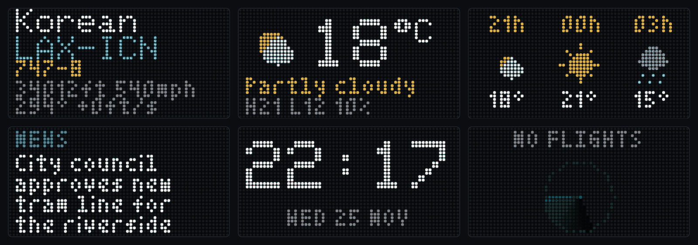

# LedMatrix

LedMatrix is a smart flight tracker for your window. A small LED panel shows each new plane that flies near your
home, once, with its airline, route, aircraft type, height and speed. Between planes it shows the weather, news
headlines and a clock. You set it up on a web page that the display serves itself on your home network, at
`http://ledmatrix.local`. It has three parts: the [firmware](docs/glossary.md#firmware) on the display's
[ESP32](docs/glossary.md#esp32) board, a small [service](docs/glossary.md#service) you run that fetches the flight,
weather and headline data, and the settings page (the [portal](docs/glossary.md#portal)).

> **You will:** wire the display, flash it (example screens appear), run a small service, and join the two.
>
> **You need:** a computer with a Terminal window; a domain name if you run the service at home or on a rented server
> (the free cloud path needs no domain name, but it needs a billing account with a payment card); and about a weekend.
> Nobody has timed a first-time build, so "a weekend" is a guess.
>
> **Weather:** Portugal only today (it comes from IPMA, the Portuguese weather service). Headlines come from the
> Portuguese edition of Google News, and your topic words can be in any language. Planes work anywhere.

*Example screens drawn at the panel's real resolution by the repository's own preview page. All flight, weather and
headline text is made-up example data. Airline logos are trademarks and are not part of this repository.*

You can see every screen before you buy anything: open `preview/index.html`, from a copy of the repository, in any
web browser.

## What you need

You build the display yourself. You need to be comfortable typing commands in a Terminal window; the guides explain
each one.

| Part | Notes | Where to buy |
| --- | --- | --- |
| Adafruit Matrix Portal S3 | The board that drives the panel and joins your Wi-Fi (ESP32-S3, 8 MB flash). Adafruit's [guide to the board](https://learn.adafruit.com/adafruit-matrixportal-s3) is a good first read. | [adafruit.com/products/5778](https://www.adafruit.com/products/5778), and Adafruit's resellers. Stock varies, so check. |
| Waveshare 64x32 P4 HUB75 panel | A 64×32 pixel [HUB75](docs/glossary.md#hub75) LED panel with 4 mm pitch (Waveshare "RGB-Matrix-P4-64x32"). | [waveshare.com/rgb-matrix-p4-64x32.htm](https://www.waveshare.com/rgb-matrix-p4-64x32.htm), and Waveshare's resellers |
| USB-C cable | To flash the board from your computer. It must carry data: a cable that only charges will not work. | Any electronics shop |
| Power supply for the panel | The one that Waveshare's guide asks for. Read [the manufacturer's guide](https://www.waveshare.com/wiki/RGB-Matrix-P4-64x32) and buy what it says. Do not guess the voltage or the current. | Any electronics shop |

You also need:

- A computer with **macOS or Linux**. The guides are written for macOS first. Windows is not covered.
- A home Wi-Fi network at 2.4 GHz. The board has no 5 GHz radio.
- A place to run the small service: a computer or small server at home (the main path), a rented server, or Google
  Cloud Run, which has a free allowance. [docs/hosting.md](docs/hosting.md) explains the choices.
- A [domain name](docs/glossary.md#domain-name) for the home-server and rented-server paths. The display only trusts
  services that have a proper [certificate](docs/glossary.md#certificate), and a certificate needs a name that is
  yours. Google Cloud Run gives you an address of its own, so that path needs no domain name, but it needs a billing
  account with a payment card.

Wiring and power details are in [docs/install.md](docs/install.md). Prices are not listed because they change.

## Words used in these guides

- **You** are the person building your own display.
- **The maintainer** publishes firmware releases and the public service image. Today that is the project's author.
- **The public image** is the service as a ready-made [container image](docs/glossary.md#docker-image),
  `ghcr.io/suvl/ledmatrix-api`, as the maintainer publishes it. You run it; you do not build it.
- **Your own build** is an image or firmware that you build yourself. Then no updates arrive unless you build and
  publish releases yourself.

## Getting help

Something unclear, broken or missing? Open an issue at <https://github.com/suvl/ledmatrix/issues>. Where a guide says
"ask in an issue", this is where.

## Quick start

Do these in order. Each step names the guide and the step title in it. [docs/operations.md](docs/operations.md), "Day 0",
is the same list as a checklist, with how to know that each step worked.

1. **Parts, wiring and power:** buy the parts above and put them together. [docs/install.md](docs/install.md).
2. **Tools and the code:** install the tools and copy the repository to your computer. You build only the firmware.
   [docs/build.md](docs/build.md).
3. **First flash:** put the firmware on the board. [docs/install.md](docs/install.md).
4. **Wi-Fi setup (setup mode):** the board starts its own Wi-Fi network, and you tell it your home Wi-Fi.
   [docs/install.md](docs/install.md).
5. **First look at the portal:** open `http://ledmatrix.local`. Example screens appear on the panel with no service at
   all, which shows that the hardware works. [docs/install.md](docs/install.md).
6. **Make the master secret and back it up:** one long secret text that you keep outside the repository. It is the
   [master secret](docs/glossary.md#master-secret). [docs/install.md](docs/install.md).
7. **Run the service:** you do not build the service; the hosting guide uses the public image. Pick a place to run it
   and give it a trusted HTTPS address ([docs/hosting.md](docs/hosting.md)), then point the display at it in the portal
   ([docs/install.md](docs/install.md)).
8. **Provision the display:** give the board its own key over USB. [docs/install.md](docs/install.md).
9. **Check it all:** test the connection, read the problem list and wait for a plane. [docs/install.md](docs/install.md).
10. **Optional, days later: the permanent burn.** Skip it if you are unsure; you can do it at any time.
    [docs/install.md](docs/install.md).
11. **A second display:** [docs/install.md](docs/install.md).

Read [docs/security.md](docs/security.md) before you leave the display on, and
[docs/architecture.md](docs/architecture.md) when you want to understand how the parts fit together. You do not need
the architecture page to build a display.

## The documents

| Document | What it covers |
| --- | --- |
| [README.md](README.md) | This page: what the project is, what you need, where to start, where to get help. |
| [docs/architecture.md](docs/architecture.md) | Read it later, to understand the system: who talks to whom, how a plane gets from a radio signal to the panel, how the display proves who it is, how updates and rollback work, and why it is built this way. |
| [docs/build.md](docs/build.md) | Build the firmware: the tools, the code, compiling, and what a good result looks like. This is all you need to build for a working display. |
| [docs/development.md](docs/development.md) | For people who change the code or publish releases: tests, the margin check, release build and CI, local image build and run. |
| [docs/install.md](docs/install.md) | Install one display, start to finish: parts, wiring and power, first flash, Wi-Fi setup, first look at the portal, the master secret, provisioning, checking it all, the optional permanent key burn, a second display. |
| [docs/hosting.md](docs/hosting.md) | Run the service: a domain name and certificate, the logo folder, and four places to run it (a home server with Docker Compose and Caddy, a small rented server, Google Cloud Run, Kubernetes), with the first deploy and the checks. |
| [docs/security.md](docs/security.md) | What protects the display and the service, the known limits, what to keep up to date, how to look after the secrets, what is private, what to do when something goes wrong, how to report a vulnerability. |
| [docs/operations.md](docs/operations.md) | Running your display: the Day 0 checklist for the first install, what normal looks like, firmware updates and rollback, logs, backups, revoking and replacing a display, and what to do when things go wrong. |
| [docs/glossary.md](docs/glossary.md) | The technical words used in these pages, each explained once in plain English. |

## What is in the repository

| Folder | What |
| --- | --- |
| `arduino/ledmatrix/` | The firmware: Arduino C++ on arduino-esp32 core 3.3.13, Adafruit Protomatter and ArduinoJson 7. Screens, Wi-Fi setup, the settings portal, signed requests, updates. |
| `service/` | `ledmatrix-api`, the Go service that gives the display compact JSON for flights, weather and headlines, and serves firmware images. |
| `portal/`, `preview/` | The source of the settings page and of the screen preview page. |
| `shared/` | What the portal, the preview page and the firmware share: the pixel renderer and fonts, the time zone table, and the written contracts for [signed requests](shared/device-auth.md) and [firmware updates](shared/firmware-update.md). |
| `tools/` | Helper scripts: `build_web.py` builds the portal and preview pages, `provision.py` gives a board its key, `burn_key/` burns the key into the chip, `make_manifest.py` writes the update list, plus the tests that run on your computer. |
| `deploy/compose/` | Example files for running the service on a home or rented server: a Docker Compose file and a Caddy configuration (see [docs/hosting.md](docs/hosting.md)). |
| `docs/` | The documents listed above. |
| `wayfinder/` | A pointer to the project's decisions and the longer research notes in `research/`. |
| `arduino/milestone/`, `circuitpython/` | Earlier experiments (a Wi-Fi and TLS interference test, CircuitPython smoke tests). |

The project's decisions and plans live in [GitHub issues](https://github.com/suvl/ledmatrix/issues), not in the
repository. Start at the map, [issue 35](https://github.com/suvl/ledmatrix/issues/35). It lists every decision in one
line and links to the issue that holds the detail. Wi-Fi passwords and keys are never stored in this repository.

## Status and honesty

This is a personal project that has been built and run on one board in one home. Here is what that does and does not
mean.

**Verified on the author's own display on 25 November 2026** (one Matrix Portal S3 with one Waveshare panel):

- Firmware updates from the service, with automatic rollback: tried with an uploaded file, through the real service,
  with wrong codes, with an image that crashes at start, with an image that never reaches the service and with the
  key refused. The display never went more than one second without redrawing, even during a download.
- The permanent key burn, followed by `provision.py --burned`.

**Checked by the author on a real board while building it** (not repeated for these guides): the screens, the Wi-Fi
setup mode, the settings portal, live data from the service, signed requests, panel protection and the problem list.

**Not tested here:**

- A real Linux computer. The build and test steps were run in an Ubuntu container on a Mac
  ([docs/build.md](docs/build.md)), and the project's automatic build compiles the firmware on Ubuntu. Flashing,
  provisioning and the other steps from a Linux computer were not tried. Every Linux note is labelled "Not tested here".
- Hosting. The service runs today on the author's own Kubernetes cluster, and the display was checked only against
  that. The Docker Compose and Caddy files were tested on a Mac without a real certificate. A real certificate request,
  a rented server and Google Cloud Run were not tested. Each section of [docs/hosting.md](docs/hosting.md) says what
  was run.
- Any board or panel other than the two named above.

**Licence:** Apache License 2.0, see [Licence](#licence) below.

**Known limits** (the security ones are explained in [docs/security.md](docs/security.md)):

- Weather works for Portugal only, and headlines come from the Portuguese edition of Google News.
- The portal uses plain HTTP, on your home network, with no password. Anyone on your network can change the display's
  settings.
- That includes the address of the service, which is also where firmware updates come from. An update still needs the
  six-digit code shown only on the panel, but a signed update list would close the gap and is not built yet.
- The automatic rollback does not catch a crash that happens before the program's `setup()` starts. Its boot counter
  lives in memory.
- After the key is burned, a lost master secret locks the display out of your service for good. Back it up offline.
- Not every commit in the history is signed.

## Licence

LedMatrix is licensed under the [Apache License, Version 2.0](LICENSE). Copyright 2026 João Trigo Soares (suvl); see
[NOTICE](NOTICE).

In plain words: you may use, change and share this project, including for business, as long as you keep the licence
and the notice and say what you changed. The licence includes a patent grant and **no warranty**: you build and power
a display at your own risk, so follow the manufacturers' guides for the electrical parts.

What the licence does **not** cover:

- **Other people's code.** The libraries and font data this project uses keep their own licences, listed in
  [THIRD_PARTY_NOTICES.md](THIRD_PARTY_NOTICES.md).
- **The data the service fetches.** Each source has its own terms. The aircraft data from adsb.fi is for personal,
  non-commercial use, so using this project commercially needs your own arrangement for that data. Check the terms of
  the weather, route and headline sources as well.
- **Airline logos and names, and product names** such as Adafruit and Waveshare. They belong to their owners. No airline
  logo is in this repository.

## Credits

- Weather data: Instituto Português do Mar e da Atmosfera (IPMA), https://www.ipma.pt
- Aircraft positions: adsb.fi open data, https://adsb.fi (personal, non-commercial use)
- Routes and airlines: adsbdb, https://www.adsbdb.com
- Headlines: Google News
- Map: © OpenStreetMap contributors, [Leaflet](https://leafletjs.com)
- Screen layouts: modelled on [FlightWall](https://theflightwall.com). This project is not affiliated with FlightWall.
- Drawing on the panel: [Adafruit Protomatter](https://github.com/adafruit/Adafruit_Protomatter), with the Adafruit GFX
  Library and its fonts. The board is Adafruit's Matrix Portal S3.
- Also used: [ArduinoJson](https://arduinojson.org), [arduino-esp32](https://github.com/espressif/arduino-esp32) and
  [tz-lookup](https://github.com/photostructure/tz-lookup).

Third-party licences (Adafruit GFX and the Tom Thumb font data this repository contains, and the libraries it uses):
see `THIRD_PARTY_NOTICES.md`.
