# Architecture

Checked on macOS on 26 Nov 2026: what was run and what was not is in the table at the end of this page. You do not need this page to build your first display; read it when you want to understand how the parts fit.

This page explains how LedMatrix fits together: what runs where, who talks to whom, how a plane gets from a radio signal to the pixels on the panel, how the display proves who it is, how it updates itself, and why it was built this way. It is for a beginner who wants to understand the system before touching it. It describes the code in this repository as it was on 26 November 2026 ([firmware](glossary.md#firmware) version 0.11.0). It does not tell you how to build, install or run anything: that is in [build.md](build.md), [install.md](install.md), [hosting.md](hosting.md), [security.md](security.md) and [operations.md](operations.md).

## Before you start

You need nothing installed. Read this page on GitHub, which draws the diagrams for you. It helps to know roughly what a web page, a web server and a Wi-Fi network are. Every other word is explained where it first appears, and again in the [glossary](glossary.md). A number like "issue 10" is a GitHub issue: `https://github.com/suvl/ledmatrix/issues/10`.

If you read only one part, read section 1 and then section 2.2 (the one-second rule). Everything else builds on those two.

## 1. The big picture

LedMatrix is a flight tracker that fits on a shelf. A small circuit board drives an LED panel and shows the planes that fly past your home. Between planes it shows weather, news headlines and a clock. You configure it on a web page that the board serves itself.

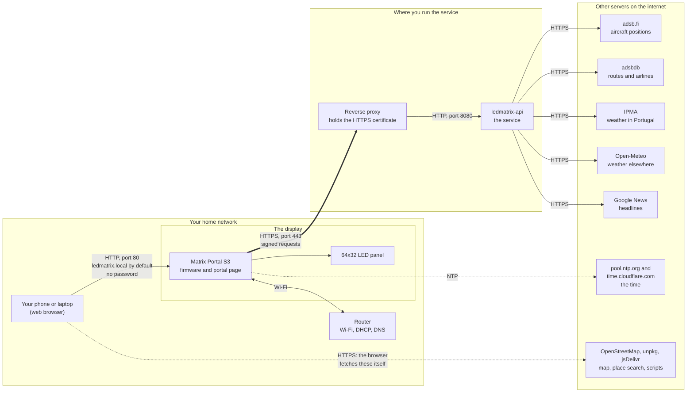

Everything the board sends to the outside world passes through your router. The thick arrow is the one that matters most: the board talks to exactly one data server, the [service](glossary.md#service) you run.

### Who talks to whom

| From | To | How | What it carries |
| --- | --- | --- | --- |
| Your browser | The board | Plain HTTP on port 80, found by the [display name](glossary.md#display-name): `ledmatrix.local` until you choose another name ([mDNS](glossary.md#mdns), section 2.5) | The [portal](glossary.md#portal) page and its small JSON interface. No password: it is meant for your [LAN](glossary.md#lan) only, and the board refuses requests that come from other web pages (section 8) |
| The board | The service | HTTPS on port 443, with the server's [certificate](glossary.md#certificate) checked against the [CA bundle](glossary.md#ca-bundle) built into the firmware | Flights, weather, headlines and logos (every request signed), and the firmware [manifest](glossary.md#manifest) and image (these two requests carry no device signature; the manifest itself is signed, section 6) |
| The [reverse proxy](glossary.md#reverse-proxy) | The service | Plain HTTP, port 8080 by default (`LISTEN`) | The same requests, after the proxy has handled [TLS](glossary.md#tls) |
| The service | adsb.fi, adsbdb, IPMA, Open-Meteo, Google News | HTTPS | Positions, routes, weather (IPMA in Portugal, Open-Meteo elsewhere), an RSS feed |
| The board | Time servers | NTP, the standard time protocol (UDP port 123) | The current time. Unauthenticated |
| Your browser | unpkg.com, cdn.jsdelivr.net, OpenStreetMap | HTTPS | The map, the time zone lookup library, place search. This is the browser, not the board |
| Your phone | The board, in [setup mode](glossary.md#setup-mode) | The board's own Wi-Fi network, named after the display (`ledmatrix` on a first start; a random password is shown on the panel), HTTP on `192.168.4.1` | The form where you pick your home Wi-Fi and type its password |

Sources: `arduino/ledmatrix/live.cpp` (port 443, host names, `configTzTime`), `arduino/ledmatrix/net.cpp` (web server on port 80, mDNS name, setup network), `service/main.go` (`LISTEN`, no TLS code), `portal/portal.template.html` (the browser-side hosts).

### The three parts

1. **The firmware** in `arduino/ledmatrix/`. C++ for the Arduino framework, running on an [ESP32](glossary.md#esp32)-S3 chip on an Adafruit Matrix Portal S3 board, drawing on a [HUB75](glossary.md#hub75) LED panel through the Adafruit Protomatter library. It joins your Wi-Fi, fetches data, draws screens and serves the portal.
2. **The service** `ledmatrix-api` in `service/`. A small Go program in one [container](glossary.md#container). It does the heavy fetching and shrinking so the board only has to read a few hundred bytes of JSON. It also carries the firmware images.
3. **The portal and the preview** in `portal/`, `preview/` and `shared/`. The portal is one web page. `tools/build_web.py` builds it into the C++ header `arduino/ledmatrix/portal_page.h`, so it is part of the firmware and the board serves it from its own memory. The preview page is the same drawing code running in a browser, so you can see every screen without a board.

| Folder | What is in it |
| --- | --- |
| `arduino/ledmatrix/` | The firmware, its [partition](glossary.md#partition) table (`partitions.csv`) and the generated `portal_page.h` |
| `service/` | The Go service, its tests, its Dockerfile, the example Kubernetes manifest |
| `portal/`, `preview/` | The page templates. `preview/index.html` is generated |
| `shared/` | Things more than one part needs: the drawing code `renderer.js`, `fonts.json`, the time zone table `tz_zones.json`, and the contracts `device-auth.md`, `firmware-update.md` and `manifest-signing.md` |
| `tools/` | [Provisioning](glossary.md#provisioning) (`provision.py`), the key [burn](glossary.md#burn) sketch (`burn_key/`), the manifest writer, the zone table generator, the laptop tests, the margin check |
| `.github/workflows/service.yml` | The workflow that tests everything, compiles the firmware and builds the service [image](glossary.md#docker-image) |
| `wayfinder/` | The research notes behind the decisions. The decisions themselves are GitHub issues (section 9) |
| `circuitpython/` | The first prototype, retired when the project chose Arduino C++ (issue 1) |

Airline logos are not in the repository: they are trademarks. The service serves them from a folder you provide (see [hosting.md](hosting.md)).

## 2. The firmware from the inside

### 2.1 The tasks

A *task* is a program that runs alongside other programs on the same chip, scheduled by a small operating system called FreeRTOS. The ESP32-S3 has two processor cores, so two tasks can really run at the same moment. This firmware has one task for drawing and others for everything that can be slow.

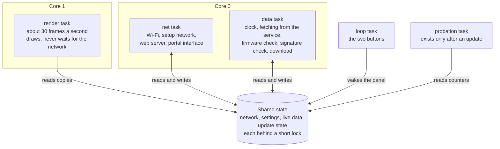

| Task | Core | Priority | Stack | Started in | What it owns |
| --- | --- | --- | --- | --- | --- |
| render | 1 | 2 | 10 KB | `ledmatrix.ino` | The panel. Picks the screen, draws it, applies dimming, drift and night blanking |
| net | 0 | 1 | 12 KB | `net.cpp` | Wi-Fi (join, reconnect), the DNS guard, mDNS, the setup network and its captive page, the web server with its portal guard and every portal route, the write of an uploaded firmware file |
| data | 0 | 1 | 16 KB | `live.cpp` | The clock (NTP), every HTTPS request to the service, the live state, the [problem list](glossary.md#problem-list), the firmware check (including the signature check) and download |
| [probation](glossary.md#probation) | not pinned | 3 | 6 KB | `ota.cpp` | Only on a freshly installed firmware: the checklist that decides whether it is kept. It deletes itself when it is done |
| loop | Arduino default | Arduino default | Arduino default | `ledmatrix.ino` | The two buttons: UP and DOWN step the demo screens, any press wakes the panel, holding UP for 5 seconds forgets the Wi-Fi network |

A higher priority number runs first. The probation task is above the others on purpose: if the main code hangs, it must still be able to give its verdict.

Start-up order (`setup()` in `ledmatrix.ino`): first the [serial port](glossary.md#serial-port) (the USB text output) and the probation check (a crash counter, section 6), then the buttons, then the settings, the identity record and the update module, then the net task, then the data task, and last the render task. Each step comes before the tasks that read what it prepares.

### 2.2 The one-second rule

**The panel must never go more than 1 second without drawing a new picture.** Once the board is online this is a hard rule (issue 10). Booting is exempt, because joining Wi-Fi and the first secure connection genuinely take seconds.

The reason is that a frozen display looks broken. The reason it is hard is that the things this device does all the time (looking up names, setting up a secure connection, downloading, writing to [flash](glossary.md#flash) memory) can each take longer than a second.

The rule works only because of a division of labour, in `ledmatrix.ino`, `live.cpp`, `net.cpp` and `ota.cpp`:

1. **The render task never does slow work.** It draws. Everything that talks to a network, a flash chip or a name server runs on the data task or the net task.
2. **The render task only reads copies.** Once per frame it asks for a copy of the network state (`netInfo()`), the settings (`settings::get()`), the live data (`liveView()`) and the update screen to show (`ota::panel()`). Each takes a lock, copies a small structure and lets go.
3. **Locks are short.** A lock is a flag that lets only one task at a time touch some shared data. The update module says in a comment (`ota.cpp`) that its lock is held for microseconds and never across an HTTPS request, a flash write or a write to [NVS](glossary.md#nvs) (the settings store, section 2.5). In `live.cpp` the lock is taken only around copies and small updates, never around a request.
4. **One secure request at a time**, taking turns (`NetTurn` in `live.cpp`). Two secure sessions at once left too little memory, and a FreeRTOS mutex held across a request once reset the board every 9 seconds, so the turn is a plain flag instead (issue 35, slice 6).
5. **Every wait has a deadline.** Connecting 5 seconds, the TLS handshake 10 seconds, all response headers together 15 seconds, silence while reading 5 seconds (10 for a firmware download).
6. **Big work happens in small pieces.** A firmware download is read, hashed and written 4 KB at a time with a 2 ms pause after each piece, and the other app slot is erased sector by sector as the writes arrive, not all at once.
7. **A logo is fetched before the plane that needs it is queued**, so the render task never waits for one.

The settings, which the render task reads every frame and the portal rarely changes, have two locks (`swapstore.h`, used by `settings.cpp`). The **state lock** guards the settings themselves and is held only to copy them or to swap in a new set: microseconds, never across a flash write. The **save lock** guards the flash writes and makes a save one-at-a-time; the render task never takes it. So a save from the portal swaps the new settings in under the short state lock and writes all of them to flash afterwards, holding only the save lock, and a frame never waits for the flash. The flash chip itself still pauses briefly while it is written; how that shows in the frame counters during a save has not been measured. The counters below are how you would see a problem.

**How the rule is measured.** The render task counts how many frames it has drawn and the gap between each pair of `show()` calls while the board is online. The board's `/status` page reports them:

| Field in `/status` | Meaning |
| --- | --- |
| `frames` | Frames drawn since boot |
| `frame_max_ms` | The longest gap between two frames while online |
| `frames_over_1s` | How many gaps were longer than 1000 ms. This should stay 0 |

`/status` also shows the version, the Wi-Fi name, the addresses, the signal strength, free memory and the identity state, and the uptime in seconds, which counts from a 64-bit hardware timer and does not wrap (verified on the author's own display on 26 Nov 2026). It is plain JSON on port 80.

Reported, not repeated here: the slice 10 commit message records a longest frame gap of 93 ms during the flash in the upload test. Verified on the author's own display on 25 Nov 2026: during a download from the real service the longest gap was 131 ms (the author's report; no file in the repository records that figure). In both, no frame took over 1 second. The same counters decide whether a new firmware is kept (section 6): a single frame over 1 second fails its probation at once.

How the panel itself is driven, so you know why `show()` is cheap: the Protomatter library refreshes the panel by itself and is double buffered. On the ESP32-S3 it clocks the picture out through the chip's LCD_CAM peripheral from memory the hardware can read directly (read from the library source, `src/arch/esp32-s3.h`). The render task draws into one buffer and `show()` asks the library to swap to it.

### 2.3 Choosing the screen

Every frame the render task runs the same decision (`renderTask` in `ledmatrix.ino`).

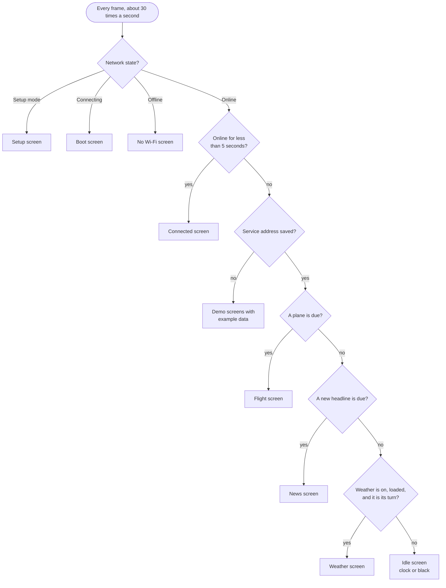

That pick is only the first step. The rest of the frame, in order:

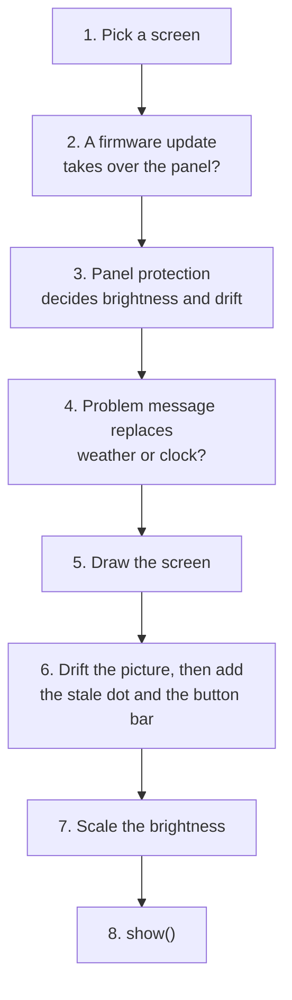

Things worth knowing about each step:

- **Planes come first, then headlines, then weather, then idle.** A plane is "due" when it is new (not shown in the last 30 minutes) or, if you switched on plane cycling, when it is next in the cycle. A plane on the panel always finishes its turn, which is 10 seconds by default. If you turned on rotation, weather only gets every second slot of the rotation time and the idle screen gets the others.
- **Demo screens.** With no service address saved, the board steps through the screens you enabled with example data, so a new board is useful before it is set up.
- **The display's name on the panel.** The Connected screen (the first 5 seconds after joining Wi-Fi) shows `<name>.local` and the IP address, and the setup screen shows the name of the setup Wi-Fi network, which is the display name. Names up to about 10 characters fit big on the setup screen, longer ones (up to 24) are drawn small on up to two lines. On the Connected screen and in the problem message a long name is cut to the panel width, so the IP address is the way to reach the display (section 2.5).
- **Update screens (step 2).** While an [update code](glossary.md#update-code) is waiting, or an image is arriving, the panel shows the code screen or the progress screen instead of everything else, and drops the stale dot and the problem message. Only while online. These count as "other" pictures for protection: never dimmed, never blanked, never drifted, because you are standing in front of the panel. The one deliberate exception is the write itself: while an image is written to flash the render task shows `Screen off` for 2.5 seconds and then switches the panel off (Protomatter `stop()`), because every flash erase and write stalls the interrupt that scans the panel and the update would flicker. It is on again for `Restarting`. The gate that decides this is `QuietGate` in `otalogic.h`; the installer asks for the dark before its first write and ends it in `finish()` or `abort()`.
- **The problem message (step 4).** If some kind of data (flights, weather, headlines, logos, the clock, the update check, the identity) has been failing for a full hour in a row and is still failing, the panel shows "PROBLEM", "Data is failing" and "See the portal:" with the display's address (`ledmatrix.local` by default) for 5 seconds once a minute, in place of the weather or the clock only. It never covers a plane or a headline, and it stays dark during night blanking. A [rollback](glossary.md#rollback) of a firmware update appears in the portal's problem list too, but as an event: it never feeds this one-hour rule, so it never puts this message on the panel. The decision itself is the pure function `problemMessageWanted()` in `problems.h`, which the laptop tests cover.
- **Overlays (step 6).** A small blinking orange dot in the top right corner means data is stale: flights (when switched on and a location is set) are stale when the last successful fetch is more than 5 minutes old, or when none has succeeded yet and the board has been up for more than 3 minutes. Weather is stale in the same way, with 2 hours and 5 minutes. A thin amber bar along the bottom shows how far you have got in the 5-second long press of UP. Overlays are drawn after the drift, so they stay where they are, but step 7 dims them with everything else.

The eleven screens in the code are: Flight (3 layouts), Weather (3), News (2), Idle (clock or black), Setup, Boot, Connected, No Wi-Fi, Problem, Update code and Update progress. Staleness is not a screen: it is only the blinking dot described above. `screens.cpp` is a C++ port of the drawing code in `shared/renderer.js`, which the preview page and the portal's layout thumbnails run in a browser. `tools/check_margins.py` (it needs Chrome) draws both and compares them.

### 2.4 Panel protection

LED panels age where the same pixels stay bright. Four measures keep a mostly static display healthy (issue 24). Each can be switched in the portal's "Panel protection" section. The logic is in `protect.cpp`, which has no Arduino code in it, so it runs in laptop tests.

| Measure | What it does | Default |
| --- | --- | --- |
| Pixel drift | Moves the finished picture one pixel right and/or down, in a four-step loop, every 3 minutes. Screens keep column 63 and row 31 blank so nothing falls off the edge | On |
| Dim after stillness | After no new plane for a set time, weather, clock and idle screens dim. Never above your brightness. Fades take about a second | After 2 minutes, to 10 percent of full brightness |
| Night blanking | The panel goes dark between two local times. Planes and headlines do not wake it. A short press of UP or DOWN lights it for 30 seconds. Needs the clock | 00:00 to 06:00 |
| Rotation | Swaps weather and clock every N minutes | Off, 15 minutes |

What counts as what (`pictureKindOf` in `ledmatrix.ino`):

| Picture | Treated as | Effect |
| --- | --- | --- |
| Flight | Plane | Never dimmed, drifts, counts as activity |
| News | Headline | Your brightness for its turn, never drifts (it scrolls or pages) |
| Weather, Idle | Static | Dims after stillness, drifts |
| Everything else | Other | Never dimmed, blanked or drifted |

The Protomatter library has no brightness control, so `applyBrightness()` scales the finished frame in software. The panel runs at 6 bits per colour so dimmed pictures keep their shades.

### 2.5 What the board remembers

Settings live in NVS, a small key-value store in the `nvs` partition of the board's flash memory. It survives restarts and firmware updates.

- **Namespace `ledmatrix`** (`settings.cpp`): the Wi-Fi name and password, and every setting the portal edits: what to show, layouts, brightness, how long a plane stays, location, radius, altitude limits, up to five headline topics, the headline edition (key `hled`, one byte), the service host name, the display name, the time zone name and rule, and the protection settings.
- **Namespace `update`** (`ota.cpp`): the version that failed here and why, written only when a firmware is rolled back, and the probation boot counter (key `pcount`), which exists only while a new image is on probation (section 6).

Values from the portal are checked before they are saved, and the time zone and the panel protection values are checked again when they are read back, so a damaged flash cannot put a bad value into a request header or the time zone setting. "Forget this Wi-Fi network" (the portal button, or holding UP for 5 seconds) removes only the Wi-Fi name and password.

Nothing in this project encrypts NVS or the flash. The Wi-Fi password is stored as plain text, and the portal's `/api/settings` never returns it.

What is **not** saved, and is lost at a restart: the live data, the 16 cached logos, the list of the last 10 problems, the log of the last 60 planes seen that the portal shows, the list of recently shown planes and headlines, and any clock offset.

**The display name.** The setting `deviceName` (default `ledmatrix`) is what the display calls itself on the network: its mDNS name (the portal is at `<name>.local`), its DHCP host name and the name of its setup Wi-Fi network. The rules are in `devicename.h`, which is plain C++ with its own laptop test: 1 to 24 characters, letters, digits and hyphens, no hyphen at either end, capitals become lower case. The portal's "Wi-Fi and device" section edits it. A new name is saved at once and takes effect at the next start, so the board restarts about a second and a half after it has answered (about 20 seconds in all, unless an update is being installed, which restarts anyway), and the portal follows it to the new address. Two displays on one network need different names; each also needs its own provisioning (see [install.md, "A second display"](install.md)). If another device on the network already has the name, the mDNS software is expected to add `-2` to it (not yet seen on a real display); the panel would not show the `-2`, and the IP address always works. The first start of a board with no saved Wi-Fi always uses `ledmatrix` for its setup network. Verified on the author's own display on 26 Nov 2026: renaming the display through the settings API and back left the settings identical afterwards, the settings JSON gained only the field `deviceName`, and invalid names were refused with the plain sentences from `devicename.h`. Not verified: the `-2` clash, and the setup screen with a long name.

### 2.6 The flash layout

The board has 8 MB of flash. The file `arduino/ledmatrix/partitions.csv` divides it. It is the stock "TinyUF2 8MB" table with one change: the data partition `ffat` is 8 KB smaller, and the freed 8 KB at the end is the read-only `ident` partition. Nothing else moved, so saved settings and both app slots stayed where they were. Every build needs this file, because every upload rewrites the table; `arduino-cli` uses a `partitions.csv` that sits next to the `.ino`.

| Partition | Type, subtype | Starts at | Size | What it holds |
| --- | --- | --- | --- | --- |
| (before 0x9000) | | 0x0 | | The second-stage [bootloader](glossary.md#bootloader) and the partition table. Not in `partitions.csv`; this is the usual ESP32-S3 layout |
| `nvs` | data, nvs | 0x9000 | 20 KB | Settings, Wi-Fi, the failed-update record |
| `otadata` | data, ota | 0xE000 | 8 KB | Which app slot boots, and the state of each slot (new, valid, invalid, and so on) |
| `ota_0` | app, ota_0 | 0x10000 | 2 MB | Firmware slot A |
| `ota_1` | app, ota_1 | 0x210000 | 2 MB | Firmware slot B |
| `uf2` | app, factory | 0x410000 | 256 KB | TinyUF2, Adafruit's USB updater that ships with the board. The update code writes only to `ota_0` and `ota_1` |
| `ffat` | data, fat | 0x450000 | 3768 KB | A FAT file system from the stock layout. This firmware does not use it (a search of the sources finds no use) |
| `ident` | data, 0x40 | 0x7FE000 | 8 KB | The board's identity record. Read-only |

Two app slots are the heart of the update design: the running firmware stays in one slot while a new one is written to the other, and only a successful check switches the boot choice in `otadata` (section 6).

`ident` is marked `readonly` in the table. The firmware only ever reads it (`identstore.h`), and a normal firmware upload never writes address 0x7FE000, so the identity survives every upload and every update. It does not stop someone with a USB cable from writing it: that is how `tools/provision.py` writes it in the first place.

## 3. The service

The service answers the display in small JSON, and carries the firmware. It is one Go program using only Go's standard library, about 4,300 lines including tests, in a distroless container image (no shell, no package manager) that runs as a non-root user. It speaks plain HTTP on `LISTEN` (default `:8080`); a reverse proxy in front gives it HTTPS (see [hosting.md](hosting.md)).

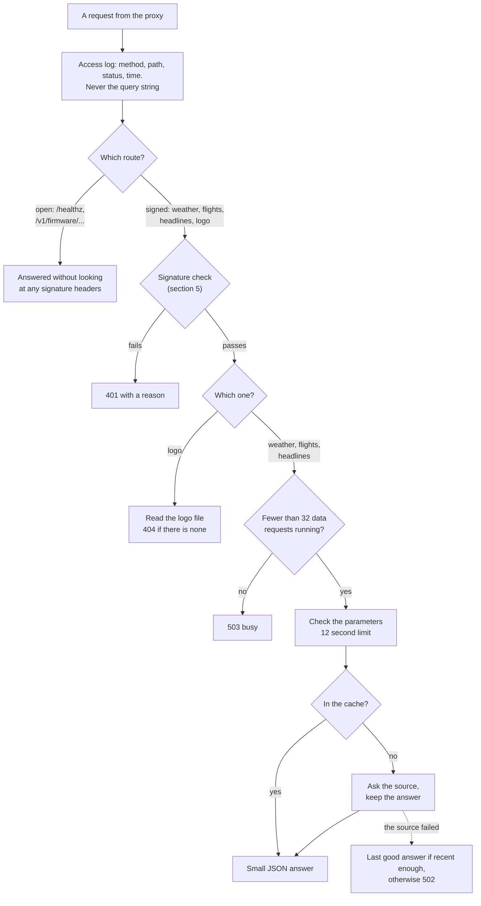

### Routes

| Route | Signed? | Answers | Source |
| --- | --- | --- | --- |
| `GET /healthz` | No | `ok` | |
| `GET /v1/flights?lat=&lon=&radius_km=&alt_min=&alt_max=&n=` | Yes | Nearest planes first, up to `n` (1 to 10, default 5), each with call sign, airline, route, cities, aircraft and telemetry | adsb.fi (positions), adsbdb (routes) |
| `GET /v1/weather?lat=&lon=` | Yes | A small answer (the IPMA one is about 155 bytes): temperature, today's high, low and rain chance, an icon now, in 3 hours and in 6 hours | IPMA inside Portugal, Open-Meteo everywhere else |
| `GET /v1/headlines?q=&n=&hl=&gl=&ceid=` | Yes | The newest titles for one topic, no duplicates, in the chosen Google News edition | Google News RSS |
| `GET /v1/logo/{code}` | Yes | 512 bytes: a 16x16 picture, 2 bytes per pixel (RGB565, big-endian). 404 if there is none | Files in `LOGO_DIR` |
| `GET /v1/firmware/manifest` | No, on purpose | The newest firmware's version, file name, size, [SHA-256](glossary.md#sha-256) (a fingerprint of the file) and notes, or 404 | The `/firmware` folder in the image |
| `GET /v1/firmware/{file}` | No, on purpose | The image named in the manifest | The `/firmware` folder in the image |

Source: `service/main.go`. Parameters are range checked: latitude -90 to 90, longitude -180 to 180, radius 1 to 250 km, altitude 0 to 60,000 ft, a headline topic 1 to 80 characters. The headlines route also takes the three parameters that choose a Google News *edition* (a language and country combination): `hl` (language, such as `pt-PT`), `gl` (country, such as `PT`) and `ceid` (country and language together, such as `PT:pt-150`). The service checks their shape and answers 400 if they are not what Google's own editions look like; a caller that sends none gets the defaults `pt-PT`, `PT`, `PT:pt-150`. The board sends them (section 4.2). Topics work best in the language of the edition you pick, because they are searched inside that Google News edition.

Errors are short JSON sentences: 400 for a bad parameter, 401 for a refused signature, 422 only when the weather provider answered with no value at all ("no weather data for this location", which should almost never happen), 502 when a source is failing and no recent answer is cached, 503 when the service is busy.

**Weather works anywhere.** Inside Portugal the service uses IPMA, Portugal's weather institute; everywhere else it uses Open-Meteo, a free open weather data service (section 4.2). Which one answers is decided by the service, so the board does not need to know.

### Caching

A cache keeps answers for a while so many requests share one upstream call, and a failing source does not blank the display. When a refresh fails, the last good answer is served for a grace period.

| What | Fresh for | Served stale for |
| --- | --- | --- |
| Positions near a spot | 15 seconds | 2 minutes |
| A route for a call sign | 12 hours | 48 hours |
| An IPMA forecast for a city | 30 minutes | 6 hours |
| IPMA station readings | 20 minutes | 3 hours |
| An Open-Meteo answer for a point, rounded to one decimal (about 11 km) | 15 minutes | 3 hours |
| Headlines for a topic | 15 minutes | 6 hours |

Source: `service/flights.go`, `weather.go`, `headlines.go`, `cache.go`. The cache lives in memory and is lost when the service restarts.

### The firmware routes

`/v1/firmware/manifest` and `/v1/firmware/{file}` answer the same with or without signature headers. That is deliberate: a board whose key is refused must still be able to fetch a fix. The service reads the folder `FIRMWARE_DIR` (default `/firmware`) and checks the manifest when it starts and at most once a minute after that. The manifest only counts if the version is three numbers, the file name is `ledmatrix-<version>.bin`, the size is above 100 KB and at most 2,097,152 bytes (one app slot), the SHA-256 matches the real file, and the notes are at most 200 characters with no control character. Otherwise the answer is "no firmware is published". A release may also be signed (section 6): the manifest then carries two more fields, `keyid` and `sig`, which must come as a pair and have the right shape (8 and 128 lowercase hexadecimal characters), and the whole answer must stay within 2,048 bytes. The service passes the two fields through unchanged. **It does not check the signature and holds no key**: it checks only their shapes, and the board's check is the one that counts. A manifest without them is answered exactly as before, and the service's log says whether the published release is `signed with key <id>` (the key id is public) or `not signed`. The file name in a download request is compared with the manifest's, never used as a path. Downloads have 8 slots of their own so a slow board cannot starve the data routes. The service never writes to this folder.

### What the service never stores

- **Device keys.** It derives a board's [device key](glossary.md#device-key) from the [master secret](glossary.md#master-secret) and the [device ID](glossary.md#device-id) on every request (section 5).
- **Anything on disk.** The code has no file writes (a search of `service/*.go` finds none); its only output is log lines on standard output or standard error (Go's logger writes to standard error, and Docker captures both). Logos, firmware and the weather tables are read-only data.
- **Request bodies, sessions or accounts.** The board sends only `GET` requests.
- **Query strings in its log.** The query carries your location, so the access log leaves it out and quotes the path with Go's `%q`, so a path containing a line break cannot forge a log line. Error messages from upstream calls name the host, never the URL.

What it does log: the access line (method, path, status, time); one line when a request is refused, with the device ID and the reason (at most once per device and reason per minute, and 30 lines a minute in all, so a scanner cannot flood the log); one line `device seen <id>` when a signed request is accepted, at most once per device per hour, so you can tell which displays use the service and notice an ID that is not yours (up to 256 devices, then one notice line until older ones expire; not written when signature checking is off); and firmware messages. A `device seen` line holds only the 12-character device ID, never a path, a query, a signature or any header. It never logs a key, a signature or the master secret. What is in memory: the caches, which hold positions rounded to two decimals, call signs and headline topics, and the time each device ID was last logged, until the service restarts.

## 4. How data gets to the panel

### 4.1 One plane

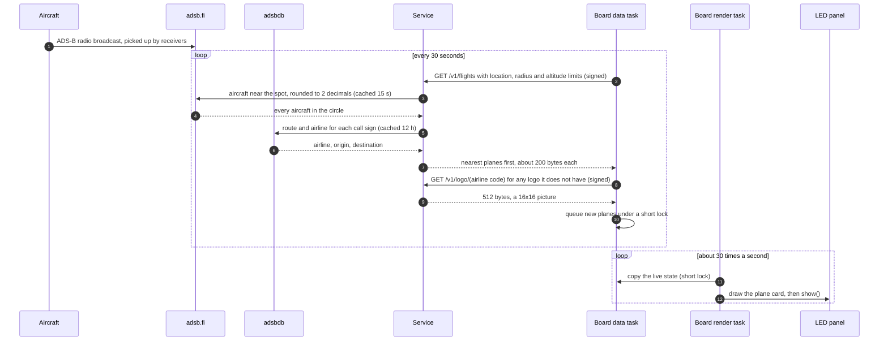

In words:

1. **The radio signal.** Aircraft broadcast their position by radio (ADS-B). Receivers on the ground pick it up, and adsb.fi publishes the result as open data.
2. **The service asks for the area.** It rounds your location to 2 decimals (about 1 km) before asking adsb.fi, so the source learns less and nearby requests share one cached answer. It then filters by your exact radius and altitude limits, sorts nearest first, keeps the first `n` and looks up each call sign at adsbdb. Routes come from community data and are missing or wrong for charter, cargo, general aviation and military flights; a missing route is simply left out.
3. **The board fetches every 30 seconds** (`FLIGHTS_EVERY_MS` in `live.cpp`). If a fetch fails it tries again after 15 seconds; if the service refused its signature it waits 5 minutes. It asks for 5 planes, or 10 if plane cycling is on.
4. **Logos come first.** For each airline code the board does not have, it fetches the 16x16 logo (at most 4 per round) before the plane is queued. A logo is refreshed every 12 hours; "no logo" is remembered for 10 minutes. A plane waits for its logo question to be settled rather than appear without one. Sixteen logos fit in the board's memory.
5. **New planes are queued.** A plane not shown in the last 30 minutes goes into a queue of at most 3 and into the plane log you see in the portal. In cycle mode all planes in range are kept in a list that the render task walks through.
6. **Pixels.** The render task takes the next plane, carries its altitude forward using its vertical speed (never more than 5 minutes, so the number keeps moving between fetches), draws the card with `drawScreen()`, and calls `show()`.

### 4.2 Weather and headlines

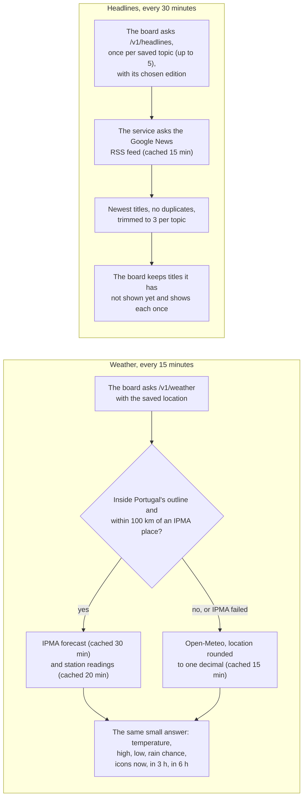

- **Weather: which provider.** The service decides (`coverage.go`, `weather.go`). It uses IPMA when the point is inside Portugal's outline (the mainland, plus 1.5 km of water off its coast, plus boxes around Madeira and the Azores) and within 100 km of one of IPMA's 35 forecast cities. Everywhere else it uses Open-Meteo. The outline is generated by `tools/make_pt_outline.py` from Natural Earth map data and is coarse by about a kilometre, so a pin within a kilometre of the Spanish border may land on either side; both give a good forecast. If IPMA fails and nothing is cached, the service falls back to Open-Meteo.
- **Weather from IPMA.** It reads the forecast of the nearest city and takes the current temperature from the nearest of the five closest stations that is within 50 km and has a recent reading (otherwise it uses the forecast for this hour).
- **Weather from Open-Meteo.** One call returns everything the screens need: the current temperature and weather code, the next 12 hours, and today's high, low and rain chance. The location is rounded to **one decimal** (about 11 km) before it is sent and before it becomes the cache key, because Open-Meteo keeps logs with coordinates (section 8). The hours are found by their time, so an answer that is a few hours old still gives the right "in 3 hours" and "in 6 hours", and the day's high, low and rain chance are used only while the time is inside the answer's own day. Open-Meteo has no place names, so the answer has no city and weather layout B shows the word WEATHER where it would show one. It sends WMO weather codes (numeric codes for the kind of weather), which the service turns into the four icons: 0 and 1 sun, 2 part, 3 and the fog codes cloud, 50 and above rain. There is no snow icon yet, so drizzle, snow, sleet, thunderstorms and hail all show as rain.
- **Weather in both cases.** A failed fetch is retried after 1 minute. The temperature is rounded and the icon is one of four: sun, part, cloud, rain. Open-Meteo's free service is for non-commercial use and must be credited (CC BY 4.0); see `service/README.md`.
- **Headlines.** The board asks once per topic, pausing 1.5 seconds between topics, and adds the language and region you chose in the portal ("Headlines language and region"). That choice is a Google News edition, one of 12 listed in `editions.h` (Portuguese (Portugal) by default, then Portuguese (Brazil), four English ones, two Spanish ones, French, German, Italian and Dutch); the board saves its position in that list in NVS under the key `hled`, and the list may only ever be added to at the end so a saved choice stays valid. Japanese is not offered because the panel's fonts are ASCII only, and accented letters show as wrong characters on the panel today, Portuguese included. It remembers a fingerprint (a hash) of the last 24 titles it has seen, so each title is shown once. After a restart it shows only the newest title per topic, not the backlog. How long a title stays depends on its length and layout, never more than 35 seconds. A failed fetch (or one broken topic) is retried after 5 minutes.
- **Which one shows.** A plane beats a headline; a headline beats weather; weather beats the idle screen (section 2.3).

## 5. Identity and trust

**The goal.** The service must know that a request comes from your display, without anyone typing a password or token into a web page. There is no token in this system. The display proves who it is by signing every request (issues 37 and 39). The full scheme is in [`shared/device-auth.md`](../shared/device-auth.md) with test vectors in `shared/device-auth-vectors.json`. This section is the summary.

### The parts

- **Device ID:** the board's factory MAC address (its network hardware address) written as 12 lowercase hexadecimal characters, for example `aabbccddeeff`. It is not secret.
- **Master secret:** a text of at least 32 characters that only you know. The service reads it from a file named by the environment variable `MASTER_SECRET_FILE` (the recommended way) or from the environment variable `MASTER_SECRET`. It never goes into the repository, a log or a chat.
- **Device key:** 32 bytes, computed as HMAC-SHA256 with the master secret as the key and the device ID as the message. [HMAC](glossary.md#hmac) is a way to mix a secret key into a message so that only someone with the key can produce the result. The service derives a board's key again on every request, so it stores no list of keys. It keeps only the master secret and, optionally, a [revoked list](glossary.md#revoked-list) (`REVOKED_DEVICES`).

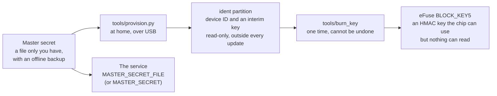

### Provisioning, the interim key and the burn

Provisioning happens at home over USB, never over the air. `tools/provision.py` derives the board's key from your master secret and writes a small record into the read-only `ident` partition: the device ID and, at first, an **interim software key** so everything can be tested end to end. The record is two checksummed copies of 60 bytes, laid out in `shared/device-auth.md`. The firmware refuses to sign if the record is missing or invalid, or if the ID in it is not this chip's own MAC (a record copied from another board).

The **burn** is a separate, deliberate, irreversible step (`tools/burn_key/README.md`). It copies the key into the chip's [eFuse](glossary.md#efuse) block `BLOCK_KEY5` with the purpose HMAC_UP, protected against reading and writing. An eFuse is a tiny switch inside the chip that can be blown once and never reset. After the burn, the chip's hardware HMAC unit can sign messages with the key, but no program, no flash tool and no person can read it back, and no update can remove it. The sketch does a dry run by default; a real burn needs a build tied to the board's own ID, every check passing, and you typing `BURN <device id>`. Then `provision.py --burned` writes a record without the software key. The author burned the first board on 25 November 2026 (verified on the author's own display, with `provision.py --burned`).

At every start `identity.cpp` picks the signer: hardware if the record says burned and the chip has a protected key, software before the burn, and if both exist it first checks that they give identical answers on a set of test messages. The result is visible in `/status` as `identity`, `signer` and `signer_check`.

**Back up the master secret offline.** After the burn the board's key lives in the chip and in what the master secret can derive. If you lose the master secret, the board is locked out of the service for good. Changing the master secret locks out every board provisioned with the old one. How to make it and back it up: [install.md, "Make the master secret and back it up"](install.md).

### A signed request

The board adds three headers to every data request to the service (flights, weather, headlines, logos) and to no other host. The firmware routes are the one exception: the board asks for those without these headers, on purpose. (That is about the request. The manifest it receives is meant to carry a different signature, made with the maintainer's key once that key is in use: section 6.) It has no code for redirects, so a signature can never follow a redirect to another site:

```
X-Device: aabbccddeeff
X-Timestamp: 1796000000
X-Signature: v1=<64 lowercase hex characters>
```

The signature is HMAC-SHA256 of six lines: the scheme version `v1`, the method, the host, the request target exactly as sent (path and query), the timestamp and the SHA-256 of the body (always the hash of nothing, because the board only sends `GET`). Because the path, the query and the time are all signed, a copy of one request cannot be turned into a different request, and an old one stops working after 2 minutes. The service checks in this order, and reveals no more than the first failing check allows:

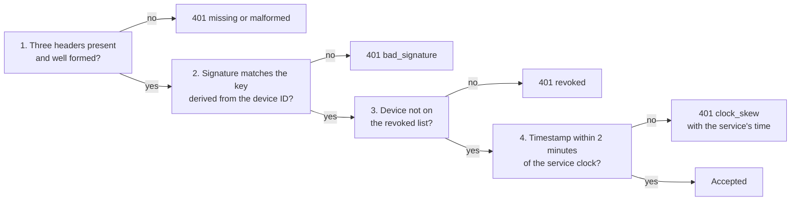

The comparison is constant time. Only a caller who has already proved the signature learns the service's time or whether a device is revoked.

### When a request is refused: soft failure

A refusal must never strand a board that is far away, so it is deliberately gentle (issue 37):

- The board keeps its key and its last data. It never wipes anything and never restarts because of a 401. It puts a plain sentence in its problem list.
- On `clock_skew` it stores the service's time as an offset, used only for signing, and retries the same request once at once. Not in a loop.
- On any other refusal, or if the board cannot sign at all, it waits 5 minutes between tries for every kind of fetch, and goes back to its normal schedule the moment a request works.
- The service never bans a device for good. `revoked` comes only from the list you keep, and removing an ID lets the board back in.
- The firmware routes ignore the signature, so a refused board can still fetch a fix, and the probation check counts any HTTP answer, even a 401, as "the service was reached".

### What this does not protect against

Stated plainly (the first two are in issue 37):

- Someone who holds the board and can flash their own firmware could ask the chip to sign anything. Stopping that needs Secure Boot and flash encryption, which are not planned.
- HMAC is symmetric: the service holds the secret every key derives from. Whoever can read the service's environment can make a valid key for any device ID.
- The portal has no password (section 8).

Where the detail lives: [`shared/device-auth.md`](../shared/device-auth.md) for the scheme, `tools/burn_key/README.md` for the burn, [install.md, "Provision the display"](install.md) for provisioning a board, and [security.md](security.md) for what to keep safe and up to date.

## 6. Firmware updates

The design (issues 21, 37 and 42, the contracts in [`shared/firmware-update.md`](../shared/firmware-update.md) and [`shared/manifest-signing.md`](../shared/manifest-signing.md)) has two paths: the board **pulls** an update from your service, and you can **upload** a `.bin` file in the portal as an escape route when the normal path is broken. Both need a code that appears only on the panel, so someone must be standing at the display. The pull path is also **signed**: a display that runs a signing build installs a service-offered update only when its manifest carries a valid signature by a key built into the firmware (the next two sections).

**Who publishes a release.** On the public image (`ghcr.io/suvl/ledmatrix-api`), firmware updates arrive when the maintainer (today the project's author) publishes a release; do not press Update when nothing was announced. On your own build (you build the image or the firmware yourself) no update arrives unless you build and publish releases yourself, so you are the maintainer: see [development.md](development.md). The same split applies to signing. A release is signed with the maintainer's key once the maintainer has set the CI secret; until then the workflow can publish an unsigned release (the 0.11.0 release was published unsigned for that reason, during the transition with `REQUIRE_SIGNING` at "0"), and a display that enforces signatures refuses an unsigned one. Once releases are signed, a display built with other keys refuses the public image's firmware. Your own build pins your own keys in `update_keys.h` and signs with your own private key.

### How a release gets to the service

```mermaid
flowchart LR
  bump["The maintainer raises FIRMWARE_VERSION<br/>in version.h and pushes to main"] --> ci["GitHub workflow:<br/>tests, then compiles the firmware"]
  ci --> man["make_manifest.py writes<br/>manifest.json and ledmatrix-VERSION.bin"]
  man --> sign["sign_manifest.py adds keyid and sig,<br/>using the private key (a CI secret)"]
  sign --> chk["The workflow checks the signed manifest<br/>against the public keys"]
  chk --> img["One service image with<br/>the firmware inside, in /firmware"]
  img --> reg["Image registry"]
  reg --> deploy["The service is updated<br/>to the new image"]
  deploy --> board["Boards find it on their next check"]
```

The firmware travels inside the service image, so no GitHub token or storage is needed to carry it. The one secret on the way is the private signing key, a GitHub Actions secret called `UPDATE_SIGNING_KEY`; only the step that signs can see it. The image is built for `linux/amd64` and tagged `latest` and with the commit hash. The workflow is `.github/workflows/service.yml`. A switch at its top, `REQUIRE_SIGNING`, decides what happens while that secret does not exist yet: with `"0"` a release goes out unsigned with a loud warning (a display that enforces signatures refuses it), with `"1"` the run fails and nothing is published. See [development.md](development.md). Updating the service means running the new image; how that is done depends on where it runs (see [hosting.md](hosting.md)).

### The signature on the manifest

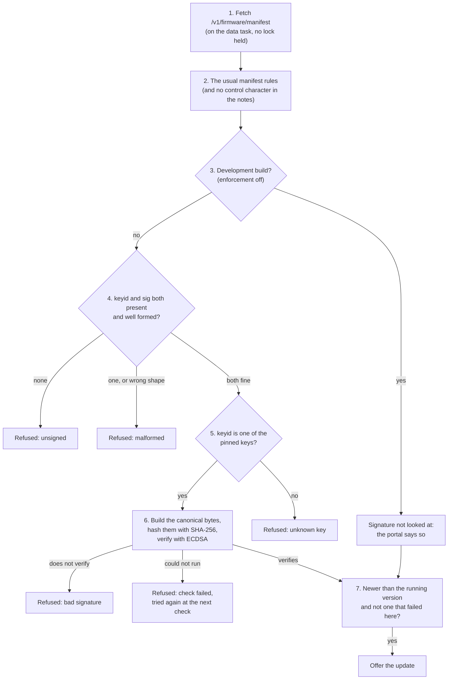

A **digital signature** is a number that only the holder of a private key can produce for a given message, and that anyone with the matching **public key** can check. LedMatrix uses ECDSA (a signature method built on elliptic curves) on the curve P-256 with SHA-256, checked with the mbedTLS library that is already inside the board's core, so no new third-party code was added (`shared/manifest-signing.md`).

- **What is signed.** Six lines of text built from the manifest's *values*, not from its JSON text: the fixed line `ledmatrix-update-v1`, then the version, the file name, the size, the SHA-256 of the image, and the notes. Because the image's SHA-256 is inside the signed text, a valid signature also fixes which image is acceptable.
- **Where the signature is.** Two extra fields in `manifest.json`, `keyid` (8 hexadecimal characters) and `sig` (128, the two halves of the signature). The service passes them through and does not check them (section 3).
- **Which keys the board trusts.** Up to two public keys are built into the firmware in `update_keys.h` (the keys are **pinned**: only these are ever accepted). The current key's private half is the CI secret. The spare's private half is kept offline and never in CI, so a lost or leaked key can be replaced by releasing a version that pins the spare and a new spare. A **key id** is the first 4 bytes of the SHA-256 of a public key; it only selects which pinned key to try, and the signature decides. The firmware derives the ids itself, so the header cannot disagree with itself, and it refuses to build with enforcement on and no key.
- **Where the code is.** `updatesig.h` holds the pure logic (the order above, the canonical text, the verdicts and the words) and has laptop tests; `updatesig_mbedtls.h` plugs in the real verifier on mbedTLS. The check sits inside `fetchManifest()` in `ota.cpp`, so there is no path that uses an unchecked manifest: both the daily check and the fresh look that starts a download go through it. The cheap refusals (steps 4 and 5) come before any cryptography.
- **A refusal is soft.** Nothing is downloaded, written or restarted, and nothing on the data side changes. The reason goes into the problem list under "update check" and into an "An update was refused" box in the portal, in plain words, and it never puts the panel's PROBLEM message up. "Could not check" means the library ran short of memory; it is not treated as an attack and is tried again at the next check.
- **What the portal and `/status` show.** `GET /api/update` gains a `signing` member (whether signatures are required, the ids of the pinned keys, and the last refusal) and `available.signedBy` (the id of the key that verified the offered manifest); `/status` gains `updateSigning` (`required` or `off`).
- **Development builds.** Building with `-DUPDATE_REQUIRE_SIGNATURE=0` switches enforcement off; the portal then says "Development build: updates are installed without checking a signature." The signing tool refuses to sign such an image, so a release can never be one.
- **The first version with the check (0.11.0).** Displays still on 0.10.x have no check. They read the manifest with their old parser, which ignores the two new fields, and install 0.11.0 once without checking anything; 0.11.0 itself was published unsigned during the transition. A display on 0.11.0 or later enforces: it installs a later release only when that release is signed with a pinned key.
- **Not signed:** the `.bin` upload. It stays code-only (it needs the panel code and the image checks) and accepts any valid image for the chip; signing it would take away the way out when keys are lost.

None of this has been tried on a real display yet (Not tested here): it is described from the code and the contract.

### The pull path

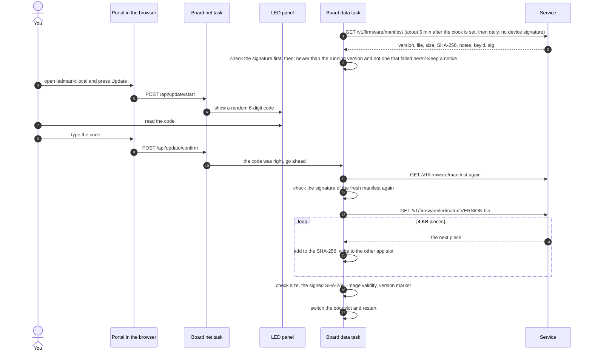

- **The check.** The board looks about 5 minutes after its clock is set, then every 24 hours (an hour later if a check failed), and when you press "Check now". The signature is checked first; only a manifest that passed it can produce a notice. The notice appears only if the manifest's version is strictly newer than the running one and is not a version that already failed here. The portal's notice names the host the update comes from, and, on a display that enforces signatures, the key that signed it.
- **The update code.** Six random digits from the chip's hardware random number generator, shown only on the panel. It is never in a response, a log, `/status` or the serial output. It lasts 3 minutes and allows 3 wrong tries. If a code is used up by wrong tries, a new start is refused for 60 seconds, then 120, doubling up to an hour. Replacing or cancelling a code does not reset the tries or the wait. The comparison takes the same time whatever the digits.
- **The download.** From `https://<saved service host>/v1/firmware/<file>`, no redirects. The board reads the manifest again first (you may have published since) and checks its signature again, so the manifest that governs the download is always the one just checked. Before it switches anything it checks: the byte count equals the signed manifest's, the SHA-256 computed while streaming equals the signed one, the image passes the ESP-IDF image validation for this chip and one app slot, and the image carries a version marker (a few bytes the firmware embeds) that says it is the version the manifest announced. Any failure changes nothing: the running image stays, the half-written slot is simply unused, and a plain sentence goes into the problem list.
- **The upload path.** The portal first calls `start` with `{"source":"upload"}` to get a code on the panel, then sends the file with the code in the same form. The code is checked before the first byte reaches flash, and the size is checked before the code is spent. There is no manifest to compare with, so the checks are the image header and validation for this chip, and the size limit of one slot.

### Two slots and a bootloader that does not roll back

The board has two app slots (`ota_0` and `ota_1`, section 2.6). The running image sits in one, the update is written to the other, and `otadata` records which one boots. After a successful check the choice is switched and the state of the new slot is `NEW`.

A bootloader can be built to go back to the old image when a new one never confirms itself. **This board's bootloader (Adafruit's prebuilt TinyUF2) does not.** The bench test on the real board (recorded in `shared/firmware-update.md`) showed that after an unconfirmed restart it booted the same new image again and left the state at `NEW`. So **the rollback is done by the application itself**, using the state record in `otadata` and a boot counter that the firmware maintains.

### Probation and rollback

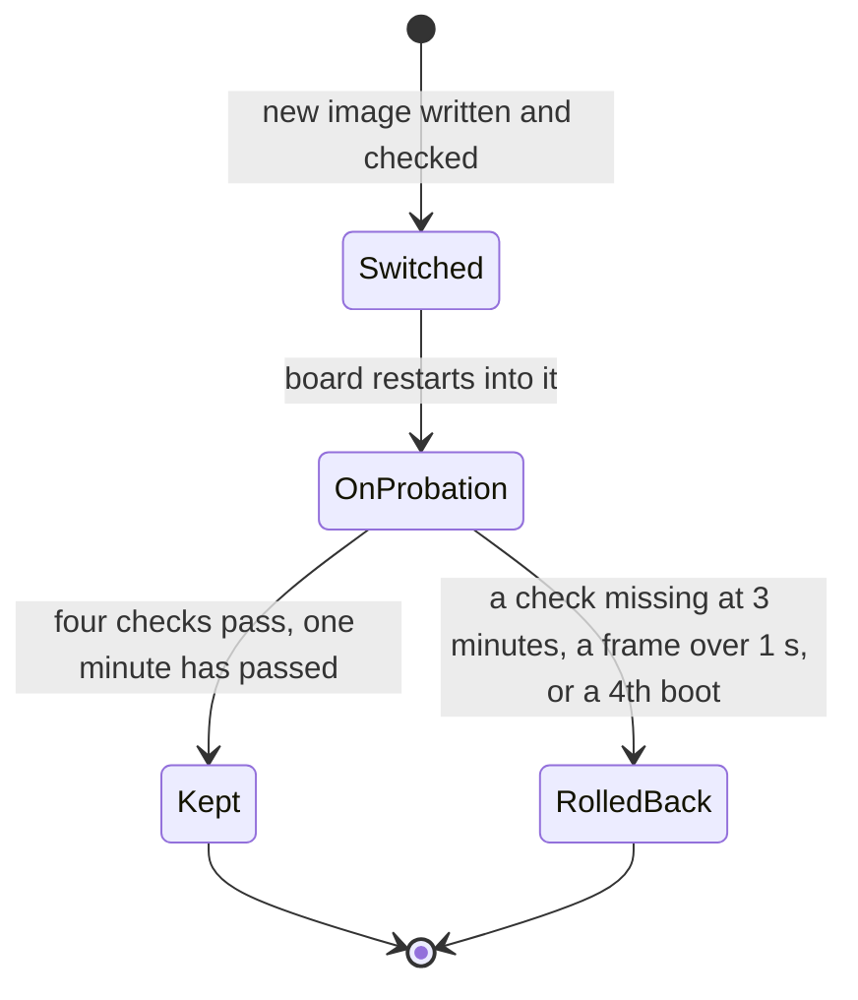

An image whose slot state is `NEW` is **on probation**. An image flashed over USB has no such state and is never on probation. The steps (`ota.cpp`, `otalogic.h`):

1. Very early in `setup()`, before Wi-Fi and the tasks, the firmware counts this boot. The count is kept in NVS (namespace `update`, key `pcount`), as one 64-bit item that holds the image's identity and the count, so a count left by another image never counts against this one. More than 3 boots in one probation means a rollback on the 4th, and it makes no difference whether the earlier boots ended in a crash or a power cut. At most 4 writes happen for one update (boots 1 to 3, and one erase), and an unreadable store counts as boot 1 rather than causing a rollback.
2. A small task of its own watches four things. Within 3 minutes of the start the board must have joined Wi-Fi, the portal must be answering, the render task must have drawn 100 frames, none more than 1 second apart, and the service must have given one complete HTTP answer of any status (this check is waived if no service address is saved, if the identity is not OK, or if nothing would be fetched).
3. When all four hold, and at least 60 seconds have passed since the start, the image marks itself good and the boot counter is erased. (It is also erased when an update is installed and at the next start that is not on probation.) If a frame is ever over 1 second, or a check is still missing at 3 minutes, the verdict is "failed".
4. On failure the image first writes the failed version and the plain reason into NVS, then asks the system to mark itself invalid and restart into the previous slot.
5. The image that runs after a rollback reads that record. The portal shows what happened, and that version, and anything not newer, is not offered again until a newer one exists. A later successful update clears the record.
6. The rollback also goes into the portal's problem list, once per start from the first data cycle after Wi-Fi is up, and again at every start while the record exists. The entry has the kind "update check", the sentence "The new firmware (version X) did not pass its start-up check, so the board went back to the previous firmware." and the reason as its detail. It is an *event*, not a failing source of data: it goes into the list only and never into the one-hour rule behind the panel's PROBLEM message. If the running image is itself on probation, the entry waits until that image has been marked good.

The verdict comes from its own task rather than the data task, so a stuck Wi-Fi join, or a start-up that hangs, still ends in a rollback at 3 minutes. If there is no previous valid image to go back to, the board stays up and says so.

**Known gaps** (stated in the contract): a crash before `setup()` starts (in the core's start-up code) is not counted, because the count is made in `setup()`. Because power cuts count like crashes, four power cuts in the first minutes after an update can roll back a version that is fine; after an update, leave the display alone until the portal says the check passed. The update-code throttle lives in RAM, so a power cut resets it. The `.bin` upload is not signed, and displays still on 0.10.x do not check signatures at all (the section on the signature above, and section 8).

**Bench evidence** (from the slice 10 commit message, the contract and the author's reports; not repeated here). Verified on the author's own display on 25 Nov 2026: an update through the upload path and through the real service; wrong codes refused; an image that crashes on start rolled back on the 4th boot; an image that never reaches the service rolled back at 3:00; an update while the board's key was refused. Verified on the author's own display on 26 Nov 2026: a crash-on-start update rolled back on the 4th start, with the entry in the problem list (kind "update check", the sentence with the version, the detail "The new version kept restarting.") and without the panel PROBLEM message; an update that hangs before Wi-Fi rolled back at exactly 3 minutes ("The board did not join Wi-Fi within 3 minutes of starting."). Not verified: a real power cut during probation (the counter in flash is proven by laptop tests and by the crash loop, not by pulling the plug).

## 7. Networks and time

### 7.1 IPv4 and IPv6

The board works on [IPv4](glossary.md#ipv4) and [IPv6](glossary.md#ipv6) networks and the portal answers on both (issue 15). `connectDual()` in `live.cpp` is the one place every outgoing HTTPS connection goes through (the time servers are reached by the system's SNTP client instead, started by `configTzTime`):

1. It looks up both the IPv4 address (an "A" record) and the IPv6 address (an "AAAA" record) of the host name. Every host is reached by name, never by a fixed address.
2. If the board has a global IPv6 address it tries IPv6 first, otherwise IPv4 first, with short timeouts on each attempt.
3. If an attempt fails it tries the other family.

So a host that publishes an AAAA record later is picked up with no firmware change. In the author's own setup the service host has only an IPv4 address today, so the board talks to it over IPv4 (the limit is the DNS record, not the firmware). The portal's connection test reaches your service and two test hosts (one reachable only over IPv6, one over both) to show this. The fallback path itself (an AAAA record that does not answer) is described in issue 15 as not yet exercised.

Two practical details. The board turns IPv6 on so that its `.local` name (`ledmatrix.local` by default) also answers with an IPv6 address; without it macOS waited 5 seconds for the missing record on every lookup. And a "DNS guard" in `net.cpp` checks every 2 seconds that the first DNS server is usable: some routers announce their own link-local IPv6 address as a DNS server, which the board's network stack cannot use, so the guard puts back the IPv4 server DHCP gave. The setup network (`192.168.4.1`) is IPv4 only, deliberately. Open issue 36: after a settings change, name lookups sometimes time out for a long time while the data task refreshes everything in a burst; the display recovers by itself on the next refresh and frames are not affected.

### 7.2 Time

The clock matters more than it looks. The board needs the real time for four things:

1. **TLS certificates have dates.** A secure connection is refused if the clock is wrong, so nothing is fetched before the clock is set (`dataTask` waits for it).
2. **Signed requests carry a timestamp.** The service accepts one within 2 minutes of its own clock.
3. **The clock screen** and the **night blanking schedule**.
4. **The firmware check** (it waits for the clock too).

The board sets its clock with NTP from `pool.ntp.org` and `time.cloudflare.com` (`configTzTime` in `live.cpp`). Plain NTP is not authenticated. If Wi-Fi has been up for a minute and the clock is still not set, the problem list says so.

**Clock-skew self-heal.** If the board's NTP time and the service's clock differ by more than 2 minutes, the service answers `clock_skew` and includes its own time. The board stores the difference in RAM, uses it only for signing, and retries once. When NTP later sets the system clock, the stored difference is dropped.

### 7.3 Time zones

The board needs a time zone to show local time and to know when "night" is. Issue 22 decided that **the browser decides, not the service**. When you place the pin on the map in the portal, a small lookup library running in your browser (downloaded from jsDelivr when the page opens, pinned by an integrity hash) turns the coordinates into a zone name such as `Europe/Lisbon`. The portal looks up that zone's rule in a table built into the page (`shared/tz_zones.json`, made by `tools/make_tz.py` from the tz database and embedded by `build_web.py`), and saves both the name and the rule on the board. The rule is a compact text such as `WET0WEST,M3.5.0/1,M10.5.0/2`. The data task applies it at once with `setenv` and `tzset`, with no restart. A searchable list in the portal overrides the map. Until a zone is saved the board uses Europe/Lisbon. The service is not involved.

## 8. Privacy and trust, in plain words

Every claim below was checked in the source named next to it.

### What is stored where

| Where | What | Notes |
| --- | --- | --- |
| The board's flash (NVS) | Wi-Fi name and password, your location, radius, headline topics, the service host name, the display name, and all other settings; the failed-update record; the probation boot counter while an update is on probation | Not encrypted. `settings.cpp`, `ota.cpp` |
| The board's `ident` partition | Device ID (not secret) and, until the burn, the interim key | Read-only for the firmware. `identstore.h` |
| The board's chip (eFuse) | The device key, after the burn | Cannot be read or changed |
| The board's RAM | Live data, logos, the last 10 problems, the last 60 planes seen, recently shown planes and headlines | Lost at restart. `live.cpp` |
| The service's RAM | Caches: positions rounded to 2 decimals, call signs, forecasts, headline topics; the time each device ID was last logged | Lost at restart. It writes nothing to disk |
| The service's environment | The master secret (in the file named by `MASTER_SECRET_FILE`, or in `MASTER_SECRET`) and the revoked list | Your secret store |
| Your computer | The master secret file and its backup | Outside the repository |
| Your browser | Nothing: the portal uses no cookies and no browser storage (a search of the page finds none) | |

### What leaves the display

| Goes to | When | What it learns |
| --- | --- | --- |
| Your service host | Flights every 30 seconds, weather every 15 minutes, headlines every 30 minutes, logos as needed, the firmware check daily | The board's public IP address, its device ID, the time, your location to 4 decimals, the radius and altitude limits, your headline topics and edition, the airline codes of planes near you. The firmware check carries no device signature: it shows the IP address and that a manifest was asked for |
| `pool.ntp.org`, `time.cloudflare.com` | At start-up and from time to time | The board's public IP address |
| `api6.ipify.org`, `api64.ipify.org` | Only when you press "Test connections" in the portal | Your public IP address (that is what these services answer). Plain request, no signature |
| Anyone else | Never | A search of the firmware sources for host names finds only the saved service host, the two time servers and the two test hosts |

The board never sends its key anywhere (only signatures made with it, and only to your service), and it sends the Wi-Fi password only to your own router.

### What the service sees and does

- It sees every request above, including your location to 4 decimals in the query string.
- **It does not log the query string.** The access log has the method, the path, the status and the time. Refusals log the device ID and the reason, and an accepted display is noted as `device seen <id>` at most once an hour.
- **It limits what its sources learn.** adsb.fi gets the location rounded to 2 decimals, about 1 km. adsbdb gets call signs. Google News gets your topic words (with `when:1d` added) and the edition you chose. IPMA gets only a city number and its public files, no coordinates at all. Open-Meteo, which answers outside Portugal, gets the location rounded to one decimal, about 11 km, because Open-Meteo keeps request logs with coordinates for up to 90 days (according to the project's research, `wayfinder/research/worldwide-weather.md`; not checked here). All of them see the service's IP address, not the board's, and the service sends a generic User-Agent.
- **Other logs are yours to check.** The reverse proxy or hosting platform in front of the service has its own access log, and such logs may include the full URL with the query string. This has not been checked for any particular proxy; look at its log settings (see [hosting.md](hosting.md) and [security.md](security.md)).

### The browser's side of the portal

The portal page is served by the board, but the map is not private. When you open it, your browser downloads the map library from `unpkg.com`, the time zone library from `cdn.jsdelivr.net` and map pictures from OpenStreetMap, and a place search goes to OpenStreetMap's Nominatim. Those servers see your browser's IP address and the map area you look at. The scripts are pinned by integrity hashes. Without internet the page still works: you type the coordinates and choose the time zone from the list.

### The portal guard

The portal has no password, but the board refuses requests that a browser sends on behalf of another web page (issue 46). Two checks run in front of every portal route (`webguard.h`, applied in `net.cpp`; the repository has a laptop test for the rules, `tools/test_webguard.cpp`):

- **Host check**, on every request including reads. The `Host` header must be one of the display's own names or addresses: `<name>.local`, the bare `<name>`, its IPv4 address or its IPv6 addresses (ports are ignored). Anything else, or no `Host` at all, gets 421 "Misdirected Request". This blunts DNS rebinding, where a web page on another site gets its name pointed at the display's address so that the browser lets the page read `/api/settings`, which holds your home location. The name accepted is the one mDNS is announcing right now, so a clash-renamed `<name>-2.local` works too.
- **Origin check**, on every request that changes something (all `POST` routes: settings, forget, and the update routes including the upload). If the browser says which page the request came from (the `Origin` header, or the `Referer` when there is no `Origin`) and that page is not the display itself, the answer is 403. An upload from another site is refused before any update code try is spent. `Origin: null` is refused too.
- **Requests with neither header pass.** `curl` and scripts are not a browser acting for another page, so they still work.
- **Setup mode.** The Host check is off, because phones send captive-portal probes under all kinds of names. The Origin check still applies to the Wi-Fi form.

Verified on the author's own display on 26 Nov 2026: requests from the same site, and requests with no `Origin`, were answered normally; requests naming another site were refused with 403; other `Host` names got 421; an upload from another site was refused without using a code try. Not verified: a real cross-site page in a browser (the proof page), and access by an IPv6 address written in the URL.

Names the display does not own get 421, even though they point at it: router DNS names such as `ledmatrix.lan`, a reverse proxy in front of the display, VPN or port-forward addresses, unique-local IPv6 addresses and `localhost`. Open the portal by `<name>.local`, the bare name, or the IP address shown on the panel or in `/status`.

### Known limits, stated honestly

- **The portal is plain HTTP on your LAN with no password.** A web page in a browser on your network can no longer change settings, press "Forget" or start an update, and cannot read the settings through DNS rebinding (the guard above). Anyone on your Wi-Fi who sends the requests directly (for example with `curl`) still can read and change the settings, including your location, the display name and the saved service host.
- **The service host is also where firmware updates come from, but a display that enforces signatures accepts only signed releases.** Someone on your LAN who sends the request directly could point the board at a server of their own (it would need a valid certificate), but that server could offer only releases signed by a key built into the firmware. So changing the saved service address, controlling DNS or a certificate, or deploying a doctored service image gets nothing installed except genuine, signed releases. This holds only for displays that already run a signing build: a display still on 0.10.x has no check until it installs 0.11.0 or later. The panel code and the portal's host notice still apply on top.
- **The `.bin` upload is not signed.** It needs the panel code and the image checks and accepts any valid image for the chip, so someone who is at the panel and on your LAN can install any firmware, just as someone with a USB cable can.
- **Whoever can sign decides what is offered.** The signing key is a GitHub secret available to the release workflow, so the maintainer's GitHub account and write access to `main` are the root of trust. A compromised service deploy or registry can no longer ship firmware to an enforcing display. What remains (`shared/manifest-signing.md`, section 10): someone who controls the service can withhold updates or show an older genuine release that is still newer than what a display runs, and a leaked key plus control of the service defeats the scheme until a rotation reaches the display. On your own build, you hold your own keys and these roles are yours.
- The board's clock comes from unauthenticated NTP.
- The protection of the identity key, and the limits of it, are in section 5.

## 9. Why it is built this way

The decisions were made by the project's author, one GitHub issue each; [issue 35](https://github.com/suvl/ledmatrix/issues/35) is the map that links them all. Read the issue for the reasoning.

| Decision | Issue | In one line |
| --- | --- | --- |
| Arduino C++ with the Protomatter library, drawing on core 1 and networking on core 0 | [1](https://github.com/suvl/ledmatrix/issues/1) (evidence: [8](https://github.com/suvl/ledmatrix/issues/8), [9](https://github.com/suvl/ledmatrix/issues/9)) | The scope, 30-second polling with a secure connection each time, and the 500 ms cap for a data cycle did not fit CircuitPython (a cold secure connection took about 4.4 s there); Rust was judged feasible but parked |
| The panel never goes more than 1 second without updating; boot is exempt | [10](https://github.com/suvl/ledmatrix/issues/10) | "1 second is the maximum we will tolerate" |
| One service of your own does the fetching and shrinking | [5](https://github.com/suvl/ledmatrix/issues/5), [17](https://github.com/suvl/ledmatrix/issues/17), [18](https://github.com/suvl/ledmatrix/issues/18) | The sources are large and unofficial; the board gets a few hundred bytes from one host |
| Hosting: one HTTPS name, run by the author; no second implementation | [20](https://github.com/suvl/ledmatrix/issues/20), [28](https://github.com/suvl/ledmatrix/issues/28) | The reference setup is the author's own server. A Cloudflare Worker was rejected because two implementations would never both be maintained; the same container runs on Google Cloud Run instead |
| A normal certificate store, never insecure TLS, never pinned certificates | [19](https://github.com/suvl/ledmatrix/issues/19) | The built-in bundle needs no firmware change when a certificate authority changes; the price is that a firmware that is never updated will eventually miss new roots |
| IPv4 and IPv6, with IPv6 added later needing no firmware update | [15](https://github.com/suvl/ledmatrix/issues/15) | Resolve both families, try IPv6 first when the board has it, fall back |
| Setup by holding UP for 5 seconds; the network and the name are both `ledmatrix` | [13](https://github.com/suvl/ledmatrix/issues/13) | A long press on one of the two buttons; UP (GPIO 6) was chosen, and either would work. The long press forgets only the Wi-Fi |
| A plane is shown once and takes priority; optional cycling | [14](https://github.com/suvl/ledmatrix/issues/14), [25](https://github.com/suvl/ledmatrix/issues/25) | A flight tracker first; weather and headlines fill the gaps |
| The portal is a page the board serves itself; the map picks the location and the time zone | [7](https://github.com/suvl/ledmatrix/issues/7), [16](https://github.com/suvl/ledmatrix/issues/16), [22](https://github.com/suvl/ledmatrix/issues/22) | No app, no account; the zone lookup runs in the browser so the board needs no internet to know its zone |
| Burn-in protection: drift, dim, night blanking, rotation | [24](https://github.com/suvl/ledmatrix/issues/24) | The weather screen and the clock sit on the panel most of the time |
| A problem list in the portal and a panel message after an hour of failure | [23](https://github.com/suvl/ledmatrix/issues/23) | A short outage must not nag; a long one must not be silent |
| Updates: the board pulls, a `.bin` upload is the escape route, a code on the panel authorises, SHA-256 and image checks, probation with rollback | [21](https://github.com/suvl/ledmatrix/issues/21), amended by [37](https://github.com/suvl/ledmatrix/issues/37) | Images come from your service, never from GitHub, so the board talks to one host |
| A signed manifest: ECDSA P-256 over the manifest's values, keys pinned in the firmware, a spare key for rotation | [42](https://github.com/suvl/ledmatrix/issues/42) (design), [50](https://github.com/suvl/ledmatrix/issues/50) (build) | Reopens issue 21's "no signature for now": a display accepts only updates the maintainer published, even if someone changes the saved service address |
| Weather outside Portugal (IPMA inside, Open-Meteo elsewhere) and a headlines language and region setting | [44](https://github.com/suvl/ledmatrix/issues/44) (research: [41](https://github.com/suvl/ledmatrix/issues/41)) | The display was usable only in Portugal. The service chooses the provider, so the board does not change; the headlines edition is a setting that the board sends to the service |
| A key per device and signed requests instead of a token | [37](https://github.com/suvl/ledmatrix/issues/37), [29](https://github.com/suvl/ledmatrix/issues/29) (replaced), [38](https://github.com/suvl/ledmatrix/issues/38), [39](https://github.com/suvl/ledmatrix/issues/39) | The credential belongs to the device. Soft failure, open firmware routes and no permanent bans mean a refusal can never strand a board |
| Documentation: Markdown in the repository, Mermaid diagrams, for a beginner, macOS and Linux | [27](https://github.com/suvl/ledmatrix/issues/27) | No documentation site; the pages change in the same commits as the code |
| Open issue | [36](https://github.com/suvl/ledmatrix/issues/36) | Name lookups time out for about 27 seconds after a settings change |

## What was run and what was not

| What | Status | How |
| --- | --- | --- |
| The 13 Mermaid diagrams on this page | Tested on macOS on 26 Nov 2026 | Each rendered without errors with Mermaid CLI 11.17.1 in headless Google Chrome 158. GitHub's own renderer was not tried |
| Statements about the firmware | Not tested here | Checked by reading `ledmatrix.ino`, `live.cpp`, `net.cpp`, `ota.cpp`, `identity.cpp`, `protect.cpp`, `settings.cpp`, `otalogic.h`, `deviceauth.h`, `problems.h`, `webguard.h`, `devicename.h`, `swapstore.h`, `editions.h`, `updatesig.h`, `updatesig_mbedtls.h`, `update_keys.h`, `partitions.csv` and the contracts in `shared/`. Nothing was run on a board, and no board was touched |
| The longest frame gap during a download from the real service (131 ms), the update through the upload path and through the real service, wrong codes refused, a crash rolled back on the 4th boot, an image that never reaches the service rolled back at 3:00, an update while the key is refused, the permanent burn with `provision.py --burned` | Verified on the author's own display on 25 Nov 2026 | Quoted from the contract and the author's report; not repeated here. The 131 ms figure is in no repository file. (The 93 ms gap in the upload test is only reported in the slice 10 commit message, so it carries no verified label) |
| The display name through the settings API and back; the portal's Origin and Host checks; a crash-on-start update rolled back on the 4th start, with its problem-list entry; an update that hangs before Wi-Fi rolled back at 3 minutes; `/status` uptime from a 64-bit timer | Verified on the author's own display on 26 Nov 2026 | The author's report; not repeated here |
| A real power cut during probation, the mDNS name clash (`-2`), setup mode with a long name, the cross-site browser proof page, IPv6 literal access | Not verified | No test on a real display. The boot counter in flash is covered by laptop tests and by the crash loop, not by pulling the plug |
| Weather outside Portugal (Open-Meteo, the provider choice and the Portugal outline), the headlines language and region setting, and the signed-manifest check (section 6) | Not tested here | Described from `service/weather.go`, `worldwide.go`, `coverage.go`, `pt_outline.go`, `headlines.go`, `firmware.go`, `editions.h`, `updatesig.h`, `updatesig_mbedtls.h`, `ota.cpp` and `shared/manifest-signing.md` (repository head 81fe5ea). None of it has been tried on a real display, and the real Open-Meteo service was not called. The repository has laptop and Python tests for these parts, which were not run for this page |
| Statements about the service | Not tested here | Checked by reading `service/*.go` and `service/README.md`, including the secret file option (`MASTER_SECRET_FILE`). The service, its tests and the host tests were not run for this page |
| Frame timing while a settings save writes to flash (section 2.2) | Not measured | The two-lock design is read from the code; the repository has a laptop test for it (`tools/test_swapstore.cpp`), which was not run for this page. The frame counters were not recorded during a save |
| Whether a reverse proxy or hosting platform logs query strings | Not checked | It depends on the product and its settings |
| What adsb.fi, IPMA, Open-Meteo, Google News, OpenStreetMap and the NTP pools log or allow | Not checked | The page says only what this project sends them |
| The one-line reasons in section 9 | Read from the issues on 25 Nov 2026 | Issues can be edited later; the issue itself is the record |
| Linux | Not applicable | The page contains no commands |
