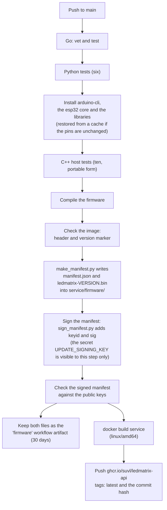

# Development: tests, releases and the service on your computer

Checked on macOS on 25 and 26 Nov 2026: what was run and what was not is in the table at the end of this page. Nothing that is new in the signed-update and weather parts of this page has been tried on a real display yet.

This page is for people who change the code or publish firmware releases: how to run every test, how a release is built and signed and what the build pipeline (CI) does, how to build the service image and run the service on your own computer, and how to look inside a build. You do **not** need it to build or run a display: [build.md](build.md) is enough for the firmware, and [hosting.md](hosting.md) runs the service from the public image.

It assumes you have done [build.md](build.md): the tools, the clone of the repository and one successful firmware build. If a Terminal word is new, see the box "Terminal in 2 minutes" in [build.md](build.md#terminal-in-2-minutes). Every command on this page is run from the repository root (`cd ~/ledmatrix`) unless it says otherwise.

## Which case are you?

Two cases come up, and the advice differs where it matters:

- **You use the public image** (`ghcr.io/suvl/ledmatrix-api`, published by the maintainer). You do not release anything. Firmware updates reach your display when the maintainer publishes a release. You use this page for the tests, the local service and for looking inside builds if you change code.
- **You build your own** firmware and service image. Then you are the maintainer of your own copy: no update ever reaches your display unless you build and publish a release yourself ([Releasing](#5-releasing)), a self-built image only carries a firmware if you put one in ([5.6](#56-rehearse-a-release-on-your-computer)), and because displays install only signed updates you also make your own signing key and pin it in your own build ([5.8](#58-signing-keys-and-signing-a-release)).

## 1. Tools for development

Tested on macOS. On top of the tools in [build.md](build.md):

| Tool | What it is for | Version | How to check it |
| --- | --- | --- | --- |
| **Python 3** | the tests and the signing tools of `tools/` | **3.10 or newer** for all the tests (see the note below); the tools themselves need 3.8 | `python3 --version` |
| **A C++ compiler** | the host tests (`c++`) | any with C++17; checked: Apple clang 21.0.0, g++ 13.3 | `c++ --version` |
| **Docker** | builds and runs the service image; the easiest way to run the Go tests | any recent Docker; the checks used OrbStack (Docker Desktop and Colima work the same way) | `docker --version` and `docker info` |
| **Go** (optional) | only to run the Go tests without Docker | **1.27 or newer** (`service/go.mod`, `service/Dockerfile` and the workflow all say 1.27) | `go version` |
| **Google Chrome** (optional) | only for the margin check | any recent; checked: 158 | the file `/Applications/Google Chrome.app` exists |
| **OpenSSL** | makes a random master secret for local tests (`openssl rand -hex 32`); the signing tools and `test_sign_manifest.py` run its command line | the one macOS ships (LibreSSL 3.3.6) and Homebrew's 4.1.0 both work | `openssl version` |
| **mbedTLS 3** (optional) | only for the second variant of `test_updatesig` (4.3), which runs the board's own signature code on your computer | Homebrew's `mbedtls@3` (checked: 3.6.8) | `brew --prefix mbedtls@3` prints a folder |

Install on macOS: `brew install python`, then Docker from <https://www.docker.com/products/docker-desktop/> or <https://orbstack.dev> (start the app once and wait until it says it is running; `docker info` must show a `Server:` part). Add `go` to the brew line only if you want to run the Go tests without Docker, and `mbedtls@3` only for the optional variant above. Not tested here: the `brew install` lines (the tools were already installed).

> **Python 3.9 runs the tools, but not every test.** The Python that comes with macOS (3.9.6) runs `build_web.py`, `make_manifest.py` and `provision.py`; their tests pass on it except one check in `tools/test_provision.py`, which fails with `AttributeError: module 'sys' has no attribute 'stdlib_module_names'` because it needs Python 3.10 or newer. The signing tools and their test (`test_sign_manifest.py`) also pass on 3.9.6. Checked with Python 3.9.6 (that one failure), 3.12.3, 3.14 and 3.15.2 (all pass). Check which Python your Terminal uses with `which python3`: Homebrew's is under `/opt/homebrew/bin` on Apple silicon.

Linux (Ubuntu or Debian), Not tested here except where noted: `sudo apt install git g++ python3 curl ca-certificates` (checked as root in an Ubuntu 24.04.5 x86_64 container: Python 3.12.3, g++ 13.3.0). Install Docker Engine from [Docker's instructions](https://docs.docker.com/engine/install/) and add yourself to the `docker` group (or put `sudo` before `docker`); also install the Docker "buildx" plugin (usually the package `docker-buildx-plugin`), which `docker build` needs here. For Go use the tarball from <https://go.dev/dl/>. For the margin check you need `google-chrome` or `chromium` on the `PATH`.

## 2. A separate arduino-cli setup

Optional; Tested. If you already use arduino-cli or the Arduino IDE for other projects and want this project's board package and libraries kept apart, point arduino-cli at folders of your own. Three environment variables choose the folders, and a fourth passes the Espressif index (the CI workflow does exactly this instead of `arduino-cli config add`):

```
export ARDUINO_DIRECTORIES_DATA="$HOME/ledmatrix-arduino/data"
export ARDUINO_DIRECTORIES_USER="$HOME/ledmatrix-arduino/user"
export ARDUINO_DIRECTORIES_DOWNLOADS="$HOME/ledmatrix-arduino/downloads"
export ARDUINO_BOARD_MANAGER_ADDITIONAL_URLS="https://espressif.github.io/arduino-esp32/package_esp32_index.json"
```

They last until you close the Terminal window. With them set, run the commands of [build.md](build.md) (`core update-index`, `core install`, `lib install`, `compile`) in that window: everything lands in the folders above and your real setup is untouched. `arduino-cli config get directories.user` prints the library folder in either setup, which is why the test commands below use it.

Always compile with `--build-path`, as in build.md: without it arduino-cli also keeps a build cache outside those folders (`~/Library/Caches/arduino` on a Mac; Tested).

## 3. The portal and preview pages

Tested on macOS and in the Ubuntu container. Opening `preview/index.html` in a browser: Not tested here (the margin check, [4.4](#44-the-margin-check), exercises the same drawing code in headless Chrome).

The [portal](glossary.md#portal) is the settings page that the display serves from its own memory, and the preview page shows the screens in a browser, drawn by the same code as the panel. Both are built from templates by one script:

```
python3 tools/build_web.py
```

A good result, in well under a second:

```
preview/index.html 40543 bytes; portal_page.h 108092 bytes
```

| Reads | Writes |
| --- | --- |
| `preview/index.template.html`, `portal/portal.template.html` | `preview/index.html` (a plain HTML file: open it by double-click, no web server needed) |
| `shared/renderer.js`, `shared/fonts.json` (put in place of `__RENDERER__` and `__FONTS__`) | `arduino/ledmatrix/portal_page.h` (the portal page wrapped as a C++ header, so the firmware contains it) |
| `shared/tz_zones.json` (put in place of `__TZ_TABLE__`) | |
| `arduino/ledmatrix/editions.h` (the list of Google News editions, written as `<option>` elements in place of `__EDITION_OPTIONS__`) | |

**Edit the templates and the files in `shared/`, never the two generated files.** After a change, run the script and commit the templates and the two generated files together.

**Why the generated files are committed.** The Arduino build only sees the sketch folder and cannot run Python, so `portal_page.h` has to be there already. That is also why a fresh clone builds with no extra step (the clone in build.md compiled without running this script).

**Check that the generated files are current.** Run the script on a clean checkout:

```
python3 tools/build_web.py
git status --short
```

A good result: `git status` prints nothing. If it lists `preview/index.html` or `portal_page.h`, a template was changed without regenerating, or a generated file was edited by hand. `python3 -I tools/test_editions_portal.py` makes the same check (it runs `build_web.py` on a copy of its inputs and compares with the committed files) and also checks the portal's list of editions against `editions.h`. The CI workflow does **not** run this script or that test, so the check is yours. A change that touches only `portal/` or `preview/` does not start the workflow either ([5.2](#52-when-it-runs)).

Three more scripts regenerate files, rarely. `python3 -I tools/extract_fonts.py <folder of the Adafruit GFX library>` rewrites `shared/fonts.json` from the library (Tested in a fresh clone: it rewrote the file identically). `python3 -m pip install tzdata && python3 tools/make_tz.py` rewrites the time zone table `shared/tz_zones.json` (Not tested here). `tools/make_pt_outline.py` rewrites `service/pt_outline.go`, Portugal's outline, which the service uses to decide whether a position is answered by IPMA (inside the outline) or by Open-Meteo (outside). Download the Natural Earth countries file (public domain; its SHA-256 is written in the header of `pt_outline.go`), then run the script on it, giving the day you downloaded it (Tested: the download's SHA-256 matched the header and the script reproduced `service/pt_outline.go` byte for byte; the offline test is `test_make_pt_outline.py`):

```
curl -LO https://naciscdn.org/naturalearth/10m/cultural/ne_10m_admin_0_countries.zip
shasum -a 256 ne_10m_admin_0_countries.zip
python3 -I tools/make_pt_outline.py ne_10m_admin_0_countries.zip --fetched 2026-11-26
```

The script writes `service/pt_outline.go` (`--out PATH` writes elsewhere). Use the 1:10m file named here and not a coarser one: the script's own notes say why. The other tools in `tools/`: `provision.py` and `burn_key/` give a board its identity ([install.md](install.md)); `make_logos.py` builds the private airline logo set ([hosting.md](hosting.md)). `gen_signing_key.py`, `sign_manifest.py` and `make_test_manifests.py` (with `update_signing.py`, their shared code, which is not a program) are the update-signing tools of [5.8](#58-signing-keys-and-signing-a-release).

## 4. The tests

Tested on macOS on 26 Nov 2026. The same tests, with the same counts, also passed on Linux (x86_64 Ubuntu) in the CI run of 26 Nov 2026 (read from the run's log), and the earlier set in Linux containers on 25 Nov. None of them needs a board, a secret or a connection to a real service. Together they take about two minutes, plus the one-time download of the Go image.

| Test | What it checks | Needs | Command (from the repository root) | A pass looks like |
| --- | --- | --- | --- | --- |
| Go service tests | the service: signatures, secret settings, the `device seen` log line, routes, caches, firmware routes, parsing of upstream answers | Docker, or Go | see 4.1 | `ok  github.com/suvl/ledmatrix/service  3.6s` |
| `tools/test_make_manifest.py` | `make_manifest.py` (the release writer) | Python | `python3 -I tools/test_make_manifest.py` | `Ran 69 tests`, `OK` |
| `tools/test_sign_manifest.py` | the signing tools (`update_signing.py`, `sign_manifest.py`, `gen_signing_key.py`, `make_test_manifests.py`): the canonical bytes and every case of `shared/manifest-signing-vectors.json` with a pure-Python P-256 verifier; fresh throw-away keys made with `openssl` to sign, verify and tamper; checks that no secret is printed and no key file is left; and "mutation" tests that break the tools on purpose and require the checks to notice | Python, `openssl` (the key tests are skipped with a message without it) | `python3 -I tools/test_sign_manifest.py` | `Ran 88 tests`, `OK` (about 27 s) |
| `tools/test_provision.py` | `provision.py` against the shared known-answer vectors; no serial port is touched | Python 3.10+ | `python3 -I tools/test_provision.py` | `Ran 66 tests`, `OK` |
| `tools/test_burn_key.py` | the one-off burn sketch's folder: same `partitions.csv`, dry run by default, every [eFuse](glossary.md#efuse) write guarded, no key printed | Python | `python3 -I tools/test_burn_key.py` | `Ran 12 tests`, `OK` |
| `tools/test_editions_portal.py` | the portal's list of headline editions equals the one in `editions.h`; the committed generated web files are current; the portal's script sends and shows the setting | Python | `python3 -I tools/test_editions_portal.py` | `Ran 6 tests`, `OK` |
| `tools/test_make_pt_outline.py` | `make_pt_outline.py` (builds Portugal's outline for the weather service), offline, with a faked map file | Python | `python3 -I tools/test_make_pt_outline.py` | `Ran 22 tests`, `OK` |
| `tools/test_deviceauth.cpp` | the board's request signing, against `shared/device-auth-vectors.json` | C++ compiler, ArduinoJson | see 4.3 | `1504 checks, 0 failed` |
| `tools/test_problems.cpp` | the problem list, its plain-English text and the one-hour rule | C++ compiler | see 4.3 | `43172 checks, 0 failed` |
| `tools/test_cycle.cpp` | which plane is shown: the one-shot queue and cycle mode | C++ compiler | see 4.3 | `2088 checks, 0 failed` |
| `tools/test_protect.cpp` | panel protection: dimming, pixel drift, night blanking | C++ compiler | see 4.3 | `23 of 23 cases passed` |
| `tools/test_otalogic.cpp` | firmware update logic: versions, the manifest rules, the code and its throttle, probation (the boot counter, kept in flash); with an image path it also checks that image | C++ compiler, ArduinoJson | see 4.3 | `147616 checks, 0 failed` |
| `tools/test_devicename.cpp` | the display name: the rules for a name, how a name is tidied (capitals become lower case) and the plain sentences for a refused name | C++ compiler | see 4.3 | `1637 checks, 0 failed` |
| `tools/test_webguard.cpp` | the portal's protection: the Host check on every request, the Origin and Referer check on every request that changes something, the display's own names, the reason codes | C++ compiler | see 4.3 | `843 checks, 0 failed` |
| `tools/test_swapstore.cpp` | the pattern the settings use so that saving to flash never delays a picture: a reader never sees a half-applied value (runs threads) | C++ compiler, `-pthread` | see 4.3 | `all swapstore checks passed` |
| `tools/test_editions.cpp` | the list of Google News editions in `editions.h` | C++ compiler | see 4.3 | `6 of 6 cases passed` |
| `tools/test_updatesig.cpp` | the signed firmware manifest on the board's side: the manifest rules, the canonical bytes, the key ids, the order of the checks and the policy, against `shared/manifest-signing-vectors.json`. The portable variant uses a stand-in for the cryptography; the mbedTLS variant runs the board's own verifier | C++ compiler, ArduinoJson; the second variant also mbedTLS 3 | see 4.3 | `595 checks, 0 failed` (portable), `691 checks, 0 failed` (mbedTLS) |
| `tools/check_margins.py` | the margin rule on every screen (the problem message and the Connected and setup screens are drawn with display names up to 24 characters), and that the board and the preview draw the same pixels | C++ compiler, GFX library, Chrome | see 4.4 | `OK: column 63 and row 31 stay black` |

CI runs the Go tests (with `go vet`), all six Python tests, all the C++ host tests in their portable form, and the firmware compile (read from `.github/workflows/service.yml`). It does **not** run `check_margins.py` (it needs Chrome), and it does **not** run the mbedTLS variant of `test_updatesig`: that needs a host mbedTLS 3.6, and the CI machine's is older. Run both by hand on your computer before you push a change that touches the update code or the screens.

### 4.1 The Go service tests

With Docker (the first run downloads the `golang:1.27` image, 1.3 GB). The Go version is the one in `service/go.mod` and `service/Dockerfile` (1.27 when this page was written); if those files say another version, use it in the commands below:

```
docker run --rm -v "$PWD":/repo -w /repo/service golang:1.27 go test ./...
```

This starts a throw-away [container](glossary.md#container) with Go 1.27, gives it your repository as `/repo`, and runs the tests in `service/`. Mount the **whole repository**, as written: the tests read `shared/device-auth-vectors.json`. A good result:

```
ok  	github.com/suvl/ledmatrix/service	1.000s
```

It took about 8 seconds, the image download included. It leaves nothing in your repository. The tests are in these files: `auth_test.go` (38 tests: the signature rules, the secret settings including `MASTER_SECRET_FILE`, and the `device seen` log line), `firmware_test.go` (18: the manifest and download routes), `firmware_signing_test.go` (9: the signature fields of the manifest are passed through only in the right shape), `service_test.go` (11: weather, flights, headlines, caches, logos and the HTTP layer), and `coverage_test.go`, `worldwide_test.go` and `headlines_test.go` (10, 15 and 3: the weather providers and the headline editions). They run against saved sample answers in `service/testdata/` and fake servers, so they need no network (the earlier set also passed with `docker run --network none`). Add `-count=1 -v` to run without the result cache and list every test: 104 print `--- PASS` (as of 26 Nov 2026). CI also runs `go vet ./...` first, which prints nothing when it finds nothing:

```
docker run --rm -v "$PWD":/repo -w /repo/service golang:1.27 sh -c "go vet ./... && go test -count=1 ./..."
```

Natively, with Go 1.27 or newer installed:

```
cd service
go vet ./... && go test -count=1 ./...
cd ..
```

Tested with Go 1.27.4 unpacked from the official download (not installed with `brew`): `go vet` printed nothing and `go test` printed `ok`. The service has no outside dependencies, so nothing is downloaded.

If your Go is too old you get `go: go.mod requires go >= 1.27 (running go 1.25.14; GOTOOLCHAIN=local)` (Tested with the `golang:1.25` image). A Go installed on your computer would normally fetch the newer toolchain by itself; that was not tried.

### 4.2 The Python tests

```
python3 -I tools/test_make_manifest.py
python3 -I tools/test_sign_manifest.py
python3 -I tools/test_provision.py
python3 -I tools/test_burn_key.py
python3 -I tools/test_make_pt_outline.py
python3 -I tools/test_editions_portal.py
```

`-I` runs Python in isolated mode: it ignores your environment variables and the current folder, so the run does not depend on your setup (CI uses it too). A good result for each is a row of dots, then:

```
Ran 69 tests in 1.633s

OK
```

(88 tests in 27 s for `test_sign_manifest.py`, 66 in 6 s, 12 in 0.1 s, 22 in 0.01 s and 6 in 0.1 s for the others.) A failure ends with `FAILED (failures=1)` or `(errors=1)` and a Traceback above it.

### 4.3 The C++ host tests

A **host test** compiles part of the firmware's own code as an ordinary program for your computer and runs it. The code under test is the plain logic in the header files, so no board is needed. Two tests include the ArduinoJson library installed in build.md; the first lines below find it. Run all ten (each compiles in 1 to 2 seconds):

```
OUT="$(mktemp -d)"
JSON="$(arduino-cli config get directories.user)/libraries/ArduinoJson/src"
c++ -std=c++17 -Wall -Wextra -Iarduino/ledmatrix -I"$JSON" tools/test_deviceauth.cpp -o "$OUT/test_deviceauth" && "$OUT/test_deviceauth" shared/device-auth-vectors.json
c++ -std=c++17 -Wall -Wextra -Iarduino/ledmatrix tools/test_problems.cpp -o "$OUT/test_problems" && "$OUT/test_problems"
c++ -std=c++17 -Wall -Wextra -Iarduino/ledmatrix tools/test_cycle.cpp -o "$OUT/test_cycle" && "$OUT/test_cycle"
c++ -std=c++17 -Iarduino/ledmatrix tools/test_protect.cpp arduino/ledmatrix/protect.cpp -o "$OUT/test_protect" && "$OUT/test_protect"
c++ -std=c++17 -Wall -Wextra -Iarduino/ledmatrix -I"$JSON" tools/test_otalogic.cpp -o "$OUT/test_otalogic" && "$OUT/test_otalogic"
c++ -std=c++17 -Wall -Wextra -Iarduino/ledmatrix tools/test_devicename.cpp -o "$OUT/test_devicename" && "$OUT/test_devicename"
c++ -std=c++17 -Wall -Wextra -Iarduino/ledmatrix tools/test_webguard.cpp -o "$OUT/test_webguard" && "$OUT/test_webguard"
c++ -std=c++17 -Wall -Wextra -Iarduino/ledmatrix tools/test_swapstore.cpp -o "$OUT/test_swapstore" -pthread && "$OUT/test_swapstore"
c++ -std=c++17 -Wall -Wextra -Iarduino/ledmatrix tools/test_editions.cpp -o "$OUT/test_editions" && "$OUT/test_editions"
c++ -std=c++17 -Wall -Wextra -Iarduino/ledmatrix -I"$JSON" tools/test_updatesig.cpp -o "$OUT/test_updatesig" && "$OUT/test_updatesig" shared/manifest-signing-vectors.json
```

`-std=c++17` is the language version, `-Wall -Wextra` turn on warnings (the compile should print none), `-I<folder>` says where header files are, `-o` names the program that is made, `-pthread` links the thread support that `test_swapstore` needs (the test's own header asks for it on Linux; on the Mac it also built and passed without the flag), and `mktemp -d` makes an empty temporary folder so nothing lands in the repository.

A good result: each test prints section names and a last line (look at the last line): `1504 checks, 0 failed`, `43172 checks, 0 failed`, `2088 checks, 0 failed`, `23 of 23 cases passed`, `147616 checks, 0 failed`, `1637 checks, 0 failed`, `843 checks, 0 failed`, `all swapstore checks passed`, `6 of 6 cases passed` and `595 checks, 0 failed`. A failing check prints its line number and the check itself, then a count, and the program exits with status 1 (so `&&` chains stop and CI fails):

```
    FAIL line 1865: strcmp(sc.text(), FIRMWARE_VERSION) == 0
147620 checks, 1 failed
```

All ten also passed on Linux in the CI run of 26 Nov 2026 with exactly these counts (`test_swapstore` built with `-pthread` there, `test_updatesig` in its portable form).

`test_otalogic` can also check a real build. Give it the firmware image as its one argument:

```
"$OUT/test_otalogic" ~/ledmatrix-build/firmware/ledmatrix.ino.bin
```

A good result adds `image 1505152 bytes, says version 0.11.0` and ends `147620 checks, 0 failed`. If the image's version marker differs from `version.h` it fails (the example failure above came from a test build with the wrong version compiled in). CI runs this on every release image.

Optional: run them with **sanitizers**, which catch memory mistakes such as buffer overruns, by adding `-fsanitize=address,undefined` to the `c++` line (and `-fno-sanitize-recover=undefined` for `test_otalogic`). `test_swapstore` can also run under `-fsanitize=thread`, which catches two threads touching the same memory without a lock. Tested on the Mac for all of them except `test_cycle`, `test_protect` and `test_editions`: all passed.

**`test_updatesig` has two variants.** The one in the block above, the *portable* variant, replaces the cryptography with a stand-in that says "valid" only for the signatures in the vectors file. It proves everything *around* the cryptography: the manifest rules, the shapes, the canonical bytes that are signed, the key ids, the order of the checks and the policy. It runs anywhere, which is why CI runs it. The second variant runs the very code the board uses to verify a signature (`updatesig_mbedtls.h`) against a real mbedTLS on your computer, with every valid vector required to verify, every invalid one required to fail, and the real keys pinned in `update_keys.h` required to be points on the curve. It needs Homebrew's `mbedtls@3` (mbedTLS 3.6; the CI machine's is older, so CI does not run this variant):

```
M=$(brew --prefix mbedtls@3)
c++ -std=c++17 -Wall -Wextra -fsanitize=address,undefined -DWITH_MBEDTLS -Iarduino/ledmatrix -I"$M/include" -I"$JSON" tools/test_updatesig.cpp "$M/lib/libmbedcrypto.a" -o "$OUT/test_updatesig_mbed" && "$OUT/test_updatesig_mbed" shared/manifest-signing-vectors.json
```

A good result ends `691 checks, 0 failed` (Tested with mbedTLS 3.6.8; the board's core carries 3.6.7). On the Mac used for the checks the linker printed many `ld: warning: object file ... was built for newer 'macOS' version` lines because of the Homebrew library; they did not matter. Add `-DUPDATE_REQUIRE_SIGNATURE=0` to either variant to test the development build ([5.8](#58-signing-keys-and-signing-a-release)): `596 checks, 0 failed` (portable) and `692 checks, 0 failed` (mbedTLS) (Tested). The mbedTLS variant was not run on Linux.

If the compile says `fatal error: 'ArduinoJson.h' file not found` (g++: `ArduinoJson.h: No such file or directory`), `$JSON` points to the wrong place: `echo "$JSON"` and check that the folder exists. The library must be installed in the same arduino-cli setup you are using now (see [2](#2-a-separate-arduino-cli-setup)).

### 4.4 The margin check

Tested on macOS with Chrome 158. Not tested here on Linux.

The panel slowly shifts the picture one pixel right or down ("pixel drift") so no pixel burns in. For that to work, column 63 and row 31 must stay black on every screen, whatever the data. This check draws every screen with worst-case data and fails if any picture lights those (the panel message that names the display is drawn with display names of every kind, up to 24 characters). It does so for the real board code (`screens.cpp`, compiled for your computer against a fake panel and the real Adafruit GFX library) and for the preview renderer (`shared/renderer.js`) in headless Chrome (Chrome without a window), and it checks that both draw exactly the same pixels. It needs a C++ compiler, the GFX library from build.md and Chrome. Chrome is found in `/Applications` on a Mac, or on the `PATH` as `google-chrome` or `chromium`.

```
python3 -I tools/check_margins.py --gfx "$(arduino-cli config get directories.user)/libraries/Adafruit_GFX_Library"
```

Chrome is looked for in this order: `--chrome PATH`, the `CHROME` environment variable, the usual Mac location, the `PATH`. `--no-board` skips the board-code half (then you need no compiler or library).

Optional: the check starts Chrome without choosing a profile folder, so it may use your own Chrome profile. To keep it away, make a two-line wrapper that gives Chrome an empty profile folder and pass it with `--chrome` (Tested):

```
printf '#!/bin/bash\nexec "/Applications/Google Chrome.app/Contents/MacOS/Google Chrome" --user-data-dir="$HOME/chrome-clean-profile" --no-first-run "$@"\n' > ~/chrome-clean.sh
chmod +x ~/chrome-clean.sh
python3 -I tools/check_margins.py --gfx "$(arduino-cli config get directories.user)/libraries/Adafruit_GFX_Library" --chrome ~/chrome-clean.sh
```

A good result, in 6 to 16 seconds (trimmed here: the real output has one line per screen and layout):

```
Board code (screens.cpp, built for the laptop):
  Flight A       30125 pictures, lit up to column 62 and row 30: ok
  ...
  Problem msg     6948 pictures, lit up to column 61 and row 29: ok
  ...
Preview and portal renderer (shared/renderer.js, headless Chrome):
  ...
  Update code         403 pictures, lit up to column 61 and row 31: ok (may use column 63 and row 31)
  ...
  same pixels as the board on the 841 example and made-up screens: yes
OK: column 63 and row 31 stay black
```

The two firmware-update screens, the Connected screen and the setup screen may use the last column and row because they are never drifted; for them the check only compares the board's pixels with the preview's (with the default name and with long ones). A failure prints `FAIL` on a line, says which picture lit the margin, and the last line is `FAILED`. If Chrome is missing the tool stops with `Chrome not found: pass --chrome PATH or set CHROME` (from the code; not triggered). If the GFX folder is wrong the board half prints `skipped: Adafruit_GFX_Library not found at ... (use --gfx)` and only the Chrome half runs.

### 4.5 Compile checks

The firmware compile in build.md is itself a test: CI treats a failed compile as a failed release. The one-off key-burn sketch in `tools/burn_key/` is a separate sketch with its own `partitions.csv`. Compiling its safe "dry run" form (which does not even contain the code that burns) shows that it still builds:

```
arduino-cli compile --fqbn esp32:esp32:adafruit_matrixportal_esp32s3 --jobs 0 --build-path ~/ledmatrix-build/burn_key tools/burn_key
```

A good result (31 seconds after the firmware had been built): `Sketch uses 369430 bytes (17%) ...` and `Global variables use 55288 bytes (16%) ...`. **Only compile it here.** Uploading it and the real [burn](glossary.md#burn) are covered, with their warnings, in [install.md](install.md) and `tools/burn_key/README.md`.

## 5. Releasing

Checked: each step of the workflow was run by hand on the Mac, and a real CI run was read on GitHub. The workflow itself was not started for this page.

A **release** is a new firmware version that displays offer to install. Releases are built by one GitHub workflow, `.github/workflows/service.yml`, whenever code is pushed to the `main` branch. One run makes both the firmware image and the service image, and puts the first inside the second. The run also **signs** the release: a display installs an update from a service only when its manifest carries a valid signature by one of the public keys built into its firmware ([5.8](#58-signing-keys-and-signing-a-release)). A display downloads its updates from the service it is set up with, never from GitHub. The contract is `shared/firmware-update.md`; [architecture.md](architecture.md) explains the design and [operations.md](operations.md) shows what a display's owner sees.

**Who does this.** On the public image, the maintainer does it; you can skip this section. If you build your own, you do it yourself, in your own copy of the repository (a fork), and your own service must run your own image: displays only ever update from the service they are set up with.

### 5.1 The pipeline



A step that fails stops everything after it, so a failing test never produces an image. The tool versions are pinned in the `env:` block at the top of the workflow (arduino-cli 1.6.0, esp32 core 3.3.13, the four libraries); if this page and the workflow disagree, the workflow is right.

### 5.2 When it runs

It starts on a push to `main` that changes a file under `service/`, `arduino/` or `shared/`, or one of `tools/make_manifest.py`, `tools/update_signing.py`, `tools/sign_manifest.py`, `tools/gen_signing_key.py`, `tools/make_test_manifests.py` and `tools/test_sign_manifest.py`, or the workflow file itself, and it can be started by hand (Actions tab, "ledmatrix-api image", "Run workflow"). A push that changes only documents, `portal/`, `preview/` or other files in `tools/` (the test programs, `build_web.py` and so on) does not start it. (Read from the file; not triggered.) Two things follow from reading the file:

- The last step pushes the tags `latest` **and** the commit hash whatever branch the run was started on, and a manual run pushes them again for the commit it runs on. Start a manual run from `main` only.
- The image name `ghcr.io/suvl/ledmatrix-api` is written into the last step. In a fork, change those two tags to your own account: a fork's workflow has no right to write to someone else's package, so the push would most likely be refused (not tried).

### 5.3 Make a release

1. **Change the version.** Open `arduino/ledmatrix/version.h` and raise the number (rules in [7.2](#72-the-version-number-and-the-version-marker)). Raise the last number for a fix, the middle one for a new feature. Never reuse a number: a release is immutable, and displays only update to a version strictly newer than theirs.
2. **Build and test on your computer** (build.md and [4](#4-the-tests)), and try the build on your own display through the forced `.bin` upload first ([operations.md](operations.md), "The forced `.bin` upload").
3. **Commit and push to `main`.** The first line of the commit message becomes the release notes the portal shows (cut to 200 characters; they are part of what is signed, and a control character in them is refused), so write it for a reader:

   ```
   git add arduino/ledmatrix/version.h
   git commit -m "Release 0.11.1: fix the clock after a power cut"
   git push origin main
   ```

   Add the files you changed, too. A release is just a push: there is no "publish" button. The run signs the release by itself, **if the signing secret is set** (see "The state today" in [5.8](#58-signing-keys-and-signing-a-release)); the first signed release is a one-off job for the maintainer.
4. **Watch the run** on GitHub: your repository, the **Actions** tab, the run named after your commit ([5.4](#54-read-a-run)). The first run that compiled the firmware took 4 minutes 17 seconds, and the runs of 26 Nov 2026 took 3 minutes 13 seconds and 3 minutes 33 seconds: the workflow caches the Arduino tools between runs, keyed on the pinned versions.
5. **Deploy the new image.** Pushing changes no running display: the image only sits on ghcr.io. Take the image tag from the run (or the repository's package page), not from `git rev-parse HEAD`: a commit that changes none of the watched paths (a documents-only commit, for example) builds no image of its own. Pin your service to that tag and deploy it as described in [operations.md](operations.md), "Update the service itself".
6. **Check** that the service now offers the new version and still refuses strangers: the manifest shows the new `version` (and, for a signed release, a `keyid` and a `sig`; the service's first log line says `signed with key <id>`), an unsigned data request answers 401 `missing`, and the display's portal finds the update after **Check now** ([operations.md](operations.md), "Firmware updates").

### 5.4 Read a run

On GitHub: **Actions**, then **ledmatrix-api image**, then the run. A green tick on the job `build` means everything passed. Click the job to see its steps:

| Step | What it does | If it is red |
| --- | --- | --- |
| Test | `go vet` and `go test` for `service/` | a service test failed: the failing test's name is printed |
| Python tests | the six `python3 -I tools/test_*.py` of [4.2](#42-the-python-tests) | same |
| Arduino settings, Cache | sets the folders and restores the cache | rare; re-run the job |
| Install arduino-cli | downloads 1.6.0 and checks its [SHA-256](glossary.md#sha-256) | the download failed or the file changed: re-run; if it fails again, check the pinned checksum in the workflow |
| Install the esp32 core and the libraries | the commands of build.md | a pin no longer exists: fix the version in the workflow's `env:` block |
| Host tests (C++, no hardware) | the ten tests of [4.3](#43-the-c-host-tests), each in its portable form (`-pthread` for `test_swapstore`; the mbedTLS variant of `test_updatesig` is not run) | a test failed: the failing line is printed |
| Compile the firmware | the compile of build.md | a compile error, with file and line |
| Check the compiled image | `test_otalogic <image>` | the image's version marker does not match `version.h` |
| Write the manifest and the image | `make_manifest.py` ([5.5](#55-the-manifest-and-why-make_manifestpy-refuses-a-mismatch)) | it prints one plain sentence saying what is wrong |
| Sign the manifest | `sign_manifest.py` adds `keyid` and `sig` to `manifest.json` ([5.8](#58-signing-keys-and-signing-a-release)); with `REQUIRE_SIGNING` at `"0"` and no secret it only warns | a plain sentence from the tool (the table in 5.8 lists them); with `REQUIRE_SIGNING` at `"1"` an empty secret fails here and nothing is published |
| Check the signed manifest (public keys only) | `sign_manifest.py --check`: the signature verifies with a pinned key, and the image next to the manifest has the manifest's size and SHA-256 | the signature does not verify, or the key is not pinned: do not publish |
| Keep the firmware as a workflow artifact | uploads `manifest.json` and `ledmatrix-*.bin` | |
| `docker/...` steps | build and push the image | a Dockerfile or login problem |

Where to look for the result:

- **The run's summary page** shows lines like ``Firmware: `version=0.11.0 size=1504848 sha256=ce7fc6ed...` `` (the numbers of the run of 26 Nov 2026): the published version, the image size in bytes and its fingerprint, the same ones the manifest carries. Under it comes the result of the signature check: ``Signature: `ok version=0.11.0 keyid=<8 hex>: the signature is valid and the key is pinned (the image next to it matches)` `` for a signed release. While the signing secret is not set and `REQUIRE_SIGNING` is `"0"` (see 5.8), the run shows instead ``Signature: `version=0.11.0 is NOT signed; accepted only because unsigned releases are allowed (REQUIRE_SIGNING is 0): displays that enforce signatures will refuse this release (the image next to it matches)` `` and a line `WARNING: the manifest is NOT signed: UPDATE_SIGNING_KEY is not set; ...` (the real run of 26 Nov 2026 showed both).
- **Artifacts**, at the bottom of the run page: `firmware` holds `manifest.json` and `ledmatrix-<version>.bin`, kept for 30 days. Download it to look at what was published or to flash it by hand. (A second, technical artifact ends in `.dockerbuild`; ignore it.)
- **Annotations** at the top: the real run showed three yellow notices. Two are harmless: "Node.js 20 is deprecated ..." (about GitHub's own actions) and "Restore cache failed: Dependencies file is not found ... go.sum" (the service has no outside dependencies, so there is no `go.sum`). The third, titled `Unsigned release` ("the manifest is NOT signed: UPDATE_SIGNING_KEY is not set; displays that enforce signatures will refuse this release"), is the one to act on: it means the release went out unsigned (see 5.8).
- **The compile step's log** ends with the same two lines as your own build: in the run of 26 Nov 2026 `Sketch uses 1504701 bytes (71%) ...` and `Global variables use 106280 bytes (32%) ...`. Under the Python tests and the host tests the counts of 4.2 and 4.3 appear (the run of 26 Nov 2026 printed exactly the ones in this page, on Linux).

### 5.5 The manifest, and why `make_manifest.py` refuses a mismatch

The release has two files: the image `ledmatrix-<version>.bin` and a small [manifest](glossary.md#manifest), `manifest.json`, that says what the newest version is and how to check the download:

```
{"version":"0.11.0","file":"ledmatrix-0.11.0.bin","size":1505152,"sha256":"4cca904b...","notes":"..."}
```

A display reads the manifest once a day, and offers an update if the version is newer. A **signed** release has two more fields after `notes`, `keyid` and `sig` (`...,"notes":"...","keyid":"c0a7d44d","sig":"<128 hex characters>"}`): `make_manifest.py` writes the first five and `sign_manifest.py` ([5.8](#58-signing-keys-and-signing-a-release)) adds the last two, so everything below about the five fields is unchanged. The service passes `keyid` and `sig` through; it checks their shape and does not verify the signature, which only the display does. After writing the new image to flash it **reads the image back, looks for the version marker inside it ([7.2](#72-the-version-number-and-the-version-marker)) and refuses the image if the marker's version is not the manifest's**. So the version in the manifest and the version inside the image must always agree. `tools/make_manifest.py` enforces that before anything is published. It is the script the workflow uses, and you can run it yourself:

```
python3 -I tools/make_manifest.py ~/ledmatrix-build/firmware/ledmatrix.ino.bin --version-from arduino/ledmatrix/version.h --notes="My test build" --out ~/ledmatrix-build/release
```

A good result: one line, and two files in the folder:

```
version=0.11.0 size=1505152 sha256=4cca904b2a4be5e1ed6f0177939e07911b6e97fe90c2bcbb909fe2d29285c3c8
```

Your numbers will differ: the size can differ by a few hundred bytes between machines, and the SHA-256 differs even between two builds of the same source made in two different folders (Checked: same size, different fingerprint). A build is not a reproducible file. What matters is that the manifest's fingerprint and size are those of the file you publish, and `make_manifest.py` makes sure of that.

It checks first and writes nothing if a check fails: the version must be `MAJOR.MINOR.PATCH`; the file must be an intact ESP32-S3 program image of the right size (more than 100 KB and at most one 2 MB slot, with a correct checksum and SHA-256: this rejects a truncated file and the 8 MB merged image); the image must carry **exactly one** version marker and it must say the version being published; and a version already published to that folder is not replaced by a different image (a release is immutable). The marker check is never skipped, not even by `--force`. Release notes longer than 200 characters are not refused: the script cuts them at a word boundary and ends them with `...` (it is the service that refuses a manifest whose notes are longer).

What a mismatch looks like. Here the image says 0.11.0 but the command asks to publish it as 0.11.1 (Tested):

```
make_manifest: the image says it is version 0.11.0 but it would be published as 0.11.1, and the board refuses an image whose version differs from the manifest's: rebuild after changing version.h, or give the right version
```

It exits with status 1 and writes nothing. The usual cause: `version.h` was changed but the firmware was not compiled again, so an old build is being published. The fix is the message: compile again, then run the script again. The other refusals read the same way, for example `the image is larger than one app slot (2097152 bytes): is it the app .bin and not a merged flash image?` (Tested with `ledmatrix.ino.merged.bin`) and `the version '0.10' is not MAJOR.MINOR.PATCH ...` (Tested). Running the script a second time on the same image prints the same line and changes nothing.

### 5.6 Rehearse a release on your computer

Tested on macOS. The Docker steps were run on 25 Nov 2026 in a copy of the `service` folder instead of the repository's own, so that the repository stayed clean (`service/firmware/` is ignored by git, so using the real one leaves `git status` clean too). The signing line and the log lines of a signed release were run on 26 Nov 2026 with the service program built from the same code and started directly, because the Docker engine did not answer that day.

These are the workflow's last steps by hand: write the release files into `service/firmware/`, sign the manifest, build the service image with them inside, run it and ask for the manifest. (A self-built image carries a firmware only if you do this: the folder holds just its `README.md` in a fresh clone.)

```
python3 -I tools/make_manifest.py ~/ledmatrix-build/firmware/ledmatrix.ino.bin --version-from arduino/ledmatrix/version.h --notes="Local rehearsal" --out service/firmware
python3 -I tools/sign_manifest.py service/firmware/manifest.json --keys-header arduino/ledmatrix/update_keys.h --key-file ~/ledmatrix-keys/ledmatrix-update-Mine.pem
docker build -t ledmatrix-api service
docker run --rm -d --name ledmatrix-api-local -e AUTH_OFF=1 -p 127.0.0.1:8080:8080 ledmatrix-api
curl -s http://127.0.0.1:8080/v1/firmware/manifest
curl -s http://127.0.0.1:8080/v1/firmware/ledmatrix-0.11.0.bin | shasum -a 256
docker stop ledmatrix-api-local
rm service/firmware/manifest.json service/firmware/ledmatrix-*.bin
```

Replace `0.11.0` in the file name with the version in `version.h`, and the key file with your own (5.8); on Linux use `sha256sum` instead of `shasum -a 256`. The second line only works for a build whose `update_keys.h` pins the public half of that key, as in 5.8: with the maintainer's keys in the repository you have no private key to sign with, so leave that line out. The manifest is then served unsigned, which is enough to see the routes work, but a display that checks signatures would refuse it.

A good result: the service logs `firmware: version 0.11.0 is published (1505024 bytes), signed with key c0a7d44d` (your size and key id will differ; an unsigned manifest says `..., not signed` instead), the manifest request prints the JSON with your `notes` and, for a signed release, the two fields `keyid` and `sig`, and the SHA-256 of the downloaded file is **the same** as the `sha256` in the manifest. The last line removes the files again. [6.3](#63-run-it) explains `AUTH_OFF`. A manifest that breaks the shape rules is not published at all: the service logs why (for example `firmware: nothing is published, the keyid and the sig must be both present or both absent`) and the manifest route answers 404 (Tested, with the test manifests of 5.8).

### 5.7 Keep the pins up to date

Tested for the pin check (below); the rest is read from `.github/workflows/service.yml` and `.github/dependabot.yml`.

**Every GitHub Action is pinned by hash.** Each `uses:` line in the workflow names a full 40-character commit hash, and a comment on the same line names the release, for example `uses: actions/checkout@11d5960a... # v4.4.0`. A tag such as `v4` can be moved by whoever owns the Action; a hash cannot. The tool versions (arduino-cli and its SHA-256, the esp32 core, the four libraries) are pinned in the `env:` block at the top of the same file.

**Dependabot proposes the updates.** `.github/dependabot.yml` asks for a weekly check, on Mondays, of three things: the Actions of the workflow (Dependabot moves the hash and the comment together), the Go modules of `service/` (there are none besides the standard library today) and the Docker base images of `service/` (the `golang` build image and the `distroless` image that ships). Minor and patch updates of the Actions come in one pull request and each major version by itself; a new release waits seven days before it is proposed; at most two pull requests per kind are open at once. Dependabot's separate "security updates" switch is in the repository settings and ignores those limits.

Two things to remember when you review one of these pull requests:

- **The workflow runs only on a push to `main`, not on pull requests**, so a Dependabot pull request shows no result from the build. Read what it changes, merge it, and then look at the run that the merge starts. A failed run leaves the image of the last good run in place.
- **Merging an update of an Action changes the workflow file, which starts a run** that pushes the tags `latest` and the commit hash again, for the same firmware version. That is not a release: no display sees a newer version.

**What Dependabot cannot see** is the `env:` block: the arduino-cli version and checksum, the esp32 core and the libraries. Check those by hand now and then ([security.md](security.md) lists them and says how often); when you change one, the build cache starts afresh because its key includes them.

**Pin an Action by hand** (a new Action, or a new release of one). Choose the release tag, then ask for the commit it points to:

```
git ls-remote https://github.com/actions/checkout 'refs/tags/v4.4.0' 'refs/tags/v4.4.0^{}'
```

A good result is one line (`<40 hex> refs/tags/v4.4.0`), or two for an "annotated" tag, a tag that is an object of its own (the second line ends in `^{}`). Take the hash from the **last** line: it is the commit. Write it into the workflow as `uses: actions/checkout@<hash> # v4.4.0`. Tested: all seven pins of the workflow match their comments, and an annotated tag (`v2.45.0` of the `git/git` repository) prints the two lines. With the GitHub command-line tool, `gh api repos/actions/checkout/git/ref/tags/v4.4.0 --jq .object` gives the same answer: `"type":"commit"` means the `sha` is the commit; `"type":"tag"` means run `gh api repos/actions/checkout/git/tags/<that sha> --jq .object.sha` to get it (that last form was not tried on an annotated tag).

To check **every** pin against its comment in one go:

```
grep -o "uses: [^ ]*@[0-9a-f]\{40\} # v[0-9.]*" .github/workflows/service.yml | while read -r _ ref _ tag; do repo=${ref%@*}; sha=${ref#*@}; got=$(git ls-remote https://github.com/$repo "refs/tags/$tag" "refs/tags/$tag^{}" | tail -n 1 | cut -f1); [ "$got" = "$sha" ] && echo "$repo $tag ok" || echo "$repo $tag DIFFERENT ($got)"; done
```

A good result: one `ok` line per Action (seven at the time of writing). `DIFFERENT` means the hash is not the commit of that tag: do not merge it until you know why.

**Check the workflow file for mistakes** with `actionlint`, a checker for GitHub workflow files: `go install github.com/rhysd/actionlint/cmd/actionlint@latest`, then `actionlint .github/workflows/service.yml` from the repository root. No output means no complaint. Not tested here: the tool was not installed for this page (it is third-party code downloaded from the network).

### 5.8 Signing keys and signing a release

Tested on macOS on 26 Nov 2026 with throw-away keys: the key tool, a firmware build that pins such a key, signing and checking by hand, every refusal quoted below, the log lines of the service and the nine test manifests. The workflow steps are read from `.github/workflows/service.yml` and from the real run of 26 Nov 2026; the signing steps with a real secret have not run in CI yet, and nothing here has been tried on a real display. The contract is `shared/manifest-signing.md`; [security.md](security.md) says what the signature protects against.

**What is signed.** The manifest ([5.5](#55-the-manifest-and-why-make_manifestpy-refuses-a-mismatch)): the version, the file name, the size, the SHA-256 of the image and the notes. The signature is **ECDSA** ([a public-key signature scheme](glossary.md#rsa-and-ecdsa)) on the P-256 curve with SHA-256, written as 128 lowercase hex characters. The firmware holds up to two **public keys** in `arduino/ledmatrix/update_keys.h`: `UPDATE_KEY_0`, the current key, and `UPDATE_KEY_1`, the spare, with `UPDATE_KEY_COUNT` saying how many are set. Keys that are built into the firmware like this are said to be **pinned**: no other key is ever accepted. A display installs an update from a service only when the manifest it has just fetched carries a `sig` that verifies with a pinned key (the manifest's `keyid`, the first four bytes of the SHA-256 of the public key written as 8 hex characters, only says which pinned key to try). The check comes before any download. The public image's firmware pins two keys with the ids `eb6a67ad` (current) and `dfcb5742` (spare). Their private halves are never in the repository: the current key's is the GitHub secret `UPDATE_SIGNING_KEY`, which only the workflow step "Sign the manifest" can see, and the spare's is kept offline.

**The state today (26 Nov 2026).** The secret is not set yet and the switch `REQUIRE_SIGNING` at the top of the workflow is `"0"`. In that state a release goes out **unsigned**, loudly: the step "Sign the manifest" prints a warning, the run shows the yellow annotation `Unsigned release`, and displays that check signatures refuse the release. Release 0.11.0, the first release that contains the check, shipped exactly like this on 26 Nov 2026: unsigned, with `REQUIRE_SIGNING` at `"0"` and the secret not set (read from its real run). Displays that run a version from before the check existed (0.10.x) do not look at signatures at all, so they install that first release once from an unsigned check, and enforce signatures from then on (a display that already runs 0.11.0 and sees an unsigned release refuses it). The maintainer does the one-off job described in [operations.md](operations.md), "The maintainer does this once": set the secret, change `REQUIRE_SIGNING` to `"1"`, and publish a release. From then on a run without the secret fails and publishes nothing, and a signed manifest must always verify. Any value of `REQUIRE_SIGNING` other than `"0"` or `"1"` fails the run. The workflow is the rule; this paragraph describes it as it was on 26 Nov 2026.

**Make keys.** Run this once, for your own build (the public image's keys already exist):

```
python3 -I tools/gen_signing_key.py --out ~/ledmatrix-keys --names Mine
```

`~/ledmatrix-keys` is only an example: use a folder of your own **outside** the repository. The tool runs the `openssl` command line, makes the folder with mode 700 and writes four files per name, each mode 600: `ledmatrix-update-Mine.pem` (the private key), `.pub.pem` and `.pub.hex` (the public key) and `.github-secret.txt` (the private key as one line of text, the value for the GitHub secret). It prints only public things: the key id, the `#define UPDATE_KEY_0 "04..."` line to paste into `update_keys.h`, the file names and the backup rule. It never prints a private key. It refuses a folder inside a git work tree, never overwrites a file (if one exists it writes nothing at all) and tests every new key before it writes anything (Tested: both refusals, with the sentences `... is inside a git work tree: the private keys must never be near a repository ...` and `... already exists: nothing was written ...`). With two names (`--names A B`) the first becomes `UPDATE_KEY_0`, the second `UPDATE_KEY_1`.

**Back the private key up offline**, in two places that are not your computer's repository, a server or the build machine (a password manager, offline media), like the master secret. If both private halves are lost, the only way to update a display again is to flash it by USB with a firmware that carries new keys. Never print, paste or commit a private key.

**Your own build: pin your own key.** A firmware that pins the maintainer's keys correctly refuses an update signed with yours. So, for your own firmware and service image:

1. Make a key as above (one is enough).
2. In `arduino/ledmatrix/update_keys.h` replace the key line with the one the tool printed, set `UPDATE_KEY_COUNT` to `1` and delete the `UPDATE_KEY_1` line. (Tested; the build then has `UPDATE_KEY_COUNT 1` and compiles as usual.) A build with enforcement on and **no key** does not compile: the compile stops with `static assertion failed: a build that requires signed updates needs at least one public key in update_keys.h (a build that could verify nothing must never be made)` (Tested, with `UPDATE_KEY_COUNT` set to `0` in a copy of the repository).
3. Compile, and flash **every display by USB** once ([install.md](install.md), "First flash"): a display that still carries the maintainer's keys refuses your releases, and a USB flash never needs a signature.
4. Sign each release with your key, in CI or by hand (below), and check the result.

**Sign by hand, and check.** After `make_manifest.py` ([5.5](#55-the-manifest-and-why-make_manifestpy-refuses-a-mismatch)) has written `manifest.json` and the image into a folder:

```
python3 -I tools/sign_manifest.py ~/ledmatrix-build/release/manifest.json --keys-header arduino/ledmatrix/update_keys.h --key-file ~/ledmatrix-keys/ledmatrix-update-Mine.pem
python3 -I tools/sign_manifest.py --check ~/ledmatrix-build/release/manifest.json --keys-header arduino/ledmatrix/update_keys.h
```

A good result, one line each:

```
signed version=0.11.0 keyid=c0a7d44d
ok version=0.11.0 keyid=c0a7d44d: the signature is valid and the key is pinned (the image next to it matches)
```

The key comes from a `--key-file` (a PEM file, or the same text as one line of base64, which is the form of the GitHub secret) or from the environment variable `UPDATE_SIGNING_KEY`, never from a command-line argument, and the tool writes it only to a private temporary file that it removes afterwards. Before it signs, it checks that the manifest follows every rule, that the image next to the manifest has exactly the manifest's size and SHA-256, that the image says it demands signatures (7.2), and that the key is one of those in `update_keys.h`. After signing it verifies its own work twice, with its own P-256 code and with `openssl`, and writes `manifest.json` again with `keyid` and `sig` added. Running it on a manifest that is already signed only checks it. `--check` needs no key: it verifies a signed manifest, and the image next to it, against the keys in the header.

Every refusal is one plain sentence on stderr with exit status 1, and nothing is written. All of these were produced on 26 Nov 2026:

| The tool said (shortened) | What it means | The fix |
| --- | --- | --- |
| `the signing key (key id c0a7d44d) is not one of the keys pinned in the keys header (eb6a67ad, dfcb5742): a release signed with it could not be verified by any display. Check that the secret holds the private half of a pinned key` | The key you gave is not one whose public half is in `update_keys.h`. | Use the private half of a pinned key, or pin yours first (steps above). |
| `the image ledmatrix-0.11.0.bin was built with signature enforcement off (a development build, UPDATE_REQUIRE_SIGNATURE=0): it must not be released` | The image is a development build (see "Development builds" below). | Compile again without the flag and sign that image. |
| `the key file ... is readable by other users (mode 644): run chmod 600 on it` | A key file that other people can read. | `chmod 600` on it. |
| `the key is given twice (UPDATE_SIGNING_KEY and --key-file): give it one way only` | Both ways at once. | Use one. |
| `UPDATE_SIGNING_KEY is empty or not set (and no --key-file), so the manifest cannot be signed. An unsigned release would be refused by every display that checks signatures, so nothing is published` | No key at all, and `--allow-unsigned` was not given. | Give a key. |
| `the manifest is not signed (it has no keyid and no sig)` (from `--check`) | An unsigned manifest where a signed one is required. | Sign it, or (maintainer's transition only) add `--allow-unsigned`. |
| `the signature does not verify with the pinned key c0a7d44d: the manifest was changed after it was signed, or it is not this key's signature` | Something in the manifest changed after signing (the test changed one letter of the notes). | Sign the manifest again from `make_manifest.py`'s output; never edit a signed manifest. |

`--allow-unsigned` is the transition rule the workflow uses while `REQUIRE_SIGNING` is `"0"`: with no key, the manifest is checked, a warning is printed and it is left unsigned (`unsigned version=0.11.0 (left as it is: no key)`), and `--check` accepts it and says so; a manifest that **is** signed must still verify.

**Sign in CI.** In your own copy of the repository, put the one-line private key in the GitHub secret and switch the policy on:

```
gh secret set UPDATE_SIGNING_KEY < ~/ledmatrix-keys/ledmatrix-update-Mine.github-secret.txt
```

then set `REQUIRE_SIGNING: "1"` near the top of `.github/workflows/service.yml` and push. Whoever can push to `main` can change the workflow and so read the secret: the key is as safe as write access to `main` ([security.md](security.md)). Not tested here: against GitHub.

**Rotate the keys** (a new spare, a lost or leaked key) with the procedure in [operations.md](operations.md), "Rotate the signing key"; the rule is that every release is signed by a key pinned in the release before it **and** by a key pinned in itself, and `sign_manifest.py` enforces the second half.

**Development builds.** For experiments that never leave your desk you can switch the check off by adding one option to the compile command:

```
arduino-cli compile --fqbn esp32:esp32:adafruit_matrixportal_esp32s3 --jobs 0 --build-path ~/ledmatrix-build/firmware-dev --build-property "compiler.cpp.extra_flags=-DUPDATE_REQUIRE_SIGNATURE=0" arduino/ledmatrix
```

Tested: it compiles (1504841 bytes, 71%, in 147 s on the Mac while other jobs were running), the image's signing marker says `off` and its serial output includes the line `OTA DEVELOPMENT BUILD: updates are installed without checking a signature` (the text is in this image and not in the normal one; the portal's own notice, "Development build: updates are installed without checking a signature.", is read from the code). Such a display installs any update its service offers without looking at a signature, so use it for development only and never on a display that stays on. The signing tool refuses to sign it, and the release workflow never passes the option. The forced `.bin` upload in the portal is unchanged either way: it is protected by the code on the panel, not by a signature ([operations.md](operations.md), "The forced `.bin` upload").

**Test manifests.** To see what a display does with a bad manifest, `tools/make_test_manifests.py` makes nine cases from a genuine signed release (a folder with `manifest.json` and its image), each in its own sub-folder that you can copy into `service/firmware/` for a test service. It is for tests only and never part of a release:

```
python3 -I tools/make_test_manifests.py --from ~/ledmatrix-build/release --out ~/ledmatrix-build/test-manifests --keys-header arduino/ledmatrix/update_keys.h
```

It prints a table (Tested); the cases are `genuine` (offered when its version is newer), `unsigned`, `outsider-key` (a valid signature by a key the board does not pin), `flipped-sig-bit`, `notes-edited`, `size-plus-one`, `version-raised`, `wrong-length-sig` and `only-keyid`. The first seven are served by the service as they are. The last two are malformed on purpose and the service **refuses to publish** them (Tested: the manifest route answers 404 and the log says `firmware: nothing is published, the keyid and the sig must be both present or both absent` or `..., the sig is not 128 lowercase hex characters`): to put those two in front of a display you need a stand-in HTTPS server. The throw-away outsider key is made at run time and is gone when the tool ends.

## 6. The service image and running it on your computer

Tested on macOS (OrbStack, Apple silicon), including a build for `linux/amd64`. You do not need this to run a display: [hosting.md](hosting.md) runs the public image.

The [service](glossary.md#service) is a small Go program packaged as a Docker [image](glossary.md#docker-image): a sealed copy of the program and what it needs, which Docker starts as a [container](glossary.md#container).

### 6.1 Build the image

```
docker build -t ledmatrix-api service
```

This reads `service/Dockerfile` and follows it. First stage: a Go 1.27 image compiles the service into one self-contained program (`CGO_ENABLED=0`, so it needs nothing else on the machine). Second stage: starts from a tiny base image ("distroless", `gcr.io/distroless/static-debian13:nonroot`: no shell, no package manager, a non-root user) and copies in the program and the `service/firmware/` folder. `-t ledmatrix-api` names the image.

A good result: the output ends with `naming to docker.io/library/ledmatrix-api ... done`. It took 8 to 10 seconds with the base images already on the computer (the first time Docker downloads them, which adds the 1.3 GB Go image). `docker images ledmatrix-api` shows the size: about 18 MB (18.1 MB, or 20.5 MB with a firmware inside, when checked on 25 Nov 2026; not measured again since). With a fresh clone the image has no firmware to offer and the update routes answer 404; that is fine for a local try.

**One sentence per CPU.** `docker build` makes an image for your own computer's CPU: arm64 on an Apple silicon Mac, amd64 on an Intel or AMD computer. The public image and CI are `linux/amd64` only. To make that one on an arm64 Mac (Tested; it also ran):

```
docker buildx build --platform linux/amd64 -t ledmatrix-api:amd64 --load service
```

An image built for the wrong CPU fails on a server with `exec format error`.

### 6.2 Three ways to give the service its secret

Every request to the service must be signed by a display's [device key](glossary.md#device-key). The service checks the signature against a [master secret](glossary.md#master-secret) that it is given in the environment variable `MASTER_SECRET`, or in a file whose absolute path is in `MASTER_SECRET_FILE` (the recommended way for a real service). To try the service on your own computer set **exactly one** of these:

- **`AUTH_OFF=1` (the default for a quick local try):** the service checks no signature at all and prints a loud warning when it starts. **Use it only on your own computer, never on a service that anyone else can reach, and never on a server.** Publishing the port on `127.0.0.1` only (see below) means only your own computer can reach it.
- **A test `MASTER_SECRET`**: a throw-away random text of at least 32 characters. The service then behaves like a real one: an unsigned request is refused.
- **A test `MASTER_SECRET_FILE`**: the same kind of secret kept in a file, whose absolute path (as the container sees it) you give. The file holds only the secret (at most 4 KB; spaces and a final newline are removed). It keeps the secret out of the environment: Tested, `docker inspect` shows no `MASTER_SECRET` for a container started this way, and shows it for one started with `-e MASTER_SECRET`.

The service never runs open by accident and never guesses which one you meant. These combinations were tried; each answers in plain words and does not start:

| What was set | What the service said |
| --- | --- |
| nothing | ``MASTER_SECRET is not set and neither is MASTER_SECRET_FILE, so the service will not start; set exactly one of MASTER_SECRET, MASTER_SECRET_FILE or AUTH_OFF=1 (AUTH_OFF=1 is for local development only); create a secret with `openssl rand -hex 32` `` |
| `AUTH_OFF=1` and `MASTER_SECRET` | `both AUTH_OFF=1 and MASTER_SECRET are set; set exactly one of MASTER_SECRET, MASTER_SECRET_FILE or AUTH_OFF=1 (AUTH_OFF=1 is for local development only)` |
| `MASTER_SECRET` and `MASTER_SECRET_FILE` | `both MASTER_SECRET and MASTER_SECRET_FILE are set; set exactly one of MASTER_SECRET, MASTER_SECRET_FILE or AUTH_OFF=1 (AUTH_OFF=1 is for local development only)` |
| a `MASTER_SECRET` shorter than 32 characters | ``MASTER_SECRET holds a secret shorter than 32 characters (after removing surrounding whitespace); create one with `openssl rand -hex 32` `` |
| `MASTER_SECRET_FILE=master` (not an absolute path) | `MASTER_SECRET_FILE must be the absolute path of a file, such as /run/secrets/master-secret (the value is not shown)` |
| `MASTER_SECRET_FILE` pointing at a file that is not in the container | `MASTER_SECRET_FILE "/run/secrets/master" cannot be read: no such file` |

An image built before the file option existed (the public `latest` image may be one) prints the older single message `MASTER_SECRET is not set, so the service will not start; create one with ...` for the "nothing" case and does not know `MASTER_SECRET_FILE`. If the file variant says "MASTER_SECRET is not set", pull a newer image.

The **real** master secret is made and backed up once, in [install.md](install.md), "Make the master secret and back it up", and never goes on a command line, into a chat, a ticket or a file in the repository. For local tests make a different, throw-away one.

### 6.3 Run it

Two Terminal windows help here: press Command+T for a new tab to ask the service questions while the first one shows its log.

**Option A (the default): no signatures, a quick look.**

```
docker run --rm -e AUTH_OFF=1 -p 127.0.0.1:8080:8080 ledmatrix-api
```

`-p 127.0.0.1:8080:8080` publishes the container's port 8080 on port 8080 of **your computer only** (`service/README.md` writes `-p 8080:8080`, which would also open the unsigned service to other computers on your network). `--rm` removes the container when it stops. A good result in this window:

```
WARNING: AUTH_OFF=1, request signatures are NOT checked. Use this only on your own computer, never on a service that other people can reach.
firmware: nothing is published, there is no manifest.json in the firmware folder
ledmatrix-api listening on :8080
```

In the second window (`curl` fetches a web address and prints the answer):

```
curl -i http://127.0.0.1:8080/healthz
curl -s http://127.0.0.1:8080/v1/firmware/manifest
curl -s "http://127.0.0.1:8080/v1/weather?lat=38.72&lon=-9.14"
```

A good result: `HTTP/1.1 200 OK` and `ok`; then `{"error":"no firmware is published"}` (none was added); then a short line of weather JSON such as `{"loc":"Lisboa","t":12,"hi":16,...,"src":"IPMA",...}` (the service takes weather from IPMA inside Portugal, as for this Lisbon position, and from Open-Meteo elsewhere; the call goes out to the internet and the numbers will differ). Which one answers depends on where the position is: `lat=40.42&lon=-3.70` (Madrid) is answered by Open-Meteo, with `"src":"Open-Meteo"` and an empty `"loc":""`, and so is `lat=38.7&lon=-9.1`, which looks like Lisbon but lies in the river Tagus, a little more than the 1.5 km margin away from the nearest coast edge, so outside Portugal's outline (Tested for all three). That is why the examples on this page use `lat=38.72&lon=-9.14`, which is inside. A request for planes (`/v1/flights?lat=38.72&lon=-9.14&radius_km=30&n=3`) also worked and returned live planes. Stop the service with **Ctrl+C** in the first window (Tested: the container stops and is removed).

**Option B: a test master secret in the environment.**

```
export MASTER_SECRET="$(openssl rand -hex 32)"
docker run --rm -e MASTER_SECRET -p 127.0.0.1:8080:8080 ledmatrix-api
```

`-e MASTER_SECRET` with no value passes on the variable from your Terminal, so the secret is not typed on the command line (it is still in the container's environment, where `docker inspect` can show it: fine for a throw-away test). In the second window:

```
curl -s -w ' [%{http_code}]\n' http://127.0.0.1:8080/healthz
curl -s -w ' [%{http_code}]\n' "http://127.0.0.1:8080/v1/weather?lat=38.72&lon=-9.14"
curl -s -w ' [%{http_code}]\n' http://127.0.0.1:8080/v1/firmware/manifest
```

A good result:

```
ok [200]
{"error":"The request is not signed.","reason":"missing"} [401]
{"error":"no firmware is published"} [404]
```

The refusal (401) shows that the service checks signatures. `/healthz` and the two firmware routes are open on purpose: a display whose key is refused must still be able to fetch a fix. Stop it with Ctrl+C, then `unset MASTER_SECRET`.

**Option C: a test master secret in a file** (the way a Docker or Kubernetes secret works):

```
mkdir -p ~/ledmatrix-test-secret && chmod 700 ~/ledmatrix-test-secret
(umask 077; openssl rand -hex 32 > ~/ledmatrix-test-secret/master-secret)
chmod 644 ~/ledmatrix-test-secret/master-secret
docker run --rm -v ~/ledmatrix-test-secret/master-secret:/run/secrets/master-secret:ro -e MASTER_SECRET_FILE=/run/secrets/master-secret -p 127.0.0.1:8080:8080 ledmatrix-api
```

This makes a throw-away secret in a private folder outside the repository, shows that one file inside the container at `/run/secrets/master-secret` (`-v host-path:container-path:ro`, `ro` = read only), and tells the service where to read it (`MASTER_SECRET_FILE` is a path **inside the container**). The same three `curl` lines as in Option B give the same answers. Stop it with Ctrl+C and delete the folder when you are done.

The permission rule is the one in [hosting.md](hosting.md) ("The secret file and its permissions"): the service runs in the container as user 65532, so on Linux the file must be readable by everyone (`chmod 644`) while the folder around it stays private (`chmod 700`); with a file that only you can read the service stops with `MASTER_SECRET_FILE "..." cannot be read: permission denied`. That message was not reproduced here with Docker on Linux; on the Mac with OrbStack a mode 600 file and the 644 file above were both read without trouble.

**Make a signed request by hand, and see `device seen`.** With Option B running (the snippet reads the secret from the `MASTER_SECRET` variable of your Terminal), sign a request the way a display does (the scheme is in `shared/device-auth.md`):

```
python3 -I - aabbccddeeff http://127.0.0.1:8080 "/v1/weather?lat=38.72&lon=-9.14" <<'EOF'
import hashlib, hmac, os, sys, time, urllib.error, urllib.parse, urllib.request
device, base, target = sys.argv[1:4]
secret = os.environ["MASTER_SECRET"].strip().encode()
key = hmac.new(secret, device.encode(), hashlib.sha256).digest()
host = urllib.parse.urlsplit(base).hostname
ts = str(int(time.time()))
canon = "\n".join(["v1", "GET", host, target, ts, hashlib.sha256(b"").hexdigest()])
sig = hmac.new(key, canon.encode(), hashlib.sha256).hexdigest()
req = urllib.request.Request(base + target, headers={"X-Device": device, "X-Timestamp": ts, "X-Signature": "v1=" + sig})
try:
    r = urllib.request.urlopen(req)
    print(r.status, r.read().decode())
except urllib.error.HTTPError as e:
    print(e.code, e.read().decode())
EOF
```

`aabbccddeeff` is a made-up device ID (a board's factory address as 12 lowercase hex characters). A good result is a line that starts `200` and shows the weather (the call goes out to the internet, so the numbers differ). Run it again with `/v1/logo/TP` instead of the weather target and the answer is `404 {"error":"no logo"}`: the request was accepted, there is just no logo. In the window that shows the service's log you now see:

```
device seen aabbccddeeff
GET "/v1/weather" 200 176ms
```

`device seen <id>` is the service's record that a display with a valid signature used it. It is logged at most once per device per hour (a second request from the same device in that hour adds only its access line; at most 256 devices are remembered, with one notice line when the list is full), and the log never holds a path with its query, a signature or a header. It is not logged at all with `AUTH_OFF=1` (Tested). A refused request logs a different line, `auth refused: device=<id> reason=<code>`, at most once per device and reason per minute. On a real service, `docker logs <container> | grep 'device seen'` (or `kubectl logs ... | grep 'device seen'`) lists the displays that came: about one line per display per hour is normal, and an ID you do not recognise means the master secret has leaked or someone else's display is using your service ([operations.md](operations.md), "Revoke a display, and allow it again"). Tested on the Mac with the service built from the same code and run directly (`go build`), not in a container: the Docker engine did not answer on 26 Nov, so this snippet was not run against the container.

**If something goes wrong**

- `Bind for 127.0.0.1:8080 failed: port is already allocated` (Tested): something already uses port 8080. Stop it, or publish on another port (`-p 127.0.0.1:8081:8080`) and use 8081 in the `curl` lines.
- `Cannot connect to the Docker daemon`: start Docker Desktop or OrbStack. Not tested here.
- You cannot get a shell inside the container: there is none in the distroless image, on purpose. Start with `-d --name ledmatrix-api-local` and use `docker logs ledmatrix-api-local`.
- `docker build` prints `Step 1/14 : FROM --platform=$BUILDPLATFORM golang...` and then `failed to parse platform : "" is an invalid OS component of ""`: Docker used its old build engine because its command-line tool has no "buildx" plugin, which the `Dockerfile` needs. Docker Desktop and OrbStack include it; on Linux install `docker-buildx-plugin` and check that `docker buildx version` prints a version. The error was reproduced with a Docker command line that had no plugins; the fix was not tried.

## 7. Inside a build

Tested on macOS.

### 7.1 What is in the build folder

```
ls -l ~/ledmatrix-build/firmware
```

| File | Size (main on 26 Nov 2026) | What it is |
| --- | --- | --- |
| `ledmatrix.ino.bin` | 1,505,152 bytes | **The firmware image**: what the board runs, what an update carries and what `make_manifest.py` publishes. At most 2,097,152 bytes. |
| `ledmatrix.ino.bootloader.bin`, `ledmatrix.ino.partitions.bin`, `boot_app0.bin` | 23,344 / 3,072 / 8,192 bytes | The other pieces a USB flash writes; `flash_args` lists where each goes (`0x0`, `0x8000`, `0xe000`; the image goes to `0x10000`). |
| `ledmatrix.ino.merged.bin` | 8,388,608 bytes | All of those joined into one picture of the whole 8 MB flash. **Not** what an update uses: `make_manifest.py` refuses it. |
| `partitions.csv` | 1,020 bytes | The partition table that was really used. |
| `ledmatrix.ino.elf`, `ledmatrix.ino.map` | 19 MB, 26 MB | Debugging files. |

### 7.2 The version number and the version marker

The compiler writes the number from `version.h` into the firmware image itself, as a **version marker**: the bytes `LEDMATRIX-FW-VERSION`, then the version, between two invisible control characters. Read it back out of a build:

```
LC_ALL=C grep -a -o $'LEDMATRIX-FW-VERSION\x02[0-9.][0-9.]*' ~/ledmatrix-build/firmware/ledmatrix.ino.bin | cat -v
```

A good result: `LEDMATRIX-FW-VERSION^B0.11.0` (`^B` is the invisible character). The version in `version.h` is `MAJOR.MINOR.PATCH`: three numbers separated by dots, each 1 to 4 digits, no leading zeros (`0.10.0`, not `0.010.0`) and no words such as `-beta`. A display offers an update only when the published version is strictly newer than the one it runs. The marker is why a release cannot say one version and carry another ([5.5](#55-the-manifest-and-why-make_manifestpy-refuses-a-mismatch)).

The firmware carries a second marker that says whether it demands signed updates. Read it the same way:

```
LC_ALL=C grep -a -o $'LEDMATRIX-FW-SIGNING\x02[a-z]*' ~/ledmatrix-build/firmware/ledmatrix.ino.bin | cat -v
```

A good result for a normal build: `LEDMATRIX-FW-SIGNING^Brequired`. A development build ([5.8](#58-signing-keys-and-signing-a-release)) says `off`, and `sign_manifest.py` refuses to sign an image that says so, so a build that installs unsigned updates cannot be released by mistake (Tested with both builds).

### 7.3 Decode the partition table

[build.md](build.md) checks that the build has the `ident` partition with one `grep`. To see the whole table the build wrote into `ledmatrix.ino.partitions.bin`:

```
python3 -I - ~/ledmatrix-build/firmware/ledmatrix.ino.partitions.bin <<'EOF'
import struct, sys
d = open(sys.argv[1], "rb").read()
for i in range(0, len(d), 32):
    e = d[i:i + 32]
    if e[:2] != b"\xaa\x50":
        break
    kind, sub, off, size = struct.unpack_from("<BBII", e, 2)
    print("%-8s type %d subtype 0x%02x offset 0x%06X size %4d KB%s" % (e[12:28].rstrip(b"\0").decode(), kind, sub, off, size // 1024, "  read-only" if e[28] & 2 else ""))
EOF
```

A good result:

```
nvs      type 1 subtype 0x02 offset 0x009000 size   20 KB
otadata  type 1 subtype 0x00 offset 0x00E000 size    8 KB
ota_0    type 0 subtype 0x10 offset 0x010000 size 2048 KB
ota_1    type 0 subtype 0x11 offset 0x210000 size 2048 KB
uf2      type 0 subtype 0x00 offset 0x410000 size  256 KB
ffat     type 1 subtype 0x81 offset 0x450000 size 3768 KB
ident    type 1 subtype 0x40 offset 0x7FE000 size    8 KB  read-only
```

A build made without the sketch's `partitions.csv` (Tested with a copy of the sketch folder that lacked it) has no `ident` line and `ffat` at 3776 KB: the stock table. [architecture.md](architecture.md) explains what each partition is for.

## 8. Clean up

Tested for the folder names (read from arduino-cli with a throw-away home folder) and for `cache clean`. Removing the folders yourself, and `docker rmi`, are Not tested here.

| What | macOS | Linux | Size |
| --- | --- | --- | --- |
| arduino-cli's settings file | `~/Library/Arduino15/arduino-cli.yaml` | `~/.arduino15/arduino-cli.yaml` | tiny |
| Board package, tools, lists ("data folder") | `~/Library/Arduino15` | `~/.arduino15` | 3.9 GB |
| Libraries ("user folder") | `~/Documents/Arduino/libraries` | `~/Arduino/libraries` | 5 MB |
| Downloaded archives | inside arduino-cli's folders; `arduino-cli cache clean` removes them (Tested: freed 1.1 GB, the installed core stayed) | same | 1.1 GB |
| arduino-cli's build cache (only without `--build-path`) | `~/Library/Caches/arduino` | not checked | about 80 MB per sketch |
| Your build output | `~/ledmatrix-build/` | same | about 110 MB per sketch |
| Docker images | inside Docker | inside Docker | `golang:1.27` 1.3 GB, `ledmatrix-api` 18 MB |

`~/Documents/Arduino` is also where the Arduino IDE keeps your own sketches: delete only `libraries/Adafruit_*` and `libraries/ArduinoJson` there to remove this project's libraries. To remove the images: `docker rmi ledmatrix-api golang:1.27`. To forget everything arduino-cli installed, delete the data folder (this removes the board package for every project that uses it). A fresh compile ignoring earlier work: add `--clean` to the compile command.

## 9. Common problems

| What you see | What it means | The fix |
| --- | --- | --- |
| `make_manifest: the image says it is version X but it would be published as Y ...` | `version.h` was changed after the last compile, or the wrong `--version` was given. | Compile again and run the script again ([5.5](#55-the-manifest-and-why-make_manifestpy-refuses-a-mismatch)). |
| `FAIL line 1865: strcmp(sc.text(), FIRMWARE_VERSION) == 0` at the end of `test_otalogic <image>` (the line number moves as the test grows) | The image was built with a different version number than the one the test was compiled with. | Compile the firmware again, and compile the test again. |
| `AttributeError: module 'sys' has no attribute 'stdlib_module_names'` in `test_provision.py` | Python older than 3.10 (macOS's own is 3.9.6). | Use a newer Python ([1](#1-tools-for-development)). |
| `go: go.mod requires go >= 1.27 (running go 1.25.14; ...)` | Your Go is older than the service needs. | Install Go 1.27 or newer, or use the Docker command of [4.1](#41-the-go-service-tests). |
| `Bind for 127.0.0.1:8080 failed: port is already allocated` | Something else uses port 8080. | Stop it or use another port ([6.3](#63-run-it)). |
| `MASTER_SECRET is not set and neither is MASTER_SECRET_FILE, so the service will not start ...` (or `both ... are set`) | The service fails closed on purpose and wants exactly one of the three settings. | Set exactly one of `MASTER_SECRET`, `MASTER_SECRET_FILE` or (local try only) `AUTH_OFF=1` ([6.2](#62-three-ways-to-give-the-service-its-secret)). |
| `MASTER_SECRET_FILE must be the absolute path of a file ...` or `MASTER_SECRET_FILE "..." cannot be read: no such file` | The value must be a full path **inside the container**, and the file must be mounted there with `-v`. | Use a path such as `/run/secrets/master-secret` and mount the file to it ([6.3](#63-run-it), Option C). For `permission denied` on Linux see the permission rule there. |
| `Chrome not found: pass --chrome PATH or set CHROME` | Chrome is not in the usual place. (From the code; not triggered.) | Pass `--chrome` with the path of the Chrome program. |
| `exec format error` when the image starts on a server | The image was built for the other CPU type. | Build with `--platform linux/amd64` ([6.1](#61-build-the-image)). |
| `docker build` fails with `failed to parse platform` | Docker has no buildx plugin. | See [6.3](#63-run-it), "If something goes wrong". |

If a problem is not here, or a fix does not work, open an issue at <https://github.com/suvl/ledmatrix/issues> and say which step failed and what the last lines said. Problems with building the firmware are in [build.md](build.md).

## What was run

"Mac" is an Apple silicon Mac (macOS 27.0.1, Apple clang 21.0.0, git 2.54.0, Python 3.15.2, arduino-cli 1.6.0, OpenSSL 4.1.0 and LibreSSL 3.3.6, Homebrew mbedtls@3 3.6.8, Chrome 158); "Ubuntu" is an Ubuntu 24.04.5 x86_64 container (emulated on that Mac); "CI" is GitHub's own Linux runner, read from the log of a real run. Nothing was run on a display.

Commit hashes in this section (and in [build.md](build.md), "What was run", and a few other pages) name the history as it was before 27 Nov 2026, when every commit was signed again, and again that evening with the committer's address that GitHub needs to show the signature as verified (the first signing changed every hash, the second changed them all once more): the files are identical and the hashes are not. Find the same commit in the current history by its title and date (`git log --oneline`). Published service images keep their old tags, because a tag is a fixed name.

- **25 Nov 2026**, on the repository as committed at `1f9b6a5` (firmware 0.10.1), with the service parts (Go tests, image, local run) run again afterwards on the service code with Go 1.27, the `distroless static-debian13` base image and `MASTER_SECRET_FILE`, then uncommitted.
- **26 Nov 2026, first part**, on a snapshot of `main` at `0789a98` (firmware 0.10.1): the rows marked "0789a98".
- **26 Nov 2026, second part**, on snapshots of `main` at `81fe5ea` (signing tools and CI, firmware 0.10.1) and at `1929bf2` (the release commit, firmware 0.11.0): the rows marked with those commits. The Docker engine did not answer on 26 Nov, so nothing that needs Docker was run again (those rows say 25 Nov).

| What | Where | Result |
| --- | --- | --- |
| The six Python tests (`test_make_manifest`, `test_sign_manifest`, `test_provision`, `test_burn_key`, `test_make_pt_outline`, `test_editions_portal`), `1929bf2` | Mac with Python 3.15.2; CI | 69, 88, 66, 12, 22 and 6 tests OK on both (CI: run of 26 Nov); `test_sign_manifest` took 23 s on the Mac and 15 s in CI |
| The same six on the system Python 3.9.6 (`81fe5ea`) | Mac | `test_provision.py` has 1 error (`sys.stdlib_module_names`), the other five pass |
| The ten C++ host tests in their portable form, compiled with `-Wall -Wextra` without warnings (`1929bf2`) | Mac (Apple clang 21.0.0); CI (g++, Linux) | 1504, 43172, 2088, 23 of 23, 147616, 1637, 843 checks, `all swapstore checks passed`, 6 of 6 cases, 595 checks: the same on both. `test_swapstore` also built and passed on the Mac without `-pthread` |
| `test_updatesig` with the real verifier: `-DWITH_MBEDTLS`, address and undefined-behaviour sanitizers, mbedTLS 3.6.8 (`1929bf2`); and both variants with `-DUPDATE_REQUIRE_SIGNATURE=0` (`81fe5ea`) | Mac | 691 checks, 0 failed; 692 and 596 for the development variants. Not run on Linux |
| Sanitizer variants of `test_deviceauth`, `test_problems`, `test_otalogic`, `test_devicename`, `test_webguard`, `test_updatesig` (address and undefined behaviour) and `test_swapstore` (also thread), `81fe5ea` | Mac | pass |
| `test_otalogic` with the real image, and a deliberate wrong-version build (`1929bf2`) | Mac | `image 1505152 bytes, says version 0.11.0`, `147620 checks, 0 failed`; with the wrong version `FAIL line 1865 ...`, `147620 checks, 1 failed` |
| `tools/check_margins.py` (`1929bf2`, with the wrapper of 4.4) | Mac | passed: 841 screens identical to the board, in 6 to 16 s |
| `python3 tools/build_web.py` on the snapshot (`1929bf2`) | Mac | `preview/index.html 40543 bytes; portal_page.h 108092 bytes`, both identical to the committed files |
| `tools/burn_key` compile (dry run, compile only), `0789a98` | Mac | 21 s: 369430 bytes (17%), 55288 bytes (16%) |
| Firmware compile from the snapshot (`1929bf2`, as in build.md) | Mac | 86 s; `Sketch uses 1505005 bytes (71%)`, `Global variables use 106280 bytes (32%)`; `ledmatrix.ino.bin` 1,505,152 bytes; `ident` line present; markers `LEDMATRIX-FW-VERSION^B0.11.0` and `LEDMATRIX-FW-SIGNING^Brequired`; partition table as in 7.3 |
| `gen_signing_key.py` with one throw-away key; again into the same folder; into a folder inside the repository (`81fe5ea`) | Mac | the key id and the `#define` line were printed and the files had modes 600 in a 700 folder; the second and third runs refused with the sentences in 5.8 and wrote nothing |
| A firmware build that pins that key (`UPDATE_KEY_COUNT 1`), `1929bf2` | Mac | 115 s, `Sketch uses 1504873 bytes (71%)` |
| A development build (`-DUPDATE_REQUIRE_SIGNATURE=0` through `--build-property`), `1929bf2`; then `make_manifest.py` and `sign_manifest.py` on it | Mac | 147 s, `Sketch uses 1504841 bytes (71%)`; signing marker `off`; the text `OTA DEVELOPMENT BUILD` is in this image and not in the normal one; signing it was refused with the sentence in 5.8 |
| A copy of the repository with `UPDATE_KEY_COUNT 0` and enforcement on, `1929bf2` | Mac | the compile failed with the `static assertion failed` message quoted in 5.8 |
| `make_manifest.py`, then `sign_manifest.py --key-file`, then `--check`; signing again; signing from `UPDATE_SIGNING_KEY` (the one-line secret form); a one-letter change of the notes then `--check`, `1929bf2` | Mac | `signed version=0.11.0 keyid=c0a7d44d`; `ok ...`; `already signed, ok ...`; the tampered manifest failed with the last sentence of the table in 5.8 |
| The refusals of 5.8: a key that is not pinned, a development image, a key file with mode 644, the key given twice, no key without `--allow-unsigned`, an unsigned manifest in `--check` (`81fe5ea`, `1929bf2`); `--allow-unsigned` with no key (`1929bf2`) | Mac | the sentences quoted in 5.8, status 1 and nothing written; the transition case printed the warning and left the manifest unsigned, status 0 |
| `make_test_manifests.py` on a signed release (`81fe5ea`) | Mac | nine cases and the table quoted in 5.8 |
| The service (built from the snapshot, run directly) on a signed, an unsigned and two malformed manifests (`81fe5ea`, `1929bf2`) | Mac | `signed with key c0a7d44d`, `not signed`, and two `nothing is published` lines with the manifest route answering 404; `keyid` and `sig` passed through unchanged |
| Weather for three positions on the service (`81fe5ea`) | Mac (network) | Lisbon centre: IPMA, `Lisboa`; `38.7,-9.1` and Madrid: Open-Meteo, empty `loc` |
| `curl -LO` of the Natural Earth file, its SHA-256, `make_pt_outline.py` (`81fe5ea`) | Mac (network) | the SHA-256 matched the one in the header of `service/pt_outline.go`; the output was identical to that file |
| `make_manifest.py` with the real image (`1929bf2`) and with a wrong `--version`, the merged image and `--version 0.10` (25 Nov) | Mac | `version=0.11.0 size=1505152 sha256=4cca904b...`; three refusals with the sentences in 5.5; nothing written |
| Go tests natively with Go 1.27.4 (unpacked, not installed with brew): `go vet`, `go test -count=1`, the `-v` count (`1929bf2`) | Mac | vet clean, `ok`, 104 tests (38 + 10 + 9 + 18 + 3 + 11 + 15) |
| A signed request by hand with the snippet of 6.3 (200 for the weather target, 404 `no logo` for a logo target); `device seen` logged once per device; not with `AUTH_OFF=1`; an unsigned request answered 401 `missing` and logged `auth refused` (`0789a98`) | Mac (the service built with `go build` and run directly; not in a container) | as in 6.3 |
| The start-up messages of 6.2 against the service built from `main` (`0789a98`) | Mac (the program run directly) | the same six sentences |
| `docker run ... golang:1.27 go test ./...` (also `go vet`, the `-v` count, the `sh -c` form, `--network none`), 25 Nov | Mac (Linux container) | `ok`, 59 tests at that time, vet clean, repository unchanged, no network needed |
| A release rehearsal with Docker (image and manifest copied into a copy of `service/`, image built, container run, manifest and download fetched); `docker build` (also `--no-cache`); `docker buildx build --platform linux/amd64`, 25 Nov | Mac | the manifest was served and the downloaded file's SHA-256 equalled the manifest's; 8 to 10 s, 18.1 MB; the amd64 image started and answered `/healthz` |
| The service run with `AUTH_OFF=1`, with a `MASTER_SECRET`, with a `MASTER_SECRET_FILE` (mode 600 and 644 files, `docker inspect` for the environment), a taken port, Ctrl+C, no shell in the image, a Docker command line without the buildx plugin, 25 Nov | Mac (containers) | as in section 6 |
| Pin check: `git ls-remote` for all seven Actions of the workflow against their comments; an annotated tag (`v2.45.0` of `git/git`); `gh api` for the seven (all lightweight tags) (`0789a98`) | Mac | all seven `ok`; the annotated tag prints two lines; `gh` gave `"type":"commit"` and the same hash |
| Reading the real CI runs of 25 and 26 Nov 2026 with `gh run view` (read only), including the run of the 0.11.0 release | GitHub | steps, summary lines, annotations (three, including `Unsigned release`), the Python and C++ test counts, the compile sizes: as in 5.4; the runs took 3 min 13 s and 3 min 33 s |
| Decoding `ledmatrix.ino.partitions.bin` with the snippet of 7.3; the two marker greps of 7.2; `arduino-cli cache clean` | Mac | as shown |

**Not tested here:** anything on a display (the signature check, the refusal sentences on the panel and in the portal, the development-build notice, the headline editions, Open-Meteo weather on the panel); the signing step with a real GitHub secret, the `gh secret set` line and flipping `REQUIRE_SIGNING` (the run of 26 Nov was an unsigned transition run); `brew install` of any tool; `arduino-cli upload` and every board step; opening `preview/index.html` in a browser; `tools/make_tz.py`; `actionlint` (not installed for this page); the Docker steps on 26 Nov (the engine did not answer), including the size of the image built from `main`; the mbedTLS variant of `test_updatesig` on Linux; a real (not emulated) Linux computer, and Linux steps beyond those in the Ubuntu container and the CI log; Docker Engine on Linux, including a `MASTER_SECRET_FILE` that the container user cannot read; the margin check on Linux; a Dependabot pull request.
