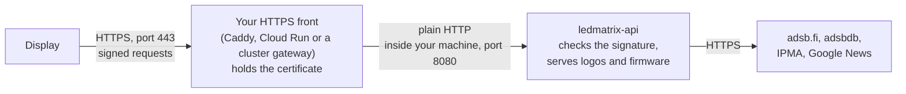
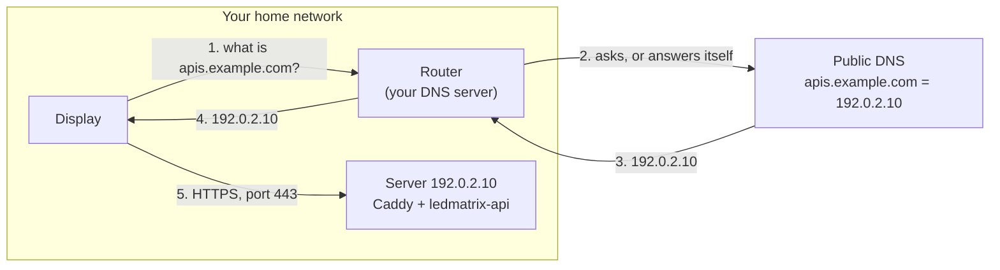
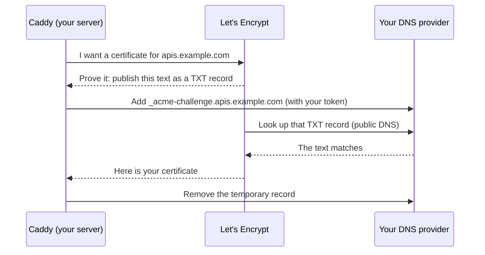

# Run the service

This page shows how to run the LedMatrix data [service](glossary.md#service), `ledmatrix-api`, so that your display can reach it over HTTPS with a certificate from a normal certificate authority. It is written for a beginner on macOS or Linux and does not cover Windows. You do not build the service: you run the public image, `ghcr.io/suvl/ledmatrix-api`, which the maintainer publishes. Besides a running program, the display needs a [domain name](glossary.md#domain-name) and a certificate, the [master secret](glossary.md#master-secret) in the service, and optionally the airline logo folder. This page covers all of them, the first start, and how to check that it works.

Checked on macOS on 25 Nov 2026. What was run, and what was not, is in [What was checked](#what-was-checked) at the end of this page.

Every host name, address and secret here is a placeholder: `apis.example.com` (your service's name), `192.0.2.10` (your server's address on your home network), `203.0.113.7` (a rented server's public address), `aabbccddeeff` (a [device ID](glossary.md#device-id)). Replace them with your own and never publish the real ones.

> **If you are unsure, use path 1, the home server.** Paths 2 and 3 are alternatives for when you have no always-on computer at home. Path 4 is for people who already run a Kubernetes cluster.

## Before you start

- **The master secret.** Make it first: [install.md, "Make the master secret and back it up"](install.md). It is one file, `~/ledmatrix-secrets/master-secret`, with a backup. This page does not repeat that recipe; it shows how to give the secret to the service.
- **A place to run the service:** one of the four in the table below.
- **A domain name** for paths 1 and 2 (the section [A domain name](#a-domain-name) says what it is and what it costs). Path 3 needs no domain, but it needs a Google Cloud billing account with a payment card.
- **A Terminal.** [build.md, "Terminal in 2 minutes"](build.md) shows how to open one, paste a block of commands and press Enter, and what `cd`, `~` and `ls` mean. To edit a file in the Terminal, use `nano` (for example `nano .env`; Ctrl+O then Enter saves, Ctrl+X leaves).
- **Time.** Plan an afternoon for path 1, most of it waiting for a download, for DNS to update and for the certificate. Nobody has timed a first-time run.

| Path | Where it runs | Reachable from the internet? | Rough cost | Pick it when | Status |
| --- | --- | --- | --- | --- | --- |
| **1. Home server** (default) | An always-on computer at home, with Docker | No: only your home network | A domain name, about 10 to 15 USD a year; the computer's power | You have such a computer and want nothing exposed | Tested (the DNS part: Not tested here) |
| **2. Small rented server** | A virtual machine from a hosting company | Yes | A domain name, plus about 4 to 6 USD a month for the smallest machine (check current prices) | You have no always-on computer at home | Not tested here |
| **3. Google Cloud Run** | Google runs the container | Yes | A free allowance covers one display; a billing account with a card is required | You want no server and no domain name | Not tested here |
| **4. Kubernetes** | Your own cluster | Your choice | Your cluster | You already run a cluster | The maintainer's own setup |

When the service runs, the next steps are in [install.md, "Provision the display"](install.md) and [install.md, "Check it all"](install.md). The portal's **Test connections** button only gives a full `OK` once the display has been provisioned.

## What the display needs

The display is a small chip with strict rules. Whichever path you pick has to meet all of these.

| The display needs | What it means for you |
| --- | --- |
| **HTTPS on port 443, and a host name only.** The portal's service address field takes a host name such as `apis.example.com` (it drops `https://` and anything after the name, and refuses a port). | Your service must answer on port 443 under a name. No `:8443`, no plain HTTP. |
| **A [certificate](glossary.md#certificate) from a normal certificate authority.** The display checks it against the [built-in list](glossary.md#ca-bundle) of authorities in its software and never skips the check. | No self-signed certificate, no certificate from your own private authority, none for an address or for `ledmatrix.local`: public authorities do not issue those. You need a real name and a real certificate. |
| **An RSA-2048 key in the certificate.** The chip checks RSA signatures with hardware help and ECDSA ones in software: the project measured about 0.4 s for a first secure connection to an RSA server and about 2.3 s to ECDSA servers. | Ask for an RSA key. The Caddy file in `deploy/compose/` already does. ECDSA works too, only slower. ([Background](#why-an-rsa-key-and-the-certificate-chain) has the detail.) |
| **An IPv4 address for the name.** The service host is IPv4 today. | Give the name an **A record**. Do not add an AAAA record unless the server really answers on IPv6: a dead IPv6 address makes the display wait 5 seconds before it falls back to IPv4. |
| **A server clock that is right.** A signed request is refused when the display's clock and the service's clock differ by more than 2 minutes. | The computer running the service needs automatic time (macOS, Linux and every cloud have it by default). |
| **No redirects, no rewriting.** The display follows no redirect, and its signature covers the host name and the request address (path and query). | Nothing in front of the service may redirect, change the `Host` header, or remove the headers `X-Device`, `X-Timestamp` and `X-Signature`. See [Settings and revoking a display](#settings-and-revoking-a-display). |

What the service does on its side:

- **Data routes need a valid signature.** `/v1/weather`, `/v1/flights`, `/v1/headlines` and `/v1/logo/...` answer `401` to an unsigned request, so a stranger who finds your server cannot use it to fetch data or to make it call the data sources.
- **Three routes are open on purpose:** `/healthz` and the two firmware routes (`/v1/firmware/manifest`, `/v1/firmware/{file}`). A display whose key was refused must still be able to fetch a fix. The firmware images are generic and contain no secret of yours.
- **The service refuses to start without a master secret.** It never runs open by accident.



## A domain name

> Not tested here (the registrar and DNS provider steps). Prices and screens change; follow your provider's own pages.

Skip this section for path 3 (Cloud Run, which has its own address) and path 4 (a cluster that already serves a certificate for a name).

**What it is.** A **domain name** such as `example.com` is a name you rent, a year at a time, from a company called a **registrar**. Renting it gives you the right to create names under it, such as `apis.example.com`, and to decide what each one points to. The pointing is done by **DNS**, the internet's phone book. A **DNS record** is one line in that book; an **A record** says "this name is at this IPv4 address". The company that keeps your lines of the phone book is your **DNS provider**.

**What it costs.** About **10 to 15 USD a year** for a common ending such as `.com`. Some endings cost less in the first year and more when you renew, and some cost much more: look at the **renewal** price before you buy. DNS hosting is free at the provider suggested below. These prices are rough and were not checked against any registrar today.

**Choose the name.** One name is enough, for example `apis.example.com`, in lower case, at most 63 characters of letters, digits, dots and hyphens. Pick one that does not identify you or your street: **every certificate a public authority issues is written to public logs** (Certificate Transparency), so the name of your service will be findable by anyone, for good.

**Where to register it.** The tool that gets your certificate (Caddy, in path 1) proves to the certificate authority that you own the name by adding a temporary record at your DNS provider. For that it needs a small add-on module for your provider; the modules are listed at <https://github.com/caddy-dns> (Cloudflare, Amazon Route 53, Google Cloud DNS, DigitalOcean, Hetzner, Porkbun, Namecheap, Gandi, OVH and many more; the list was read on 25 Nov 2026). **The simplest route is to register the domain at the DNS provider you will use**, so that no name server has to be moved. This page's worked example is **Cloudflare**: a domain registered there uses Cloudflare's DNS from the start, and Cloudflare says it charges the registry's price without a markup. If you already own a domain elsewhere, either use a DNS provider from the list above that your registrar can point to, or add the domain to Cloudflare and change the name servers at your registrar (Cloudflare's "Add a domain" guide; it can take up to a day).

### Cloudflare, click by click

> Not tested here. These steps are based on Cloudflare's documentation as read on 25 Nov 2026 (the "Register a new domain", "Create API token" and "Manage DNS records" pages) and on how the dashboard looked when this was written. Some labels ("Use template", "Add more", "Include", "Specific zone", "DNS only", the grey cloud) are not in those pages and were not seen on screen. Names may differ a little; if something does not match, trust Cloudflare's own page.

1. **Create an account.** Open <https://dash.cloudflare.com/sign-up>, type an e-mail address and a password, and follow the link in the confirmation e-mail. *Good result:* you are in the Cloudflare dashboard. Cloudflare needs a verified e-mail address before it will register a domain.
2. **Register the domain.** In the dashboard open **Domain Registration**, then **Register Domains**. Type the name you want and select **Search**. In the results, select **Purchase** next to a name. Choose the number of years, fill in the contact form, choose how to pay, accept the terms and confirm. *Good result:* the domain is listed in your account, and Cloudflare sends an e-mail asking you to verify your contact address. Do that: the rules of the registry (ICANN) put the domain on hold when the address is not verified.
3. **Create the token that Caddy will use.** Open **My Profile**, then **API Tokens** (the profile menu at the top right), then select **Create Token**. Next to the template **Edit zone DNS**, select **Use template**. Give the token a name such as `ledmatrix-caddy`. The template already lists one permission: **Zone**, **DNS**, **Edit** (some screens say "Write"). Select **Add more** and add a second one: **Zone**, **Zone**, **Read**. Under **Zone Resources** choose **Include**, **Specific zone**, and your domain. Select **Continue to summary**, check that the summary shows those two permissions and only your domain, and select **Create Token**. *Good result:* a screen shows the token once, with a copy button. **Copy it now**: Cloudflare does not show it again. Tokens made today start with `cfut_`; the Caddy module accepts them (read in its source) as well as the older, shorter ones.
4. **Check the token.** In your Terminal, run the first line, paste the token when nothing is shown, and press Enter; then run the other two:

   ```sh
   read -rs CF_TOKEN
   curl -s https://api.cloudflare.com/client/v4/user/tokens/verify -H "Authorization: Bearer $CF_TOKEN"
   unset CF_TOKEN
   ```

   *Good result:* the answer contains `"status":"active"` and the sentence `This API Token is valid and active`. If it says the token is invalid, create it again.

The token goes into your `.env` file ([Path 1, step 4](#path-1-a-home-server)). Treat it like a password: with it someone can change where your domain points. The A record is made in [Path 1, step 5](#path-1-a-home-server).

## The image

The service ships as a [container image](glossary.md#docker-image): `ghcr.io/suvl/ledmatrix-api`, built by the project's workflow (`.github/workflows/service.yml`) from the main branch. It is tagged `latest` and with the full 40-character commit hash. One image holds both the service and the firmware that matches it (see [Update the service and Caddy](#update-the-service-and-caddy)). It is public: anyone can pull it without logging in.

**Which processor do you have?** The public image is built for `linux/amd64` only.

- **Intel or AMD** (most PCs, mini PCs, NAS boxes, and most rented servers): it runs as it is.
- **Apple Silicon Macs and other ARM machines** (Raspberry Pi, some cheap rented servers): the Compose file asks Docker for the amd64 image anyway (`platform: linux/amd64`), so it runs under emulation. Docker Desktop and OrbStack on a Mac set that emulation up themselves. Only the service image is amd64: Caddy is built on your own machine, for your own processor. The service image of the current code ran under emulation on an Apple Silicon Mac and passed the checks below (Tested). On an ARM Linux machine the emulation has to be installed first (Not tested here). Emulation is fine for trying things, but **on a server build your own image** for your own processor, below.
- Without the `platform` line, `docker compose pull` on an ARM machine stops with `no matching manifest for linux/arm64 in the manifest list entries` (Tested).

**Build your own image** (any machine with Docker; Tested, where it produced an `arm64` image):

```sh
git clone https://github.com/suvl/ledmatrix.git
docker build ledmatrix/service -t ledmatrix-api:local
docker version --format '{{.Server.Os}}/{{.Server.Arch}}'
```

The last command prints your platform, for example `linux/arm64`. Put these two lines in your `.env` file:

```
LEDMATRIX_IMAGE=ledmatrix-api:local
LEDMATRIX_PLATFORM=linux/arm64
```

Use the platform the command printed. Without `LEDMATRIX_PLATFORM` the Compose file asks for amd64, finds an image for another processor, tries to pull it, and stops with `pull access denied for ledmatrix-api` (Tested). **Your own image carries no firmware.** The folder `service/firmware/` holds only a note, so the update routes answer `404` and your display never sees an update. To change that you must compile the firmware, write the manifest and the image into that folder, and rebuild; that is the maintainer's job, described in [development.md](development.md).

**The file option for the master secret needs an image built from the commit that added it or later.** If the service says `MASTER_SECRET is not set` with the file variant, your image is older: pull it again.

**To pin a version**, set `LEDMATRIX_IMAGE=ghcr.io/suvl/ledmatrix-api:<commit>` in `.env`. Take the commit from the package page on GitHub, not from `git log`: a commit that changed only documents has no image. A commit tag names one commit, not one build: the workflow can be run by hand and then pushes the same tag again.

## The secret file and its permissions

> Tested, with an image built from the current `service/` folder. The Linux behaviour is Not tested here.

The service keeps one secret, the master secret, and works out each display's [key](glossary.md#device-key) from it and the display's ID. It reads it from **one** of these, and refuses to start if you give it more than one (or none):

- **A file** (`MASTER_SECRET_FILE`, the path of a file that holds only the secret). **This is the recommended way.** The secret is then not in the container's environment, so it does not show up in `docker inspect`, in `docker compose config`, or in anything that dumps the environment. The service reads the file once, at start. The path must be absolute, the file at most 4 KB, and it may be a symbolic link to a regular file (a Kubernetes secret mount is one). The Compose file and the Kubernetes appendix use it.
- **An environment variable** (`MASTER_SECRET`, the secret itself). Simpler, and it still works. Cloud Run uses it below.

Either way it is the same text as in your `~/ledmatrix-secrets/master-secret` file: at least 32 characters, spaces and line ends around it are ignored. Keep it out of the repository, chat and tickets, and keep the offline backup ([install.md, "Make the master secret and back it up"](install.md)). Changing it locks out every display that was provisioned with the old one. [security.md](security.md) says what else it protects.

**The permissions rule.** The service runs as an unprivileged user (number 65532) inside its container, and Docker hands a mounted file over with the owner and permissions it has on the server. So on Linux, a secret file that only you can read is unreadable to the service, which then stops with `MASTER_SECRET_FILE "/run/secrets/master_secret" cannot be read: permission denied`. **The rule is: make the file readable, and keep it inside a folder only you can enter.**

```sh
chmod 644 master_secret
chmod 700 .
```

Run both inside the folder that holds the file. The first line lets the service's user read the file. The second keeps other people who have an account on the same computer out of the folder, and so away from the file. Your own copy of the secret in `~/ledmatrix-secrets/` stays at mode 600; this rule is only for the copy that Docker mounts. On macOS the service also read a mode-600 file (Docker there maps the owner), and mode `000` gave exactly the `permission denied` message above.

**What the service logs about the secret:** nothing. Refusals are logged as a device ID and a reason (`missing`, `malformed`, `bad_signature`, `revoked`, `clock_skew`), at most once per device and reason per minute, and never a key, a signature or the secret. Request addresses are logged without the query, because the query carries the display's coordinates.

## Path 1: a home server

> Tested: the Compose file, the Caddy image build with a DNS module, the Caddyfile and the checks. Not tested here: the DNS challenge against a real provider, any Linux or Raspberry Pi machine, any router.

One computer on your home network runs two [containers](glossary.md#container) with Docker Compose: **Caddy**, a [reverse proxy](glossary.md#reverse-proxy) that holds the certificate and speaks HTTPS, and **ledmatrix-api**, which Caddy forwards to. Nothing is opened to the internet: you do **not** forward any port on your router.

### How the display reaches a private address under a public name

The display asks your router "what is `apis.example.com`?". The answer is an address on your own network, such as `192.0.2.10` (yours will start with `192.168.`, `10.` or `172.16.` to `172.31.`). The display then connects to it over your [home network](glossary.md#lan). DNS is only a phone book: nothing stops a public name from pointing at a private address. The certificate check is about the **name**, not the address: the certificate says "this key belongs to `apis.example.com`", and Let's Encrypt issued it after you proved, through DNS, that you control that name. That is why you need a real domain but not a server that anyone on the internet can reach.



You make that work with **one public A record** that points to your private address (step 5 below). Some routers refuse such an answer; if yours does, see [DNS rebinding protection and split DNS](#dns-rebinding-protection-and-split-dns) in the Background section.

### How the certificate arrives



`deploy/compose/Caddyfile` sets four things:

| Line | What it does |
| --- | --- |
| `key_type rsa2048` | Asks for an RSA-2048 key. Caddy's default is ECDSA P-256. (Tested with Caddy's own test authority: the default gave an ECDSA P-256 certificate and `key_type rsa2048` an RSA-2048 one; a client that offered only ECDSA was refused, one that offered RSA connected.) |
| `acme_ca https://acme-v02.api.letsencrypt.org/directory` | Asks Let's Encrypt only, so the chain is the one described in the Background section. |
| `dns cloudflare {env.CF_API_TOKEN}` | Chooses the DNS challenge, with Cloudflare's module and the token from `.env`. |
| `resolvers 1.1.1.1` | Looks for the challenge record at a public resolver instead of your router. |

`deploy/compose/docker-compose.yml` has two services. `api` is the public image with your logo folder and your secret file mounted read-only; it publishes no port. `caddy` is built here from Caddy's official builder image with your DNS module added (about a minute the first time; Tested: Caddy 2.11.9 with the Cloudflare module 0.2.4) and publishes port 443. Its `caddy_data` volume keeps the certificate and Caddy's account key: keep it, because without it Caddy asks for a new certificate at each start and the authority limits how many it gives. The Caddyfile has no `log` line on purpose: a request's address carries the display's coordinates, and Caddy writes no access log unless asked (Tested: neither Caddy's nor the service's log held a query).

### Steps

**Step 1. Install Docker.**

- **macOS:** install Docker Desktop (<https://docs.docker.com/desktop/setup/install/mac-install/>) or OrbStack, and start it. Any recent Docker will do; this page was checked with OrbStack. Not tested here: the installation itself. A Mac only makes a good server if it never sleeps and stays on your network.
- **Linux (Not tested here):** install Docker Engine from <https://docs.docker.com/engine/install/> and add your user to the `docker` group, or put `sudo` before every `docker` command. The packages enable Docker at start-up.

Check it: `docker --version` and `docker compose version` should both print a version, for example `Docker Compose version v5.5.0`. You need Docker Compose version 2 (the command has a space: `docker compose`). The files were checked with v5.5.0; an old 2.x may not understand the `dockerfile_inline` setting the Compose file uses (added in 2.17, from memory, not re-checked). Which processor you have decides which image you use: see [The image](#the-image).

*If something goes wrong:* `docker: command not found` means the install did not finish or the program is not running. `docker compose` unknown means an old Docker: update it.

**Step 2. Give the server a fixed address.** In your router, reserve `192.0.2.10` for the server's network card (the router calls this a "DHCP reservation" or "static lease"). If the address changed, the name would point at the wrong machine. Write the address down. Not tested here.

**Step 3. Get the three files into a folder of your own.** On the server:

```sh
git clone https://github.com/suvl/ledmatrix.git
cp -r ledmatrix/deploy/compose ~/ledmatrix-service
cd ~/ledmatrix-service
ls -a
```

You should see `Caddyfile`, `docker-compose.yml` and `.env.example`. You work in `~/ledmatrix-service` from now on, **not** inside the repository: the repository does not ignore a `.env` file, and a secret put there could end up in a commit. (No `git` on the server? Copy the folder from the computer that has the repository: `scp -r deploy/compose you@192.0.2.10:ledmatrix-service`.)

**Step 4. Make the `.env` file and the secret file.**

```sh
cp .env.example .env
chmod 600 .env
nano .env
```

`chmod 600` makes the file readable by you only. In the editor, replace every value, then save (Ctrl+O, Enter) and leave (Ctrl+X):

| Variable | What to put |
| --- | --- |
| `SERVICE_HOST` | Your name, such as `apis.example.com`. |
| `CF_API_TOKEN` | The DNS token from [Cloudflare, click by click](#cloudflare-click-by-click). |
| `DNS_MODULE` | Leave it for Cloudflare. For another provider, put the module's name from <https://github.com/caddy-dns> here, change the `dns` line in the `Caddyfile` to the module's own (its page shows the line and the credentials it needs), and pass those credentials to Caddy: add each variable under `environment:` of the `caddy` service in `docker-compose.yml`, next to `CF_API_TOKEN`, and set it in `.env`. |
| `LEDMATRIX_IMAGE`, `LEDMATRIX_PLATFORM` | Leave them out to use the public image. For your own build see [The image](#the-image). |
| `MASTER_SECRET_PATH` | Leave it out unless the secret file (below) is somewhere other than next to `docker-compose.yml`. |

Check that Compose reads the file without complaint: `docker compose config > /dev/null && echo ok`. Compose stops with `required variable SERVICE_HOST is missing a value` if `SERVICE_HOST` is empty (Tested). Never run `docker compose config` without `> /dev/null` in a shared screen or a chat: it prints your DNS token (it does not print the master secret, which is in a file).

Now the **secret file**: a file called `master_secret` in the same folder, holding one line, the text of your master secret. If the server is the computer that holds `~/ledmatrix-secrets/master-secret`, copy it: `cp ~/ledmatrix-secrets/master-secret master_secret`. If it is another computer, copy it across with `scp` from the computer that holds it (`scp ~/ledmatrix-secrets/master-secret you@192.0.2.10:ledmatrix-service/master_secret`), or type it on the server without leaving it in your shell history:

```sh
(umask 077; cat > master_secret)
```

Paste the secret, press Enter, then press Ctrl+D. Check the size without showing the text: `wc -c master_secret` prints a number of at least 33 (the secret, 32 or more characters, plus the line end). Then apply [the permissions rule](#the-secret-file-and-its-permissions) (`chmod 644 master_secret` and `chmod 700 .`). If you would rather use an environment variable than a file, the top of `docker-compose.yml` says which lines to change (Tested: it works; the secret then also goes in `.env` as `MASTER_SECRET=...` and shows up in `docker inspect`).

**Step 5. Make the A record.** At your DNS provider, add a record of type **A**, name `apis` (or the full name, as the form asks), value `192.0.2.10` (your server's fixed address), and, if the provider has a "proxy" switch, **turn it off**: a proxied record would point at the provider's servers, not at your server. Do not add an AAAA record.

On Cloudflare: select your domain, open **DNS**, then **Records**, then **Add record**. Set **Type** to `A`, **Name** to `apis`, **IPv4 address** to `192.0.2.10`, and **Proxy status** to **DNS only** (the grey cloud; Cloudflare turns the proxy on by default), then **Save**. *Good result:* the record appears in the list with the proxy status "DNS only". Then, from any computer on your network:

```sh
dig +short apis.example.com
```

You should see `192.0.2.10`. (If `dig` is missing, `nslookup apis.example.com` does the same.) A new record is usually visible within a minute or two. Not tested here.

*If something goes wrong:* no answer yet: wait a few minutes and try again. No answer on your network, but an answer from a public resolver (`dig +short apis.example.com @1.1.1.1`): your router is hiding it; see [DNS rebinding protection and split DNS](#dns-rebinding-protection-and-split-dns).

**Step 6. Add the logos (optional).** Skip it if you have none; the display then draws a small badge with the airline code. If you have them ([The logo set](#the-logo-set)):

```sh
mkdir -p logos
cp /path/to/your/logos/*.bin logos/
chmod 755 logos
chmod 644 logos/*.bin
```

The service runs as an unprivileged user inside its container, so the logo files must be readable by everyone. On Linux a file that is not world-readable makes its logo silently answer 404. That could not be reproduced on macOS, where Docker maps the owner, so these `chmod` lines are advice (Not tested here).

**Step 7. Start it.**

```sh
docker compose up -d --build
```

`up -d` starts the containers in the background; `--build` builds the Caddy image the first time (a minute or two, then it is kept). Then:

```sh
docker compose ps
docker compose logs -f caddy
```

`ps` should show `api` as `Up` and `caddy` as `Up (healthy)` after about a minute (Tested, with Caddy's test certificate in place of the real one). In the Caddy log, look for a line containing `certificate obtained successfully`; it takes one to a few minutes, mostly waiting for the new record to spread (Not tested here: this is how Caddy behaves, but it was not run against a real authority). Press Ctrl+C to stop watching; that does not stop the service.

*If something goes wrong:* see [If something goes wrong](#if-something-goes-wrong).

**Step 8. Check that it works, from another computer.** Use a computer on the same home network, not the server itself:

```sh
curl -i https://apis.example.com/healthz
curl -i https://apis.example.com/v1/logo/ZZ
curl -i https://apis.example.com/v1/firmware/manifest
```

(`curl` fetches a web address and prints the answer; `-i` also shows the answer's first lines.)

| Command | A good answer |
| --- | --- |
| The first, `/healthz` | `HTTP/2 200` and the body `ok`. |
| The second, an unsigned request to a data route | `HTTP/2 401` and `{"error":"The request is not signed.","reason":"missing"}`. **This refusal is what you want**: it shows the signature check is on. `/v1/logo/ZZ` is used because it needs no location and no outside call. |
| The third, the firmware manifest | `HTTP/2 200` and a short line of JSON such as `{"version":"0.10.1","file":"ledmatrix-0.10.1.bin","size":1479472,"sha256":"<64 hex characters>","notes":"..."}` with the numbers of the newest firmware. `404` and `{"error":"no firmware is published"}` is also a working service: it means the image has no firmware inside (your own build, see [The image](#the-image)). |

These three checks, with these answers, were tested through Caddy on `127.0.0.1`: the manifest from the public image (200) and from a locally built image (404, no firmware inside); the unsigned request used `/v1/logo/XX`, a name with no real logo behind it, and was refused the same way. That run used Caddy's own test authority, so `curl` needed `--cacert` there. With a real certificate `curl` needs no extra option: if it prints `SSL certificate problem`, the certificate is not the one you expect.

Now look at the certificate itself:

```sh
echo | openssl s_client -connect apis.example.com:443 -servername apis.example.com 2>/dev/null \
  | openssl x509 -noout -issuer -enddate -text | grep -E "issuer=|notAfter=|Public Key Algorithm|Public-Key"
```

You want an issuer that names Let's Encrypt (`YR1`, `YR2` or `YR3` at the time of writing), `rsaEncryption` and `(2048 bit)`. The command was tested against the test certificate, with both the system's and Homebrew's `openssl`; it printed `rsaEncryption` and `(2048 bit)`.

**Step 9. Point the display at it.** In the display's portal, put `apis.example.com` in **Data service, Service address** and save ([install.md, "Run the service"](install.md), sub-step "Tell the display where the service is", shows where). Then provision the display ([install.md, "Provision the display"](install.md)) and run the checks ([install.md, "Check it all"](install.md)): **Test connections** then shows `OK` on the service line, with the time the first secure connection took. The project's own measurement of another RSA server suggests under a second; this setup was not measured, so read your own number.

### Rehearse without spending certificate attempts (optional)

Let's Encrypt limits failed attempts. If you are unsure about your token or DNS, first point Caddy at Let's Encrypt's **staging** authority, which has generous limits and gives certificates that nothing trusts: in the Caddyfile change the `acme_ca` line to `https://acme-staging-v02.api.letsencrypt.org/directory`, run `docker compose up -d`, and wait for `certificate obtained successfully` in the log. When it works, put the real address back and run `docker compose restart caddy`. The staging and real certificates are kept apart, so nothing needs deleting. Not tested here.

## Path 2: a small rented server

> Not tested here. The files are the ones checked in path 1. The server steps come from general practice and the vendors' guides.

Use this when you have no always-on computer at home. It is the same Compose folder on a machine that sits on the internet.

**What is different from the home path**

- **Anyone can reach it.** Scanners will find the server within hours. That is acceptable because every data route needs a valid signature and the service refuses to start without a master secret. A scanner can read `/healthz` and download the public firmware, nothing else. There is no built-in rate limit beyond the service's own caps (32 data requests at once, 8 firmware downloads at once, then `503`), so check your provider's traffic allowance.
- **The name points to a public address**, so the A record holds the server's public IPv4 address (`203.0.113.7` is a placeholder), and you can use the simpler certificate method below.
- **You look after the machine**: updates and a firewall.

**Steps**

1. **Rent the smallest virtual machine** (1 CPU and 1 GB of memory is plenty; the Kubernetes file limits the service to 96 MiB) from any hosting company, with **Ubuntu LTS** or Debian, a **public IPv4 address**, and, if offered, **login by SSH key** instead of a password. Choose a machine with an **x86 (amd64) processor**: the public image is built for amd64 only ([The image](#the-image)). Some of the cheapest machines are ARM; on one of those, build your own image.
2. **Log in** with the command the company shows (`ssh root@203.0.113.7`, or a normal user), then **update**: `sudo apt update && sudo apt full-upgrade -y`, and reboot if it asks. Turn on **automatic security updates** (`sudo apt install -y unattended-upgrades`; Ubuntu usually has it already). Create a normal user for yourself if you were given only `root`, and switch off password login for SSH.
3. **Set a firewall.** In the company's firewall panel (best, since it blocks before traffic reaches the machine) allow only **TCP 22** (SSH; from your own address if you can), **TCP 80** and **TCP 443**. If you use `ufw` on the machine, know that Docker publishes ports around `ufw`'s rules, so `ufw` will not stop a port the Compose file publishes. That is why the file publishes only 443 (and 80 if you ask for it) and never the service's own port.
4. **Install Docker** from <https://docs.docker.com/engine/install/ubuntu/> (or the page for your system), and `git`: `sudo apt install -y git`. Without `git`, copy the folder from your own computer instead: `scp -r deploy/compose you@203.0.113.7:ledmatrix-service`.
5. **Make the A record**: name `apis`, value `203.0.113.7` (your server's public address), proxy off (the same Cloudflare screen as in path 1, step 5). Check it with `dig +short apis.example.com`.
6. **Get the files and fill `.env`** as in path 1, steps 3 and 4 (a text editor in the Terminal is `nano`). The secret file is made over SSH: step 4 shows the `cat > master_secret` way, which leaves nothing in your shell history.
7. **Choose how Caddy proves the name.** Two ways:
   - **Simplest: the HTTP challenge, no DNS token.** In the `Caddyfile`, **delete the whole `tls { ... }` block** (the `dns` and `resolvers` lines), and in `docker-compose.yml` **remove the `#` in front of `- "80:80"`**. Caddy then proves the name by answering on ports 80 and 443, which are open to the internet. Leave `CF_API_TOKEN` empty. The Caddyfile without the `tls` block loads and still asks for an RSA key (Tested with `caddy validate`; no real authority involved).
   - **Keep the DNS challenge** (as in path 1). It also works on a public server, needs only port 443 open, and keeps port 80 closed.
8. **Start it and check it** as in path 1, steps 7 to 9. From your own computer, `curl -i https://apis.example.com/healthz` should answer `200`, with no `-k` and no complaints about the certificate.
9. **Keep it up to date** ([Keep it running](#keep-it-running)) and look at the machine now and then.

*If something goes wrong:* with the HTTP challenge the Caddy log says why it failed, usually the A record not pointing at this machine yet, or port 80 or 443 blocked by a firewall.

## Path 3: Google Cloud Run

> Facts re-checked on 25 Nov 2026 (Google's Cloud Run, Artifact Registry and Secret Manager pages, and `openssl` against Google's front end with a made-up name). Not tested here: no account was used and nothing was deployed, so every `gcloud` command below is written from the documentation and is untested.

Cloud Run runs the container for you and gives it an HTTPS address of its own, so you need **no server, no Docker Compose, no Caddy and no domain name**. It is a good fit for one display. It has three catches that the other paths do not: it needs a billing account with a payment card, the certificate is Google's (not yours to choose), and Google writes request logs.

### The facts

| Question | Answer (25 Nov 2026) |
| --- | --- |
| **Does it run this container?** | Yes. Cloud Run runs Linux x86-64 images, which is what the public image is. It sends requests to port **8080** by default and the service listens on `:8080` unless told otherwise. If you ever change the port in Cloud Run, set `LISTEN` to match. |
| **Is it free?** | Cloud Run has a monthly free allowance, applied across your billing account: with the default (request-based) billing, **2 million requests, 180,000 vCPU-seconds and 360,000 GiB-seconds of memory**. One display asks the service about **100,000 times a month** (flights every 30 seconds is about 86,000; weather every 15 minutes and headlines every 30 minutes add a few thousand more per topic). Responses are small, and Google gives 1 GiB a month of outbound data free within North America (beyond that, a small charge). Google's own pricing page is the authority; read it before you rely on this. |
| **Is a billing account required?** | **Yes.** Google's quickstart tells you to check that billing is enabled for the project, which means a payment card on file. The free allowance is then applied to your bill. A **budget alert** only sends you an e-mail: it does not stop spending. The setting that really limits cost is the maximum number of instances (below). |
| **Other services this uses** | **Artifact Registry** holds your private image (free for the first 0.5 GiB of storage a month). **Secret Manager** holds the master secret (free for 6 secret versions and 10,000 accesses a month). |
| **Public address** | Automatic. Cloud Run prints it when you deploy; it looks like `ledmatrix-api-123456789012.europe-west1.run.app` or `ledmatrix-api-abcdefghij-ew.a.run.app`, depending on Cloud Run's current naming. It must be at most 63 characters to fit the display's field; it normally is. It has an IPv4 address (names under `a.run.app` resolved to IPv4 addresses when checked). |
| **Cold start** | When no instance is running, the first request waits while one starts. For a small Go program that is about a second, not measured on Cloud Run. With the display asking every 30 seconds, an instance usually stays up. A **minimum instances** setting of 1 avoids cold starts and costs money all month; leave it at 0. |
| **Secrets** | Secret Manager, exposed to the container as the environment variable `MASTER_SECRET` (this page's choice, the simplest). Cloud Run can also mount a secret as a file; you would then set `MASTER_SECRET_FILE` to that path and not `MASTER_SECRET`. That variant is not written out here. |
| **Who may call it** | It must allow **unauthenticated** callers (`--allow-unauthenticated`): the display cannot send Google credentials. The data routes are protected by the display's signature, as on every path; `/healthz` and the firmware routes are open by design. |

### The certificate Google serves

You cannot choose it. Google's front end was asked for `*.a.run.app` with `openssl` and a made-up service name (no deployed service involved):

- To a client that offers both RSA and ECDSA (like the display's chip: its TLS library supports both), Google answered with an **ECDSA** chain: `*.a.run.app` (P-256) ← WE2 ← GTS Root R4 (cross-signed by GlobalSign Root CA).
- To a client that offers RSA only, it answered with an **RSA 2048** chain: `*.a.run.app` ← WR2 ← GTS Root R1 (cross-signed by GlobalSign Root CA).

So **the display probably gets the ECDSA chain**, and its first secure connection will cost about what the project measured for other ECDSA hosts, around 2.3 seconds, not 0.4. That is slow but not a failure: the display does its network work away from the part that draws, so the picture does not stall; data arrives a little later after a restart. Both chains end at roots that are in the display's list: "GlobalSign Root CA", "GTS Root R4" and "GTS Root R1" are all present by name in a firmware image compiled with the current core (Tested). Not verified: the display connecting to a deployed service, and the real handshake time. The portal's **Test connections** shows the real time once you have deployed it. If it does not work or is too slow for you, use path 1 or 2, where you control the certificate.

### Request logs

Cloud Run writes a log entry for every request to Cloud Logging, and you cannot switch that off; you can only exclude it in Cloud Logging. The entry's request field is documented to hold the full URL including the query string, and the display's address carries your coordinates. No real Cloud Run log entry was looked at. Before you put a real location on this path, check your own entries (Logs Explorer) and, if they hold the coordinates, add a log exclusion for the service's requests. This is a cost of a hosted path that the others do not have, and [security.md](security.md) discusses logs.

### Steps

You need the `gcloud` tool (<https://cloud.google.com/sdk/docs/install>), Docker, and the folder `logos/` with your `.bin` files (optional, [The logo set](#the-logo-set)). Replace `your-project-id` with your project's ID and keep the region you choose the same in every command (`europe-west1` is a placeholder; pick one near you).

1. **Create a project and turn on billing** in the Google Cloud console (<https://console.cloud.google.com>). Note the project ID.
2. **Sign in and choose the project:**

   ```sh
   gcloud auth login
   gcloud config set project your-project-id
   gcloud services enable run.googleapis.com artifactregistry.googleapis.com secretmanager.googleapis.com
   ```

3. **Make a private registry for your image** and let Docker use it:

   ```sh
   gcloud artifacts repositories create ledmatrix --repository-format=docker --location=europe-west1
   gcloud auth configure-docker europe-west1-docker.pkg.dev
   ```

4. **Build and push the private image** ([The logo set](#the-logo-set) has the `Dockerfile`). Without logos you can skip this step: Cloud Run can run public images from GitHub's registry, so use `ghcr.io/suvl/ledmatrix-api:latest` as the image in step 6.

   ```sh
   docker build --pull --platform linux/amd64 \
     -t europe-west1-docker.pkg.dev/your-project-id/ledmatrix/ledmatrix-api:1 .
   docker push europe-west1-docker.pkg.dev/your-project-id/ledmatrix/ledmatrix-api:1
   ```

5. **Store the master secret** and let Cloud Run read it. The service account that Cloud Run uses by default is `PROJECT_NUMBER-compute@developer.gserviceaccount.com` (the project number is on the console's home page):

   ```sh
   gcloud secrets create ledmatrix-master-secret --data-file="$HOME/ledmatrix-secrets/master-secret"
   gcloud secrets add-iam-policy-binding ledmatrix-master-secret \
     --member="serviceAccount:PROJECT_NUMBER-compute@developer.gserviceaccount.com" \
     --role="roles/secretmanager.secretAccessor"
   ```

6. **Deploy:**

   ```sh
   gcloud run deploy ledmatrix-api \
     --image europe-west1-docker.pkg.dev/your-project-id/ledmatrix/ledmatrix-api:1 \
     --region europe-west1 \
     --allow-unauthenticated \
     --port 8080 \
     --max-instances 2 \
     --update-secrets MASTER_SECRET=ledmatrix-master-secret:latest
   ```

   `--max-instances 2` is your cost limit. At the end it prints a **Service URL**.

7. **Check it** as in path 1, step 8, with the host from the Service URL (without `https://`).
8. **Set the display's service address** to that host (the part after `https://`; [install.md, "Run the service"](install.md), sub-step "Tell the display where the service is"). It must be at most 63 characters.

**Optional settings** go on the same `deploy` command (or on `gcloud run services update ledmatrix-api`): `--update-env-vars REVOKED_DEVICES=aabbccddeeff` for one ID, and `--update-env-vars PUBLIC_HOST=...` (rarely needed: Cloud Run passes the `Host` header on). For several IDs `gcloud` needs another separator, because it splits on commas itself: `--update-env-vars "^@^REVOKED_DEVICES=aabbccddeeff,001122334455"`.

**Updating the firmware** means building the private image again with `--pull` (it starts from the newest public image), pushing it with a new tag (`:2`), and running the `deploy` command again with that tag. Old tags cost storage: delete old ones now and then (the free 0.5 GiB holds many, but not forever).

*If something goes wrong:* the first `deploy` may ask to turn on more services: answer yes. A `Permission denied` on `--allow-unauthenticated` can mean your organisation's policy forbids public services; this path then needs another account. A service that does not start shows its log in the console under the service's **Logs**: look for a `MASTER_SECRET` line like the ones in [If something goes wrong](#if-something-goes-wrong).

## Path 4: Kubernetes (appendix)

> The maintainer's own setup, checked by the author while building the project. The manifest was only rendered with `envsubst` on a Mac (Tested: the three placeholders were replaced); it was not applied, because no cluster was touched. Everything else here is read from `service/deploy/ledmatrix-api.yaml`.

For people who already run a cluster (the maintainer's is k3s). You need `kubectl`, a working cluster, and a way in with HTTPS: `service/deploy/ledmatrix-api.yaml` has a Deployment, a Service and a Kubernetes Gateway API `HTTPRoute` that attaches to a gateway named `gateway` in the `default` namespace, which already serves a certificate for your name. If your cluster uses something else (an Ingress, another gateway), keep the Deployment and the Service and replace the last part. The same display rules apply: the certificate should be **RSA 2048** (with cert-manager, set `privateKey: {algorithm: RSA, size: 2048}` on the Certificate), the name needs an **A record** to the gateway's IPv4 address, and the gateway must not rewrite `Host` or drop the three signature headers.

**Steps** (placeholder names; use your own):

1. **Create the master secret** in the cluster **before** you deploy. The pod does not start without it:

   ```sh
   kubectl create secret generic ledmatrix-api --from-file=master-secret=$HOME/ledmatrix-secrets/master-secret
   ```

2. **Optional logos**: a ConfigMap of the `.bin` files only (about 100 KB for 190 logos; the folder also holds a contact sheet, `_sheet.png`, about 120 KB, which you do not want in it). The volume is marked optional, so the service starts without it:

   ```sh
   kubectl create configmap ledmatrix-logos $(for f in logos/*.bin; do printf -- '--from-file=%s ' "$f"; done) \
     --dry-run=client -o yaml | kubectl apply -f -
   ```

3. **Deploy**, pinned to one commit. Take the commit tag from the package page ([The image](#the-image)):

   ```sh
   API_HOST=apis.example.com \
   IMAGE=ghcr.io/suvl/ledmatrix-api:0123456789abcdef0123456789abcdef01234567 \
   PULL_POLICY=IfNotPresent \
     envsubst '${API_HOST} ${IMAGE} ${PULL_POLICY}' < service/deploy/ledmatrix-api.yaml | kubectl apply -f -
   ```

4. **Recommended: give the service the secret as a file, not as an environment variable.** The manifest as it stands passes the secret as the environment variable `MASTER_SECRET`, which works. A mounted file keeps it out of the container's environment, where `kubectl exec ... env` and any tool that dumps the environment would show it. Make four changes to `service/deploy/ledmatrix-api.yaml` (a copy of it is best), then apply it as in step 3:

   - in the pod's `securityContext`, add `fsGroup: 65532` (so the mounted file belongs to the group of the service's user);
   - under the pod's `volumes:`, add
     ```yaml
        - name: master-secret
          secret: {secretName: ledmatrix-api, defaultMode: 0440}
     ```
   - in the container's `env:`, **replace** the whole `MASTER_SECRET` entry (the three lines with `secretKeyRef`) with
     ```yaml
            - {name: MASTER_SECRET_FILE, value: /run/secrets/master-secret}
     ```
   - under the container's `volumeMounts:`, add
     ```yaml
            - {name: master-secret, mountPath: /run/secrets, readOnly: true}
     ```

   The file is called `master-secret` because that is the key you used in step 1 (`--from-file=master-secret=...`). Use one way only: the service refuses to start if both `MASTER_SECRET` and `MASTER_SECRET_FILE` are set. The comment at the top of the manifest says the same. Not tested here: no cluster was touched. The service's side of it (reading the secret from a file, a symbolic-link chain like a Kubernetes mount, and refusing to start with both set) was tested.
5. **Optional settings** are plain `env` entries in the manifest: uncomment `REVOKED_DEVICES` (comma-separated device IDs) and `PUBLIC_HOST` (the name the display uses, only if a proxy rewrites `Host`), then apply again. `AUTH_OFF` has no place here.
6. **Check it** as in path 1, step 8.

**Why a commit tag and not `latest`.** A pod that has already pulled `latest` does not pull again when it restarts (with the default `IfNotPresent` policy), so the tag tells you nothing about what runs; with the `Always` policy a restart or a node change silently pulls whatever is newest, new firmware included. A commit tag names one commit, so you move on purpose and can move back. (It is one commit, not one build: the workflow can be run by hand and then pushes the same tag again.)

**To deploy a new image** (a restart does not do it):

```sh
kubectl set image deployment/ledmatrix-api ledmatrix-api=ghcr.io/suvl/ledmatrix-api:<new commit>
kubectl rollout status deployment/ledmatrix-api
```

Then **check that an unsigned request is still refused** (`curl -i https://apis.example.com/v1/logo/ZZ` must answer `401` and `missing`) and that `/v1/firmware/manifest` shows the new version. To go back: `kubectl rollout undo deployment/ledmatrix-api`, or set the previous tag. If the image is private (for example, with logos in it), see the note at the end of `service/README.md` (`IMAGE=ledmatrix-api:local PULL_POLICY=Never` after loading the image on the node).

## The logo set

> Tested for the folder, the file rules and the private image, with synthetic files. Not tested here: running `tools/make_logos.py` (it downloads about 190 pictures from the internet).

The display draws a 16 by 16 picture of the airline for each plane. The service serves them from a folder.

- **Airline logos are trademarks.** They are **not in the repository and not in the public image**, and must never be put in either, or in a public registry. The folder `logos/` is git-ignored. The service works without it: every logo answers `404` and the display draws a badge with the airline code.
- **What a file is.** `<IATA>.bin`, for example `TP.bin`: the airline's two-character IATA code in capitals, then `.bin`, exactly **512 bytes** (16 by 16 pixels, 2 bytes each, RGB565, high byte first). A file of any other size, or a name that is not two capital letters or digits, is ignored and the answer is `404`.
- **How to make them.** `tools/make_logos.py` (Python 3 and the Pillow library, `python3 -m pip install pillow`) does this for about 190 airlines most likely to pass over Europe and the big world carriers: for each code it fetches a small picture from a public logo-image web service, brightens and crops it for an LED panel, shrinks it to 16 by 16, and writes `logos/<IATA>.bin`. It also writes a contact sheet `logos/_sheet.png` to look at and keeps the downloaded pictures in `logos/_src/`. Run it from the repository root: `python3 tools/make_logos.py` (`--from-cache` converts again without the network). You are responsible for having the right to use the pictures in your own display at home. The folder is **your** private data: back it up yourself.
- **The service reads a file each time it is asked**, so you can add or replace files without restarting it. The display keeps a logo for 12 hours and asks again for a missing one after 10 minutes.
- **`LOGO_DIR`** is the setting that says where the folder is (`/logos` in all the setups here). Without it, no logos.

How the folder reaches the service, per path:

| Path | How |
| --- | --- |
| 1 and 2 (Compose) | The folder `logos/` next to `docker-compose.yml`, mounted read-only at `/logos` (path 1, step 6). Only the `.bin` files are needed. |
| 3 (Cloud Run) | In a private image built on the public one (below). |
| 4 (Kubernetes) | A ConfigMap of the `.bin` files, mounted at `/logos` (path 4, step 2). |

**A private image with the logos in it** (used by Cloud Run, and by anyone who prefers one self-contained image). Make a folder holding `logos/` and this `Dockerfile`:

```dockerfile
# Private image: the public service image plus your own logo folder. Never push this to a public registry.
FROM ghcr.io/suvl/ledmatrix-api:latest
COPY --chmod=u=rwX,go=rX logos/*.bin /logos/
ENV LOGO_DIR=/logos
```

```sh
docker build --pull --platform linux/amd64 -t ledmatrix-api-private:1 .
```

`--platform linux/amd64` matters on an Apple Silicon Mac, because Cloud Run runs amd64. The unusual `--chmod=u=rwX,go=rX` is not decoration: `--chmod=0644` also gives the new `/logos` folder mode 644, with no "enter" permission, and the service then answers `404` for every logo (Tested: that happened, and signed requests returned `200` and 512 bytes after the fix). Push the result only to **your own private** registry ([Path 3](#path-3-google-cloud-run) shows Google's; a private GitHub package also works).

## Settings and revoking a display

> Tested for `MASTER_SECRET_FILE`, `MASTER_SECRET`, `AUTH_OFF`, `REVOKED_DEVICES` and `PUBLIC_HOST`, including how the service refuses a bad value, with an image built from the current `service/` folder. The other rows are from `service/auth.go`, `service/main.go` and `service/README.md`.

**The service's settings** are environment variables. In the Compose setup you set them in `.env` and the Compose file passes them on.

| Variable | Meaning | Default |
| --- | --- | --- |
| `MASTER_SECRET_FILE` | **One of the next two is required.** The absolute path of a file that holds only the master secret (at least 32 characters; surrounding spaces and line ends are removed; at most 4 KB; read once at start). **Recommended.** Compose and Kubernetes mount the secret there. | None. |
| `MASTER_SECRET` | The master secret itself, as text. At least 32 characters; surrounding spaces and line ends are removed. Set **either** this **or** `MASTER_SECRET_FILE`, never both. | None: with neither (and no `AUTH_OFF=1`) the service will not start. |
| `LISTEN` | Address and port the service listens on inside its container. | `:8080` |
| `REVOKED_DEVICES` | Optional. Comma-separated device IDs (12 lowercase hexadecimal characters, the display's factory MAC) the service refuses with `revoked`, even with a valid signature. A malformed ID stops the service from starting, and the log names its position, not its value. | None. |
| `PUBLIC_HOST` | Optional. The name the display uses, for the case where something in front of the service rewrites the `Host` header: the service then signs with this instead of the `Host` it receives. A plain host name: the service lower-cases it and removes a port itself, and refuses a value that contains `/`, `\`, `@` or a space (so no `https://`). | The request's `Host` (lower-cased, without the port). |
| `LOGO_DIR` | Folder of `<IATA>.bin` logo files ([The logo set](#the-logo-set)). | None: no logos. |
| `FIRMWARE_DIR` | Folder with `manifest.json` and the firmware image. The image already has it at `/firmware`; nothing to mount or create. | `/firmware` |
| `AUTH_OFF` | `1` turns the signature check off, **for your own computer only** ([development.md](development.md)). The service refuses to start if `MASTER_SECRET` or `MASTER_SECRET_FILE` is also set. | Unset. Never use it in a deployment. |

The Compose-only variables in `.env` are `SERVICE_HOST` (Caddy's site name), `CF_API_TOKEN` (and whatever your provider's module needs), `DNS_MODULE`, `LEDMATRIX_IMAGE`, `LEDMATRIX_PLATFORM` and, optionally, `MASTER_SECRET_PATH` (where the secret file is). The master secret itself is in its own file, not in `.env`.

**Revoke a display, or let it back in.** Put its device ID (shown in the portal under *Data service* and on `http://ledmatrix.local/status`) in `REVOKED_DEVICES` in `.env`, then run `docker compose up -d`: Compose recreates the service with the new value. Take the ID out the same way to let the display back in; nothing is ever banned for good. A revoked display keeps its last data and can still fetch firmware. (Tested: with an ID in `REVOKED_DEVICES`, a correctly signed request from that ID got `401` and `"reason":"revoked"`; after removing the ID it was accepted again; a bad value such as `AA:BB` stopped the service with `REVOKED_DEVICES entry 1 is not a device ID`.) In Kubernetes, edit the `REVOKED_DEVICES` entry in the manifest and apply it; on Cloud Run use `--update-env-vars` ([Path 3](#path-3-google-cloud-run)).

**If something sits between the display and the service** (a second proxy, a tunnel, a firewall product, a content delivery network): it must pass the three headers `X-Device`, `X-Timestamp` and `X-Signature`, the request address (path and query) and the `Host` header **unchanged**, follow or add **no redirect**, and not cache the answers of `/v1/`. If it cannot keep the `Host` header, set `PUBLIC_HOST` to the name the display uses. A request signed for `apis.example.com` was refused as `bad_signature` while `PUBLIC_HOST` named another host (Tested), which is also what you would see if a proxy changed the `Host` header without `PUBLIC_HOST` being set. A proxy that drops the headers makes the display say "The service did not receive a signature on the request" ([install.md, "Provision the display"](install.md) lists the sentences); the service then logs `reason=missing`. Caddy in this page's setup passes everything through unchanged (Tested: signed requests went through Caddy and were accepted).

## Keep it running

### Update the service and Caddy

There is nothing to upload and no storage to set up. A new firmware travels **inside a new service image**: when the maintainer publishes a release, the build workflow compiles the firmware, writes `manifest.json` and `ledmatrix-<version>.bin` into the image's `/firmware`, and publishes the image. **On the public image you get new firmware when the maintainer publishes a release**; do not press **Update** in the portal when nothing was announced. On your own build you are the maintainer: see [development.md](development.md).

To pick up a new image you **run the new image**, and Caddy is updated separately (it is built on your machine from Caddy's official image):

| Path | Update the service image | Update Caddy |
| --- | --- | --- |
| 1 and 2 | `docker compose pull api` then `docker compose up -d`. If you pinned a commit tag, change it in `.env` first. | `docker compose build --pull caddy` then `docker compose up -d`. |
| 3 | Rebuild the private image `FROM` the new public one (`docker build --pull ...`), push it, and `gcloud run deploy` it again ([Path 3](#path-3-google-cloud-run)). | Not needed. |
| 4 | `kubectl set image ...` with the new commit tag ([Path 4](#path-4-kubernetes-appendix)). | Not needed. |

Write `pull api`, not just `pull`: `docker compose pull` alone stops with `pull access denied for ledmatrix-caddy` and exit code 1, because the Caddy image is built here and has nothing to pull, and then `up -d` never runs (Tested; `pull api` and `build --pull caddy` both worked, the build taking about a minute). Update Caddy now and then (about monthly, and whenever [security.md](security.md) says so): `build --pull` fetches the newest Caddy and the newest version of your DNS module.

A self-built image needs a new build with the new firmware ([The image](#the-image)). After any update, run the checks of path 1, step 8; the manifest's `version` should be the new one. The display checks the manifest once a day and when you press "Check now" in the portal. An update still needs the code shown on the panel; the display checks the download and rolls back a new image that does not come up. All of that is in [operations.md](operations.md), and the trust limits (an update comes from the saved service address) are in [security.md](security.md).

### Check that it is healthy

| Check | Command or place | Good result |
| --- | --- | --- |
| The service is up | `curl -i https://apis.example.com/healthz` | `200`, body `ok`. This route is open and does not check the data sources. |
| The signature check is on | `curl -i https://apis.example.com/v1/logo/ZZ` | `401`, `"reason":"missing"`. |
| The containers | `docker compose ps` | `api` `Up`, `caddy` `Up (healthy)`. Caddy's health check asks the service's `/healthz` over the Compose network every 30 seconds. |
| The certificate | the `openssl` command in path 1, step 8 | A Let's Encrypt issuer, an RSA 2048 key, an end date weeks away. |
| The whole chain, including the signature | the portal's **Test connections** | `OK` on the service line. |
| Recent trouble | `docker compose logs --tail 100 api` and `... caddy` | The service logs one line per request (method, path without the query, status, time) and refusals as `auth refused: device=... reason=...`. |

Check the certificate's end date every month or two, and after any change to DNS. If renewal fails, Caddy keeps trying and logs why; the display only notices when the old certificate runs out. [operations.md](operations.md) has the routine.

### Back up and stop

- **Back up** the master secret (offline; the `master_secret` file is only a copy of it), your `.env`, and your `logos/` folder. The `caddy_data` volume is nice to keep but can be recreated: a new certificate is issued (within the authority's limits).
- **Keep the machine updated.** Home: the operating system's own updates. Rented server: as in [path 2](#path-2-a-small-rented-server), step 2.
- **Stop** with `docker compose down` (keeps the certificate and the logos); `docker compose down -v` also deletes the certificate volume.
- **If the server's clock is wrong**, displays are refused with `clock_skew` and the problem list says so. Make sure the machine's automatic time is on.

## If something goes wrong

> Paths 1 and 2. Not tested here unless it says otherwise; the sentences quoted from the display are the real ones from its source (`arduino/ledmatrix/problems.h`), and those from the service are its real log lines.

If this table does not help, ask in an issue: <https://github.com/suvl/ledmatrix/issues>.

| What you see | Likely cause | What to do |
| --- | --- | --- |
| `docker compose` says `required variable SERVICE_HOST is missing a value` | `.env` is missing, empty, or not in the folder you run Compose from. (Tested.) | `ls -a` shows `.env`? Fill it in (step 4). |
| `docker compose up` prints `secret file ... does not exist` and then `bind source path does not exist` | There is no `master_secret` file where Compose looks (next to `docker-compose.yml`, or at `MASTER_SECRET_PATH`). (Tested.) | Make the secret file (step 4). |
| `docker compose up` stops with `pull access denied for ledmatrix-api` after you built your own image | The Compose file asks for the amd64 image and yours is for another processor. (Tested.) | Set `LEDMATRIX_PLATFORM` in `.env` ([The image](#the-image)). |
| `docker compose pull` stops with `pull access denied for ledmatrix-caddy` | Caddy is built here, not pulled. (Tested.) | `docker compose pull api` ([Update the service and Caddy](#update-the-service-and-caddy)). |
| `docker compose ps` shows `api` as `Restarting` | The service refuses to start. `docker compose logs api` says why. (Tested.) | See the next rows. |
| The service log says `MASTER_SECRET is not set, so the service will not start; create one with ...` | The image is older than the file option, so it ignores `MASTER_SECRET_FILE`. (Tested with the public `latest` image of 25 Nov 2026 and the file variant.) | `docker compose pull api`, then `docker compose up -d`; or use the environment variable (top of `docker-compose.yml`). |
| The service log says `MASTER_SECRET is not set and neither is MASTER_SECRET_FILE, so the service will not start; ...` | The image is new enough, but neither setting reached it: the Compose file lost its `MASTER_SECRET_FILE` line, or the variable is empty. (Tested.) | Check the `environment:` of `api` in `docker-compose.yml`. |
| The service log says `the file named by MASTER_SECRET_FILE holds a secret shorter than 32 characters` | The secret file is empty, holds a placeholder, or the wrong text. (Tested.) | Put your real master secret in it (step 4), then `docker compose up -d`. |
| The service log says `MASTER_SECRET_FILE "/run/secrets/master_secret" cannot be read: permission denied` | The service's user cannot read the secret file (on Linux, a file only you can read). (Tested with mode `000`.) | [The permissions rule](#the-secret-file-and-its-permissions). |
| The service log says `MASTER_SECRET_FILE "..." is not a regular file` or `... is larger than 4 KB; it must hold only the secret` | The path names a folder, or a file that holds more than the secret. (Tested.) | Point it at a file that holds only the secret. |
| The service log says `both MASTER_SECRET and MASTER_SECRET_FILE are set` | You switched to the environment variable but left the file line, or the other way round. (Tested.) | Use one way only. |
| The Caddy log says `API token ... appears invalid` or `Invalid request headers` | The token is wrong, or the variable is empty or inside quotes. | Check `CF_API_TOKEN` in `.env` (no quotes, no spaces) and the token's permissions ([Cloudflare, click by click](#cloudflare-click-by-click)). |
| The Caddy log says `timed out waiting for record to fully propagate` | The DNS provider is slow, or Caddy cannot ask the resolver. | Wait and check again; make sure the server can reach `1.1.1.1` on port 53, or remove the `resolvers` line. |
| `curl: (6) Could not resolve host` | No A record yet, or your router hides it. | Path 1, step 5 (`dig`), and [DNS rebinding protection and split DNS](#dns-rebinding-protection-and-split-dns). |
| `docker compose up` fails with `port is already allocated` or `address already in use` | Another program on the server already uses port 443. | Stop that program, or run this service on another machine. The display can only use port 443. |
| `curl` waits and times out | Wrong address, a firewall, or the port is not published. | `docker compose ps` should show `0.0.0.0:443->443/tcp` for `caddy`. Is `192.0.2.10` still the server's address? |
| `curl` works from your computer but the display cannot connect | The display's Wi-Fi network cannot see the server's network (a guest network, or "client isolation" or "AP isolation" in the router), or the display uses a different DNS server. | Put the display and the server on the same network; check the router's isolation settings. |
| `curl: (60) SSL certificate problem` | Caddy has no real certificate yet, or the clock is wrong. | `docker compose logs caddy` for errors; give it a few more minutes. |
| The portal says "The server name could not be looked up (DNS). Check the service address and the router's DNS." | A typo in the service address, no A record, or DNS rebinding protection. | `dig +short <name>` from your computer; [DNS rebinding protection and split DNS](#dns-rebinding-protection-and-split-dns). |
| The portal says "The server's certificate could not be checked. The board's clock may be wrong, the certificate authority may be unknown, or this is not the real server." | The certificate is not from a public authority the display trusts (staging, a private authority), the chain is incomplete, or the display's clock is wrong. | Run the `openssl` check from path 1, step 8; the issuer must be a public authority. Check the display's clock in the portal. |
| The portal says "The secure handshake timed out" or "Could not connect to the server (nothing answered on port 443)" | The server is off, blocked, or too slow. | `curl` from your computer; `docker compose ps`. |
| The portal says the service refused the display ("does not accept this board's key", "signature missing") | Wrong master secret, or something in front of the service strips the signature headers. | [Settings and revoking a display](#settings-and-revoking-a-display) and [install.md, "Provision the display"](install.md). |

## Where each thing lives

| Thing | Where |
| --- | --- |
| The Compose, Caddy and `.env` examples | `deploy/compose/` |
| The Kubernetes manifest | `service/deploy/ledmatrix-api.yaml` |
| The service's code and its list of routes and settings | `service/` (`README.md`, `main.go`, `auth.go`, `firmware.go`) |
| How the display signs requests | `shared/device-auth.md` |
| How firmware updates work | `shared/firmware-update.md` |
| Making the master secret, provisioning a display, setting the service address | [install.md](install.md) |
| Updates, what to watch, rollbacks | [operations.md](operations.md) |
| What is and is not protected | [security.md](security.md) |
| The Terminal basics, building the firmware | [build.md](build.md) |
| Releasing firmware and the service image, running the service on your own computer | [development.md](development.md) |

## Background

You do not need this section to get a working display. It explains why the page asks for what it asks for.

### Why an RSA key, and the certificate chain

Caddy asks Let's Encrypt, a free authority. Since 2026 its default chain for an RSA certificate is:

> your certificate (RSA 2048) ← intermediate **YR1**, **YR2** or **YR3** (RSA 2048) ← **ISRG Root YR** (RSA 4096, a newer root that most devices do not trust yet) ← cross-signed by **ISRG Root X1** (RSA 4096)

The server sends your certificate, the intermediate and the cross-signed Root YR; the display ends the chain at ISRG Root X1, which is on its list. So the display checks three RSA signatures. A certificate with an ECDSA key would instead go through YE and ISRG Root X2 up to X1, which is slower on this chip. The root names were looked for in a firmware image compiled with the current core: ISRG Root X1 and X2 are present, ISRG Root YR and YE are not. If Let's Encrypt one day stops sending the cross-signed chain, the display will show "The server's certificate could not be checked"; the fix would be a newer firmware. Let's Encrypt's "Chains of Trust" page (last updated 11 Nov 2026) gives ISRG Root X1 as trusted until 2030-06-04, and the certificate list is part of the display's firmware: [security.md](security.md) lists what to keep up to date.

Other authorities are possible. The Caddyfile asks Let's Encrypt only; with Caddy's defaults it may fall back to ZeroSSL, whose chain ends at a root that is also in the display's list (USERTrust RSA, found by name) but whose handshake was not checked.

### Certificate lifetimes

Let's Encrypt says certificates last 90 days today, 64 days from 10 Feb 2027 and 45 days from 16 Feb 2028. Caddy renews by itself well before the end. The consequence for you: **the machine and its DNS access must keep working**, because renewal repeats the whole DNS challenge every few weeks.

### DNS rebinding protection and split DNS

The home path works with **one public A record that points to your private address**. Anyone can look it up, which tells them only that someone uses that private address; it cannot be reached from outside. One catch: many routers and DNS filters have **DNS rebinding protection**. They refuse a public answer that contains a private address, to stop a web page from attacking your devices. If yours does, the display's lookup fails ("The server name could not be looked up (DNS)"). There are two ways out:

- **Add your domain to the protection's exceptions.** Look for "DNS rebinding" or "rebind" in the settings of OpenWrt, FRITZ!Box, pfSense or OPNsense, Pi-hole, AdGuard Home, or your ISP's router. Not tested here.
- **Split DNS.** Your router (or Pi-hole, AdGuard Home) answers `apis.example.com` itself with `192.0.2.10`, and the public DNS has no A record for it at all (or a different one). The certificate still works, because the DNS challenge uses a different record (a TXT record) that only the public DNS needs. This needs a router with a "local DNS name" or "host override" feature, and the display must use that router's DNS (the default). The Caddyfile already asks public resolvers when it checks its own challenge record, so split DNS does not confuse it. Not tested here.

## What was checked

On 25 Nov 2026, on a Mac (Apple Silicon, Docker 29.8.2 and Docker Compose v5.5.0 under OrbStack). No display was involved and nothing was put on the internet: the HTTPS tests used Caddy's own test certificate authority on `127.0.0.1`. The Compose, Caddyfile and environment files in `deploy/compose/` are the ones that were run.

| What | Result |
| --- | --- |
| Image build | `docker build service` produced an `arm64` image; a `--platform linux/amd64` build also worked. |
| Compose file | `docker compose config` works; a missing `SERVICE_HOST` gives a clear error; `config` does not print the master secret. |
| Caddy image | Built from Caddy's official builder with the Cloudflare module (Caddy 2.11.9, module 0.2.4) in about a minute; `caddy list-modules` shows the module. |
| Caddyfile | `caddy adapt` shows `key_type: rsa2048`, the Let's Encrypt-only setting, the Cloudflare DNS challenge and `resolvers`. `caddy validate` passes with a well-formed dummy token; the placeholder token is rejected by the module as invalid. The variant without the `tls` block also validates. |
| RSA key | With Caddy's test authority, `key_type rsa2048` gave an RSA-2048 certificate; a client offering only ECDSA was refused; Caddy's default gave ECDSA P-256. |
| Checks through Caddy | `/healthz` 200 `ok`; unsigned data route 401 `missing`; manifest 200 from the public image and 404 from a local build; a Range download 206; signed requests (a script written for the test) got a logo (200, 512 bytes); a wrong secret got 401; a 10-minute-old timestamp got 401 `clock_skew` with the server time. |
| Logs | Neither Caddy's nor the service's log held a query string. |
| Master secret | File variant (modes 600, 644, 000, short, empty, a directory, over 4 KB, relative path, a missing file), a symbolic-link chain, the environment variable, both set, none set: all as described on this page, with the messages quoted here. The secret was not in the container's environment for the file variant. |
| Old image | The public `latest` image of 25 Nov 2026 with the file variant printed `MASTER_SECRET is not set, so the service will not start; ...` and restarted. |
| `platform` line | The amd64 image of the current code ran under emulation with the default; an own `arm64` build needed `LEDMATRIX_PLATFORM=linux/arm64` and otherwise stopped with `pull access denied`. |
| Update commands | `docker compose pull` failed (exit 1, `pull access denied for ledmatrix-caddy`); `docker compose pull api` and `docker compose build --pull caddy` worked. |
| Revoking | An ID in `REVOKED_DEVICES` gave `revoked`; removed, the request was accepted; a malformed ID stopped the service. A wrong `PUBLIC_HOST` gave `bad_signature`. |
| Private logo image | `COPY --chmod=0644` made `/logos` unreadable (404); `--chmod=u=rwX,go=rX` fixed it; a signed logo returned 200. |
| Registry | The public image answers an anonymous manifest request; it is `linux/amd64` only; asking for the ARM variant fails with `no matching manifest for linux/arm64`. |
| Roots in the firmware | A firmware image compiled with the current core contains ISRG Root X1 and X2, GTS Root R1 and R4, GlobalSign Root CA and USERTrust RSA; it does not contain ISRG Root YR or YE. |
| Cloud Run front end | `openssl` against a made-up `*.a.run.app` name: an ECDSA chain for a client offering both kinds, an RSA chain for an RSA-only client. |
| Vendor facts | Read on 25 Nov 2026: Google Cloud (Cloud Run, Artifact Registry, Secret Manager), Let's Encrypt (chains of trust, certificate lifetimes), Caddy (the `key_type` and `dns` options, the Docker builder), Cloudflare (create a token, register a domain, DNS records). |
| Kubernetes manifest | Rendered with `envsubst`; not applied. |

**Not tested here:** a real certificate from a real authority and the DNS challenge; a domain or a DNS provider account (the Cloudflare steps are from Cloudflare's documentation); any Linux, Raspberry Pi or other ARM Linux machine, including whether a mode-600 secret file is unreadable to the service there; a rented server; any router setting; any `gcloud` or `kubectl` command; `tools/make_logos.py`; a real display against any of these setups; how long the display needs for its first secure connection with a Let's Encrypt RSA certificate (the 0.4 s and 2.3 s figures come from the project's measurements of other servers, `wayfinder/research/arduino-milestone.md`).
