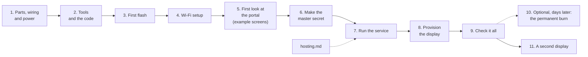
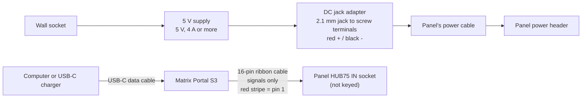
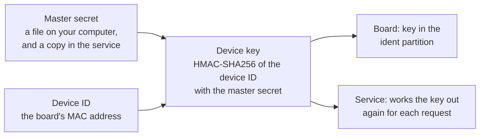

# Install one display

Checked on macOS on 25 Nov 2026. What was run, and what was not, is in the table at the end of this page ([What was run, and what was not](#what-was-run-and-what-was-not)).

This page takes you from a box of parts to one working LedMatrix display on your desk. You assemble the panel and the board, put the [firmware](glossary.md#firmware) on it, join it to your home Wi-Fi, set it up in its web page (the [portal](glossary.md#portal)), run the data [service](glossary.md#service), and give the display its own identity so that the service accepts it. It is written for a beginner on macOS. It does not cover Windows. Notes for Linux are marked "Not tested here". The data service (where it runs, how it gets an HTTPS address) is in [hosting.md](hosting.md).

**You can stop after step 5 and still have a result.** Steps 1 to 5 need no service. The display then shows example screens with made-up planes, weather and headlines, and that proves the hardware works.

Every host name, address, ID and path on this page is a placeholder: `apis.example.com` (your service), `192.0.2.10` (the display's address on your network), `aabbccddeeff` (a device ID), `/dev/cu.usbmodem1234` (a serial port), `Example Home Wi-Fi` (your Wi-Fi name). The name `ledmatrix.local` is real: every display asks for that name. The address `192.168.4.1` is real too: it is the fixed address of the display's own Wi-Fi network in setup mode.

## Before you start

- **The parts.** Step 1 has the shopping list.
- **A Mac with a free USB port, and the Terminal.** If you have never typed a command, read "Terminal in 2 minutes" in [build.md](build.md) first. The commands here are written for `zsh` or `bash`; the macOS Terminal uses `zsh`.
- **Your home Wi-Fi name and password.** The display's chip does 2.4 GHz Wi-Fi only: [Espressif's datasheet](https://documentation.espressif.com/esp32-s3_datasheet_en.html) shows only 2.4 GHz radio parts in its block diagram and describes Wi-Fi in the 2.4 GHz band. If your router offers separate 2.4 GHz and 5 GHz networks, use the 2.4 GHz one.
- **A phone or a second computer** is handy for step 4. The computer you flash from works too.
- **Later, for the service:** [hosting.md](hosting.md) says what you need (for most paths a domain name).
- **Help:** if something here does not work and the "If something goes wrong" notes do not help, ask in the project's [GitHub issues](https://github.com/suvl/ledmatrix/issues).

## The road map



## 1. Parts, wiring and power

*Label: Not tested here. This step comes from the manufacturers' guides and from the author's own wiring notes in the project's map ([issue 2](https://github.com/suvl/ledmatrix/issues/2) and [issue 35](https://github.com/suvl/ledmatrix/issues/35)).*

This is one recommended build: the author's display, with one change. The author feeds the board from the same supply as the panel through a DC-to-USB-C adapter. Here the board takes its USB power from your computer, or from a USB charger once it is running. That is simpler. The author's own way, and the other ways, are in the Variants box (1.5).

### 1.1 The shopping list

| What | Exact name to look for | What it does and what to check |
| --- | --- | --- |
| The board | **Adafruit Matrix Portal S3**, the "PCB Antenna" version ([Adafruit product 5778](https://www.adafruit.com/product/5778)) | The small computer with Wi-Fi ([ESP32](glossary.md#esp32) chip, 8 MB of flash memory). Adafruit sells a second version, [product 6475](https://www.adafruit.com/product/6475), with a u.FL connector. Adafruit says that version has no antenna on the board, that you "MUST connect an external antenna", and that the antenna is not included. The author's display uses that version with a patch antenna: without one, about a third of the secure fetches failed in the author's early tests (issue 2). Buy 5778 and you need no antenna (that version is Not tested here). |
| The panel | **Waveshare RGB-Matrix-P4-64x32** ([wiki](https://www.waveshare.com/wiki/RGB-Matrix-P4-64x32), [product page](https://www.waveshare.com/rgb-matrix-p4-64x32.htm)) | The screen: 64 x 32 RGB LEDs, 4 mm apart, 256 x 128 mm, with [HUB75](glossary.md#hub75) sockets. Waveshare's package list says the box holds the panel, a "power supply terminal adapter" and a "16P wire ~30cm" (16 pins is the right count for the 2x8 ribbon cable). Waveshare does not say what the adapter looks like. The author's notes (issue 2) describe a power cable of the panel that goes under the supply's terminals, so look at what your box holds. |
| A 5 V power supply for the panel | **5 V DC, at least 4 A**, with a 2.1 mm DC plug | Waveshare's tables list the panel as "5V / 4A", and its product page says a panel needs "a standalone 5V/4A or above power supply" (in a sentence about chaining several panels) and recommends using it with a 5 V 4 A supply. The author uses a 5 V 6 A supply, which meets that. It must be 5 V and nothing else (see the warning in 1.3). Check that the plug has the + on its tip (Adafruit's adapter below is labelled for that). |
| A DC jack adapter | **Female DC Power adapter, 2.1 mm jack to screw terminal block** ([Adafruit product 368](https://www.adafruit.com/product/368); Adafruit showed it out of stock when checked, so any equivalent) | Turns the supply's plug into two screw terminals, marked + and -. The panel's power cable goes under them. |
| A USB-C cable that **carries data** | USB-C to the plug of your computer | Flashes the board and powers it. Adafruit says charge-only cables will not work. |
| A power source for the board | Your computer, or later any USB charger | The author's notes budget the board with Wi-Fi at about 0.3 A. That is the author's figure, not Adafruit's. |
| A small screwdriver | One that fits the screws of the adapter's terminals | |
| A multimeter | Any that measures DC volts | For the polarity check in 1.3. |

Optional: if you chose the u.FL board, a 2.4 GHz antenna with a u.FL connector. An LED diffusion acrylic faceplate softens glare; Adafruit's guide suggests one and nothing here needs it.

Read once before you start: Adafruit's [Pinouts](https://learn.adafruit.com/adafruit-matrixportal-s3/pinouts) and [USB Power](https://learn.adafruit.com/adafruit-matrixportal-s3/usb-power) pages, and the "Header definition" picture on Waveshare's [product page](https://www.waveshare.com/rgb-matrix-p4-64x32.htm).

### 1.2 What connects to what



- The panel's power and the board's power are **separate**. The ribbon cable carries signals only.
- The board's own screw terminals stay unused. Nothing is plugged into the panel's HUB75 OUT socket. This is the author's wiring (issue 2): the board never carries the panel's current.

### 1.3 Put it together

> [!WARNING]
> **A wrong power supply can damage the panel.** Waveshare's wiki says: "The power supply ports (VCC and GND) of the display screen are 5V power supply, do not connect to other power supply voltages, so as not to burn the display screen." Adafruit says some USB "booster" cables deliver higher voltages that could destroy the matrix. Use a plain 5 V supply, check the label on every supply and cable before you connect it, and do the polarity check below.

**Recognise the input socket and pin 1.** This is as far as the sources go.

- The panel has two HUB75 sockets: one for data coming in from a controller (IN), one for data going out to a second panel (OUT) (Waveshare's features list). The board's ribbon goes into **IN**. Look for the marking on your panel. Waveshare says the silkscreen and layout can differ a little from batch to batch, and its product page shows a back-view picture of the header "for reference only".
- **The IN socket is not keyed**, so a plug fits it both ways round, and only one way is right (issue 2). A ribbon plugged in the wrong way round is expected to give a garbled picture, so match the red stripe to pin 1. The author's notes (issue 2) say that a board seated directly on the header, rotated by 180 degrees, garbles the display and puts the board's outputs on the panel's ground pins: one more reason to use a ribbon.
- The red stripe on the ribbon marks pin 1. Match it to pin 1 on the panel's IN header (issue 2). The sources do not say in words which end of the header is pin 1: use the markings on your panel and Waveshare's picture. If you cannot tell, ask in an [issue](https://github.com/suvl/ledmatrix/issues) before you switch anything on.
- The board end: Adafruit's Pinouts page says the board has "a 2x8 pin HUB75 socket connector on the component side" for connecting "a 2x8 IDC cable". It does not say in words which end is pin 1: use the markings on the board and Adafruit's Pinouts page.

**The steps.** Do them with every power source unplugged.

1. Lay the panel face down on a soft cloth.
2. If you have the u.FL board, connect the antenna to the board's u.FL socket now.
3. Plug one end of the ribbon cable into the panel's **IN** socket, red stripe on pin 1. Plug the other end into the board's 2x8 socket.
4. Fix the panel's power cable under the screw terminals of the DC jack adapter: **red under +, black under -**. Tighten the screws and tug each wire gently.
5. **Polarity check** (below). Do it before the cable goes into the panel.
6. Plug the cable's plug into the panel's power header. The plug should fit only one way; do not force it. The author's notes say to check the header for reversed terminals: if the header is marked + and -, they must match the cable's red and black.

> [!IMPORTANT]
> **Polarity check, before the panel is connected.**
> 1. Set the multimeter to DC volts (the V with a straight line) on a range above 5 V.
> 2. Plug the supply into the DC jack adapter and into the wall. The panel's cable plug is not in the panel yet: keep the loose plug away from metal and from the board.
> 3. Touch the red probe to the + terminal and the black probe to the - terminal.
> 4. The author's notes expect **+5.0 to 5.2 V**. If the meter shows about -5 V, the wires are swapped: unplug the supply and swap them at the terminals. If the reading is far from 5 V, unplug it, do not connect the panel, and ask in an [issue](https://github.com/suvl/ledmatrix/issues).
> 5. Unplug the supply from the wall again before you connect the panel.

### 1.4 First power-up check, before you flash

1. With the ribbon and the power cable connected, plug the supply into the wall.
2. Plug the USB-C cable into the board and into your computer.

**A good result:** the panel lights up and shows a clear coloured picture. Adafruit says a new board is preprogrammed with a basic display demo for 32x64 matrices; its Factory Reset page calls it a self-test demo. A board that was flashed before shows its last program instead. This proves the panel's power and the data link. The author's notes record the same check (the panel ran the board's stock demo, issue 2).

**A bad result:** a dark panel or a scrambled picture. Unplug everything and read 1.6.

### 1.5 Variants

Use these only if you have a reason.

- **One supply for both, with a DC-to-USB-C adapter (the author's way).** Add a DC male plug and a DC-to-USB-C adapter, and run a short lead from the same terminals of the DC jack adapter to the board's USB-C port. The board then never needs your computer or a charger. Measure the lead before you plug it into the board, as in the polarity check (expect +5.0 to 5.2 V; swap the wires if negative). **Never have two USB power sources on the board at the same time.** Unplug this lead from the board before you connect your computer to flash. The panel can stay on its supply: the author's notes record the panel running the board's stock demo from the supply while the board was on laptop USB.
- **Everything from one USB-C supply through the board's screw terminals (Adafruit's way).** Adafruit documents it: the USB power goes straight to the +5V terminals, which feed the panel, and the overview says "any USB C power supply" works. Adafruit calls the terminals outputs only and strongly discourages feeding power into them. The author avoided this way because the panel's current (the author budgets up to 4 A at full white) would flow through the board. Adafruit's [USB Power page](https://learn.adafruit.com/adafruit-matrixportal-s3/usb-power) warns that a computer's USB port may give 1 A or less (sometimes 0.5 A), small wall chargers 1 A or less, and that a supply that is too weak causes "ghosting" or "sparkling" on bright pictures.
- **The board plugged straight into the panel, without a ribbon.** Adafruit's photos show it. Only one orientation is correct: the one where the board overhangs the panel's edge, with the white arrow on the panel pointing up and to the right. The author's notes (issue 2) say the only correct direct orientation leaves the board overhanging the panel's edge, and the author chose the ribbon instead; the socket is not keyed (1.3).
- **A supply rated above 4 A** is fine: Waveshare says "4A or above". Adafruit's own suggestion for a separate panel supply is 2 A "preferably more"; Waveshare's figure for this panel is higher.

### 1.6 If something goes wrong

- **Nothing lights up.** Check the green power lights on the board (Adafruit's guide says it has green indicator LEDs for the 3 V and 5 V rails), the USB cable (data, not charge-only), the supply and that the panel's power plug is fully in. A panel that showed something at first and is dark later may be dimmed or in night blanking (step 5).
- **The picture is garbled from the first moment.** Unplug everything at once. The ribbon may be on the IN socket the wrong way round. Turn it so the red stripe is on pin 1 and try again. If the picture stays garbled, or the panel or the board stays dark, ask in an [issue](https://github.com/suvl/ledmatrix/issues).
- **Parts of the picture are missing, the colours are wrong, or it sparkles.** Re-seat the ribbon at both ends. If the supply or cable is weak, read the USB Power page above.
- **The picture is upside down.** Turn the panel 180 degrees. The firmware has no setting for it.
- **Anything gets hot, smells or smokes.** Unplug it at once and check the wiring against this step.

## 2. Tools and the code

*Label: Tested on macOS (the version lines). The installs themselves are in build.md.*

[build.md](build.md) is the one place that explains installing the tools and getting the code. Do its steps now, up to and including the compile, then come back. When you are done you have:

- **arduino-cli** (the command-line tool that compiles and flashes), the **esp32 board package** and the project's libraries;
- **Python 3**, **git** and **OpenSSL** (macOS ships OpenSSL);
- **the repository** in `~/ledmatrix`. This folder is "the repository root". **Run every command on this page from there:** `cd ~/ledmatrix`;
- **a compiled firmware** in `~/ledmatrix-build/firmware`.

A good result: `arduino-cli version`, `python3 --version` and `openssl version` each print a version line. On the Mac used for the checks they printed `arduino-cli  Version: 1.6.0 Commit: ... Date: ...`, `Python 3.15.2`, and `LibreSSL 3.3.6` (the built-in one) or `OpenSSL 4.1.0` (Homebrew). A "command not found" means an install did not finish: go back to [build.md](build.md).

Linux: the same tools are needed. Not tested here.

## 3. First flash

*Label: Checked by the author (the first flash with `arduino-cli upload`). Not tested here: the first flash of a factory-fresh board (it is not recorded whether the author's board was fresh), and the manual bootloader procedure.*

**Flashing** means writing a program into the board's [flash](glossary.md#flash) memory over USB, the chip that remembers when the power is off. The first flash also writes the board's [partition](glossary.md#partition) table, the map that divides the flash into labelled regions (the Background section at the end says more). Use `arduino-cli upload` for every flash, never `esptool` by hand: the Background section says why.

### 3.1 Find the serial port

The [serial port](glossary.md#serial-port) is how the computer talks to the board over USB.

1. Plug the USB-C cable into the board and into the Mac.
2. List the ports:

   ```
   arduino-cli board list
   ```

   A good result: a line with a name like `/dev/cu.usbmodem1234` and the words `Serial Port (USB)`; if the tool recognises the board it also names it. Entries about Bluetooth or the debug console are not your board. Write down the port name. This page writes it as `/dev/cu.usbmodem1234`: use your own. The number differs on every computer and may change after an upload.

Linux (Not tested here): the port is usually `/dev/ttyACM0`. You may need to be in the `dialout` group (Debian, Ubuntu) or the `uucp` group (Arch) to use it.

### 3.2 Compile and upload

Both commands run from the repository root. The board name `esp32:esp32:adafruit_matrixportal_esp32s3` is the "fully qualified board name" (FQBN): the exact name `arduino-cli` uses for this board.

1. **Compile.** This is the same command as in [build.md](build.md). If you already ran it there and `~/ledmatrix-build/firmware` exists, skip it.

   ```
   arduino-cli compile --fqbn esp32:esp32:adafruit_matrixportal_esp32s3 --jobs 0 --build-path ~/ledmatrix-build/firmware arduino/ledmatrix
   ```

   A good result: it ends with lines about the program and memory space the sketch uses, and no `error`. Keep the build folder: provisioning (step 8) needs it again.

2. **Upload.** This writes the program to the board. It does not compile again.

   ```
   arduino-cli upload --fqbn esp32:esp32:adafruit_matrixportal_esp32s3 --port /dev/cu.usbmodem1234 --input-dir ~/ledmatrix-build/firmware arduino/ledmatrix
   ```

   A good result: lines that write several addresses (the program at `0x10000`, the partition table at `0x8000`, TinyUF2 at `0x410000`), a line that says the data was verified, and a last line about restarting the board. No `error`, no `failed`. The exact words depend on the tool versions. The port may disappear for a moment and come back under another number: that is normal for this board.

3. **If the panel stays dark after the upload,** press the RESET button once. Adafruit's guide says boards with an ESP32-S3 sometimes need this after an upload.

### 3.3 What you should see

**On the panel.** For a few seconds the boot screen: the word `ledmatrix` and `connecting...` with moving dots. Then, because a new board has no saved Wi-Fi, the setup screen (step 4). All the screens a display can show before it has data:

| Screen | What it shows | What it means |
| --- | --- | --- |
| Boot | `ledmatrix`, `connecting...` | The board is joining the Wi-Fi, or scanning for networks before it starts setup mode. |
| Setup | `ledmatrix` in amber, `WIFI PASSWORD`, an 8-character password, `192.168.4.1` | [Setup mode](glossary.md#setup-mode): the board has no saved Wi-Fi and has started a Wi-Fi network of its own. |
| Connected | `WIFI OK`, the board's address, `ledmatrix.local` | The board joined your Wi-Fi. Shown for 5 seconds. |
| No Wi-Fi | a red cross, `NO WIFI`, `hold UP 5s`, `to set up` | The saved network could not be joined within about 20 seconds. |
| Example screens | made-up flight cards, example weather, sample headlines | No service address saved: the board cycles example data (a clock takes their place only if you switch all three off). A short press of UP or DOWN steps through them. |
| Problem | `PROBLEM`, `Data is failing`, `See the portal:`, `ledmatrix.local` | Something has been failing for an hour. See step 9. |
| Update | `UPDATE` with six digits, `Type it in portal` | A firmware update waits for its [update code](glossary.md#update-code) (see [operations.md](operations.md), "Firmware updates"). |

A small orange square that blinks at the top right of a live screen means the data is stale. A thin amber line that grows along the bottom edge is the UP button being held.

**In the serial monitor.** The serial monitor shows what the board prints about itself. Open it (leave it with Ctrl+C):

```
arduino-cli monitor --port /dev/cu.usbmodem1234 --config baudrate=115200
```

You see lines like these, in about this order (taken from the source code, not from a recording; the version follows the firmware you built, and your password differs):

```
ledmatrix: slice 4, live data
IDENT device aabbccddeeff record missing signer none check not_run
OTA version 0.10.1
matrix.begin() = 0
SETUP network "ledmatrix" password 7K3PQ9XM at 192.168.4.1
```

- `matrix.begin() = 0` means the panel driver started. Any other number means it did not: check the wiring.
- `IDENT device aabbccddeeff ...` shows the board's **[device ID](glossary.md#device-id)**: its factory MAC address (a number built into a network chip at the factory) written as 12 lowercase characters. Write it down. `record missing` is right for now: the identity record comes in step 8.
- `SETUP ...` shows the setup network name, password and address, the same as the panel. Later lines include `NET state N` (0 connecting, 1 online, 2 offline, 3 setup), `ONLINE <address> as ledmatrix.local` once the Wi-Fi is joined, `LIVE ...` lines about the data, and `SHOW <screen>` each time the picture changes.

If the monitor shows nothing, press RESET once. If it stops when the board restarts, start it again: the USB port briefly disappears on a restart. Not tested here.

### 3.4 If something goes wrong

- **`board list` does not show the board.** Try another USB cable, then another port. Close any program that may hold the port (another serial monitor, the Arduino IDE).
- **The upload says it cannot connect or finds no device.** Put the board in its manual bootloader mode, from [Adafruit's guide](https://learn.adafruit.com/adafruit-matrixportal-s3/arduino-blink) (Not tested here):
  1. Make sure the board is on USB with a data cable.
  2. Press and hold the **BOOT** button, the separate small button (it is not UP or DOWN).
  3. While still holding it, press and release the **RESET** button.
  4. Release BOOT.

  No drive appears in this mode; that is normal. The serial port is almost certainly a different one now, so run `arduino-cli board list` again and use the new name. Adafruit says that after uploading this way you should press RESET, and that it is a good idea to upload once more so the next upload resets the board by itself. The chip's ROM bootloader (the built-in one) cannot be erased, so you can always get back this way.
- **You erased the board completely, or Adafruit's bootloader repair was needed.** Adafruit's [Factory Reset](https://learn.adafruit.com/adafruit-matrixportal-s3/factory-reset) page warns that installing the UF2 bootloader erases everything on the board. Flash again (3.2), join Wi-Fi again (step 4), set it up again (step 5) and provision it again (step 8). A board whose key was burned needs `provision.py --burned`: see [tools/burn_key/README.md](../tools/burn_key/README.md).
- **Compile fails** (a missing library or a wrong core version): see the problems table in [build.md](build.md).
- **Upload works, but nothing happens.** Open the serial monitor. A reset loop means a bad flash: enter bootloader mode and upload again.

## 4. Wi-Fi setup (setup mode)

*Label: Not tested here. The steps come from `arduino/ledmatrix/net.cpp`, `screens.cpp` and `settings.cpp`, which also hold the exact wording. Running normally on a saved Wi-Fi was checked by the author.*

### 4.1 How setup mode starts

A board with no saved Wi-Fi network goes into [setup mode](glossary.md#setup-mode) by itself when it starts. To start it later, **hold the UP button for 5 seconds**. Adafruit's guide describes three buttons along one edge of the board: RESET at the top, UP in the middle and DOWN at the bottom, plus a separate small BOOT button. Check the printed labels on your own board, and do not confuse UP with BOOT. A thin amber line grows along the bottom edge of the panel while you hold. At 5 seconds the board forgets the Wi-Fi network and restarts into setup mode. Only the Wi-Fi network is forgotten. Settings and identity stay. The portal also has a button, "Forget this Wi-Fi network", that does the same.

In setup mode the board creates its own Wi-Fi network named `ledmatrix`, with a random 8-character password that is shown on the panel and printed in the serial monitor. The password uses capital letters and digits without 0, O, 1 and I, and it changes every time setup mode starts.

### 4.2 Steps

1. **Read the panel.** It shows the network name (`ledmatrix`), the password and the address `192.168.4.1`.
2. **Join that network** from your phone or computer: open the Wi-Fi list, choose `ledmatrix`, and type the password from the panel. Your device may say there is no internet on this network. That is true: stay connected.
3. **Open the setup page.** A sign-in page may open by itself (the board answers every name with its own address). If not, open `http://192.168.4.1` in a browser. Use `http`, not `https`.
4. **Fill in the form.** The browser tab says "ledmatrix setup"; the page's heading is "ledmatrix" and it says "Choose the Wi-Fi network this display should use." Pick your network from the list (the board scans when setup starts and lists up to 20 networks, strongest first). If yours is not listed, type its exact name in the box "Network not listed? Type its name". Type the Wi-Fi password and press **Save and connect**.
5. **Wait.** The page says "Saved" and that the display is restarting. After about 2.5 seconds the board restarts and joins your network. The panel shows the boot screen, then the Connected screen for 5 seconds (`WIFI OK`, its address, `ledmatrix.local`).
6. **Move your phone or computer back** to your usual Wi-Fi.

The Wi-Fi password is saved in the board's flash. It is never put in this repository.

### 4.3 Find the display on your network

Open **`http://ledmatrix.local`** in a browser on a device that is on the same home network. This works through [mDNS](glossary.md#mdns), a way for devices on a [local network](glossary.md#lan) to find each other by name without a server. macOS supports it. The page you see is the portal (step 5). The address is plain `http`: the portal is for your home network only and has no password (see [security.md](security.md)).

If `ledmatrix.local` does not open, use the board's address instead:

- The Connected screen shows it, but only for 5 seconds after each join. To see it again, unplug the board and plug it in again, or press RESET.
- The serial monitor prints `ONLINE 192.0.2.10 as ledmatrix.local`.
- Your router's list of connected devices names it `ledmatrix`.

Then open `http://192.0.2.10` (with your own address). Not tested here: `ping ledmatrix.local` is a quick test that the name resolves.

Linux (Not tested here): `.local` names need the Avahi service and the `nss-mdns` package. Without them, use the address.

### 4.4 If something goes wrong

- **No `ledmatrix` network in the Wi-Fi list.** Check that the panel shows the Setup screen. Move closer. If the panel shows the Boot screen for a long time, wait a few seconds: the board scans first.
- **You joined it, but no page opens.** Type `http://192.168.4.1` yourself. Turn off a VPN or private DNS on the device while you do this, and keep the connection when it says there is no internet.
- **The Wi-Fi list is empty or does not have your network.** Type the name in the "Network not listed" box.
- **After Save the panel says `NO WIFI`.** The name or password was wrong, the network is out of range, or it is 5 GHz only. Hold UP for 5 seconds and try again. The password is case sensitive.
- **`ledmatrix.local` does not open.** Use the address (4.3). Check that your computer is on the same network as the display and not on a guest network. Some routers block devices from talking to each other (often called client isolation): look for that setting. Not tested here.
- **The address changes after a restart.** That is normal on many routers. Use `ledmatrix.local`, or ask the router to always give the display the same address.
- **You have two displays.** Both ask for the name `ledmatrix.local`. See step 11.

## 5. First look at the portal

*Label: Checked by the author (the portal sections and their fields). The section names below are the ones in `portal/portal.template.html`.*

> [!NOTE]
> **Milestone: the hardware works.** Open `http://ledmatrix.local` in your browser. You should see a dark page titled "ledmatrix" with sections from "What to show" down to "Wi-Fi and device", and under "Wi-Fi and device" your network's name. On the panel, after the Connected screen, example screens cycle by themselves, about 10 seconds each: made-up flight cards, example weather (18 degrees) and sample headlines. They come from the board, not from any service. If you see this, the panel, the board, the Wi-Fi and the firmware all work. You can stop here for today.

Settings apply when you press **Save**, the amber button in the bar at the bottom ("Saved." appears in the bar). Brightness is the one exception: it applies and is saved when you let go of its slider. Settings live on the board, one set for each display. The portal has no export button; [operations.md](operations.md) ("Backups") shows how to save and restore them with `/api/settings`.

> [!NOTE]
> The portal has no password. Anyone on your home network can open it and change the settings, including the saved service address. This is a known limit; [security.md](security.md) explains it.

### 5.1 What to set now

Leave **Data service** empty for now: you fill it in at step 7. Everything else you can set today.

- **What to show.** Three switches: *Nearby flights*, *Weather*, *Headlines*. **Weather covers Portugal only today.** Outside Portugal, switch *Weather* off. A slider sets how many seconds each new plane stays on screen (3 to 60; the default is 10). *Cycle every plane in range* is off by default.
- **Display.** *Brightness*, 10 to 100 percent (default 100). If the picture sparkles on bright screens, lower it and read the USB Power page in step 1.
- **Layouts.** Click a picture to choose a design: three flight cards (A, B, C), three weather layouts, two headline layouts, and, for *When there is nothing to show*, a clock or a black screen. *24-hour clock* switches the clock format.
- **Location.** Click the map, drag the pin, search for a place, or type the latitude and longitude. The service looks for planes within the **radius** (default 15 km; 1 to 250) and between the **lowest and highest altitude** (default 0 to 45000 feet) around this point; the weather is for this point; and the time zone is chosen from it. The display sends the coordinates (four decimals) and the radius to your service with each request, so you can pin a point near your house rather than the house itself. The map, its search and the time zone lookup need the internet **in your browser**: the page loads two scripts (from `unpkg.com` and `cdn.jsdelivr.net`), the map pictures from `tile.openstreetmap.org`, and sends a place search to `nominatim.openstreetmap.org`. The display itself does not talk to those hosts. If they cannot load, type the coordinates and choose the time zone by hand.
- **Time zone.** Moving the pin sets the zone. The line under it says what time it is in that zone and what the display's own clock reads. Check that they agree. The display's clock comes from internet time servers over NTP (the Network Time Protocol: it asks `pool.ntp.org` and `time.cloudflare.com`), so it needs to reach the internet.
- **Headline topics.** Up to five searches, one per line, each up to 40 characters. Without a topic, no headlines are fetched.
- **Panel protection.** LEDs that show the same picture for hours can wear unevenly (this is called burn-in), so the display protects the panel. The details are in [operations.md](operations.md) ("Panel protection: dimming, pixel drift, night blanking").

### 5.2 Defaults that surprise a newcomer

- **The time zone is `Europe/Lisbon`** until you change it. Anywhere else, set your location (the pin sets the zone) or pick your zone.
- **Night blanking is on from 00:00 to 06:00** in that time zone: the panel is dark. A short press of UP or DOWN lights it for 30 seconds.
- **Dimming is on:** after 2 minutes without a new plane, the clock, weather and idle screens dim to 10 percent. Planes are never dimmed.

So a dark or dim panel is usually normal. Press UP or DOWN briefly to wake it.

### 5.3 The rest of the portal

*Recent planes* lists the planes the display has seen enter your radar. *Problems* is the list of the last 10 problems, in plain English (step 9). *Firmware* shows the version and a **Check now** button, and *Install a .bin file* is for when the normal update does not work (both are in [operations.md](operations.md), "Firmware updates"). *Wi-Fi and device* shows which network the display is on and has the button **Forget this Wi-Fi network**, which restarts the display into setup mode (it asks you first). If you press Save with a value the display does not accept, it says why next to the button, for example "The radius must be between 1 and 250 km." and saves nothing.

### 5.4 If something goes wrong

- **No example screens.** If the panel shows a dark or dim picture, see 5.2. If it shows `NO WIFI`, go back to step 4.
- **The map does not load.** It needs the internet in your browser. Type the coordinates and pick the time zone from the list.
- **"Could not reach the display."** The display is busy or the network dropped. Wait a few seconds and press Save again.
- **`http://ledmatrix.local` does not open.** See 4.3 and 4.4.

## 6. Make the master secret and back it up

*Label: Tested on macOS (the commands, in a scratch folder).*

This is the one place on any page that explains the master secret and how to make it. Other pages link here.

### 6.1 What it is, in plain words

Your data service sits on the internet. It must hand out data only to your displays. The project does not use a password or token that could leak from a log. Instead, each display gets a key of its own, signs every request it makes to your service, and the service checks the signature. Three words:

- **[Master secret](glossary.md#master-secret).** One long random text that only you know, at least 32 characters. It lives in a file on your computer, outside the repository, and in your service's settings. Every display's key comes from it.
- **[Device ID](glossary.md#device-id).** The board's own factory address: its MAC address, 12 lowercase characters such as `aabbccddeeff`. It is not secret. You can read it in the portal under *Data service* ("This board's ID"), in the `device` field of `http://ledmatrix.local/status`, and in the serial monitor.
- **[Device key](glossary.md#device-key).** A 32-byte value worked out from the two: HMAC-SHA256 of the device ID, using the master secret as the key ([HMAC](glossary.md#hmac) mixes a secret and a message into a short fingerprint that nobody can make without the secret). Each board has a different one. The board keeps it in the read-only `ident` partition. The service keeps **no** device keys: for each request it works the key out again from the device ID the request claims, and checks the signature. So a new display needs no change on the service.



The secret and the key never travel over the network. The scheme is written down in [shared/device-auth.md](../shared/device-auth.md). [Provisioning](glossary.md#provisioning) is the step that puts the identity on a board (step 8). It happens at home over USB, never over the air.

**A refusal is soft.** If your service refuses a board's key, the board keeps showing its last data, tries again every 5 minutes, never wipes anything and never restarts itself. It says why in its problem list. The service never bans a board for good.

### 6.2 Make it

Do this **once for all your displays**. Make a private folder outside the repository, and the secret in it. The second command refuses to run if a secret already exists, so you cannot overwrite it by mistake.

```
mkdir -p ~/ledmatrix-secrets && chmod 700 ~/ledmatrix-secrets
test -e ~/ledmatrix-secrets/master-secret && echo "STOP: a master secret already exists" || (umask 077; openssl rand -hex 32 > ~/ledmatrix-secrets/master-secret)
ls -l ~/ledmatrix-secrets/master-secret
```

What it does: `openssl rand -hex 32` writes 32 random bytes as 64 text characters; `umask 077` makes the file readable by you alone.

A good result: `ls -l` shows one line that starts with `-rw-------` and a size of 65 (64 characters and a line end). Run the commands a second time and the second one prints `STOP: a master secret already exists` and changes nothing.

The commands are written for `zsh` and `bash`; the `fish` shell uses different syntax.

**File permissions.** The file is mode 600: only you can read it. That is right for this master copy on your own computer. If the service runs in Docker on Linux, its user (number 65532) must be able to read the copy the service uses; [hosting.md](hosting.md) ("The secret file and its permissions") has the rule for that copy. Do not loosen the permissions of this master copy.

### 6.3 Back it up now

> [!IMPORTANT]
> **If you lose the master secret you can lose a display for good.** Every display's key comes from it, and your service needs it. Before the permanent burn (step 10), a lost secret means making a new one and provisioning every display again. After the burn, a display's key cannot be changed, so without the secret your service can never work out that display's key again: the display is locked out of your service for good. A backup is the only cure. Changing the master secret also locks out every display that was provisioned with the old one.

Put a copy in a **password manager**: that is the default backup. If your password manager can attach or import a file, add `~/ledmatrix-secrets/master-secret` to it directly. Otherwise copy the text: on a Mac `pbcopy < ~/ledmatrix-secrets/master-secret` puts it on the clipboard, but the secret then stays on the clipboard until you copy something else, and a clipboard manager may keep a history. Paste it into the password manager, copy something harmless, and check that no clipboard history keeps the secret. Paper in a safe place is a second backup. Then open a backup and check that it matches the file.

Never put the secret in the repository, an issue, a log, a chat or an e-mail.

Linux (Not tested here): `xclip -selection clipboard < file` copies to the clipboard; the same warning applies.

## 7. Run the service

*Label: Not tested here (this step points to hosting.md).*

You do not build the service. [hosting.md](hosting.md) runs the public image (`ghcr.io/suvl/ledmatrix-api`) and gives it an HTTPS address. It names a default path if you are unsure where to run it. Follow it until:

- the service runs with the master secret from step 6. It reads it from a file named by `MASTER_SECRET_FILE` (the recommended way) or from `MASTER_SECRET` (the secret as text);
- it answers on an address such as `https://apis.example.com` with a certificate your browser trusts. A running container is not enough: the board talks to it only over [TLS](glossary.md#tls).

hosting.md shows how to check this. In short, `/healthz` answers `ok`, and a request without a signature is refused with `401`.

### 7.1 Tell the display where the service is

1. Open `http://ledmatrix.local`. Under **Data service**, type the host name in *Service address*: `apis.example.com`, a name only. If you paste a whole address, the portal drops `https://` and anything after the name. Press **Save**.
2. **The example screens now stop.** Until the display has real data you see the clock (or a black screen). That is normal at this point. With default settings the clock shows only when the weather is not valid (weather is the resting screen), or when you turn on *Swap weather and clock*. Real data needs the identity from step 8.

The portal's line about the identity record now says "This board has no identity record. It must be provisioned over USB." That is expected.

## 8. Provision the display

*Label: Checked by the author (`provision.py --from-board ... --flash`). Tested on macOS (no board): the identity file with `--device-id`, `--check`, the file mode, the tool's error messages and its 66 tests. Not tested here: the `--device-id` flow with `--flash`, and Linux.*

[Provisioning](glossary.md#provisioning) writes a small identity file (8192 bytes) into the board's `ident` partition. The tool, `tools/provision.py`, makes the file from your master secret and the board's device ID, and then flashes it **with the normal firmware, using `arduino-cli upload`**. That runs the whole upload again, with the same steps as the first one. Your Wi-Fi and settings stay. After a good flash the tool deletes the file, because it holds the device key.

About `python3 -I`: the `-I` flag runs Python in isolated mode. Python then ignores its environment variables and your own installed packages, and does not add the current folder to its search path, so a stray file cannot change what the tool does. Use it for every tool in this project.

There are two ways. They differ in where the tool gets the device ID. Use Way 1 unless you cannot.

**Way 1: ask the board over the network (`--from-board`).** Use it when the display is on your Wi-Fi, `ledmatrix.local` opens in your browser, and there is only one display on your network.

```
python3 -I tools/provision.py --from-board ledmatrix.local \
  --secret-file ~/ledmatrix-secrets/master-secret \
  --out ~/ledmatrix-secrets/ident.bin \
  --flash --port /dev/cu.usbmodem1234 --input-dir ~/ledmatrix-build/firmware
```

What it does: asks `http://ledmatrix.local/status` for the device ID, makes the identity file, writes it to `--out` (mode `0600`), prints the device ID and a checksum, then runs `arduino-cli upload` with the file added. `--port` is the serial port from step 3 and `--input-dir` is the build folder from step 3.

A good result: first a line like `device=aabbccddeeff crc32=3ed30d13` (the checksum differs for every secret), then the `arduino-cli upload` output, and last `deleted the image file (it held the device key); use --keep to keep it`. The tool never prints the secret or the key.

**Way 2: give the device ID yourself (`--device-id`).** Use it when `.local` names do not work for you, when the display is not on Wi-Fi yet, or when you have several displays on one network (the name `ledmatrix.local` may then reach the wrong one; the firmware refuses an identity made for another board, so a mix-up is caught). Get the ID from the serial monitor (the `IDENT device ...` line), from `/status` at the board's address, or from the portal's "This board's ID". It is exactly 12 lowercase hexadecimal characters.

```
python3 -I tools/provision.py --device-id aabbccddeeff \
  --secret-file ~/ledmatrix-secrets/master-secret \
  --out ~/ledmatrix-secrets/ident.bin \
  --flash --port /dev/cu.usbmodem1234 --input-dir ~/ledmatrix-build/firmware
```

To check an identity file without flashing anything: `python3 -I tools/provision.py --check <file>`. It prints the device ID, the checksum, and `burned=no` (an interim software key: the normal case now) or `burned=yes` (step 10).

Never give the secret on the command line. The tool refuses: it says that an argument was not understood, does not show it, and tells you to give a file with `--secret-file`. You can also set the environment variable `LEDMATRIX_MASTER_SECRET_FILE` to the path of the file. Do not copy an identity file from one display to another: it holds the first board's ID, and the second board's firmware refuses it.

### 8.1 What the board says afterwards

The board restarts. Check it:

- **The portal.** Under *Data service*, the line about the identity record says "The identity record is in place. The display signs its requests to the service with this ID."
- **`/status`.** Open `http://ledmatrix.local/status` in a browser (a short line of JSON; or run `curl -s http://ledmatrix.local/status`, where `curl` fetches a web address and prints the answer). You want these fields (the rest, such as the Wi-Fi name and the frame counters, are left out here):

  ```
  {"version":"0.10.1", ... "device":"aabbccddeeff","identity":"ok","signer":"software","signer_check":"not_run"}
  ```

  `identity` is `ok` when the record is valid and made for this board. `signer` is `software` (the key from flash signs: the normal state until the burn), `hardware` (the chip signs: step 10) or `none` (the board cannot sign). `signer_check` is `not_run` for now.
- **The serial monitor.** The `IDENT` line now says `record ok signer software check not_run`.

What each `identity` value means and what to do:

| `identity` | Meaning | What to do |
| --- | --- | --- |
| `ok` | A valid record made for this board. | Nothing. |
| `missing` | There is no record. | Provision (above). |
| `invalid` | The record is damaged or not valid. | Provision again. |
| `other_board` | The record was made for another board's ID. | Provision again with this board's ID. |
| `hardware_key` | The record says the key is burned into the chip, but the chip has none. | Provision again without `--burned`. |
| `hardware_unprotected` | The record says the key is burned, but the burned key is not fully protected, so it is not used. | Provision again without `--burned`. |

The **[problem list](glossary.md#problem-list)** (portal section *Problems*, or `http://ledmatrix.local/api/problems`) says in plain English what is wrong when the board cannot get data. The sentences about identity and the service's answer:

| The list says | Meaning | What to do |
| --- | --- | --- |
| "This board has no identity record. It must be provisioned over USB." | See `missing` above. | Provision. |
| "The service does not accept this board's key. Either the service is set up for other boards, or this board must be provisioned again over USB." | The key from the master secret on your computer is not the key your service works out. | Check that the service has exactly the same master secret. If it does, provision again. |
| "The service has revoked this board. The owner of the service has to allow it again." | The service's [revoked list](glossary.md#revoked-list) holds this device ID. | Take the ID off the service's `REVOKED_DEVICES` (see [operations.md](operations.md), "Revoke a display, and allow it again"). |
| "The service says this board's clock is too far off from its own. Check that both clocks are right." | The signature carries the time, and the two clocks differ by more than 2 minutes. | Check the service's clock; the board's clock comes from internet time servers. |
| "The service did not receive a signature on the request. Something between the board and the service may be removing it." | A proxy between them drops the signature headers. | See [hosting.md](hosting.md). |

After you fix the cause, a board that was refused tries again within 5 minutes. To retry at once, unplug the board and plug it in again.

### 8.2 What the service needs

The service needs **the same master secret**, exactly as in your file (at least 32 characters; spaces and line ends around it are ignored), in its `MASTER_SECRET_FILE` (the recommended way) or `MASTER_SECRET`. Nothing else changes for a new display. How to give it to the service is in [hosting.md](hosting.md); the service's settings are in [service/README.md](../service/README.md).

### 8.3 If something goes wrong

These are the tool's own messages with the fix. The first seven were produced by running the tool on a Mac on 25 Nov 2026 (Tested on macOS); the last two come from reading `tools/provision.py`.

| The tool says | What it means | What to do |
| --- | --- | --- |
| `error: the master secret is shorter than 32 characters` | The file is too short. | Make the secret as in step 6, or fix the file. |
| `error: the master secret must be kept outside the repository` | You pointed `--secret-file` at a file inside the repository. | Move the file out (step 6). |
| `error: the device ID must be 12 lowercase hexadecimal characters` | The ID has capitals, colons or another length. | Copy the ID again from the serial monitor or the portal. |
| `error: give exactly one of --device-id and --from-board` | You gave both or neither. | Give one. |
| `provision.py: error: unrecognized arguments (not shown: one of them may be a secret)...` | An option the tool does not know, for example the secret typed as an argument. | Give the file with `--secret-file`. |
| `error: could not read the device ID from the board (is it on, and is the firmware up to date?)` | The tool could not reach the board's `/status`. | Check the board is on your Wi-Fi and `ledmatrix.local` opens in a browser, or use Way 2. |
| `error: an identity image is exactly 8192 bytes` | `--check` was given a file that is not an identity file. | Check the file name. |
| `the image file was kept (it holds the device key): <path>`, then `error: arduino-cli upload failed (exit code N)` | The flash step failed. The tool keeps the file so that you can try again. | Fix the cause (3.4), then run the same command again. After a good flash the tool deletes the file; if you give up, delete it yourself: it holds the device key. |
| `error: arduino-cli could not show the board's upload properties` | The tool could not run `arduino-cli`. | Check that `arduino-cli version` works in the same Terminal window (see [build.md](build.md)). |

Other cases: **`/status` says `identity` is not `ok`** after provisioning: see the table above. **You lost the board's ID:** read it again from the serial monitor or the portal.

## 9. Check it all

*Label: Checked by the author (the portal sections and the `/status` `version` field). Not tested here: the panel screens with real data at your own location (written from the source code).*

Do these in order. They need the display provisioned (step 8), the service address saved (step 7) and the service running with your master secret.

1. **`/status`.** Open `http://ledmatrix.local/status`. `identity` is `ok`, `signer` is `software` or `hardware`, and `device` is your board's ID. `version` is the firmware version.
2. **Test connections.** In the portal, under *Data service*, press **Test connections** and wait up to half a minute. It tries three connections: your service, a host that has only an [IPv6](glossary.md#ipv6) address, and a host with both (two public test hosts of the ipify service). The first line is the one that matters: it says `OK` when the service answered and accepted the board's signature. On a home network without IPv6 the IPv6-only line is expected to fail; that does not stop the display. This needs the display provisioned first: before step 8 the service line cannot pass. If the service line says `FAIL`, the text next to it is a plain sentence: use the tables in step 8.
3. **The Problems section.** It should say "No problems since the last restart." in green.
4. **The live line.** Under *Data service* you want "Clock synchronised." and lines such as `Flights 12 s ago (0 in range).` The "0 in range" is fine: the fetch works and no plane is within your radius and altitude limits right now. Flights come every 30 seconds, weather every 15 minutes and headlines every 30 minutes. Flights and weather need a location. Headlines need at least one topic.
5. **A plane in range.** When a plane enters your radius, the panel shows its card for the number of seconds you chose, and the *Recent planes* table fills in. Each new headline is shown once as it arrives. Between those, the display rests on the weather (Portugal only: outside it, switch *Weather* off and the clock rests instead). A small blinking orange square at the top right means the data is stale (no flights for 5 minutes, or no weather for 2 hours).
6. **Firmware.** The portal's *Firmware* section shows the version you built. On the public image, firmware updates arrive when the maintainer publishes a release. If you run your own build of the service image, it offers no firmware unless you publish releases yourself. [operations.md](operations.md) ("Firmware updates") explains both.

A good result is: identity `ok`, the service line `OK`, no problems, and fresh ages in the live line. Write down the device ID, the service address and where your master secret backups are: [operations.md](operations.md) has a record sheet in its Day 0 checklist.

If something is wrong, [operations.md](operations.md) ("Reading the Problems section") explains each problem. If you are stuck, ask in the [GitHub issues](https://github.com/suvl/ledmatrix/issues).

## 10. Optional, days later: the permanent burn

*Label: Verified on the author's own display on 25 Nov 2026: the dry run, the real burn with `tools/burn_key`, and `provision.py --burned` afterwards, with the `identity` and `signer` fields in that procedure. Not tested here: a second board, and a power cut in the middle of the burn.*

**Skip this if you are unsure. You can burn at any time later. Run the display for a few days first.** This section only summarises. **The runbook is [tools/burn_key/README.md](../tools/burn_key/README.md). Read all of it before you start, and follow it, not this summary.**

### 10.1 What it is

So far the board's key is a file in flash (the "interim software key"). The [burn](glossary.md#burn) copies the key into the chip's own [eFuse](glossary.md#efuse) memory. An eFuse is a one-time switch inside the chip: it can be set once and never cleared. After the burn, the chip's built-in HMAC unit can sign with the key, but no program, no flash tool and no person can read it back. Then `provision.py --burned` removes the software key from flash. The key sits in a part of the chip called `BLOCK_KEY5`.

### 10.2 Why you might want it, and why you might not

**A reason to do it:** while the key is a file in flash, a flash tool connected to the USB port could read it back. After the burn, nobody can read the key off the board. [security.md](security.md) says what this does and does not protect against.

**Reasons not to:**

- **It cannot be undone.** The key, its purpose and its protections are fixed for good. `BLOCK_KEY5` is used up. You can never change that display's key again.
- **A lost master secret then locks the display out for good** (step 6).
- **A mistake is permanent.** The burn sketch cannot tell whether the key on the board is the one your service works out from the master secret. If the master secret that made the identity was wrong, burning that key makes the mistake permanent. The only protection is to check, right before, that the service accepts the board (step 9: the service line of *Test connections* is `OK`).

If the display sits on your own shelf and you trust the people who can reach it, the software key may be enough.

### 10.3 The steps, in short

The real commands, the exact wording of each check and the recovery notes are in [tools/burn_key/README.md](../tools/burn_key/README.md). In short:

1. **Make sure you can start.** The board runs this firmware (with the hardware signer), `/status` says `"identity":"ok"`, `"signer":"software"` and `"signer_check":"not_run"`, the problem list is empty and *Test connections* shows the service line `OK`. Your master secret has an offline backup. The USB cable is solid: do not touch it during the burn.
2. **Dry run first.** A dry run runs every check and prints what it would do, and **writes nothing**. Compile and upload the sketch `tools/burn_key` without any extra flag. It is a separate sketch: the display goes dark and offline while it runs. A dry-run build does not even contain the code that writes. You read its output in the serial monitor. It ends with `BURN DRY RUN done: every check passed. Nothing was written.` If any line says `FAILED`, or a key block is not unused when you expected it to be, **stop and ask in the [GitHub issues](https://github.com/suvl/ledmatrix/issues)**.
3. **The real burn.** Compile the same sketch with two extra flags: one switches the writing code on, and the other names this board's own ID (a build works for one board only). Upload it. It runs the checks again. When they pass it asks you to type `BURN` and the board's 12 characters (for example `BURN aabbccddeeff`) in the serial monitor within 3 minutes. A reset, a wrong word or a wait that is too long burns nothing. Do not remove power until it says `BURN verified`.
4. **Put the normal firmware back and check it.** `/status` should now say `"identity":"ok"`, `"signer":"hardware"` and `"signer_check":"match"`: the firmware signed test messages with the chip's key and with the saved key and got the same answers. Check that data still arrives.
5. **Remove the software key from flash.** Only after the check in 4 shows `hardware` and `match`, run `provision.py --burned --from-board ... --flash ...` (the full command is in the runbook). It writes a record with no key and flashes it. Afterwards `/status` says `"signer":"hardware"` and `"signer_check":"not_run"`, and data still arrives. `--burned` needs no master secret. With `--from-board` it first asks `/status` and refuses unless the board already signs with the chip.

### 10.4 If something goes wrong

The runbook covers each case. In short:

- **A check says `FAILED` in the dry run:** nothing was written. Fix what it says and run the dry run again. If you cannot, ask in the [GitHub issues](https://github.com/suvl/ledmatrix/issues).
- **The sketch says the chip's answers differ:** the burn is done, but it could not prove the chip signs like the saved key. Do not run `provision.py --burned`. Put the normal firmware back (the runbook's step 4), restart the board and read `signer_check` on `/status` (`match`, `mismatch`, `unprotected`). The runbook says what to do for each. On `mismatch` or `unprotected`, stop and ask in the [GitHub issues](https://github.com/suvl/ledmatrix/issues).
- **The power fails during the burn:** the chip may be left half written. This has not been seen on a real board; the runbook reasons that some of the bits are set. The board keeps signing with the saved key, and the problem list says so. Do not run `provision.py --burned`. See the runbook.
- **You want to undo it:** you cannot. A display with a burned key whose flash was erased is provisioned again with `provision.py --burned`.

## 11. A second display

*Label: Not tested here. Nobody has set up a second display.*

The steps are the same as for the first display, with these differences. [operations.md](operations.md) ("Replace or add a display") covers the day-to-day side.

1. **Parts and wiring:** step 1 again.
2. **First flash:** step 3 again. The build folder from the first display works: the firmware is the same for every board. Use the second board's own serial port.
3. **Wi-Fi:** step 4 again.
4. **Settings:** step 5 and the service address in step 7 again. Settings are per display; the portal has no copy button (see "Backups" in [operations.md](operations.md)).
5. **Identity: reuse the same master secret, and give the new board its own provisioning.** Run `provision.py` again with the same `--secret-file` and the new board's own device ID (Way 2). The new board has a different ID, so it gets a different key from the same secret. Do not reuse the first board's identity file. **The service needs no change:** it works out each board's key from its ID.
6. **The burn:** each board has its own dry run and its own real burn, with its own build for its own ID.
7. **Back up:** the master secret is the only thing to back up. A leak of it affects every display.

**Name clash.** Each display asks for the name `ledmatrix.local`. What your network does when two displays ask for it at once is not tested here. The safe way: set up and provision the second display while the first is unplugged, find each one by its address, and use Way 2 in step 8.

## Background

Nothing here is needed to build your first display.

### What the first flash writes (the partition table)

The 8 MB flash is a building with labelled rooms. The partition table is the floor plan, stored near the start of the flash. Every upload rewrites it, and every build needs the file `arduino/ledmatrix/partitions.csv` that sits next to `ledmatrix.ino`, so you always compile the folder `arduino/ledmatrix` as a whole. This project's plan is the stock "TinyUF2 8MB" plan with one change: a read-only 8 KB room called `ident` at `0x7FE000`, where the board's identity record lives. A normal upload never writes there, so the identity survives every firmware update and re-flash. There are also two rooms for the program, so that a firmware update can be tried in one while the old program waits in the other. The full table is in [architecture.md](architecture.md) ("The flash layout").

An upload writes the boot loader at the start of the flash, the partition table at `0x8000`, a small file at `0xe000`, the program at `0x10000` and the TinyUF2 file at `0x410000` (from the esp32 board package's settings). It does not write the settings room, so your Wi-Fi and settings survive a re-flash ([tools/burn_key/README.md](../tools/burn_key/README.md) says the same about an upload).

### Why only `arduino-cli upload`

- `arduino-cli upload` knows the project's partition table and writes the boot loader, the table, the program and the TinyUF2 file together at the right places.
- Adafruit's guide warns that nothing protects the UF2 bootloader on these chips, and that a tool that does not know about it can overwrite it.
- On the author's board, an `esptool` run by hand once left the board stuck in download mode. The author's notes ([issue 3](https://github.com/suvl/ledmatrix/issues/3)) say esptool's own reset does not leave the bootloader on this chip, so the board stays there until you tap RESET. `arduino-cli upload` restarts the board into the program afterwards.
- One path is one thing to get right. `tools/provision.py` itself calls `arduino-cli upload` when you ask for `--flash`.

## What was run, and what was not

| Evidence | What it covers |
| --- | --- |
| **Verified on the author's own display on 25 Nov 2026** | The dry run and the real burn with `tools/burn_key`, followed by `provision.py --burned`, and the `identity` and `signer` fields in that procedure. |
| **Checked by the author while building it** (not re-run for this page) | The first flash with `arduino-cli upload`; running normally on a saved Wi-Fi; the portal sections and their fields; the `version` field of `/status`; `provision.py --from-board ... --flash`. |
| **Tested on macOS on 25 Nov 2026** (macOS 27.0.1, no board attached) | `python3 -I tools/provision.py --device-id aabbccddeeff --secret-file <placeholder> --out <file>` printed `device=aabbccddeeff crc32=3ed30d13` and wrote an 8192-byte file with mode `-rw-------`. `--check` on it printed `device=aabbccddeeff crc32=3ed30d13 burned=no`. A `--burned --device-id` file printed `crc32=2514c637 burned=yes`, and `--check` agreed. The first seven messages in the table in step 8 were produced by running the tool. `tools/test_provision.py` ran 66 tests and `tools/test_burn_key.py` ran 12 tests: all OK. The secret recipe in step 6 ran in `zsh` in a scratch folder with the built-in LibreSSL 3.3.6: a 65-byte file with mode `-rw-------`, and the second run printed the STOP line; Homebrew OpenSSL 4.1.0 gave the same file. `arduino-cli version`, `python3 --version` and `openssl version` printed the versions in step 2. Only `--help` of `arduino-cli upload`, `monitor` and `board list` was run: no serial port was touched. |
| **Read from the manufacturers' pages** (fetched 25 Nov 2026) | The quotes and figures in step 1: Adafruit's Matrix Portal S3 learn guide and product pages 5778 and 6475, Waveshare's wiki and product page, and Espressif's datasheet page. |
| **Not tested here** | The wiring and power steps and the first power-up check; the PCB-antenna board; the first flash of a factory-fresh board; the manual bootloader procedure; setup mode (written from `net.cpp`, `screens.cpp` and `settings.cpp`); `.local` names, including on Linux; `provision.py` with `--device-id` and `--flash`; the second display and the name clash; the panel screens with real data at your own location; which USB charger is enough; a power cut during the burn; every Linux command. |
