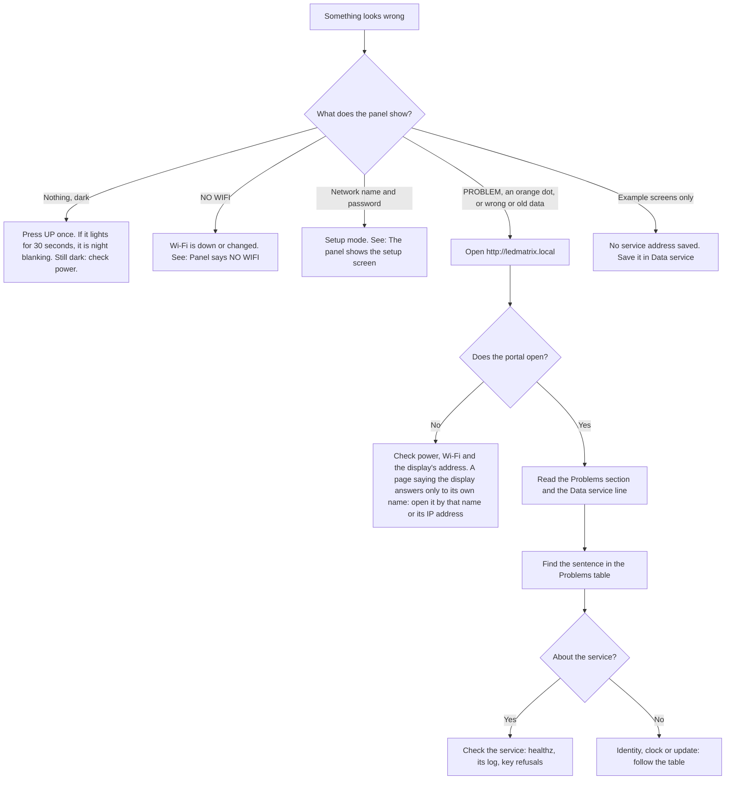
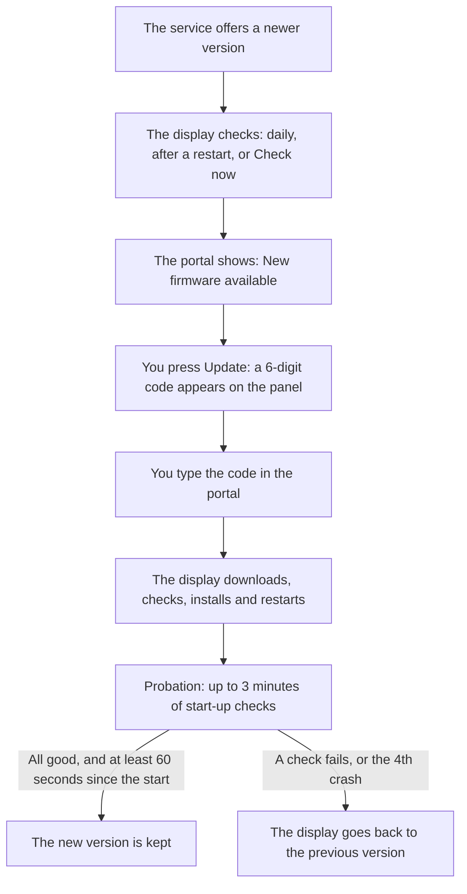

# Operations: running your display

Checked on macOS on 25 and 26 Nov 2026, and read against the code of the `main` branch on 26 Nov 2026. What was run, and what was not, is in the table at the end of this page.

This page is for you if you own a working LedMatrix display and want to keep it running. It has three parts. **Day 0** is the first-install checklist: it follows the order of [install.md](install.md) and [hosting.md](hosting.md) and tells you how to know that each step worked. **Day 1** shows what normal looks like and how to change settings. **Day 2** covers everything after that: [firmware](glossary.md#firmware) updates and [rollback](glossary.md#rollback), reading problems and logs, backups, revoking and replacing a display, updating the [service](glossary.md#service), moving it to a new address, and a decision list for when things go wrong. Whoever publishes firmware releases has a short section of their own at the end.

It assumes the hardware exists and the parts are put together. It does not repeat the wiring ([install.md](install.md)), the build ([build.md](build.md)), where to run the service ([hosting.md](hosting.md)), the security decisions ([security.md](security.md)) or the design ([architecture.md](architecture.md)). It links to them. The words "you", "the maintainer", "the public image" and "your own build" are defined in the [README](../README.md). In short: if you run the public image, firmware updates arrive when the maintainer publishes a release; if you build your own, no updates arrive unless you publish them yourself.

## Contents

- [Before you start](#before-you-start)
- [Day 0: the first-install checklist](#day-0-the-first-install-checklist)
  - [Step 1. Parts, wiring and power](#step-1-parts-wiring-and-power)
  - [Step 2. Tools and the code](#step-2-tools-and-the-code)
  - [Step 3. First flash](#step-3-first-flash)
  - [Step 4. Wi-Fi setup](#step-4-wi-fi-setup)
  - [Step 5. First look at the portal](#step-5-first-look-at-the-portal)
  - [Step 6. Make the master secret and back it up](#step-6-make-the-master-secret-and-back-it-up)
  - [Step 7. Run the service](#step-7-run-the-service)
  - [Step 8. Provision the display](#step-8-provision-the-display)
  - [Step 9. Check it all](#step-9-check-it-all)
  - [Step 10. The permanent burn (optional, days later)](#step-10-the-permanent-burn-optional-days-later)
  - [Step 11. A second display](#step-11-a-second-display)
- [Day 1: what normal looks like](#day-1-what-normal-looks-like)
  - [The screens and when each appears](#the-screens-and-when-each-appears)
  - [Open the portal](#open-the-portal)
  - [The portal, section by section](#the-portal-section-by-section)
  - [Change a setting](#change-a-setting)
  - [Panel protection: dimming, pixel drift, night blanking](#panel-protection-dimming-pixel-drift-night-blanking)
  - [The plane log](#the-plane-log)
  - [`/status`: the display's own health page](#status-the-displays-own-health-page)
  - [Where to look first when something seems off](#where-to-look-first-when-something-seems-off)
  - [A light routine](#a-light-routine)
- [Day 2: everything after](#day-2-everything-after)
  - [Firmware updates](#firmware-updates)
  - [Rollback: when the new version does not pass](#rollback-when-the-new-version-does-not-pass)
  - [The forced `.bin` upload](#the-forced-bin-upload)
  - [Update the service itself](#update-the-service-itself)
  - [Reading the Problems section](#reading-the-problems-section)
  - [Logs](#logs)
  - [Backups](#backups)
  - [Revoke a display, and allow it again](#revoke-a-display-and-allow-it-again)
  - [Replace or add a display](#replace-or-add-a-display)
  - [Move the service to a new address](#move-the-service-to-a-new-address)
  - [When things go wrong](#when-things-go-wrong)
  - [The USB recovery](#the-usb-recovery)
  - [Known issue: slow name lookups after a settings change](#known-issue-slow-name-lookups-after-a-settings-change)
- [For the maintainer: publish a firmware release](#for-the-maintainer-publish-a-firmware-release)
  - [The maintainer does this once](#the-maintainer-does-this-once)
  - [Rotate the signing key](#rotate-the-signing-key)
- [Background and reference](#background-and-reference)
  - [The serial log, line by line](#the-serial-log-line-by-line)
  - [The shape of `/api/problems`](#the-shape-of-apiproblems)
  - [The shape of `/api/update`](#the-shape-of-apiupdate)
- [What the labels mean, and what was run](#what-the-labels-mean-and-what-was-run)
- [Related pages](#related-pages)

## Before you start

You need:

- A working display: it shows pictures and answers at `http://ledmatrix.local` (if it does not yet, start with [install.md](install.md)).
- A computer on the same home network as the display, with a web browser and a Terminal. New to the Terminal? [build.md](build.md) has a short "Terminal in 2 minutes" box: how to open it, paste a block and press Enter, and what `cd`, `~` and `curl` mean.
- The address of your data service (this page uses `apis.example.com`).
- For recovery only: a USB cable that carries data, and the tools from [build.md](build.md).

Terms are explained once in the [glossary](glossary.md) and linked the first time they appear here. The short version of the three parts you will keep meeting:

- The firmware is the program on the board.
- The [portal](glossary.md#portal) is the settings page the display serves itself on your home network ([LAN](glossary.md#lan)).
- The service is the small program that gives the display flights, weather and headlines, and also the firmware updates.

Every host, address, ID and path in this page is a placeholder. Use your own. `ledmatrix.local` is the display's default name: if you set a Display name in the portal (see "Change a setting"), use `<name>.local` wherever this page says `ledmatrix.local`.

| Placeholder | Stands for |
| --- | --- |
| `http://ledmatrix.local` | the display on your home network (`ledmatrix` is its default name) |
| `192.0.2.10` | the display's address on your network |
| `apis.example.com` | your data service |
| `203.0.113.7` | the service host's public address |
| `aabbccddeeff` | a [device ID](glossary.md#device-id) |
| `example-master-secret-...` | a [master secret](glossary.md#master-secret) (never a real one) |
| `/dev/cu.usbmodem1234` | the board's [serial port](glossary.md#serial-port) on macOS (on Linux it looks like `/dev/ttyACM0`) |
| `Example Home Wi-Fi` | your Wi-Fi network name |

If you need help, or something here is wrong, open an issue at https://github.com/suvl/ledmatrix/issues (remove private values first: see "Never share a log with private values in it").

## Day 0: the first-install checklist

Do these steps in this order. Each one says how to know it worked. Do not go on until it did. They are the same steps, in the same order, as the steps of the same titles in [install.md](install.md); this page adds the checks. Steps 1 to 4 and 10 to 11 live in other pages. The `curl` checks in step 7 were run against a local copy of the service (Tested); the texts of the panel and the portal were read in the code.

### Step 1. Parts, wiring and power

**What to do.** Build the hardware as described in [install.md](install.md), "Parts, wiring and power".

**How to know it worked.** The first power-up check in that step: what you should see before you flash anything. Do not go on until you see it.

**If something goes wrong.** The "If something goes wrong" notes in that step.

### Step 2. Tools and the code

**What to do.** Install the tools and get the code: [install.md](install.md), "Tools and the code", with the details in [build.md](build.md).

**How to know it worked.** In the repository folder (the folder you cloned, the "repository root"), `ls` lists `arduino`, `docs` and `service`, and `arduino-cli version` prints a version number.

**If something goes wrong.** [build.md](build.md) has a table of common problems for these steps.

### Step 3. First flash

**What to do.** Compile the firmware and upload it over USB: [install.md](install.md), "First flash". Flash only with `arduino-cli upload`.

**How to know it worked.** The upload ends without an error. The panel shows `ledmatrix` and `connecting...` for a moment and then the setup screen: a network name (`ledmatrix`), `WIFI PASSWORD`, 8 characters and `192.168.4.1`. A board with no saved Wi-Fi goes straight to setup mode.

**If something goes wrong.** [install.md](install.md), "First flash", and "The USB recovery" in Day 2 below.

### Step 4. Wi-Fi setup

**What to do.** Follow [install.md](install.md), "Wi-Fi setup (setup mode)". In [setup mode](glossary.md#setup-mode) the board starts its own Wi-Fi network and shows its name and a generated password on the panel. You join it from a phone or laptop, open `192.168.4.1`, pick your home network and type its password.

**How to know it worked.** After you press "Save and connect" the board restarts. The panel shows `ledmatrix` and `connecting...` (the boot screen), then for 5 seconds `WIFI OK`, the display's address and `ledmatrix.local`. Then it shows example screens.

**If something goes wrong.** If the panel shows a red cross and `NO WIFI`, the board could not join. Hold the UP button for 5 seconds to start setup mode again and re-enter the network name and password. See "The panel says NO WIFI" in Day 2.

### Step 5. First look at the portal

**What to do.** Open `http://ledmatrix.local` in your browser on the same network.

**How to know it worked.** The page titled `ledmatrix` loads, and the panel shows **example screens**: example flights, weather and headlines, whichever of the three you have switched on (the example clock shows only if all three are off). They change every few seconds. No service is needed for this. It is the first milestone: the board, the panel, the power and your Wi-Fi all work.

You can set your location and time zone now; they do not need the service. Three defaults surprise newcomers: the time zone is `Europe/Lisbon` until you change it, the panel is dark from 00:00 to 06:00 (night blanking), and it dims after 2 minutes without a plane. See "Panel protection" in Day 1. Weather works anywhere: the service uses IPMA inside Portugal and Open-Meteo elsewhere (see "No weather" in Day 2).

Do not save a service address yet. It comes in step 7, once the service runs. As soon as one is saved the example screens stop.

**If something goes wrong.** See "Open the portal" in Day 1.

### Step 6. Make the master secret and back it up

**What to do.** The master secret is a long random text that only you know. The service derives every display's [device key](glossary.md#device-key) from it. Follow [install.md](install.md), "Make the master secret and back it up": that page has the one recipe (it writes the secret to `~/ledmatrix-secrets/master-secret` and refuses to overwrite one that already exists), the file rules and the backup advice. Do it once for all your displays.

**How to know it worked.** The file exists, is 65 bytes long (64 characters and a line end), and you have a backup: in a password manager, or on paper in a safe place. Open a backup and compare it with the file.

```
ls -l ~/ledmatrix-secrets/master-secret
```

**Why this matters.** After the key is [burned](glossary.md#burn) into the board's chip, a lost master secret cannot be recovered and the board is locked out of your service for good. Before the burn a lost secret is a nuisance (make a new one, provision every display again). After it, it is permanent. The secret must never go into the repository, a ticket, a chat or a log.

**If something goes wrong.** If you pasted the secret somewhere public by mistake, treat it as lost: make a new one and provision again. On a display whose key is already burned that is not possible; see [security.md](security.md).

### Step 7. Run the service

**What to do.** Follow [hosting.md](hosting.md) until the service runs and answers on a name with a certificate your browser trusts. You do not build the service: [hosting.md](hosting.md) uses the public image. The board will only talk to it over [TLS](glossary.md#tls) with a certificate from an authority in its built-in [CA bundle](glossary.md#ca-bundle). A running container is not enough.

The service needs exactly one of three settings for its secret: `MASTER_SECRET_FILE` (the path of a file that holds the secret; recommended, because the secret then stays out of the environment), `MASTER_SECRET` (the secret itself) or `AUTH_OFF=1` (your own computer only: nothing is checked). With none of them, or with more than one, it refuses to start.

**How to know it worked.** Two checks from your computer. The first asks the service if it is alive:

```
curl -s https://apis.example.com/healthz
```

Good result: it prints `ok`.

The second asks for data without a signature. It must be refused:

```
curl -s -i "https://apis.example.com/v1/weather?lat=38.7&lon=-9.1"
```

Good result: the first line says `401` and the body is `{"error":"The request is not signed.","reason":"missing"}`. That refusal is correct. It proves the service checks signatures. (Tested on a local copy of the service.)

**If something goes wrong.**

- If you get weather data instead of the 401, the service runs without its signature check. Stop and fix it before going on: it must run with `MASTER_SECRET_FILE` or `MASTER_SECRET`, not with `AUTH_OFF=1`.
- If the service stops with `MASTER_SECRET is not set` although you gave it a file, your image is older than the file option. The older message reads `MASTER_SECRET is not set, so the service will not start; create one with ...`; the newer one reads `MASTER_SECRET is not set and neither is MASTER_SECRET_FILE, so the service will not start; ...`. Pull the public image again. (Tested with both images.)
- If `healthz` does not answer, the problem is the address, the certificate or the [reverse proxy](glossary.md#reverse-proxy) in front of the service; see [hosting.md](hosting.md).

**Tell the display where the service is.** Once the two checks pass:

1. Open `http://ledmatrix.local`. Under "Data service", type the host name in "Service address": `apis.example.com`, a name only (the portal drops `https://` and anything after the name). Press **Save**. The bar says `Saved.` in green.
2. The example screens now stop. Until the display has real data you see the clock (or a black screen). The portal says `This board has no identity record. It must be provisioned over USB.` That is expected until step 8: without its identity the board cannot sign, so no data arrives yet.

### Step 8. Provision the display

**What to do.** [Provisioning](glossary.md#provisioning) gives the board its identity: the script `tools/provision.py` derives the board's key from the master secret and writes a small record into a read-only flash [partition](glossary.md#partition) named `ident`, over USB. Follow [install.md](install.md), "Provision the display". The default way asks the board for its ID over the network (`--from-board`).

**How to know it worked.** Open `http://ledmatrix.local/status`. You want `"identity":"ok"` and `"signer":"software"` (`software` is right until the permanent burn). In the portal, "Data service" shows the board's ID and says `The identity record is in place. The display signs its requests to the service with this ID.`

**If something goes wrong.** `identity` says why in one word; the portal shows the sentence. See the identity rows in the problem table in Day 2 ("Reading the Problems section").

### Step 9. Check it all

**What to do.** Check that everything works. "Test connections" only works after step 8, because the display must be able to sign.

1. In the portal, make sure the service address from step 7, your location, your radius and at least one headline topic are saved. Press **Save** if you changed anything.
2. Press **Test connections** and wait up to half a minute. You get a note about IPv6 and one line for each of three tests. The first test, `service (IPv4 only today)`, must say `OK`: it proves the service accepts the board's signature.

   ```
   This display has a global IPv6 address: no
   OK    service (IPv4 only today) (apis.example.com) over IPv4 in 210 ms
   FAIL  IPv6-only host (api6.ipify.org) - ...
   OK    dual-stack host (api64.ipify.org) over IPv4 in 190 ms
   ```

   *(An illustration built from the code, not a capture.)* The other two lines reach two public test hosts: one that can only be reached over [IPv6](glossary.md#ipv6) and one that works over both. On a home network without IPv6 the IPv6-only line is expected to fail. This is reasoned from the code and Not tested here on such a network. Only the first line matters for a working display.
3. Scroll to "Problems". Good result: `No problems since the last restart.` in green.
4. Read the line under "Data service". After about a minute it reads `Clock synchronised. Flights 12 s ago (0 in range).` `0 in range` is fine: it means the fetch works and no plane is within your radius right now.
5. Wait for a plane. Planes appear when one enters your radius and has not been shown in the last 30 minutes. Headlines appear when a new one arrives (the newest per topic right after a restart). Weather appears whenever nothing else is shown and weather data has arrived (the service answers for any location).
6. Write down what you have. Keep this table in your own notes (not in the repository). You will want it on day 2.

   | Item | Your value |
   | --- | --- |
   | Display's device ID | `aabbccddeeff` (from the portal or `/status`) |
   | Service address | `apis.example.com` |
   | Where the master secret backups are | (two places) |
   | Where the service runs, and how to reach it | |
   | Firmware version | (from the portal's "Firmware" section) |
   | Burned? | no / yes, on this date |
   | Date of the last settings backup | |

**If something goes wrong.** If the service line fails with a sentence about the key, go to "The service refuses the key" in Day 2. If all lines are slow or time out, see the known issue about slow name lookups at the end of Day 2. If the Problems section lists the identity sentence `This board has no identity record`, step 8 was not done.

### Step 10. The permanent burn (optional, days later)

Skip this if you are unsure. You can burn at any time later. Run the display for a few days first. The permanent burn moves the key into the chip, where nobody can read it. It cannot be undone. Wait until the display has run normally and your backup of the master secret is confirmed. Then follow [install.md](install.md), "Optional, days later: the permanent burn", and the runbook [`tools/burn_key/README.md`](../tools/burn_key/README.md).

### Step 11. A second display

Each display has its own ID and key; the same master secret serves all of them, and the service needs no change. Give the second display its own Display name (portal, "Wi-Fi and device") so that the two do not share the name `ledmatrix.local`. See [install.md](install.md), "A second display", and "Replace or add a display" in Day 2.

## Day 1: what normal looks like

*Label: Checked in the code (`ledmatrix.ino`, `screens.cpp`, `net.cpp`, `live.cpp`, `protect.cpp`, `settings.cpp`) and in the portal page. Not run on a board for this page.*

### The screens and when each appears

The display shows one picture at a time. This table lists every picture, what it looks like, and when it appears. In normal use with live data, the order of priority is: a **plane** first, then a **headline**, then **weather**, then the **clock**.

| Screen | What it shows | When it appears |
| --- | --- | --- |
| Boot | `ledmatrix` and `connecting...` | At power-up, and while the board joins Wi-Fi (the first 20 seconds). |
| Setup | The setup network name (`ledmatrix`, or the display name you set; a name longer than 10 characters is drawn small, on up to two lines), `WIFI PASSWORD`, the 8-character password, and `192.168.4.1` | When no Wi-Fi network is saved: first start, after you hold UP for 5 seconds, or after "Forget this Wi-Fi network" in the portal. It stays until you finish setup. |
| Connected | `WIFI OK`, the display's address, `<name>.local` (`ledmatrix.local` unless you set a Display name; a long name is cut at the panel's edge, and about 10 characters of name fit with `.local`, so read the address above it) | For 5 seconds after the board joins Wi-Fi. |
| NO WIFI | A red cross, `NO WIFI`, `hold UP 5s`, `to set up` | If the board has not joined 20 seconds after starting, and any time the connection is lost later. It keeps trying to rejoin by itself. |
| Example screens | Example flights, weather and headlines, for the screens you have switched on. The example clock (21:47) shows only if all three are off. | When no service address is saved. They change every few seconds (the "show each new plane for" setting). UP and DOWN step through them. |
| Flight (layouts A, B, C) | Airline, route, aircraft type, altitude and speed, and the airline's logo if the service has it | When a plane is new in your radius. It stays for the "show each new plane for" time (10 seconds by default). The same plane is not shown again for 30 minutes. |
| Headlines (layouts A, B) | One headline and its source | When a new headline has arrived and no plane is showing. Layout A scrolls it across; layout B shows it in pages. |
| Weather (layouts A, B, C) | Temperature, icon, high and low, chance of rain; layout C shows now, +3 hours and +6 hours. Layout B shows the place name, or `WEATHER` when the data has none (outside Portugal). The icons are sun, part cloud, cloud and rain: snow, sleet, thunderstorms and hail all show as the rain icon, because there is no snow icon yet | Whenever nothing more urgent is showing and weather data has arrived. |
| Idle | The clock and date, or a black screen (your choice under "Layouts") | When there is nothing else to show. |
| Stale-data dot | A small orange square flashing in the top right corner of any live picture | When live data is old. See below. |
| Problem message | `PROBLEM`, `Data is failing`, `See the portal:`, `<name>.local` | After one kind of data has failed for an hour and is still failing. It replaces weather or the clock for 5 seconds at the start of every minute. Never over a plane or a headline, and not while the panel is dark at night. |
| Update code | `UPDATE`, a countdown, a 6-digit code in two groups, `Type it in portal` | While you are authorising a firmware update. See "Firmware updates". |
| Update progress | `UPDATE`, a percentage, the version, a status word (`Checking`, `Downloading`, `Installing`, `Restarting`) and a bar | While a firmware update is downloading or installing. |

The **stale-data dot** appears only on live pictures (a service address is saved). With flights switched on and a location set, it starts when flights were last fetched more than 5 minutes ago (or never, 3 minutes after the start). With weather switched on, it starts when weather is more than 2 hours old (or never, 5 minutes after the start). It stops by itself when fresh data arrives. If it stays, open the portal's Problems section.

While one of the two update screens is shown, neither the stale-data dot nor the problem message is drawn.

### Open the portal

1. Make sure your computer is on the same home network as the display (not a guest network, not a VPN that routes everything elsewhere).
2. Open `http://ledmatrix.local` in a browser.

Good result: the page titled `ledmatrix` loads with "What to show" at the top.

The portal is plain HTTP and has no password. Your browser may call it "Not secure". That is how it is built: it only works on your home network, and the most serious thing it can do, installing new firmware, needs a code that shows only on the panel. See [security.md](security.md) for what that means.

**If `ledmatrix.local` does not open.** The name works through [mDNS](glossary.md#mdns), which macOS supports out of the box. Try the display's address directly, for example `http://192.0.2.10`. You can find the address on the panel for 5 seconds after it joins Wi-Fi (the `WIFI OK` screen), in `/status`, in your router's list of connected devices, or by restarting the display. On Linux the `.local` name needs the Avahi daemon and name service switch support (**Not tested here**). If you run two displays on one network, give each its own Display name (see "Replace or add a display"). If two displays do ask for the same name, the one that comes second adds `-2` to its own (`kitchen-2.local`); the panel does not show that `-2`, but the IP address always works (**Not tested here**: no board has been seen doing it).

**What the portal answers to.** The portal answers only to the display's own names: `<name>.local`, the bare `<name>`, and its IP address (IPv4 or IPv6; ports are ignored). A request that names any other host gets a plain page with the status 421: `This display answers only to its own name (for example ledmatrix.local) or its own IP address. Open it that way.` That includes names your router makes up for the display (`ledmatrix.lan`, `ledmatrix.home`, `ledmatrix.fritz.box`), a reverse proxy in front of it, a VPN or port-forward address, and `localhost`. The display also refuses a save, a Forget or an update that a browser sends on behalf of *another* web page: it answers 403 with `The display refused this request because it came from another web page. Use the display's own portal page.` Commands you type yourself (`curl`) send no page name and still work: the portal has no password. Other Host names refused with 421 and other sites refused with 403, an upload from another site refused without using up a code try, and requests from the portal itself and from `curl` accepted: **Verified on the author's own display on 26 November 2026**. **Not tested here**: addresses written as IPv6, and a proof page in a real browser on another site. In setup mode the Host check is off (a phone's sign-in probe may use any name); the page check still applies.

### The portal, section by section

The sections appear in this order. Nothing is sent to the display until you press **Save**, except brightness (applies when you release the slider), the "Firmware" buttons, "Install a .bin file", and "Forget this Wi-Fi network".

| Section | What it is for |
| --- | --- |
| Banner at the top | Appears only when new firmware is available or an update is under way. It links to "Firmware". |
| What to show | Switches for flights, weather and headlines; how long each new plane stays; and "Cycle every plane in range" (off by default: it shows each plane in range in turn instead of only new ones). |
| Display | Brightness, 10 to 100 percent. |
| Panel protection | Pixel drift, dimming, night blanking, and swapping weather and clock. See below. |
| Layouts | The layout for each screen, drawn at the panel's real size with example data, and the 24-hour clock switch. |
| Location | Map, search box, latitude, longitude, radius (1 to 250 km) and the lowest and highest altitude (feet). The map and the search need internet in your browser, not on the display. Without it, type the numbers. |
| Time zone | Picked from the map position; you can choose another by hand. It shows what time it is there and what the display's own clock reads. |
| Recent planes | The last planes the display saw enter your radar. |
| Data service | Your service address, this board's ID, the identity message, **Test connections**, and one line of live status (clock, age of flights, weather and headlines, the last problem). |
| Problems | The last 10 problems, with plain words. See "Reading the Problems section". |
| Firmware | The running version, **Check now**, and the update notice and buttons. See "Firmware updates". |
| Install a .bin file | The escape route for when the normal update does not work. See "The forced `.bin` upload". |
| Headline topics | Up to five searches, one per line, and **Headlines language and region**: which Google News edition the headlines come from (12 editions; the default is Portuguese (Portugal)). |
| Wi-Fi and device | **Display name** (what the display is called on the network; default `ledmatrix`), the network the display is on, its signal, its addresses and how long it has been up; and **Forget this Wi-Fi network**. |

The map tiles, the map library and the time zone lookup are loaded by your *browser* from public servers when you open the portal. That does not involve the display. It does mean that your browser makes requests to those servers when you use the Location section.

### Change a setting

1. Change the field in the portal.
2. Press **Save** (except brightness, which saves when you release the slider).
3. Read the bar at the bottom.

Good result: `Saved.` in green. The page refills itself with what the display accepted.

If a value is not allowed the bar turns orange and says why. Nothing is saved, not even the fields that were fine.

What happens next, **Checked in the code** (`settings.cpp`, `live.cpp`):

- Settings are written to the board's flash straight away.
- If you changed the service address, the screens to show, the location, the radius, the altitudes, a headline topic or the headlines language and region, the display fetches flights, weather and headlines again straight away, and the one-hour timer for the panel's problem message starts again.
- Other changes (layouts, brightness, protection, clock format, dwell time) apply on the next frame, without any fetch.
- A time zone change applies within about half a second, without a restart.
- A save does not pause the picture: the new settings are swapped in memory first and written to flash afterwards (**Checked in the code**: `settings.cpp`, `swapstore.h`; the picture's timing during a burst of saves was not measured on a board).
- The service address is cleaned for you: `https://`, `http://` and anything after the host name are dropped, and it is made lower case. It can only have letters, digits, dots and hyphens, up to 63 characters. It cannot hold a port: the display always connects on port 443.
- The **Display name** (under "Wi-Fi and device") is what the display is called on the network: the portal is at `<name>.local`, the display gives that host name to your router, and its setup Wi-Fi network has that name. Use 1 to 24 letters, digits or hyphens, with no hyphen at the start or end; capital letters become lower case. A name that breaks a rule is refused with a plain sentence and nothing is saved: `The display name cannot be empty.`, `The display name can be at most 24 characters.`, `The display name can only have letters, digits and hyphens, with no spaces.`, `The display name cannot start or end with a hyphen.` **Saving a new name restarts the display** (about 20 seconds), because the network name is set once at start-up. The portal says where the display will be and follows it: a page you opened with a `.local` name moves to the new name by itself when the display answers there, and a page you opened by IP address reloads. The settings did not change except for the name after renaming a display through the API and back, and the refusals were worded as above (**Verified on the author's own display on 26 November 2026**). The portal's following was read in its code (**Checked in the code**); **Not tested here**: the restart and the follow with two displays on one network.
- **Headlines language and region** (under "Headline topics") picks which [Google News edition](glossary.md#google-news-edition) the headlines come from. There are 12: Portuguese (Portugal), Portuguese (Brazil), English (United Kingdom, United States, Australia, Canada), Spanish (Spain, Mexico), French (France), German (Germany), Italian (Italy) and Dutch (Netherlands). The default is Portuguese (Portugal), which is what a display that never saved this setting has always used. Your topics are searched in that edition, so write them in its language. Changing it fetches the headlines again straight away. The panel's fonts have plain letters only: an accent or a curly quote appears as an odd character pair in layout A (scrolling) and is left out in layout B (pages), as it already does with Portuguese. Japanese is not offered for that reason. (**Checked in the code**: `editions.h`, `settings.cpp`, `live.cpp`; **Not tested here**: on a real board.)

**What survives a restart.**

| Thing | Where it lives | Power cut or restart | Firmware update | USB upload |
| --- | --- | --- | --- | --- |
| Settings you saved in the portal, including the display name | Flash (the [NVS](glossary.md#nvs) area) | Kept | Kept (an update writes only the other program slot) | Kept (not separately tested) |
| Wi-Fi name and password | Flash (NVS) | Kept | Kept | Kept (not separately tested) |
| Identity record (device ID, and the interim key until the burn) | A read-only flash partition, `ident` | Kept | Kept | Kept (Verified on the author's own display on 25 Nov 2026: it survived the USB uploads of the burn procedure) |
| The permanent key, once burned | The chip's [eFuse](glossary.md#efuse) | Kept for ever | Kept for ever | Kept for ever |
| The record "this version failed and was rolled back" | Flash (NVS) | Kept | Cleared when a newer version installs and passes its start-up check | Cleared when you flash that version or a newer one |
| The probation boot counter (only while a new version is on probation) | Flash (NVS, key `pcount`, together with the identity of the image it counts for) | **Kept**: a power cut counts like a crash | Erased when an update is installed, and when the new version is marked good | Erased at the next start (a version flashed over USB is never on probation) |
| Recent planes, the problem list, the data on screen | Memory | **Lost**: starts empty | Lost | Lost |
| The update code, its tries, the throttle after wrong codes | Memory | **Lost** | Lost | Lost |

"Forget this Wi-Fi network" (or holding UP for 5 seconds) deletes the network name and password only. Everything else is kept. (**Checked in the code**: `clearWifi()` removes only those two entries.)

### Panel protection: dimming, pixel drift, night blanking

An LED panel that shows the same picture for hours can wear the same LEDs. Four settings under "Panel protection" reduce that. They take effect when you press Save. The defaults:

| Setting | Default | What it does |
| --- | --- | --- |
| Pixel drift | On | Moves static pictures one pixel every 3 minutes, in a loop of four positions. Applies to plane cards and static pictures, not to headlines. |
| Dim when nothing new | On, after 2 minutes, to 10 percent | After this many minutes with no new plane, the clock, weather and idle screens dim to the level you set, never above your brightness setting. A new plane or a button press brings the brightness back. Planes and headlines are never dimmed. |
| Night blanking | On, from 00:00 to 06:00 | The panel is dark between these local times. See below. |
| Swap weather and clock | Off; every 15 minutes when on | Alternates the weather and clock screens when nothing else is showing. |

Other settings: **Brightness** sets full brightness (10 to 100 percent). **Cycle every plane in range** is off by default.

The line "Panel now:" under these settings says what the panel is doing right now (for example `dimmed to 10 %` or `dark (night blanking)`).

**Night blanking in detail.**

- The times are local times in the display's time zone (the one under "Time zone"). A start later than the end runs past midnight (22:00 to 06:00). Equal times mean no blanking.
- Planes and headlines do not wake the panel. A short press of UP or DOWN lights it for 30 seconds.
- Until the display has set its clock (it uses internet time), nothing is blanked.
- The setup, boot, connected, NO WIFI and firmware update screens are never blanked, dimmed or drifted: if you are standing at the panel for one of those, you can read it.
- If the panel is dark at the wrong hours, the time zone is almost always the reason. Look at the "Time zone" section: it shows `The display's clock reads ...`. If that is wrong, pick the right zone and Save.

### The plane log

"Recent planes" lists the last 60 planes the display counted, newest first: time (in your time zone), flight, airline, route, aircraft and altitude. It lives in the display's memory and is empty after a restart. A plane is logged when it is first shown (or, in cycle mode, when it first enters the radius). The same plane is not logged again within 30 minutes.

Use it to answer "did it miss that plane?": if a plane you saw is not in the list, either it was outside the radius or altitude range you set, or the service had no data for it. Routes and airlines come from community data and are missing for some charter, cargo, general aviation and military flights; a plane without a route is still shown.

### `/status`: the display's own health page

Open `http://ledmatrix.local/status` in a browser. It returns one line of JSON. With `curl` and `python3`:

```
curl -s http://ledmatrix.local/status | python3 -m json.tool
```

The shape (placeholder values):

```json
{
  "version": "0.10.1",
  "ssid": "Example Home Wi-Fi",
  "ip": "192.0.2.10",
  "ip6_link_local": "fe80::1",
  "ip6_global": "",
  "rssi": -58,
  "uptime_s": 86400,
  "heap": 150000,
  "min_heap": 120000,
  "frames": 2600000,
  "frame_max_ms": 134,
  "frames_over_1s": 0,
  "device": "aabbccddeeff",
  "identity": "ok",
  "signer": "software",
  "signer_check": "not_run",
  "updateSigning": "required"
}
```

What each field means (**Checked in the code**: `net.cpp`, `identity.cpp`, `ledmatrix.ino`):

| Field | Meaning | What you want to see |
| --- | --- | --- |
| `version` | The firmware version running now. | The version you expect after an update. |
| `ssid`, `ip` | The Wi-Fi network and the display's address. | Your network and address. |
| `ip6_link_local`, `ip6_global` | The display's IPv6 addresses. `ip6_global` is empty on a network without IPv6. | Either is fine. |
| `rssi` | Wi-Fi signal strength in dBm. Closer to zero is better. | A number that is not far below -80. That figure is a general rule of thumb, not something measured here; a weak signal makes data slow. |
| `uptime_s` | Seconds since the display started, counted from a 64-bit hardware timer, so it does not start again from zero without a restart (**Verified on the author's own display on 26 November 2026**: it counts from that timer). | A number that grows. |
| `heap`, `min_heap` | Free memory now, and the lowest it has been since start, in bytes. | They are for the maintainer. No safe range was measured for this page. |
| `frames` | How many pictures the display has drawn. | A number that grows. |
| `frame_max_ms` | The longest time between two pictures, in milliseconds, counted only while online and since the start. | Well under 1000. The design rule is that the display never stalls for more than a second. During a firmware download the longest gap measured on the author's own display was 131 ms (**Verified on the author's own display on 25 Nov 2026**). |
| `frames_over_1s` | How many gaps were longer than a second. | `0`. If it is not zero, open a [GitHub issue](https://github.com/suvl/ledmatrix/issues). |
| `device` | The device ID: the board's factory address as 12 lowercase characters. It is not secret. | The ID you wrote down. |
| `identity` | Can the board sign its requests? `ok`, `missing`, `invalid`, `other_board`, `hardware_key` or `hardware_unprotected`. | `ok`. |
| `signer` | What signs: `software` (the key saved in the `ident` partition), `hardware` (the chip's own key, after the burn) or `none` (cannot sign). | `software` before the burn, `hardware` after. |
| `updateSigning` | Whether the display checks the signature of a firmware update: `required` (normal) or `off` (a development build, see "Signed updates"). | `required`. |
| `signer_check` | The chip's key compared with the saved key: `not_run`, `match`, `mismatch` or `unprotected`. | `not_run` normally. `match` only appears after a burn before the saved key is removed. Anything else after a burn: see [`tools/burn_key/README.md`](../tools/burn_key/README.md). |

Related pages on the display, all read-only JSON for the maintainer: `/api/problems`, `/api/update`, `/api/live`, `/api/planes`, `/api/settings` and `/api/selftest` (it takes up to about 30 seconds).

### Where to look first when something seems off

Always start from the panel, then the portal, then the service, then the log. Most problems are found in the first two.



In words, the first five minutes:

1. **Look at the panel.** Which screen is it? The table above tells you what each one means.
2. **Open the portal.** If it opens, the board, its power and its Wi-Fi are fine.
3. **Read the Problems section** and the line under "Data service". The sentence tells you what failed and often what to do. The table in Day 2 lists every sentence.
4. **Press "Test connections"** if the sentence is about the service or the network.
5. **Open `/status`** and look at `identity`, `signer` and `frames_over_1s`.

Only then go to the service's own log, and last to the board's serial log.

### A light routine

Nothing here is required by the display. It is a suggestion for keeping a small system healthy, and none of it was measured: the intervals are the author's judgement, not facts about the hardware.

- **When you notice the display.** Glance at it. A normal picture, no orange dot, no `PROBLEM` message: all is well.
- **About once a month.** Open the portal. Read "Problems" (should be empty or old), "Firmware" (is a newer version offered?) and `/status` (`frames_over_1s` is `0`).
- **After you change settings you like.** Save a copy (see "Backups").
- **When the maintainer publishes a release.** Read its notes in the "Firmware" box, then update ([Day 2](#firmware-updates)).
- **Now and then.** Check that you can still open the backup of the master secret. A backup you cannot read is not a backup.
- **Keep the parts up to date.** The libraries, the service's base image and the other things that need security updates are listed in [security.md](security.md).

## Day 2: everything after

### Firmware updates

*Labels: the update through the upload path and through the real service, wrong codes refused, the rollbacks and an update while the key is refused are Verified on the author's own display on 25 Nov 2026. The exact words and timings are Checked in the code (`ota.cpp`, `otalogic.h`, `net.cpp`, `screens.cpp`, the portal page) and in the contract [`shared/firmware-update.md`](../shared/firmware-update.md). The manifest and download routes of the service: Tested on macOS with a synthetic image. The signature check ("Signed updates") is Checked in the code and was not run on a real board.*

**How it works in one minute.** Firmware images travel inside the service's [docker image](glossary.md#docker-image) (the packaged program, run as a [container](glossary.md#container)). When the maintainer deploys a new service image that carries a newer firmware, the service offers it. The display asks the service for the newest version's details (the [manifest](glossary.md#manifest)): about 5 minutes after its clock is set (that is also 5 minutes after every restart), then every 24 hours, and whenever you press **Check now**. A check that failed is tried again after an hour. The display offers an update only when the published version is strictly newer than the one it runs. Nothing is installed without you: you must type an [update code](glossary.md#update-code) that shows only on the panel.

**Public image or your own build?** If you run the public image, an update reaches your display only after two things: the maintainer publishes a release, and you update your service to the image that carries it (see "Update the service itself"). A notice you did not expect, when you have not just updated your service, is a reason to read the `From:` line twice. If you run your own build, no updates arrive unless you publish them yourself (see "For the maintainer: publish a firmware release"). A display built with its own keys accepts only updates signed with its own key, so it refuses the public image's firmware (see "Signed updates"). You can always flash a display over USB (see "The USB recovery").

**Signed updates.** A display installs an update from the service only when the manifest it has just fetched carries a valid [signature](glossary.md#signature) by one of the [public keys](glossary.md#public-key) built into its firmware. On the public build these are the maintainer's two keys, with the [key ids](glossary.md#key-id) `eb6a67ad` (current) and `dfcb5742` (spare). The check is the first thing done, before anything is downloaded. After the download, the image's [SHA-256](glossary.md#sha-256), size and version must equal the signed ones. So a changed service address, a doctored service image or a hijacked name no longer gets anything installed except a genuine, signed release. The portal's "Firmware" section says `Updates must be signed. Accepted keys: eb6a67ad, dfcb5742.` and the update notice says `Signed with key eb6a67ad.` A refusal is soft: nothing is downloaded, written or restarted, and it is explained in plain words (see "Reading the Problems section").

Which displays check: only those that run a version with the check. A display still on a version from before it (0.10.x) does not verify anything. It installs the first release that has the check once, from an unsigned check (that release may even be unsigned while the maintainer's signing key is being put in place), and from then on it enforces. The forced `.bin` upload cannot be signed (there is no manifest) and stays behind the panel code. A development build (`-DUPDATE_REQUIRE_SIGNATURE=0`, for experiments on your own desk) checks nothing: the portal says `Development build: updates are installed without checking a signature.`, the notice says `Signature not checked (development build).` and `/status` shows `"updateSigning":"off"`.

(**Checked in the code**: `updatesig.h`, `ota.cpp`; the contract is [`shared/manifest-signing.md`](../shared/manifest-signing.md), which also explains why ECDSA on the P-256 curve was chosen. **Not tested here**: on a real board. No display has run the check yet, and the first signed release is not published yet.)



#### Update step by step

**Before you start.** Stand where you can see the panel and the portal. Do not start while the display is still checking an earlier update (the portal says so and the buttons are greyed out).

1. **Open the portal and find the notice.** If a newer version exists you see two things: an amber banner at the top, `New firmware 0.10.2 is available. See Firmware below.`, and in the "Firmware" section a highlighted box titled `New firmware available` with the version and its size, the key that signed it (`Signed with key eb6a67ad.`), the first lines of the release notes, and an amber **Update** button.

   If you see neither, press **Check now**. The line says `Checking for a new version…` and then either shows the box or says `Checked just now. You have the newest version.`

2. **Read the "From:" line.** Under the notes the box says `From: apis.example.com. Only update if this is your own service.` The name must be your service. The portal has no password, so anyone on your network could change the saved service address. This line, and the code on the panel in the next step, are what protect you. See [security.md](security.md).

3. **Press Update.** The panel changes to the update code screen: `UPDATE`, a countdown (`3:00` counting down, red in the last 30 seconds), a 6-digit code in two groups of three, `Type it in portal`, and a bar along the bottom edge that shrinks with the time. The portal opens a box: `A 6-digit code is now on the display. Type it here:`.

4. **Type the code and press Confirm.** The code is valid for 3 minutes and for 3 wrong tries. The portal tells you: `The code works for 2:41 more. 3 tries left.` The code is random, shown only on the panel, and never in the portal, a log or the serial output.

   - A wrong code: `That is not the code on the display. 2 tries left.` The display refuses it (**Verified on the author's own display on 25 Nov 2026**).
   - After three wrong tries the code is gone. Starting again is blocked for 60 seconds, then 120, doubling up to an hour. A correct code resets that. The portal says `Too many wrong codes. Wait 60 seconds, then press Update.`
   - **Cancel** drops the code. It is refused while an image is being installed.

5. **Watch the progress.** The panel shows `UPDATE`, a percentage, the new version (`v0.10.2`), a status word and a bar. The status word is first `Checking` (the display reads the manifest again), then `Downloading`. The portal shows `Downloading version 0.10.2: 512 of 1380 KB (37 %)`. The display goes on drawing and the portal keeps answering during the download. Before anything is requested, the display checks the signature of the manifest. Before anything is switched, it checks the size, the SHA-256 checksum against the manifest, that the file is a valid image for this chip, and that it says it is the version the manifest announced. Anything wrong: nothing changes, the running version stays, and a plain sentence goes into the problem list.

6. **Installing and restarting.** The panel shows `Installing` at 100 %, then `Restarting`. The portal says `Installing version 0.10.2. Do not unplug the display.` and then `The display is restarting. This page reconnects by itself.` **Do not unplug the display while it installs.** The panel goes dark for a moment, shows the boot screen (`ledmatrix`, `connecting...`), then `WIFI OK`, then its normal pictures.

7. **The start-up check.** When the portal reconnects it first says `Done: the display now runs version 0.10.2. It is on probation: ...`. The new version starts "on [probation](glossary.md#probation)". The "Firmware" section then says: `The display is still checking the new firmware. This takes a few minutes. It checks that Wi-Fi, this page and the data service work, and if they do not within 3 minutes it goes back to the previous version by itself.` During this time you cannot start another update or upload (the buttons are greyed out; the display answers `The new firmware is still being checked; try again in a few minutes.`). The check is described below. Leave the display alone until it has passed: a restart or a power cut during these minutes counts against the new version (see "Rollback").

8. **Done.** When the check passes, the portal says `Version 0.10.2 is running on this display.` and `Checked ... You have the newest version.` Open `/status` and confirm `"version":"0.10.2"`.

**If something goes wrong.** The portal shows a red box with the reason in plain words, and the same sentence goes into the Problems section. The running version is never changed by a failed update. See "Reading the Problems section" for each sentence. If nothing seems to happen after you confirm, wait a minute: the download runs at a gentle pace on purpose, so the display never stalls.

#### What the start-up check tests

The new version has to prove itself within 3 minutes of its start. It must have done all four of these:

1. The board joined Wi-Fi.
2. The portal answers.
3. The panel drew at least 100 pictures, **and none took more than a second** (a single stall fails the check at once: `The panel stalled for more than a second.`).
4. The service was reached: one complete answer from your saved service address, to any request the display made. *Any* answer counts, even a refusal, because a display whose key is refused must still be able to take a fix. The check is waived when no service address is saved, when the board cannot sign, or when there is nothing to fetch.

It is never marked good sooner than 60 seconds after the start, even if all four are met earlier: a late stall or crash should still count. This is why the whole thing takes between one and three minutes. (**Checked in the code**: `otalogic.h`, `ota.cpp`. The rollbacks themselves were **Verified on the author's own display on 25 Nov 2026**; the 60-second minimum was not separately timed on the board.)

### Rollback: when the new version does not pass

The board's bootloader (Adafruit's prebuilt TinyUF2) does not roll back by itself: the contract [`shared/firmware-update.md`](../shared/firmware-update.md) records this as a bench result on the real board on 25 Nov 2026. So the firmware does it. A rollback needs the previous version to be still in the board's other program slot, which it is after any update installed over a working version. Three things send a new version back:

- **A crash loop.** A new version that crashes more than 3 times is rolled back on the 4th start (**Verified on the author's own display on 25 Nov 2026**, and again on 26 November 2026, now with the entry in the Problems section described below). A power cut counts as a start too; see "Two things to know".
- **A failed check.** One of the four conditions above is still missing at 3 minutes (**Verified on the author's own display on 25 Nov 2026**, for an image that never reaches the service: rolled back at 3:00; and on 26 November 2026, for an update that hangs before Wi-Fi: rolled back at exactly 3 minutes with `The board did not join Wi-Fi within 3 minutes of starting.`).
- **A stall.** The panel took more than a second between two pictures during probation.

**What you see.** The display restarts (more than once, if it was crashing) and comes back on the *previous* version. In the portal, the "Firmware" section shows a red box:

```
Version 0.10.2 failed on this display and was rolled back: The service did not answer within 3 minutes of starting.
```

and the version line shows the old version. The reason is one of these sentences:

| Reason the portal gives | What it usually means |
| --- | --- |
| `The board did not join Wi-Fi within 3 minutes of starting.` | Your Wi-Fi was down or unreachable at that moment, or the new version cannot join your network. |
| `The portal did not answer within 3 minutes of starting.` | The new version's web page did not come up. Probably a faulty release. |
| `The panel did not draw 100 frames within 3 minutes of starting.` | The new version did not draw. Probably a faulty release. |
| `The service did not answer within 3 minutes of starting.` | The display could not reach your service in those 3 minutes: the service, your internet or the certificate may have been down. Often not the firmware's fault. |
| `The panel stalled for more than a second.` | The new version broke the display's one-second rule. Faulty release. |
| `The new version kept restarting.` | It crashed more than 3 times. Faulty release. |

Where it is recorded, in two places. The **Firmware** section shows the red box above, kept from a record in the board's flash, so it is still there after later restarts. The **Problems** section lists the rollback too: a row of kind `update check`, with the sentence `The new firmware (version 0.10.2) did not pass its start-up check, so the board went back to the previous firmware.` and, in grey under it, the reason (for example `The new version kept restarting.`). That row is added once after each start, shortly after the display joins Wi-Fi, and again at every start for as long as the failure record exists. It goes away when a newer version is installed and passes its check. If the running version is itself on probation, the row is added only after it has passed. It is a note for you to read, not data that is failing, so it does **not** make the panel show its `PROBLEM` message. A crash-on-start update showed exactly this row after its rollback on the 4th start and did not trigger the panel message (**Verified on the author's own display on 26 November 2026**).

**What happens next.** The failed version, and every older one, is not offered again until a *newer* version exists. The record is cleared when a newer version installs and passes its own check, or when you flash that version or a newer one over USB.

**What to do.**

1. Do not press Check now and try the same version again; it will not be offered.
2. Read the reason. If it says the service did not answer, look at whether your service or internet was down in those 3 minutes. If it was, the release may be fine. Push the same file through the forced upload (next section), which does not use the record, or wait for the maintainer's next release. On your own build you can also publish a newer version number.
3. For any other reason, open a [GitHub issue](https://github.com/suvl/ledmatrix/issues) and do not install that release.

**Two things to know.**

- **After an update, leave the display alone until the portal says the check passed, and do not unplug it.** The count of starts is kept in the board's flash, together with the identity of the version it counts for, so a power cut counts like a crash. After 3 starts without a pass, the 4th start rolls back, even if the new version is fine; four power cuts in the first minutes of a good update roll it back. Waiting one to three minutes avoids that. A display that restarts by itself after an update either settles or is rolled back within four starts; if it has not settled after 5 minutes, use the USB recovery below. The counter is read in the code and tested on the laptop, and the crash loop on the real board used it (**Checked in the code**; **Not tested here**: a real power cut during probation, nobody pulled the plug).
- **If the new version has no previous version to go back to**, it stays running and says so: `The new firmware failed its start-up check, but there is no previous firmware to go back to, so it keeps running.`

**Known gap.** A new version that crashes before its `setup()` function even begins (in the core's own start-up, or in a static constructor) is not caught by this mechanism. The image has passed the checksum and the ESP-IDF image validation first, and comes from the same build process as the one that runs, so this is unlikely. If it happens, only the USB recovery helps.

### The forced `.bin` upload

This is the escape route for when the normal update cannot work: a bad release, no connection to your service, a certificate problem on the service, a version blocked because it was rolled back, or a build of your own that you want to try.

> **Be careful.** An uploaded file skips the checksum, and it has no signature to check. The display checks only that the file is a valid image for this chip and fits the 2 MB program slot, not that it is the right one or a good one. Install only a file you built yourself or trust. The portal says the same in a box labelled `Read this first`.

**Where to get a `.bin`.**

- Build it yourself ([build.md](build.md)). The file `ledmatrix.ino.bin` in your build folder is the one to use. Not the files named `bootloader` or `partitions`, and not the `.merged.bin` file, which holds a whole flash image (**Not tested here**: what the display does with those; it should refuse them).
- Or download the `firmware` artifact from the GitHub run of the workflow (kept for 30 days). It holds `manifest.json` and `ledmatrix-<version>.bin`; use the second file.

**Steps.**

1. In the portal's "Install a .bin file", press **Choose file** and pick the `.bin`. A file bigger than 2 MB is refused at once: `That file is larger than the display's 2 MB program slot, so it cannot be a firmware image.`
2. Press **Install this file**. The panel shows the code screen, exactly as for a normal update.
3. Type the code in the portal and press **Install**. The code is checked before a single byte is written.
4. The portal shows `Sending the file: 512 of 1380 KB (37 %)`; the panel shows `UPDATE`, a percentage and `Receiving`. When the file is sent: `The file is sent. The display is checking it and writing it…`. Do not close the page and do not unplug the display.
5. The display restarts. Then the start-up check described above runs, **also for an uploaded file**: a faulty build is rolled back the same way (**Checked in the code**: both paths end in the same function).

The upload path was **Verified on the author's own display on 25 Nov 2026**.

**If something goes wrong.** `The firmware file did not finish arriving, so nothing was changed. Try the upload again.` means the browser stopped sending (a closed tab, a sleeping laptop). Nothing changed. Try again from step 1.

### Update the service itself

*Labels: the refusal to start without a secret, `/healthz`, the 401 for unsigned requests and the open firmware routes were Tested on macOS. The cluster and Compose commands: Not tested here.*

The service runs from a container image. To update it:

1. **Choose the image.** On the public image, a tag the maintainer has published, taken from the image's package page on GitHub and pinned by its commit hash; a commit that changed only documents has no image. On your own build, the tag you built and pushed. Do not use `latest` in a long-lived deployment.
2. **Deploy it**, pinned to that tag. The secret, `REVOKED_DEVICES`, `PUBLIC_HOST` and the logo folder come from your configuration and stay as they were. The firmware images are inside the image, so a new image also changes which firmware is offered. Kubernetes:

   ```
   kubectl set image deployment/ledmatrix-api ledmatrix-api=ghcr.io/suvl/ledmatrix-api:<commit>
   kubectl rollout status deployment/ledmatrix-api
   ```

   Docker Compose, with the files in `deploy/compose/` ([hosting.md](hosting.md)): in the `.env` file next to `docker-compose.yml`, set the image to the tag, then pull and restart the service:

   ```
   LEDMATRIX_IMAGE=ghcr.io/suvl/ledmatrix-api:<commit>
   ```

   ```
   docker compose pull api
   docker compose up -d
   ```

   (The first block is a line for the `.env` file, not a command. Pull only the `api` service: Caddy is built on your computer, and a plain `docker compose pull` stops with an error before it restarts anything. Updating Caddy is in [hosting.md](hosting.md).) Pin to the tag and do not rely on `latest`: a restart does not fetch a new image, and a moving tag changes under you without you knowing. A tag names one commit, not one build.
3. **Check, in this order.**
   1. `curl -s https://apis.example.com/healthz` prints `ok`.
   2. An unsigned data request is **still refused**: the `curl` for `/v1/weather` above answers 401 with reason `missing`. If it answers with weather data, the service is open. Roll back at once.
   3. The manifest shows the version you expect.
   4. In the portal, press **Test connections**: the service line says `OK`. (That one is signed, so it proves the display's key is still accepted.)
   5. Within a minute or so the line under "Data service" shows fresh ages (`Flights 12 s ago`).
4. **To go back**, set the image to the previous tag and check again. An older image offers an older firmware; displays ignore it, because they only offer strictly newer versions.

While the service restarts, the display keeps its last data and tries again. You may see a few failed fetches in the Problems section; they clear by themselves.

What else must be kept up to date for security (the board's libraries, the Go toolchain, the container base image, GitHub Actions, the browser libraries the portal loads) is in [security.md](security.md).

### Reading the Problems section

*Labels: every sentence is copied from `arduino/ledmatrix/problems.h` (Checked in the code). Which sentence appears for which cause is read from `live.cpp`, `identity.cpp` and `ota.cpp`; none was provoked on a board. The five service refusals: Tested on macOS, from the service's side.*

The portal's "Problems" section (the [problem list](glossary.md#problem-list)) keeps the last 10 *different* problems, newest first. The same problem again does not add a row: it moves to the top and its counter goes up. The columns are:

- **When**: the time in your time zone (or `N min after start` if the clock was not set yet).
- **What**: the kind of data: `flights`, `weather`, `headlines`, `logo`, `clock`, `update check` or `identity`. A rollback is listed too, as an `update check` row.
- **What happened**: a plain sentence, and under it in grey the technical text it came from.
- **Times**: how often, and since when.

Above the table, `Failing now: flights for 3 min.` lists what is failing at this moment. The list is kept in memory: it is empty after a restart, except that a rollback note is added again at every start (see "Rollback"). If one kind of data fails for a whole hour and is still failing, the panel starts showing its `PROBLEM` message. A sentence the display does not know is shown as it came, with a capital letter, so a new kind of failure is visible and never hidden.

The line under "Data service" (`Last problem: ...`) shows the technical text of the most recent problem, such as `flights: no identity record`. The Problems section words the same thing as a plain sentence. Look for the sentence in the tables below.

**Connection and data service**

| What the display says | What it means | What to do |
| --- | --- | --- |
| `The server hung up or did not answer in time.` | No answer arrived: the connection closed or timed out. | Check the service is running (`/healthz`), then your internet. Often it clears by itself. |
| `The server name could not be looked up (DNS). Check the service address and the router's DNS.` | The name lookup returned nothing. | Check the address in "Data service" for typos. If the address is right and the display worked before, wait a few minutes: see "Known issue: slow name lookups". |
| `The server's certificate could not be checked. The board's clock may be wrong, the certificate authority may be unknown, or this is not the real server.` | The secure connection failed its certificate check. The display cannot tell an expired certificate, an unknown authority and the wrong server apart. | Check "Clock synchronised" in "Data service". Check the certificate in a browser (it must be valid, from a normal authority, for exactly that name). See [hosting.md](hosting.md). |
| `The secure handshake timed out: the server did not answer in time.` | The server accepted the connection but the secure set-up did not finish. | Check the service and any proxy in front of it. |
| `The server did not answer in time.` | A timeout. | As for "hung up". |
| `The server refused the connection.` | Something answered and said no. | Check the proxy or firewall in front of the service. |
| `The server closed the connection before it finished answering.` | The connection broke half way. | Check the proxy and the service's log. |
| `Could not connect to the server (nothing answered on port 443).` | Nothing listens on the HTTPS port at that name. | Check the name resolves to your service and that port 443 is open. |
| `The service answered with something this device cannot read.` | The answer was not the JSON the display expects. | Check that the address is your service and not another page. |
| `The device was busy with another request and gave up waiting.` | The display makes one secure request at a time and it waited too long. | Usually temporary. Open a GitHub issue if it repeats. |
| `The service refused the request (HTTP 401) without a reason this device knows. Check the service address.` (also for 403) | A refusal that is not one of the five known reasons: an older service, or something in front of it. | Check the address and any proxy or access layer in front of the service. |
| `The address answered, but it is not the data service (HTTP 404). Check the service address.` | The address leads to some other server. | Correct the address. |
| `The service is limiting requests (HTTP 429). It should recover by itself.` | The service or a proxy is slowing the display down. | Wait. |
| `The service, or the server in front of it, is down or had an error (HTTP 502).` (any 5xx) | The service or its proxy failed. On `weather`, 502 means the weather sources are not answering. | Look at the service's log and restart it if needed. For weather, the service needs outbound HTTPS to `api.open-meteo.com` (and to IPMA's server for Portugal): check that nothing blocks it. |
| `The service answered with an unexpected status (HTTP 422).` | Any other status. 422 on `weather` means no weather source had any value for your location (`no weather data for this location`): this almost never happens. | For 422: check the location on the map. Otherwise look at the service's log. |

**The service refuses the board's key**

These come from the service's 401 answer. The section "The service refuses the key" below goes through each one.

| What the display says | What it means | What to do |
| --- | --- | --- |
| `The service did not receive a signature on the request. Something between the board and the service may be removing it.` | Reason `missing`. | Look for a proxy or filter that strips the `X-Device`, `X-Timestamp` and `X-Signature` headers. |
| `The service could not read the signature on the request. The board and the service may run versions that do not match.` | Reason `malformed`. | Update the service and the firmware to the same release. Check that a proxy does not add or repeat the headers. |
| `The service does not accept this board's key. Either the service is set up for other boards, or this board must be provisioned again over USB.` | Reason `bad_signature`. | See the section below. Check the service's master secret first. |
| `The service has revoked this board. The owner of the service has to allow it again.` | Reason `revoked`. | Remove the ID from `REVOKED_DEVICES` (see "Revoke a display, and allow it again"). |
| `The service says this board's clock is too far off from its own. Check that both clocks are right.` | Reason `clock_skew`: more than 2 minutes apart. | Check the clock on the host that runs the service, and the display's clock in "Time zone". |

**The board's own identity** (checked before anything is sent)

| What the display says | What it means | What to do |
| --- | --- | --- |
| `This board has no identity record. It must be provisioned over USB.` | `identity` is `missing`. | Provision it ([install.md](install.md)). |
| `This board's identity record is not valid. It must be provisioned again over USB.` | `invalid`: the record is damaged. | Provision again. |
| `This board's identity record is for another board. It must be provisioned again over USB.` | `other_board`: the record's device ID is not this chip's. | Provision this board. Do not copy records between boards. |
| `This board's record says the key is burned into the chip but the chip has no key. It must be provisioned again over USB.` | `hardware_key`. | Provision again with no flag. See [`tools/burn_key/README.md`](../tools/burn_key/README.md). |
| `This board's record says the key is burned into the chip but the burned key is not fully protected, so it is not used. It must be provisioned again over USB.` | `hardware_unprotected`: a burn was interrupted. | Same. The key block is wasted; ask in a [GitHub issue](https://github.com/suvl/ledmatrix/issues) what to do next. |
| `The key in the chip is not fully protected (was a burn interrupted?), so the board does not use it and keeps signing with the saved key.` | Signing still works with the saved key. | Read the burn runbook ("If the power fails during the burn"). Do not run `provision.py --burned`. |
| `The chip's key and the saved key give different answers, so the board keeps signing with the saved key. The burn may have used the wrong key.` | `signer_check` is `mismatch`. | Do not go on: ask in a [GitHub issue](https://github.com/suvl/ledmatrix/issues). Do not run `provision.py --burned`. |
| `The board could not sign the request. Restart it; if this keeps happening the firmware needs an update.` | The signer failed. | Restart (unplug, plug in). If it repeats, update the firmware. |

**The clock**

| What the display says | What it means | What to do |
| --- | --- | --- |
| `The clock is not set: the time servers did not answer. Secure connections need the right time.` | The display has been on Wi-Fi for a minute with no time from `pool.ntp.org` or `time.cloudflare.com`. | Make sure your router lets the display reach internet time servers (port 123). Without the time nothing secure works. |

**Firmware updates** (kind `update check`)

| What the display says | What it means | What to do |
| --- | --- | --- |
| `The service answered, but it has no firmware published to offer.` | The manifest route answered 404. | The service image has no valid firmware: the public image always carries one, so this means an image built outside the workflow (see "For the maintainer: publish a firmware release"). Not harmful. |
| `The firmware details from the service are not valid, so no update is offered.` | The manifest broke a rule. | Check the service's log line `firmware: nothing is published, ...`. |
| `The service offers a firmware update that is not signed, so it was not offered. This board accepts only updates signed with the key built into it.` | The manifest has no `keyid` and no `sig`, and this display requires a signature (`signing.refused` is `unsigned`). | On the public image: your service image carries an unsigned release (one published while the maintainer's signing key was not yet in use, or an image built outside the workflow). Update your service to a signed release ("Update the service itself"). On your own build: sign the manifest ("For the maintainer"). A signed manifest ends in `"keyid":"...","sig":"..."`: look with `curl -s https://apis.example.com/v1/firmware/manifest`. |
| `The firmware update is signed with a key this board does not know, so it was refused and nothing was changed. A USB flash may be needed.` | The manifest's `keyid` is not one of the keys built into this display (`signing.keys` in `/api/update`). Usually a display with its own keys meets the public image, or the other way round; or the display is two key rotations behind. | Compare the two ("An update was refused" in the symptom list). Run a service image and a firmware that share a key. To move a display onto the release's keys, flash a firmware that pins them over USB ("The USB recovery"). |
| `The signature on the firmware update does not check out, so it was refused and nothing was changed. Check that the service address is yours.` | The `keyid` is known, but the signature does not verify. The manifest was changed after signing (even one letter of the notes), or it was signed by another key under this id, or something between the display and the service, or a server that is not yours, altered it. The display cannot tell a damaged signature from a signature over other values. | Check the service address in "Data service" and the `From:` line. Fetch the manifest yourself and check it ("An update was refused"). Do not force the upload unless you know where the file came from. |
| `The board could not check the signature on the firmware update (it ran short of memory). Nothing was changed. It tries again at the next check.` | The check could not run. This is not an attack and not a bad manifest. | Press **Check now** again in a minute. If it repeats, restart the display and open a [GitHub issue](https://github.com/suvl/ledmatrix/issues). |
| `The firmware details from the service are not valid, so no update is offered.` with the grey detail `the signature fields are malformed` | Only one of `keyid` and `sig` is there, or one has the wrong shape. The service checks the same shapes before it publishes, so something is altering the answer, or the service and the firmware do not belong together. | Fetch the manifest with `curl` and look at it. Update the service and the firmware to the same release. |
| `No service address is saved, so there is nothing to check for updates.` | Shown in the Firmware box, not in the list. | Save the service address. |
| `The clock is not set yet, and secure connections need the right time. Try again in a minute.` | Shown in the Firmware box, not in the list. | Wait; press Check now later. |
| `The firmware download did not finish, so nothing was changed. Try again later.` | The transfer broke off or the server said no. | Press Update again. |
| `The firmware file did not finish arriving, so nothing was changed. Try the upload again.` | The browser stopped sending the file. | Try the upload again. |
| `The downloaded firmware is not the size the service announced, so it was thrown away. Nothing was changed.` | A broken download or a wrong file. | Try again. If it repeats, check the service image. |
| `The downloaded firmware does not match the checksum the service announced, so it was thrown away. Nothing was changed.` | The bytes differ from the manifest. | Try again. If it repeats, the service image is wrong or something alters the download. Do not force it. |
| `The downloaded firmware is a different version from the one the service announced, so it was not installed. Nothing was changed.` | A mislabelled build. | Open a GitHub issue; the release is wrong. |
| `The firmware file is not a valid program for this board's chip, so it was not installed. Nothing was changed.` | Not an ESP32-S3 program image. | Use the right file. |
| `The firmware is too big for the space kept for updates, so it was not installed. Nothing was changed.` | More than the 2 MB slot. | Use the right file. |
| `Writing the new firmware to the board's memory failed. The board keeps running the current firmware.` | A flash write failed. | Try again. If it repeats, use the USB recovery. |
| `The update was refused: the code was typed wrong three times. Starting again is blocked for a while.` | The 3 tries were used up. | Wait as the portal says, then press Update again. |
| `The update was refused: the code on the panel ran out of time. Start again if you still want to update.` | 3 minutes passed. | Press Update again. |
| `The new firmware (version 0.10.2) did not pass its start-up check, so the board went back to the previous firmware.` | A rollback happened. The version is the one that failed, and the grey text under the sentence is the reason. It comes back at every start until a newer version is installed, and it never triggers the panel's `PROBLEM` message. | See "Rollback". |
| `The new firmware failed its start-up check, but there is no previous firmware to go back to, so it keeps running.` | A rollback was wanted and was not possible. | The display keeps running. Open a GitHub issue and plan a USB re-flash. |
| `The new firmware passed its start-up check, but the board could not record that, so it may go back after a few restarts.` | The board could not write the "good" mark. | It tries again at every start. Unplug and plug in once and wait 3 minutes. If it repeats, open a GitHub issue. |

**Where the signature refusals show.** In the Problems section, as `update check` rows (the sentence, and in grey the technical text). In the portal, in the red box `An update was refused`, with the sentence. In `/api/update`, as `signing.refused` (`unsigned`, `malformed`, `unknown_key`, `bad_signature` or `check_failed`). On the serial line `OTA signature refused (<code>, N ms)`. Never on the panel: they never reach the code screen, and they never make the panel show its `PROBLEM` message, because the checks are an hour apart. A notice shown earlier is withdrawn. All of them are soft: nothing is downloaded, written or restarted, the data side is untouched, and the next check tries again (an hour after a failed one). (**Checked in the code**: `ota.cpp`, `problems.h`; **Not tested here**: on a real board.)

A problem you do not find here is shown as it came. Write it down (with private values removed) and report it in a GitHub issue.

### Logs

*Labels: the line formats are Checked in the code; the service's lines were also seen in a run on macOS (Tested). The serial log was not read from a real board: the examples are built from the code's format strings.*

#### The board's serial log

The display prints one line per event on its USB serial port. Reading it needs a USB cable to your computer. Reading the log changes no setting on the display.

How to find your board's port name is in [install.md](install.md), "First flash". With the `arduino-cli` from [build.md](build.md), on macOS or Linux:

```
arduino-cli monitor --port /dev/cu.usbmodem1234 --config baudrate=115200 --timestamp
```

What it does: opens the serial port at 115200 bits per second and prints every line with a time stamp. Press Ctrl+C to stop. On Linux the port is usually `/dev/ttyACM0` and your user may need to be in the `dialout` group (**Not tested here**). **Not tested here**: whether opening the monitor restarts the board; do not open it in the middle of an update.

An illustration of what the lines look like:

```
IDENT device aabbccddeeff record ok signer software check not_run
OTA version 0.10.1
ONLINE 192.0.2.10 as ledmatrix.local
LIVE clock synchronised
LIVE flights ok
LIVE weather ok
LIVE headlines ok
SHOW flight ABC123
PROBLEM headlines: The server name could not be looked up (DNS). Check the service address and the router's DNS.
```

The lines are explained one by one in "The serial log, line by line" under "Background and reference". No line ever contains a key, a signature or the update code (**Checked in the code**).

#### The service's log

```
kubectl logs deployment/ledmatrix-api --tail=100
docker compose logs --tail=100 api
```

(**Not tested here**: the two commands; the names in them depend on your setup.) The first five lines below were seen in a run on macOS on 25 Nov 2026 (**Tested on macOS**), before the service passed signatures through; the `signed with key` ending, the extra reasons, the weather line, the last two lines and the "not logged" line are **Checked in the code** (Docker did not answer on 26 Nov 2026, so the newer service was not run).

| Line | Meaning |
| --- | --- |
| `ledmatrix-api listening on :8080` | Started. |
| `firmware: version 0.10.2 is published (204800 bytes), signed with key eb6a67ad` | The firmware folder is valid. Logged once per change. It ends `, not signed` for an unsigned release. The key id is public; the signature is never logged. |
| `firmware: nothing is published, there is no manifest.json in the firmware folder` | No valid firmware, and the reason in plain words (here: the folder has no manifest). Other reasons for a signed manifest: `the keyid and the sig must be both present or both absent`, `the keyid is not 8 lowercase hex characters`, `the sig is not 128 lowercase hex characters`, `the notes hold a control character`, `the answer would be longer than 2048 bytes`. |
| `GET "/v1/weather" 200 12ms` | Method, path, status and time. The query is never logged: it holds the display's location. |
| `device seen aabbccddeeff` | A signed request from this display was accepted. At most once per display per hour, and nothing of what the display asked for is logged. Normal: one line per display per hour. Not logged with `AUTH_OFF=1`. After 256 different devices in an hour, one line says `device seen: more than 256 devices in the last hour, new ones are not logged until older ones expire`. An older image does not print it. |
| `auth refused: device=aabbccddeeff reason=bad_signature` | A refusal, with the device ID and the reason. At most once per device and reason per minute, and 30 lines a minute in all. When lines are skipped, a later line says `auth refused: N more refusals in the last minute were not logged`. |
| `upstream error: ...` | A data source (aircraft, weather, headlines) failed. The service serves the last good answer for a while. |
| `weather: IPMA failed (...), using Open-Meteo` | Inside Portugal, IPMA did not answer and nothing was cached, so Open-Meteo answered instead (the temperature may differ by a degree or two, and the place name is empty). |
| `WARNING: AUTH_OFF=1, ...` | The signature check is off. Never on a service others can reach. |

The service never logs a key, a signature, a path, a query or the master secret.

#### Is only my display using the service?

Every accepted display shows up once an hour as `device seen <ID>`. To list them:

```
docker compose logs api | grep 'device seen'
kubectl logs deployment/ledmatrix-api | grep 'device seen'
```

Each ID should be one of yours (the IDs in your record sheet). Your log may keep only the most recent lines. An ID you do not recognise was accepted, so its signature was made with a key derived from your master secret: a display you forgot about, or someone who has the secret or that display's key. Add the ID to `REVOKED_DEVICES` ("Revoke a display, and allow it again"); a list entry works for any ID. If you cannot explain where it came from, treat the master secret as leaked and read [security.md](security.md). (**Checked in the code**: `auth.go`; the commands are **Not tested here**.)

#### Never share a log with private values in it

Before you paste a log, a `/status` answer, a settings file or a problem list into a ticket, a chat or a forum, replace:

- the device ID, if you do not want that display identified (it is not a secret key, but it identifies the display);
- your service's host name and any address of your home or server;
- your Wi-Fi network name, and above all the **setup network's password** in the `SETUP network ...` line;
- the coordinates in a settings file (they are your home's);
- plane call signs with times (together they show where you live);
- and anything that looks like a secret. The master secret must never appear in anything you share.

Use placeholders such as the ones at the top of this page.

### Backups

*Labels: Checked in the code (`settings.cpp`) and in [`shared/device-auth.md`](../shared/device-auth.md). The two `curl` commands were run against a stand-in server on macOS (Tested), not against a display.*

**1. The master secret. The only thing you cannot recreate.**

Keep two offline copies in two places (a password manager, or paper in a safe). Test that you can read a copy back. If you lose it:

- *Before the key is burned:* make a new secret, put it in the service and provision every display again.
- *After the key is burned:* the display cannot sign for any secret other than the one its key was derived from. It is locked out of your service for good. A new board is the only way back.

**2. The settings.** The portal's saved settings can be read as JSON, without any secret in them:

```
curl -s http://ledmatrix.local/api/settings -o ~/ledmatrix-secrets/ledmatrix-settings-2026-11-25.json
```

Good result: a file that starts `{"showFlights":true,...` and ends with the `timezone` group. It holds your layouts, protection settings, location, radius, topics, headlines language and region (`headlineEdition`, a number: the position in a list of 12 that only ever grows, so an old backup stays valid), service address, time zone and display name (`deviceName`, right after `cyclePlanes`). A backup made before the headlines setting existed leaves it as it is; a number that is not in the list is refused with `Pick the headlines language and region from the list.` It does **not** hold the Wi-Fi password, the key or any secret. It does hold your home coordinates, so keep it private. That is why the command writes it into `~/ledmatrix-secrets/`, the private folder you made for the master secret, and not into the current folder: if you run the command from the repository folder, the file would land next to the code, where `git add` could pick it up. Any other folder outside the repository will do.

To restore (for example on a replacement board, after its Wi-Fi is set up):

```
curl -s -X POST -H 'Content-Type: application/json' --data @"$HOME/ledmatrix-secrets/ledmatrix-settings-2026-11-25.json" http://ledmatrix.local/api/settings
```

Good result: the display answers with the same JSON. If the backup's display name is not the display's current name, the display restarts about 20 seconds later to use it, which is how you restore a renamed display. A backup made before the display name existed has no `deviceName` and leaves the current name alone. These commands send no page name, so the portal's cross-site check lets them through; a script in a web page from another site would be refused. Renaming through the API and back left the settings identical, and the refusals were worded in plain sentences (**Verified on the author's own display on 26 November 2026**). The display checks every value; a wrong one refuses the whole file with a sentence. Keep the Wi-Fi password in your password manager; the display cannot give it back.

**3. The service's configuration.** Keep a copy (with the secret left out) of: your Compose file or Kubernetes manifest; the values of `PUBLIC_HOST` and `REVOKED_DEVICES`; and the source files of your airline logos (the folder that `tools/make_logos.py` builds). The logos are not in the repository and not in the image.

**4. Your record sheet** from Day 0: the device IDs, the service address, where the backups are.

**5. A trusted firmware file.** The `.bin` of the version that works for you (the workflow's artifact is kept only 30 days).

**What is NOT backed up, and why:**

| Thing | Why |
| --- | --- |
| The key inside the chip, once burned | By design nobody can read it. It can be derived again by the service from the master secret, which is why that secret matters. |
| The identity record | You can recreate it any time with `provision.py` from the master secret and the device ID (before the burn), or with `provision.py --burned` (after it, no secret needed). Do not keep the image file it writes: it holds the key; the script deletes it after flashing. |
| The Wi-Fi password | The settings file leaves it out. |
| Recent planes, the problem list | Memory only. |
| The update code and its tries | Memory only, and gone at a restart. |

### Revoke a display, and allow it again

*Labels: revoking and allowing again were Tested on macOS against the service in a container. An update while the key is refused was Verified on the author's own display on 25 Nov 2026. The `kubectl` and Compose lines: Not tested here.*

**Why.** To stop one display from using your service: it was lost, sold, or you retire it. The service never bans anything for good by itself; the list is yours.

**Revoke.**

1. Find the display's ID: the portal's "Data service" section, `/status` (`device`), or the service's log lines `device seen ...` and `auth refused: device=...`.
2. Put it in `REVOKED_DEVICES` (the [revoked list](glossary.md#revoked-list)) as a comma-separated list of IDs (12 lowercase hexadecimal characters each), and restart the service. The service reads it only at start.
   - Compose (`deploy/compose/`): in the `.env` file next to `docker-compose.yml`, set `REVOKED_DEVICES=aabbccddeeff` and run `docker compose up -d`. Compose sees the changed value and recreates the service.
   - Kubernetes: `kubectl set env deployment/ledmatrix-api REVOKED_DEVICES=aabbccddeeff` (this restarts the pod). If you deploy from a manifest file, edit it there too, or the next apply undoes the change.
3. A bad entry (upper case, wrong length) stops the service from starting, with a message naming the position, not the value.

**What the display does.** It keeps its last data, tries again every 5 minutes, never wipes anything and never restarts because of it, and its Problems section says `The service has revoked this board. The owner of the service has to allow it again.` It can still fetch firmware: the update routes are open on purpose, so a revoked board can still get a fix.

**Allow it again.** Remove the ID from the list and restart the service. The display recovers at its next retry (within 5 minutes). Nothing needs doing on the display.

### Replace or add a display

Each display has its own ID (its chip's factory address) and its own key. The service needs no change for a new display: it derives every key from the one master secret.

**Replace a broken or lost display, or add a second one.**

1. Build the new board and flash it ([install.md](install.md)).
2. Provision it with the *same* master secret ([install.md](install.md); `tools/provision.py`). The new ID is read from the board. **Check which board you are provisioning:** with `--from-board`, the script asks the network, not the USB cable, for the ID. With two displays on your network, make sure the host you give is the one on the USB port.
3. Restore the settings from your backup (see Backups), after the Wi-Fi is set up. Or enter them by hand.
4. Check `/status` (`identity` is `ok`) and press **Test connections** (the service line says `OK`).
5. If the old display is gone for good, revoke its ID (above).
6. The permanent burn is separate for each board and starts with its own dry run ([`tools/burn_key/README.md`](../tools/burn_key/README.md)).

You cannot copy one board's identity to another: the record holds the chip's own ID and a copy is refused (`identity` says `other_board`).

**Two displays on one network.** Give each its own Display name in the portal, for example `kitchen` and `study`: each is then at `<name>.local`, and its setup Wi-Fi network has that name. A new board is called `ledmatrix` like the first one until you rename it, so rename it before you rely on the name, and provision each display on its own ("A second display" in [install.md](install.md)). If two displays do ask for the same name, the later one becomes `<name>-2.local`; the panel does not show the `-2` and nothing can read it back, but the IP address always works. Giving each display a fixed address in your router helps too. **Not tested here**: a clash on a real network; no board has been seen doing it.

### Move the service to a new address

*Labels: that the key does not depend on the address was Checked in the code (`auth.go`, `deviceauth.h`, `live.cpp`) and Tested on macOS. What a change of address leaves alone: Checked in the code (`settings.cpp`, `live.cpp`, `ota.cpp`).*

**Why it is safe.** A display's key is `HMAC-SHA256(master secret, device ID)` (an [HMAC](glossary.md#hmac) is a keyed checksum). It does not contain the address. The display signs each request over the host name it connects to, and the service checks that name against the `Host` it sees (or against `PUBLIC_HOST`, when that is set). So a display that is pointed at the new name signs for the new name by itself. Nothing in the display needs re-provisioning.

**Steps.**

1. **Bring up the new service first**, with the **same master secret** (and the same `REVOKED_DEVICES`), on the new name with a trusted certificate ([hosting.md](hosting.md)). Check it as in Day 0, "Run the service": `healthz` answers `ok` and an unsigned request is refused with 401 `missing`.
2. **If you use `PUBLIC_HOST`, set it to the new name** on the new service (with the Compose files, `PUBLIC_HOST` in `.env`; `SERVICE_HOST` there is the name Caddy gets the certificate for). Otherwise every display is refused with `bad_signature`. (**Tested**: with `PUBLIC_HOST` set, only a signature over that name is accepted.)
3. **On each display**, open the portal, change "Service address" in "Data service" to the new name, and press Save. Do not leave it empty: an empty address puts the display back on example screens.
4. **Check.** Press **Test connections** (the service line says `OK`) and wait for fresh ages in the line under "Data service". Then press **Check now** in "Firmware": the update notice names the saved address at the time you look, and the display has not asked the new service yet.
5. **Keep the old service running** until every display has moved. A display that still points at the old name keeps working with the old service, as long as it runs. Then shut the old one down.

**What a change of address does not touch.** Reading the code: saving a settings change rewrites only the fields in the form. The identity record is in a partition the firmware never writes. The Wi-Fi network, the layouts, the protection settings and the rolled-back record are left as they are. What does change: the display fetches flights, weather and headlines again at once, and the hour that has to pass before the panel's `PROBLEM` message starts again. The Problems list keeps its old rows until they scroll out or the display restarts. Nothing is erased.

**If it does not work.** `bad_signature` on every display usually means a different master secret in the new service, or a `PUBLIC_HOST` that does not match the name the display uses. `The server's certificate could not be checked...` means the new name's certificate is not valid for it, or comes from an authority the display does not know. `The server name could not be looked up (DNS)...` means a typo, or a DNS record that is not published yet.

### When things go wrong

Find the symptom, then follow the steps in order. Each ends with "If that does not help".

#### The panel is dark, no picture

1. Press UP once. If the panel lights for 30 seconds, it is **night blanking** (the default is 00:00 to 06:00 in the display's time zone). If that is at the wrong hours, fix the time zone ("Night blanking in detail").
2. Open `http://ledmatrix.local`. If the portal opens and `/status` shows `frames` growing, the board is fine: the cause is the panel's power or its protection settings (dim level, black idle screen).
3. If the portal does not open either, check the power supply and plug, then unplug for 10 seconds and plug in again.

If that does not help: use a USB cable and read the serial log (see "Logs"), or the USB recovery below.

#### The panel says NO WIFI

The display has not joined Wi-Fi 20 seconds after starting, or it lost the connection. It keeps trying by itself.

1. Check your router is on and the network is up (try your phone).
2. If you changed the network's name or password, or replaced the router: hold the UP button for 5 seconds. A thin amber line fills the bottom row. The display forgets the network and starts setup mode. Enter the new details. Your other settings stay, the display name included.
3. The display's Wi-Fi is 2.4 GHz only (a property of the chip). A router that offers only 5 GHz will not work (**general fact, not tested here**).

If that does not help: the signal is too weak (move the router or the display), or see the USB recovery.

#### The panel shows the setup screen

The panel shows a network name (`ledmatrix`, or the display name you set), `WIFI PASSWORD` and 8 characters. The display has no saved Wi-Fi network. Reasons: first start; you held UP for 5 seconds; someone pressed **Forget this Wi-Fi network** in the portal (anyone on your network can, there is no password).

1. On a phone or laptop, join the network named on the panel with the password shown there. It is `ledmatrix` on a first start, and your display name after you set one (**Not tested here**: setup mode with a long name).
2. Open `192.168.4.1` (a browser may open the page by itself).
3. Pick your home network, type its password, press **Save and connect**.
4. The display restarts and joins. Then open `http://<name>.local` (`ledmatrix.local` by default). Your settings are still there.

If that does not help: re-read the password on the panel (it changes each time setup starts) and try again.

#### The portal says "This display answers only to its own name"

The page says `This display answers only to its own name (for example ledmatrix.local) or its own IP address. Open it that way.` (status 421). The display refuses any request that names a host that is not its own. In the serial log it shows as `PORTAL refused GET /: host`.

1. Open the display as `http://<name>.local` (`ledmatrix.local` by default), by the bare name, or by its IP address (on the panel for 5 seconds after it joins Wi-Fi, in `/status`, or in your router's list).
2. Names that your router makes up (`ledmatrix.lan`, `ledmatrix.home`, `ledmatrix.fritz.box`), a reverse proxy, a VPN or port-forward address and `localhost` are refused. Use the display's own name or IP address instead.
3. A client that sends no `Host` header at all (an old HTTP/1.0 tool) is refused as well.

A save, Forget or update refused with `The display refused this request because it came from another web page. Use the display's own portal page.` (status 403) means the request came from a page the display did not serve, or with the page name `null`. Open the portal at the display's own address and try again. The serial log says `PORTAL refused POST /api/settings: origin` (one line a second at most; the words after the colon are `host-missing`, `host`, `origin-null`, `origin-malformed`, `origin`, `referer-malformed` or `referer`). Both refusals were **Verified on the author's own display on 26 November 2026**.

If that does not help: use the display's IP address, and open a [GitHub issue](https://github.com/suvl/ledmatrix/issues) if the IP address is refused too.

#### A `PROBLEM` message on the panel

The text `PROBLEM / Data is failing / See the portal: / ledmatrix.local` for 5 seconds each minute means one kind of data has failed for an hour and is still failing.

1. Open the portal and read "Problems" and the `Failing now:` line.
2. Find the sentence in the table in "Reading the Problems section" and follow it.

If that does not help: use "Test connections", then the service's log.

#### The orange dot (stale data)

A flashing orange square in the top right: flights were last fetched more than 5 minutes ago, or weather more than 2 hours ago.

1. Look at the line under "Data service": the ages tell which one is old.
2. Press **Test connections**.
3. Read "Problems".

If that does not help: see "Slow or missing data" and the service's log.

#### Example screens only, with no live data

No service address is saved (or it is empty). Save it under "Data service". If it is saved and the screens are still examples, press Save again and watch for an orange message.

#### The time or time zone is wrong

1. In "Time zone", read `The display's clock reads ...`. Pick the right zone by hand if the map chose wrong, and Save.
2. If "Data service" says `Clock not synchronised yet.`, the display cannot reach internet time servers. Nothing secure works without the time. Check that your router lets the display reach `pool.ntp.org` and `time.cloudflare.com`.

#### Nothing changes after an update

You pressed Update and the version is the same, or a release was published and no notice appears.

1. Press **Check now** and read the line: `Checked just now. You have the newest version.` means the service offers nothing newer.
2. Compare the two versions: `curl -s https://apis.example.com/v1/firmware/manifest` (what the service offers) and `/status` (`version`, what the display runs). If the service offers the same or an older number, the maintainer has not published a newer version, or you have not yet updated your service to it ("Update the service itself"); on your own build, the number was not bumped or the new image was not deployed ("For the maintainer: publish a firmware release").
3. If the portal shows a red `An update was refused` box, see "An update was refused". If it shows a red `Version ... failed on this display and was rolled back` box, or the Problems section lists the rollback, that version is not offered again until a newer one exists ("Rollback"). A display that was unplugged or restarted several times during its start-up check can roll back a good version.
4. If the display is still "on probation", it refuses new updates for a few minutes.

If that does not help: the forced `.bin` upload.

#### An update was refused

The portal shows a red box titled `An update was refused`, with one of the sentences in the table "Firmware updates" (the signature check). Nothing was changed.

1. Find the sentence in the table in "Reading the Problems section" and read what to do.
2. Compare what the display accepts with what the service offers:

   ```
   curl -s http://ledmatrix.local/api/update | python3 -m json.tool
   curl -s https://apis.example.com/v1/firmware/manifest
   ```

   In the first answer, `signing.keys` lists the key ids the display accepts and `signing.refused` says what the last refused check found. In the second, `keyid` is the key that signed the release (a manifest with no `keyid` is unsigned). If the `keyid` is not in `signing.keys`, the display and the service do not share a key.
3. With a clone of the repository you can check a manifest yourself, with no key needed:

   ```
   curl -s https://apis.example.com/v1/firmware/manifest -o manifest.json
   python3 -I tools/sign_manifest.py --check manifest.json --keys-header arduino/ledmatrix/update_keys.h
   ```

   `ok version=... keyid=...: the signature is valid and the key is pinned` means the manifest is genuine for the keys in your checkout. An error sentence says what is wrong. (**Tested** on macOS with a throwaway key pair.)
4. If the cause is a service that is not yours, or an address you did not set, change the address back and read [security.md](security.md).

If that does not help: open a [GitHub issue](https://github.com/suvl/ledmatrix/issues) with the sentence (private values removed).

#### An update that rolled back

See "Rollback". In short: read the reason in the red box, do not retry the same version, and either publish a newer version or force the same file through the upload if the reason was a temporary outage.

#### The service refuses the key

The Problems section shows one of the five sentences from the table "The service refuses the board's key". The service logs `auth refused: device=<ID> reason=<reason>` (at most once a minute per device and reason).

| Reason | Cause | Action |
| --- | --- | --- |
| `missing` | The three signature headers did not arrive. | Something between the display and the service strips them: a proxy, CDN or filter. Let `X-Device`, `X-Timestamp` and `X-Signature` through. |
| `malformed` | The headers arrived but not in the right form, or twice. | Check the service and firmware are the same release, and that a proxy does not repeat or alter the headers. |
| `bad_signature` | The signature does not match the key the service derives. | See below. |
| `revoked` | The ID is in `REVOKED_DEVICES`. | Remove it and restart the service. |
| `clock_skew` | The display's time and the service's differ by more than 2 minutes. | The display corrects this by itself once, by signing with the service's time. A standing refusal means the retry failed too: check the date on the service's host (set it right and keep it right with a time service), then the display's clock. |

**`bad_signature`, in order of likelihood:**

1. *The service has a different master secret from the one the display was provisioned with.* Put the original back, from your backup. Changing the secret locks out every display provisioned with the old one. For a display whose key is burned, putting the original back is the **only** fix.
2. *`PUBLIC_HOST` is set and does not equal the name the display uses.* The signed text carries the host name. When `PUBLIC_HOST` is set the service ignores the request's `Host` and uses that name, so the two must be the same name. The service lower-cases `PUBLIC_HOST` and drops a port itself.
3. *A proxy rewrites the `Host` header, the path or the query.* The signature covers the path and the query exactly as the display sends them. Set `PUBLIC_HOST` if only the `Host` is rewritten. Stop other rewriting.
4. *The display was provisioned with a wrong secret (before the burn).* Provision it again with the right one ([install.md](install.md)).

(**Tested**: a signature made with another secret, or over another host name, is refused as `bad_signature`; a revoked ID is reported only after the signature is valid, so a caller who cannot sign learns nothing about the list.)

The display never wipes anything and never restarts because of a refusal. It keeps its last data, tries again every 5 minutes and recovers by itself when the cause is fixed (**Checked in the code**: `live.cpp`). That a firmware update still works while the key is refused was **Verified on the author's own display on 25 Nov 2026**, with a revoked key.

#### Slow or missing data

First, how often the display asks (**Checked in the code**, `live.cpp`):

| Data | Every | After a failure |
| --- | --- | --- |
| Flights | 30 seconds | 15 seconds (5 minutes after a key refusal) |
| Weather | 15 minutes | 1 minute (5 minutes after a refusal) |
| Headlines | 30 minutes | 5 minutes |
| Airline logos | kept 12 hours | a "no logo" answer is remembered 10 minutes |

Then:

- **No planes.** The line under "Data service" says `Flights 12 s ago (0 in range)`: the fetch works and nothing is within your radius and altitude limits. Widen them under "Location" (the defaults are 15 km, 0 to 45,000 ft). A plane is shown once, then not again for 30 minutes.
- **No headlines.** A headline is shown only once. A quiet topic gives no new headline for long stretches. After a restart only the newest headline per topic is shown. Check that "Headlines" is on and at least one topic is filled in. Topics are searched in the edition you chose under "Headlines language and region", so a topic written in another language finds little. Accents and curly quotes look odd on the panel (see "Change a setting").
- **No weather.** Weather works anywhere. Inside Portugal (the mainland outline plus Madeira and the Azores, within 100 km of one of IPMA's 35 forecast places) the service uses IPMA. Everywhere else it uses [Open-Meteo](glossary.md#open-meteo). If IPMA fails and has nothing cached, Open-Meteo answers instead. Open-Meteo answers have no place name, so layout B shows `WEATHER`; that is normal. Snow, sleet, thunderstorms and hail show as the rain icon. For Open-Meteo, the service rounds your coordinates to one decimal (about 11 km) before it sends them, and keeps an answer for 15 minutes (up to 3 hours when Open-Meteo is not answering). If weather is missing: a `weather` row with HTTP 502 means neither source answered, so check that the service can reach `api.open-meteo.com` over HTTPS; HTTP 422 means no value at all for the location, which almost never happens (check the location on the map). Open-Meteo's free service is for non-commercial use: a service that is run for others, or paid for by advertising, needs Open-Meteo's paid plan. Open-Meteo keeps request logs with coordinates for up to 90 days, which is why the coordinates are rounded; [security.md](security.md) lists what each data provider sees. The data must be credited as "Weather data by Open-Meteo.com" (it is in the README). (**Checked in the code**: `service/weather.go`, `service/worldwide.go`; **Not tested here**: a real display outside Portugal.) (**Checked in the code**; not tried from outside Portugal.)
- **A plane with no logo, or no route.** Logos come from your private logo set; without one the display draws a badge with the airline code. Routes come from community data and are missing for some flights.
- **Everything is slow or times out.** Press **Test connections**. See the known issue below if the lines take about half a minute each.

#### The display restarts by itself

This page cannot say why for your display: restarts that are not part of an update were not studied here.

1. Is it an update that has just finished or rolled back? Then a restart is normal (see "Rollback").
2. Look at `uptime_s` in `/status`. If it keeps going back to a small number, the display really is restarting. (It counts from a 64-bit timer and does not wrap.)
3. An LED panel draws a lot of current. A power supply that is too weak, or a loose power connection, is the usual suspect for restarts on boards like this one (a general hardware rule, **not tested here**). See the power section of [install.md](install.md).
4. Read the serial log at the moment it restarts (see "Logs"). Remove private values before you share any of it.

If that does not help: open a GitHub issue with the log (private values removed), and use the USB recovery if it never settles.

#### The display was unplugged during an update

- *During `Checking` or `Downloading` (or the upload):* nothing was switched. The old version still starts. Plug it in and start again from the portal.
- *During `Installing` or `Restarting`:* **Not tested here.** By design the new image is written to the *other* program slot and the boot choice is switched only after the image passed its checks, so the display should start either the old or the new version. If it is the new one, the start-up check runs as usual.
- *During the start-up check:* the count of starts is kept in the board's flash, so the unplug counts as a start; the check itself starts again from zero. After 3 starts without a pass, the 4th rolls back even a good version (**Checked in the code**; **Not tested here**: a real power cut).
- If the display does not come back after 5 minutes: the USB recovery.

### The USB recovery

Use it when the display does not start, keeps restarting and does not roll back, or never answers at its address after an update or a rollback. It replaces the firmware over USB. It is the last resort, and the only one for a version that crashes before its `setup()` begins.

*Labels: the command shape is the one in [`tools/burn_key/README.md`](../tools/burn_key/README.md), where it was used on the author's own display; the options were confirmed with `arduino-cli upload --help` (Tested). Nothing was flashed for this page.*

1. **Set up the tools** as in [build.md](build.md): `arduino-cli`, the ESP32 core `esp32:esp32@3.3.13` and the pinned libraries.
2. **Choose the version to flash.** Usually the last one that worked: check out its tag or commit. A version flashed over USB is never on probation, so it never rolls back.
3. **Plug in the USB cable** (it must carry data) and find the port. On macOS it looks like `/dev/cu.usbmodem1234`; on Linux `/dev/ttyACM0` (**Not tested here**).
4. **Compile** (from the repository root, with a build folder outside the repository; `~/ledmatrix-build/firmware`, the folder [install.md](install.md) and [build.md](build.md) use). The sketch folder holds a `partitions.csv` that every build needs:

   ```
   arduino-cli compile --fqbn esp32:esp32:adafruit_matrixportal_esp32s3 --build-path ~/ledmatrix-build/firmware arduino/ledmatrix
   ```

5. **Upload:**

   ```
   arduino-cli upload --fqbn esp32:esp32:adafruit_matrixportal_esp32s3 --port /dev/cu.usbmodem1234 --input-dir ~/ledmatrix-build/firmware arduino/ledmatrix
   ```

   Good result: the command ends without an error and the display restarts. Open `http://ledmatrix.local/status` and check `version`.

6. **Flash only with `arduino-cli upload`.** Never use `esptool` by hand (it once left a board in download mode). Never choose an option that erases the whole flash: that would delete your settings and the identity record.

**What survives.** The saved settings and the Wi-Fi network (they live in an area that a normal upload does not write: documented in the burn runbook; not separately tested), the identity record (the read-only `ident` partition is never written by an upload: **Verified on the author's own display on 25 Nov 2026** through the USB uploads of the burn procedure), and the permanent key, if burned, for ever. A rolled-back record is cleared when you flash that version or a newer one.

**If the identity was lost** (the `/status` answer says `identity` is `missing` or `invalid`): provision again ([install.md](install.md)). Before the burn that needs the master secret. After the burn use `provision.py --burned`, which needs no secret ([`tools/burn_key/README.md`](../tools/burn_key/README.md)).

**If the board does not appear as a port at all**, the first-flash steps in [install.md](install.md) cover how to get it into its bootloader.

### Known issue: slow name lookups after a settings change

[Issue #36](https://github.com/suvl/ledmatrix/issues/36) in the project's issue list. It is open. In short:

- **What happens.** Name lookups on the display sometimes time out for a long time, about 27 seconds for each name, with the message `no address found for the host name`. It happens mostly right after a settings change, when the display refreshes flights, weather and headlines at once. It was seen several times while the display was being built. The same names resolve instantly from a computer on the same network.
- **What you notice.** The Problems section shows `The server name could not be looked up (DNS). Check the service address and the router's DNS.` for a short while. **Test connections** can take about a minute instead of a few seconds. In the case the ticket describes, the two public test hosts failed after about 27 seconds each (62 seconds for the whole test), and a few minutes later the same test passed in 2.9 seconds.
- **What it does not do.** The picture is not affected: `frames_over_1s` stayed at 0. The display recovers by itself at the next refresh. It is not urgent.
- **What is normal and not a sign of it.** At every start the log says the first name server "is not usable" and that it uses the IPv4 one; and every connection to an IPv4-only service first logs `resolve ... AAAA failed (error 202)`. Both are by design.
- **What to do.** Wait a few minutes after saving a setting, then press **Test connections** again. The cause is not known yet: the ticket lists a throttling router or the board's own name-lookup client as the open questions.

## For the maintainer: publish a firmware release

This section is for the maintainer, and for you if you run your own build. If you run the public image you can skip it: releases reach you when the maintainer publishes them and you update your service.

Making a release (raising the number in `arduino/ledmatrix/version.h`, pushing to `main`, reading the workflow run, taking the image tag) is written out in [development.md](development.md), "Releasing". Do not repeat it from here. What is specific to operating a release is below.

*Labels: the manifest and download routes were Tested on macOS with a synthetic image; the `kubectl` and Docker Compose lines are Not tested here.*

1. **Deploy the new image** as in "Update the service itself", with the tag from the run or the package page.
2. **Check that the service offers it, and still refuses strangers.**

   ```
   curl -s https://apis.example.com/v1/firmware/manifest
   ```

   Good result: JSON that starts `{"version":"0.10.2","file":"ledmatrix-0.10.2.bin","size":...` and, for a signed release, ends with `"keyid":"eb6a67ad","sig":"<128 hex characters>"}`. Then:

   ```
   curl -s "https://apis.example.com/v1/weather?lat=38.7&lon=-9.1"
   ```

   Good result: `{"error":"The request is not signed.","reason":"missing"}`. To be thorough, download the image and compare its checksum with the manifest's `sha256` (Tested, with a synthetic image: the two matched):

   ```
   curl -s -o check.bin https://apis.example.com/v1/firmware/ledmatrix-0.10.2.bin
   shasum -a 256 check.bin
   ```

3. **Check the signature and the logs.** The service's first log line after the deploy says `firmware: version 0.10.2 is published (N bytes), signed with key eb6a67ad` (or `..., not signed`). The workflow run's summary has the line `Signature: ok version=0.10.2 keyid=eb6a67ad`. Locally, with a clone and no key: `python3 -I tools/sign_manifest.py --check manifest.json --keys-header arduino/ledmatrix/update_keys.h` (**Tested** on macOS with throwaway keys: it passes for a good manifest and refuses one signed by a key that is not pinned).
4. **Check that a display offers it.** In the portal's "Firmware" section press **Check now**, then follow "Update step by step". Without it the display finds the update by itself within 24 hours.
5. **Watch the first display through its start-up check.** A good release ends with `Version 0.10.2 is running on this display.` A bad one rolls back; "Rollback: when the new version does not pass" shows what that looks like and what the portal says.

**Things that can go wrong.**

- *Nothing is offered.* The number was not bumped, or it is not larger than the display's, or the displays' service has not been updated to the new image. Compare the manifest's `version` with the display's `/status`.
- *The manifest answers 404 `no firmware is published`.* The image does not carry a valid firmware: it was not built by the workflow, or the manifest does not match the image. The service's log says why, in a line starting `firmware: nothing is published,`.
- *A release is immutable.* `tools/make_manifest.py` refuses to write a different image under a version that already has one; the reason and the rules are in [development.md](development.md). Bump the number instead.
- *Displays say `The service offers a firmware update that is not signed`.* The release went out unsigned. See "The maintainer does this once" below.

### The maintainer does this once

*Labels: written from the workflow and the contract. **Not done yet**: as of 26 Nov 2026 the GitHub secret is not set and the flag below is still "0". Nothing here was run against GitHub.*

Until it is done, a release goes out unsigned, with a yellow `Unsigned release` warning in the run, and a display that checks signatures refuses it. Do this before the first release that must be signed:

1. Make sure both private keys exist outside the repository, mode 600, and are backed up offline in two places. The current key's private half goes to GitHub; the spare's stays offline and is never in CI. (`tools/gen_signing_key.py` made them; their public halves are pinned in `arduino/ledmatrix/update_keys.h`.)
2. Set the secret from the current key's `.github-secret.txt` file (the key as one line of text):

   ```
   gh secret set UPDATE_SIGNING_KEY < ~/ledmatrix-keys/<the current key's .github-secret.txt file>
   ```

3. Change `REQUIRE_SIGNING: "0"` to `"1"` near the top of `.github/workflows/service.yml` and push. From then on a run without the secret fails and publishes nothing, and a signed manifest must verify. Any other value fails the run.
4. Publish a release and read the run summary: `Signature: ok version=... keyid=...`.

The secret is visible only to the step "Sign the manifest". Whoever can push to `main` can change the workflow and read the secret, so the key is as safe as write access to `main`: see [security.md](security.md).

### Rotate the signing key

*Labels: the tools were Tested on macOS with throwaway keys (below). The procedure is from the contract, [`shared/manifest-signing.md`](../shared/manifest-signing.md), section 9. Not tested here: against GitHub, or on a display.*

The rule: **a release must be signed by a key pinned in the release before it, and by a key pinned in itself.** The tool enforces the second half; the procedure the first. The state at the start: releases pin `[A, B]`, CI signs with A, B is offline.

1. Create the new spare, C, outside the repository (the tool refuses a folder inside a git work tree and never overwrites a file):

   ```
   python3 -I tools/gen_signing_key.py --out ~/ledmatrix-keys --names C
   ```

   It prints the key id and a `#define UPDATE_KEY_n "04..."` line (public key only). Back up C's files in two places.
2. Edit `arduino/ledmatrix/update_keys.h` so it pins `[B, C]`: `UPDATE_KEY_0` is B's line, `UPDATE_KEY_1` is C's, `UPDATE_KEY_COUNT` is 2.
3. Put B's key into CI in place of A's:

   ```
   gh secret set UPDATE_SIGNING_KEY < ~/ledmatrix-keys/<B's .github-secret.txt file>
   ```

4. Release as usual ([development.md](development.md), "Releasing"). The run signs with B, which every display already pins, and the release pins `[B, C]`. Read the summary line `Signature: ok version=... keyid=<B's id>`.
5. Before you deploy, check the new manifest against the **previous** release's keys, because that is what the displays that run it will use. Download the workflow's `firmware` artifact (it holds `manifest.json`), save the old header, and check:

   ```
   git show <previous release commit>:arduino/ledmatrix/update_keys.h > old_update_keys.h
   python3 -I tools/sign_manifest.py --check manifest.json --keys-header old_update_keys.h
   ```

   Good result: `ok version=... keyid=...: the signature is valid and the key is pinned`. If it says the key is not one of the pinned keys, do not deploy: displays running the previous release would refuse it. Keep the old header file outside the repository.
6. Destroy A's copies and keep C's backup. B is now the current key (in CI), C the spare.

What to do in the other situations (the contract has the full table):

| Situation | What to do |
| --- | --- |
| A is lost (the CI secret and the offline copy are gone) | The same steps. No release can be signed by A, but B can. No USB flash is needed. |
| A is leaked | Delete the GitHub secret at once, check the service, the registry and the GitHub account, then rotate as above. A leaked key does not let anyone attack a display that talks to your own, uncompromised service. |
| B is lost or leaked | Release a version signed by A that pins `[A, C]`, and check that no copy of B is in CI. |
| A and B are both lost, or a display is two rotations behind | It cannot be fixed over the air: flash a firmware with new keys over USB ("The USB recovery"). |

**Your own build.** One key is enough: `python3 -I tools/gen_signing_key.py --out ~/ledmatrix-keys --names Mine`, put its public line into `update_keys.h` with `UPDATE_KEY_COUNT 1`, and sign with `--key-file` (or set the secret in your copy of the repository). The firmware build fails if signatures are required and no key is pinned. [development.md](development.md) has the details.

## Background and reference

Details for the maintainer and for people who read logs. You do not need them to run a display.

### The serial log, line by line

| Line starts with | Meaning |
| --- | --- |
| `ledmatrix 0.10.1` | The start-up banner: the firmware version, as plain text. |
| `matrix.begin() = 0` | The panel driver started. `0` is good. |
| `IDENT device ... record ... signer ... check ...` | The identity at start: the same words as `/status`. |
| `OTA version 0.10.1` | The firmware version. It adds `(an update to a newer version failed here and was rolled back)` when that record exists. |
| `NET state N` | Wi-Fi state: 0 connecting, 1 online, 2 offline, 3 setup. |
| `ONLINE 192.0.2.10 as ledmatrix.local` | Joined Wi-Fi; the portal is up. The name is your Display name. |
| `SETUP network "ledmatrix" password ... at 192.168.4.1` | Setup mode started. The network name is your Display name. **It prints the setup network's password.** |
| `SETUP saved network "..."` | A Wi-Fi network was saved. It prints your network's name. |
| `UP held: forgetting Wi-Fi and restarting into setup` | The 5-second long press. |
| `DNS: first server fe80... is not usable, using 192.0.2.1` | Normal at start: the router's IPv6 announcement offered a name server the board cannot use, so it uses the IPv4 one. |
| `LIVE clock synchronised` | The display has the time. |
| `LIVE flights ok` or `failed` (also `weather`, `headlines`) | One fetch from the service worked or not. |
| `LIVE resolve apis.example.com AAAA failed (error 202)` | Normal for a service that has only an IPv4 address: the display asks for both kinds, then uses IPv4. |
| `LIVE core resolver for ... returned ...` | The name lookup found nothing at all. See the known issue. |
| `LIVE the service's clock differs from the board's: signing with its time, trying once more` | A `clock_skew` refusal was corrected automatically. |
| `LIVE time zone now Europe/Lisbon` | The time zone rule was switched. |
| `PROBLEM headlines: ...` | A problem entered the Problems list, with its sentence. |
| `SETTINGS saved` | You pressed Save. |
| `SETTINGS display name is now "kitchen": restarting to use it` | A new Display name was saved; the display restarts. |
| `PORTAL refused POST /api/settings: origin` | The portal's guard refused a request (see "The portal says ..."). At most one line a second; never a header value. |
| `SHOW flight ABC123` | The picture changed. The first word is `flight`, `weather`, `news`, `idle`, `setup`, `boot`, `connected`, `nowifi`, `problem`, `update code` or `update progress`. |
| `PROTECT mode=Dim brightness=10 drift=1,0` | Dim, night or drift changed. |
| `SCREEN 2/3 weather` | You pressed UP or DOWN and the example screens moved. |
| `TRUNC "..." -> "..."` | A text was too long for the panel and was cut. |
| `OTA check: service has 0.10.2, newer: offered` | An update check. Others: `OTA a code is on the panel (service)` (never the code itself), `OTA downloading 0.10.2 (N bytes)`, `OTA download 40%`, `OTA installed 0.10.2`, `OTA restarting into the new firmware`, `OTA failed: ...`, `OTA this image is on probation: boot 1 of at most 3 (image 1a2b3c4d, counter kept in flash)`, `OTA probation: boot 1 of at most 3, 40 s since start, not yet marked good` (every 20 seconds while on probation), `OTA erased the boot counter that an earlier probation left`, `OTA the boot counter could not be read: counting this as boot 1`, `OTA the new firmware passed its start-up check: kept`, `OTA start-up check failed: ...`, `OTA going back to the previous firmware`. |
| `EVENT update check: The new firmware (version 0.10.2) did not pass its start-up check, ...` | A rollback was added to the Problems list (a note, not a failure: it never starts the panel's `PROBLEM` message). |
| `OTA updates must be signed; accepted keys: eb6a67ad dfcb5742` | At start: the key ids this display accepts (public). A development build prints `OTA DEVELOPMENT BUILD: updates are installed without checking a signature`. |
| `OTA signature of 0.10.2 checks out (key eb6a67ad, 120 ms)` | A manifest was checked and was good. A refusal prints `OTA signature refused (bad_signature, 3 ms)` with one of the codes `unsigned`, `malformed`, `unknown_key`, `bad_signature`, `check_failed`: never the signature itself. |
| `LIVE data task stack free N bytes` | Once a minute. For the maintainer. |

### The shape of `/api/problems`

`/api/problems` returns the same list as JSON, for the maintainer. The shape (placeholder values):

```json
{"problems":[{"what":"headlines","why":"The server name could not be looked up (DNS). Check the service address and the router's DNS.","detail":"no address found for the host name","n":3,"t":1796000000,"first":1795996400,"up":3600,"firstUp":0}],"failing":[{"what":"headlines","forS":300,"long":false}],"max":10,"message":false}
```

`t` and `first` are Unix times (0 if the clock was not set); `up` and `firstUp` are seconds since the display started; `failing` lists what is failing now and for how long (`forS`), and `long` says the one-hour rule has been reached; `message` is true while the panel is allowed to show its `PROBLEM` message.

### The shape of `/api/update`

`GET http://ledmatrix.local/api/update` answers the state of the update machine. It never holds the code. The shape (placeholders; the full list is in [`shared/firmware-update.md`](../shared/firmware-update.md)):

```json
{"version":"0.10.1","available":{"version":"0.10.2","notes":"Example release notes","size":1412537,"host":"apis.example.com","signedBy":"eb6a67ad"},"checkedAgo":3600,"state":"idle","source":null,"progress":null,"codeSecondsLeft":null,"triesLeft":null,"error":null,"rolledBack":null,"signing":{"required":true,"keys":["eb6a67ad","dfcb5742"],"refused":null}}
```

`state` is one of `idle`, `checking`, `waiting_code`, `downloading`, `installing`, `restarting`, `failed` and `probation`. `available` is `null` when there is nothing newer to offer. `rolledBack` holds `{"version":"...","why":"..."}` after a rollback. `signing.keys` lists the key ids the display accepts and `signing.refused` is `null` or the code of the last refused check; `available.signedBy` is the key that verified the offered manifest (`null` in a development build). Key ids are public; no signature or key bytes are ever returned.

## What the labels mean, and what was run

**Labels used on this page.**

| Label | Meaning |
| --- | --- |
| Verified on the author's own display on 26 November 2026 | The author ran it on the real board: renaming the display through the API and back (the settings identical afterwards), and the refusals with plain sentences; the portal's Host and Origin checks (requests from the portal itself and from `curl` accepted, requests from another site refused with 403, other Host names refused with 421, an upload from another site refused without using up a code try); a crash-on-start update rolled back on the 4th start with the Problems entry (kind `update check`, the sentence with the version, the detail `The new version kept restarting.`, and no panel `PROBLEM` message); an update that hangs before Wi-Fi rolled back at exactly 3 minutes with `The board did not join Wi-Fi within 3 minutes of starting.`; `/status` `uptime_s` counting from a 64-bit timer; the settings JSON gaining only `deviceName`. |
| Verified on the author's own display on 25 Nov 2026 | The author ran it on the real board. Only these things: a firmware update through the upload path and through the real service; wrong codes refused; an image that crashes on start rolled back on the fourth boot; an image that never reaches the service rolled back at 3:00; an update while the service refuses the board's key (revoked); the longest gap between two frames during a download was 131 ms, never over 1 s; the permanent key burn with `provision.py --burned`, and the identity and signer fields in those procedures, as recorded in [`tools/burn_key/README.md`](../tools/burn_key/README.md). |
| Tested (on macOS on 25 Nov 2026) | Run for this page on a Mac, on the computer only and never on the board: the service in a local container with placeholder values, signed and unsigned requests to it, a synthetic firmware image, `openssl`, `python3`, `arduino-cli --help`. The list is below. |
| Checked in the code | The behaviour was read in the source (the file is named) and agrees with [`shared/firmware-update.md`](../shared/firmware-update.md) and [`shared/device-auth.md`](../shared/device-auth.md). Nobody ran it on a board for this page. |
| Not tested here | Everything else. The step is written from the code or from general knowledge and may need small changes on your system. Nothing marked this way is presented as tested. |

Two limits apply to the whole page. The board was not touched while writing it: no serial port, no network request to it, no flashing. And the commands are written for macOS first. A short Linux note follows where it differs; every Linux note is Not tested here unless it says otherwise. Windows is not covered.

**What was run for this page.** All of it on a Mac, on 25 Nov 2026, never on the board. Scratch files stayed outside the repository. The service was built twice from `service/`: first from the committed state, which has no `MASTER_SECRET_FILE` option, then from the working copy that has it.

| What | Result |
| --- | --- |
| Built the service image from `service/` (both versions) into scratch-named images | Built. |
| Started the older image with no secret; with a 9-character secret; with `REVOKED_DEVICES=AABBCCDDEEFF`; with `AUTH_OFF=1` and a secret | Each refused to start. The first message was `MASTER_SECRET is not set, so the service will not start; create one with ...`. |
| Started the newer image the same four ways, and with `MASTER_SECRET` and `MASTER_SECRET_FILE` together, with a file that does not exist, and with a relative path | Each refused to start. No secret: `MASTER_SECRET is not set and neither is MASTER_SECRET_FILE, so the service will not start; set exactly one of MASTER_SECRET, MASTER_SECRET_FILE or AUTH_OFF=1 ...`. Short secret: `MASTER_SECRET holds a secret shorter than 32 characters ...`. Bad revoked ID: `REVOKED_DEVICES entry 1 is not a device ID (12 lowercase hexadecimal characters)`. `AUTH_OFF=1` with a secret: `both AUTH_OFF=1 and MASTER_SECRET are set; set exactly one of ...`. Both secrets: `both MASTER_SECRET and MASTER_SECRET_FILE are set; ...`. Missing file: `MASTER_SECRET_FILE "/run/secrets/x" cannot be read: no such file`. Relative path: `MASTER_SECRET_FILE must be the absolute path of a file, such as /run/secrets/master-secret (the value is not shown)`. |
| Started both images with a placeholder secret (the newer one also from a mounted file) and a folder with a synthetic firmware image, and sent requests signed as `shared/device-auth.md` says (with a small Python script) | `/healthz` 200 `ok`; unsigned data 401 `missing`; correct signature accepted; wrong key 401 `bad_signature`; 10-minute-old timestamp 401 `clock_skew` with `serverTime`; signature over another host name `bad_signature`. Same results with the secret from a file. |
| The same with `PUBLIC_HOST=apis.example.com` and `REVOKED_DEVICES=aabbccddeeff` | Only a signature over the `PUBLIC_HOST` name accepted; a valid signature from the revoked ID got 401 `revoked`; a wrong key got `bad_signature` (no hint about the list); without the revoked entry the ID was accepted. |
| Manifest and download without any signature; a wrong file name; a service with no firmware folder | 200 with the manifest; 200 with the file, whose SHA-256 equalled the manifest's; 404 `no such firmware`; 404 `no firmware is published`. |
| The service's log lines | As in the table in "Logs". |
| `openssl rand -hex 32 \| tr -d '\n' \| wc -c` | 64. |
| The two backup commands (`curl ... -o ~/ledmatrix-secrets/...` and `curl ... --data @"$HOME/ledmatrix-secrets/..."`) against a stand-in server, with a scratch folder as the home folder | The file was written into the private folder; the POST body was the file's content with the JSON content type. This does not test the display. |
| `python3 -I tools/provision.py --help`; `arduino-cli monitor --help` and `arduino-cli upload --help` with a scratch configuration | Options as written here. |
| Synthetic firmware images made with the helper in `tools/test_make_manifest.py` and written with `tools/make_manifest.py` | Valid manifests for 0.10.1 and 0.10.2. They are fakes, not firmware. |
| `tools/gen_signing_key.py --out <scratch> --names Throwaway1 Throwaway2` (and a third key), a second run, and a run with an output folder inside the repository | Key files created mode 600 in a folder mode 700, with the public key line and key id printed and nothing secret. The second run refused to overwrite; the folder inside the repository was refused. |
| A rotation rehearsal with throwaway keys and synthetic images: a header pinning `[1, 2]` and a release signed by key 1; a header pinning `[2, 3]` and a release signed by key 2; `tools/sign_manifest.py` to sign and `--check` to verify | Each signed and verified. The newer release also verified against the older header (they share key 2). A release signed by key 3 was refused against the older header (`not one of the pinned keys`), and signing with a key that the header does not pin was refused. `--check` also works on a manifest alone, with no image next to it. |
| The two Mermaid diagrams, parsed with mermaid 11.4.1 under Node | Both parse. |

Afterwards the containers and the scratch images were removed.

**Not run, and why:** anything on the board (the board was not touched; on 26 November 2026 the author's own display was not tested for: a real power cut during probation, the `-2` name clash, setup mode with a long name, a proof page in a browser on another site, the timing of a burst of settings saves, and IPv6 addresses for the portal). Weather outside Portugal, the headlines language and region, and the signed-update check were not run on a real board either: they are written from the code and its tests; the service's `device seen` log line and the newer service image (Docker did not respond on 26 November 2026, so the line is Checked in the code and not Tested); `kubectl` and Docker Compose (the author's cluster was not touched, and the Compose files belong to [hosting.md](hosting.md)); Linux; the GitHub workflow; a real firmware build and update.

## Related pages

- [install.md](install.md): parts, wiring, first flash, setup mode, first settings, provisioning, the burn, a second board.
- [hosting.md](hosting.md): where to run the service, and how to give it a trusted HTTPS address.
- [security.md](security.md): what must be kept up to date, the portal's no-password model, what is private.
- [architecture.md](architecture.md): how the parts fit together.
- [build.md](build.md): the tools and building the firmware.
- [development.md](development.md): changing the code, the tests, and publishing releases.
- [glossary.md](glossary.md): every term used here.
