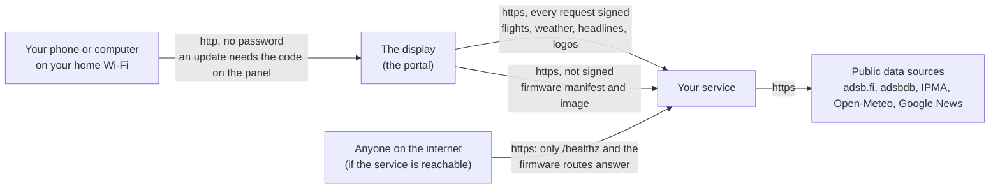

# Security

Checked on macOS on 25 and 26 Nov 2026: what was run and what was not is in the table at the end of this page. Checks on the author's own display carry the label "Verified on the author's own display". The signed-update check and Open-Meteo weather (26 Nov) are described as they work in the code and the host tests; they have not been checked on a display.

This page explains what protects a LedMatrix display and its data [service](glossary.md#service) at home, what does not, which parts you must keep up to date and how often, how to look after the secrets, what stays private, what to do when something goes wrong, and how to report a vulnerability. It is for a beginner who runs this project on a home network. It describes the code in this repository as it was on 26 November 2026 ([firmware](glossary.md#firmware) version 0.10.1 is the latest release; the signed-update check of section 1.7 is in the code but in no release yet, see L17). It does not build, install or host anything: for that see [build.md](build.md), [install.md](install.md), [hosting.md](hosting.md) and [operations.md](operations.md). For how the parts fit together see [architecture.md](architecture.md). Questions and problems: <https://github.com/suvl/ledmatrix/issues> (never put a secret there, and never the details of a vulnerability: section 7).

Every host name, address, ID and secret on this page is a placeholder: `apis.example.com` (your service), `192.0.2.10` (an address), `aabbccddeeff` (a [device ID](glossary.md#device-id)), `example-master-secret-...` (never a real secret).

**Roles, as in the [README](../README.md).** **You** build your own display. **The maintainer** publishes firmware releases and the public service image (the steps are in [development.md](development.md), "Releasing"). With **the public image** you run the service as the maintainer publishes it, and a new firmware reaches your display when you run a newer image. With **your own build** no update arrives unless you build and publish a release yourself, and then you are the maintainer too. Where the advice differs, the page says which one it means.

## Before you start

You need to know three things about your own setup, because the answers change which parts of this page matter to you:

1. **Where does your service run, and can people outside your home reach it?** If it only answers on your home network (the main path in [hosting.md](hosting.md): a home server with a private address and a real HTTPS name), the section about strangers on the internet mostly does not apply. If it runs on a rented server or on Google Cloud Run, it does.
2. **Who shares your Wi-Fi?** The display's web page (the [portal](glossary.md#portal)) has no password. Everyone who can join your Wi-Fi can use it.
3. **Where is your [master secret](glossary.md#master-secret) and where is its backup?** If you cannot answer this, read section 4 first.

If you read nothing else, do these eight things:

1. Never forward a port from your router to the display, and never put the display on the internet. The portal has no password.
2. Give visitors the guest Wi-Fi, not your main Wi-Fi.
3. Make the master secret as [install.md](install.md), "Make the master secret", says: one file outside the repository that only you can read, and a backup that is not on that computer. The copy that the service reads follows the rule in [hosting.md](hosting.md), "The secret file and its permissions" (section 4).
4. Press **Update** only when you expect a new version: on the public image, after the maintainer has published a release and you have run the new image; on your own build, after you published one. And only when the host named in the notice is your own service (section 6.3).
5. Write down the device ID of every display you set up, so that you can block a lost one (section 6.2).
6. Run the monthly check in section 3.4.
7. Turn on two-factor sign-in (a second proof besides your password, such as a code from an authenticator app or a security key) for your GitHub, domain registrar and DNS provider accounts (section 3).
8. Read the known limits (section 2) once, so that none of them surprises you.

## 1. How the system is protected

### 1.1 Three doors with three different locks

The display and the service meet at three places. Each has its own lock.



| Door | Where | The lock | Why it is built this way |
| --- | --- | --- | --- |
| The portal | On the display: `http://ledmatrix.local`, plain HTTP | Your home network. No password. Anything that changes the program also needs the [update code](glossary.md#update-code) that only the panel shows | The project's author chose no stored password: the code shown on the panel proves that someone is standing in front of the display, like the setup Wi-Fi password does (decision: issue 21) |
| The data routes | On the service: `/v1/weather`, `/v1/flights`, `/v1/headlines`, `/v1/logo/<code>` | Every request is signed by the display with its own key. Without a valid signature the answer is `401` | The service should only work for your displays (decision: issue 37) |
| The firmware routes | On the service: the [manifest](glossary.md#manifest) at `/v1/firmware/manifest`, the image at `/v1/firmware/<file>`, and `/healthz` | None on the route: open on purpose. The manifest itself is signed by the maintainer's key, and a display that checks signatures verifies it before it downloads anything (1.7) | See 1.4 |

### 1.2 The portal: plain HTTP, no password

The display serves its settings page itself at `http://ledmatrix.local` (the name works through [mDNS](glossary.md#mdns); `ledmatrix` is the default display name, and the address follows the display name you set in the portal). It is plain `http`, not `https`, and it has no password. The only lock is that you must be on the same home network ([LAN](glossary.md#lan)). The display only ever makes outgoing connections (to your service, to two time servers and, only when you press **Test connections**, to two test hosts); the code does not ask the router to open any port (a search of the firmware sources for UPnP finds nothing), and the display's own Wi-Fi network exists only while it is in [setup mode](glossary.md#setup-mode).

**What the portal refuses.** One guard sits in front of every route (`arduino/ledmatrix/webguard.h`, `net.cpp`; issue 46):

- **Host check, on every request.** The `Host` header must name the display itself: `<name>.local`, the bare `<name>`, its IPv4 address or its IPv6 addresses (ports are ignored). If another device on the network already has the name, the display's mDNS name becomes `<name>-2` and that is accepted. Anything else gets `421 Misdirected Request`. This blunts DNS rebinding: a web page on another site whose name was re-pointed at the display's address still sends its own name in `Host`, so it cannot read `/api/settings`, which holds your home location. A missing or empty `Host` is refused too (a very old HTTP/1.0 tool).
- **Origin check, on every request that changes something.** Every POST (`/api/settings`, `/forget`, `/api/update/check`, `start`, `confirm`, `cancel` and `upload`) that carries an `Origin` header, or a `Referer` when there is no `Origin`, naming another site gets `403`. An `Origin` of `null` is refused as well.
- A request with neither `Origin` nor `Referer` (`curl`, a script) still works, and there is still no password.
- **Setup mode:** the Host check is off (phones probe the setup network under other names); the Origin check still applies to `/save`.

**Verified on the author's own display on 26 November 2026:** requests from the page itself and requests with no `Origin` answered `200`, requests naming another site `403`, other `Host` names `421`, and an upload naming another site was refused without using up a code try. Not verified: a web page on another site driving a real browser (the checks were made with plain requests), access by an IPv6 literal address, and the `-2` name after a real name clash.

What anyone on the network can do with the portal, and what they cannot, is in section 1.8. The firmware does not show the Wi-Fi password, the [device key](glossary.md#device-key) or the update code in any answer: `GET /api/settings` has no Wi-Fi fields, `/status` shows the network name but not its password, and no update answer holds the code (`settings.cpp`, `net.cpp`, `shared/firmware-update.md`).

### 1.3 The data routes: signed requests

Every request the display makes to the data routes carries three extra headers: its device ID, the time, and a **signature**. The signature is an [HMAC](glossary.md#hmac)-SHA-256 fingerprint. In plain words: the display and the service share a secret for that display (the device key). The display mixes the request (the method, the host name, the address with its query, the time) with the key and sends the result. The service does the same calculation and compares. A caller who does not have the key cannot make a matching signature, and a request that was changed on the way no longer matches. The key itself never travels. The full scheme is in [`shared/device-auth.md`](../shared/device-auth.md).

The service checks four things, always in this order (`service/auth.go`):

1. The three headers are there and well formed.
2. The signature matches (compared in constant time).
3. The device is not on the [revoked list](glossary.md#revoked-list).
4. The time is within 2 minutes of the service's clock.

A caller who cannot sign is told only whether the request was unsigned, badly formed or wrongly signed. The service's time and the revoked status are only revealed to a caller whose signature is valid.

**Tested** (service image running locally, requests signed by a small script that follows the contract):

| Request | Answer |
| --- | --- |
| No signature headers | `401`, reason `missing` |
| Signed with a different secret | `401`, reason `bad_signature` (no time in the answer) |
| Signed correctly, time 200 s in the past | `401`, reason `clock_skew`, and the answer carries the service's time |
| Signed correctly | accepted (`404 no logo` for a logo that does not exist, which is only possible after the signature passed) |
| Device ID on `REVOKED_DEVICES`, valid signature | `401`, reason `revoked`; a different ID with a valid signature was accepted |
| The service started with `PUBLIC_HOST=apis.example.com`; request signed for the host `127.0.0.1` | `401`, reason `bad_signature`; the same request signed for `apis.example.com` was accepted |

**A refusal is soft.** A display whose key is refused keeps its last data, retries every 5 minutes, never wipes anything, never restarts because of it, and says why in its [problem list](glossary.md#problem-list). The service never bans a device for good; only your own revoked list blocks one.

**Why protect public data at all?** The flights, weather and headlines are public. The signature is there so that strangers cannot use your service as a free relay to providers whose terms say "personal, non-commercial use" (see [`service/README.md`](../service/README.md)), so that you can block a lost display, and so that the service fails closed: with no secret it does not start.

### 1.4 The firmware routes: open on purpose

The two firmware routes (`/v1/firmware/manifest` and `/v1/firmware/<file>`) ignore the signature headers completely. This is deliberate, for three reasons:

- **A display whose key is refused must still be able to fetch a fix.** If a wrong secret or a revoked ID also cut the update path, a deployed display could end up unrepairable except over USB (decision: issue 37, point 2).
- **The image is not secret.** The repository is public and the firmware is built from it. The image holds no key: the identity lives in a separate [flash](glossary.md#flash) [partition](glossary.md#partition) that updates never touch.
- **The protection is not the route.** What protects the display is the signature on the manifest, its own checks and the code on the panel (1.7).

**Tested** (on the image published for commit 1f9b6a5, which is unsigned): `GET /v1/firmware/manifest` without any request signature answered `200` with the five fields `version`, `file`, `size`, `sha256` and `notes`. A signed release adds two more after `notes`: `keyid` and `sig` (the **signature**, a value that only the holder of the private key can make). The service passes them through unchanged. It never verifies a signature and holds no key: it checks only their shape (both or neither, 8 and 128 lowercase hex characters, no control character in the notes, an answer of at most 2,048 bytes), and the display's check is the only one that counts (`service/firmware.go`, `shared/manifest-signing.md`).

What an open route costs: anyone who can reach the service can download the image (it is about 1.4 MB), and can use up the service's limited download slots. Downloads have their own limit of 8 at once, then `503`, apart from the limit of 32 for the data routes, so a flood of downloads cannot starve signed data requests (`service/firmware.go`, `service/main.go`).

### 1.5 The device key and the master secret

You make one secret, the **master secret** (text, at least 32 characters, from `openssl rand -hex 32`). Each display's key is worked out from it: **device key = HMAC-SHA-256(master secret, device ID)**. The device ID is the board's factory MAC address. The service stores no device keys. It keeps the master secret and your revoked list, and works the key out again for each request.

What follows from this design:

- **A new display needs no change on the service.** Any well-formed ID has a key. There is no list of allowed devices, only a list of blocked ones.
- **One display's key does not reveal another's, and does not reveal the master secret.** HMAC is a one-way mix. Someone who holds the key of one display (a thief, say) cannot work back to the master secret or forward to the key of a different display.
- **The master secret is the one secret that matters.** Whoever holds it can sign as any device (1.8). Whoever loses it, after the [burn](glossary.md#burn), locks the burned displays out of the service for good (section 6.1).

### 1.6 The eFuse burn

During [provisioning](glossary.md#provisioning) the display's key first sits as a file in the read-only `ident` flash partition (the interim software key). The burn then copies the key into the chip's [eFuse](glossary.md#efuse): one-time-programmable bits inside the chip. The key is marked read-protected and write-protected, and the chip's HMAC unit can use it to sign, but no program, flash tool or person can read it back (`tools/burn_key/README.md`). Afterwards `tools/provision.py --burned` removes the software key from flash.

The burn **does** close one door: reading the key off the flash chip with a cable and a flash tool.

The burn does **not** close another. Two protections that the [ESP32](glossary.md#esp32) chip offers are not used here: **secure boot** (the chip starts only programs that you signed) and **flash encryption** (the flash chip's contents are scrambled, so a cable cannot read them). Without secure boot a person who holds the display can put their own program on it, and that program can ask the chip's HMAC unit to sign any message. They never learn the key, but they can use it for as long as they hold the display. That is why a lost display must be revoked (section 6.2). This limit was written down when the decision was made (issue 37).

It is **irreversible**: the key cannot be changed, so the master secret cannot be rotated for a burned display (limit L8). It was done once, on the author's own board, on 25 Nov 2026; the runbook and what it showed are in `tools/burn_key/README.md`.

### 1.7 The update path: what is checked before the new program runs

An update changes the program that runs on the display, so it gets the most checks (`shared/firmware-update.md`, `shared/manifest-signing.md`, `arduino/ledmatrix/ota.cpp`). The first row applies to a display that runs a **signing build**, which is any firmware built from the current code with its default settings; no published release is one yet (L17). Everything below it applies to every display.

| Step | What is checked | What it protects against |
| --- | --- | --- |
| Whose release | The manifest that the display has just fetched must carry a signature made by one of the up to two **pinned** public keys built into the firmware (`update_keys.h`; a public key is the half that checks a signature and is not secret). The scheme is ECDSA (a standard way to sign data with a pair of keys) on the P-256 curve with SHA-256, checked with the mbedTLS library that is already in the core. The signature covers the version, file name, size, SHA-256 and notes. This is the first check, before the display requests anything else, and it runs again on the fresh manifest at the start of a download. A manifest that fails it is refused in plain words: nothing is downloaded, written or restarted, and the data side is untouched | Changing the saved service address, controlling DNS or a certificate, or a doctored service image: none of them gets anything installed except genuine, signed releases |
| Who asks | A random 6-digit code is shown only on the panel. You type it in the portal. It lives 3 minutes, allows 3 wrong tries, and is compared in constant time. After 3 wrong tries a new start is refused for 60 seconds, then 120, doubling up to 1 hour | Someone on the network starting an update; the code is never in an answer, a log, `/status` or the serial output |
| Where from | Always `https://<saved service host>/v1/firmware/...`, port 443, a [certificate](glossary.md#certificate) that must chain to the built-in list of certificate authorities (the [CA bundle](glossary.md#ca-bundle)) and match the host name, no redirects followed (`connectDual` and `liveHttpsStream` in `live.cpp`; the host name is handed to the [TLS](glossary.md#tls) library for the certificate check, `mbedtls_ssl_set_hostname` in the core's `ssl_client.cpp`; the firmware never calls the core's insecure mode) | A plain-HTTP download; a redirect to another host |
| Which file | The manifest's `file` must look like `ledmatrix-<version>.bin`; only a version strictly newer than the running one (and than any version that already rolled back here) is offered | A downgrade; a path or host smuggled in through the manifest |
| Is it intact | The [SHA-256](glossary.md#sha-256) and the size of the download must match the manifest (on a signing build, the signed values: so the signature vouches for the image, its version and its size). The image must pass ESP-IDF's image validation (header, segments, checksum, the image's own appended SHA-256), be an image for the ESP32-S3 with one app slot, and say that it is the version the manifest announced (a version marker inside the image, read back from flash before the switch) | A damaged download; an image for another chip; a build published under the wrong version |
| Is it good | The new image runs on [probation](glossary.md#probation): within 3 minutes it must join Wi-Fi, serve the portal, draw 100 frames with none over 1 second, and get one HTTP answer from the service. Otherwise, or after 3 starts without a pass (crashes or power cuts), the display goes back to the previous image ([rollback](glossary.md#rollback)) and says so in the portal's Problems section | An image that starts but does not work |
| The escape route | A `.bin` uploaded in the portal needs the same code, checked before the first byte is written. It gets the image checks but there is no manifest to compare with | |

**What these checks do not prove.** A valid signature shows that a release was made by the holder of a pinned key. It does not show that the release is good (the probation row catches one that does not work), and it does not stop someone who controls your service from withholding updates or offering an older genuine release that is still newer than the version a display runs (L18). It does not cover the forced `.bin` upload (L19). On a display without the check (0.10.x, or a development build) the SHA-256 only shows that the file is undamaged, not that it comes from the maintainer, and the rollback catches an image that does not work, not one that works and is hostile (L2, L3, L17).

### 1.8 Who can do what

This table is about what each kind of person can do **today, with the code as it is**. "Can" means the code allows it. Details and what to do about each row follow the table.

| Who | What they can do | What they cannot do |
| --- | --- | --- |
| **Someone on your Wi-Fi** | Using a tool that sends no `Origin` (`curl`, a script): open the portal's data and read your saved location, settings, the display's ID, the Wi-Fi network name and the problem list. Change any setting, including your location and the service address. Press "Forget this Wi-Fi network" (the display wipes its Wi-Fi and restarts into setup mode; it shows nothing new until you join it to your Wi-Fi again). Start an update, which puts a code on the panel and can use up your tries. Point the display at a server of their own (L2) | Read the Wi-Fi password, the device key or the master secret. Install firmware without the code that only the panel shows. Read the encrypted traffic to your service. Use your service's data routes (they cannot sign). Through a web page in a browser on your network: change settings, press Forget or start an update, or read your settings by DNS rebinding (the guard in 1.2 refuses requests that name another site or another host name) |
| **Someone on the internet who finds your service** | Ask `/healthz`. Download the firmware manifest and image (public anyway). Fill the service's limited slots and write refusal lines to its log (capped). Find your service's name in public certificate logs (unless you use a wildcard certificate) | Get any flights, weather, headlines or logos (`401`). Learn whether a device ID exists or is revoked, or the service's time. Guess a key (256 bits). Change anything on a display |
| **Someone who steals the display** | Read the saved Wi-Fi password, your location and the service address from the flash chip over USB (not encrypted). On a display whose key is not burned, also read the device key. Put their own program on it (and replace the pinned update keys, which sit in the same unprotected flash) and, if the key is burned, ask the chip to sign requests as your display until you revoke its ID | Learn the master secret. Sign for your other displays. Read a burned key out of the chip with software or a flash tool |
| **Someone who gets your master secret** | Work out the key of any display and sign requests as any device; use your data service for free. The service's log shows an ID that is not one of your displays (`device seen <id>`, L7), but nothing marks a request signed as one of your own IDs | Open, change or update any display. Read your Wi-Fi. Push firmware. The secret alone gives them no access to a display or to your server |
| **Someone who controls your DNS, or a certificate authority** | If they control your name in the *public* DNS (a stolen registrar or DNS account): send the display to a server of theirs that has a valid certificate; show false flights, weather and headlines; collect each signed request (device ID, signature, time, and your location in the address); show the portal a "newer firmware" notice under the name your own notice shows. On a signing build they can offer only genuine, signed releases: they can withhold updates, or offer an older genuine release that is still newer than what the display runs (L18). On a display without the check (0.10.x, and the transition window of L17) the old rule holds: it installs only if someone types the code from the panel | Learn the master secret or a device key from the signatures. Make a signing build install their own firmware (the signature fails, nothing is downloaded). Install anything without the code. If they control only your *home router's* DNS: get a valid certificate for your name, so the display refuses the connection and shows a certificate problem |
| **Someone who gets the update signing key** | Sign a release that displays accept. That is dangerous only together with a way to serve it to a display: control of your service, your DNS or a certificate, or a changed saved address (L2, L3) | Reach a display that talks to your own, uncompromised service. Install anything without the code from the panel. Change data or settings. Read the master secret. (The key is a CI secret, so "gets the key" in practice means write access to `main` or the maintainer's GitHub account: L12, 4.4) |

**Someone on your Wi-Fi.** Treat your Wi-Fi password like the key to the portal: the guard in 1.2 keeps other web pages out, not a person who types commands. Give visitors the guest network (it normally keeps guests away from your other devices; check the router's "client isolation" or "guest" setting). Use WPA2 or WPA3 (the two current security standards for Wi-Fi passwords) with a long password. The Wi-Fi library's default minimum is WPA2, so the display will not join an open or older network (`WiFiSTA.h` in core 3.3.13); A WPA3-only network was not tested (Not tested here), so choose the mixed WPA2/WPA3 mode if your router offers it. On a network where everyone knows one WPA2 password, people may be able to read each other's plain-HTTP traffic; WPA3 closes that. Everything you type in the portal, including the update code, crosses your Wi-Fi as plain HTTP. The code works once and only for 3 minutes, so a copy taken from the air is of little use after you have typed it (`CodeAuth::check` in `otalogic.h` spends the code on the first correct entry).

**Someone on the internet.** If your service is public, expect strangers to find it: a name that has its own public certificate appears in public certificate logs (the "Certificate Transparency" logs, where certificate authorities must record what they issue; the [project's site](https://certificate.transparency.dev/) explains them), so treat the name as public. A wildcard certificate keeps individual names out of the logs. Run the service behind a [reverse proxy](glossary.md#reverse-proxy) that gives it HTTPS, as in [hosting.md](hosting.md), and keep Go and the base image current (section 3).

**Someone who steals the display.** Revoke its ID and change your Wi-Fi password (section 6.2). Assume that the finder can learn roughly where you live from the saved location.

**Someone who gets your master secret.** Section 6.1 says what to do and, honestly, what is stuck.

**Someone who gets the update signing key.** Section 4.4 has the recovery table: delete the secret, check the service, the registry and the GitHub account, and rotate at once.

**Someone who controls your DNS or a CA.** For firmware this was the weakest link in the design; on a signing build it is closed (L3), but it is still open for false data, for your location and for withheld updates (L2, L18). What helps: two-factor sign-in and registrar lock on the domain and DNS accounts, a CAA record, and the habit in section 6.3: you know when a new version should arrive, so one you did not expect is a warning, whatever host the notice names.

## 2. Known limits

These are things the design does not do. Each was checked in the code or the contract.

**L1. The portal is plain HTTP on your LAN with no password.** Anyone on your Wi-Fi can read and change the settings, wipe the Wi-Fi with "Forget" (`/forget`), and start the update-code screen, with a tool that sends no `Origin` or `Referer` (`curl`, a script, any program). That is by design: the author decided that Forget and changing the saved address need no panel code. What the guard in 1.2 does stop is a web page in a browser acting for another site. What it does not stop: tools that send no `Origin` or `Referer`; a request to another port (ports are ignored); another page served from the display itself (the display serves only the portal, so there is none); and `GET /api/selftest`, which is not Origin-checked (it changes no state and takes up to 30 seconds). What reduces the risk: the guest Wi-Fi for visitors, a strong Wi-Fi password, and never exposing the display to the internet. A firmware update is still protected by the panel code.

**L2. Anyone on the LAN can change the saved service host, and that host is also where updates come from.** The display trusts the host saved in its settings. Someone on your network could point it at a server of their own (they need a normal, valid certificate for that name, which is easy to get for a domain they own). That server then gets the display's device ID, signature, time and your location, and can show false data. **On a signing build it can no longer get its own firmware installed**: an update must carry the maintainer's signature (1.7), so only genuine releases can arrive (L18 says what is left). **On a display without the check (0.10.x, a development build) the old risk stays**: such a server could publish a "newer" version, and what stands in the way is the code shown only on the panel and the portal's notice, which names the host next to the Update button ("From: ... Only update if this is your own service."). The author decided "no signature for now" in issue 21 and reversed it in issue 42.

**L3. The update's authenticity used to rest on DNS, the certificate authorities and your host.** The display trusts every root certificate in its built-in list (the source file of the list has 146 of them) and the DNS answer for your service name. A person who controls your public DNS, or a certificate authority that issues a certificate for your name by mistake, can stand in for your service (section 1.8): show false data and collect requests. **On a signing build they can no longer get firmware installed, because that needs the maintainer's signature.** On a display without the check, the checks in 1.7 prove only that a file is intact, not that it is the maintainer's.

**L4. A crash before `setup()` starts is not caught by the rollback.** The rollback runs from inside the new program, so a fault in the very first start-up code (core initialisation, static constructors) cannot be caught. The image has passed the validation and the SHA-256 check, and it comes from the same build as the running one, which makes this unlikely. The recovery is a USB flash from your computer ([install.md](install.md)).

**L5. The update-code throttle lives in RAM.** The throttle (60 s, doubling to 1 hour) is in ordinary RAM and starts afresh after any restart. The 3-minute health check does not depend on it. The count of starts during probation is kept in flash instead (L16).

**L6. A captured signed request can be replayed for 2 minutes.** Anyone who sees a signed request (on the stretch between your proxy and the service, say, if they are on different machines) can send the same bytes again while the timestamp is still within the window. **Tested:** one signed request sent twice, 5 seconds apart, was accepted both times. What a replay gets: public flight, weather or headline data. It cannot change anything. Between the display and your proxy the traffic is encrypted. Setting `PUBLIC_HOST` (section 4) also stops a signature made for another host name from working against your service (tested, 1.3).

**L7. The revoked list needs a restart, and a leaked secret is only partly visible in the log.** `REVOKED_DEVICES` is read when the service starts (`authFromEnv` in `service/auth.go`); edit it and restart. The service logs `device seen <id>` the first time it accepts a device in each hour (at most 256 devices; one notice line when that list is full). The line holds the 12-character ID only, never a path, query, address, signature or header, and it is not written with `AUTH_OFF=1`. So an ID that is not one of your displays shows up: `docker compose logs api | grep 'device seen'`, or `kubectl logs` on Kubernetes (Not tested here). What it cannot show: someone who signs as one of your own IDs, and how much was fetched. The line is covered by the service's Go tests (`TestSeenLog...` in `service/auth_test.go`); it was not run in a container here.

**L8. The master secret cannot be rotated for a display whose key is burned.** The chip's key is the one made from the old secret and it can never be changed. A new secret locks that display out of the data service (it can still get firmware updates, because those routes are open). Section 6.1 lists the options. There are only six key blocks on the chip, and one burn uses a block for good.

**L9. A stolen display gives up more than its key.** Secure boot and flash encryption are not used, so a person with USB access can read the whole flash chip: the saved Wi-Fi password and your location (stored in plain text in the `nvs` partition, see [NVS](glossary.md#nvs); the partition table has no key store for encrypting it), and, on a display that is not burned, the device key in the `ident` partition. The partition is marked read-only, but that is a rule for the firmware's own code; a flash tool writes raw flash. With a burned key a thief cannot read the key but can ask the chip to sign (section 1.6).

**L10. The clock comes from plain NTP.** The display asks `pool.ntp.org` and `time.cloudflare.com` for the time with NTP (the protocol devices use to ask for the time), which is not authenticated, as on most devices. Someone who can forge those answers can make the clock wrong. That makes secure connections fail (certificates have dates) and the service answers `clock_skew` (the display repairs the signing time from the service's answer). It also weakens the check of a certificate's dates.

**L11. Setup mode is short but open to anyone in Wi-Fi range.** The display's own network (named `ledmatrix` the first time, and after that after its display name) uses WPA2 with a generated password of 8 characters from a 32-character alphabet (about 40 bits), new each time setup mode starts, shown on the panel and printed on the USB [serial port](glossary.md#serial-port). Your home Wi-Fi password is typed into a plain-HTTP form over that network (`net.cpp`). Do setup when nobody you do not know is within Wi-Fi range.

**L12. The update chain is only as strong as the signing key's custody, your GitHub account and your deploy step.** On a signing build, whoever holds the signing key decides which firmware the display accepts. The key is a CI secret, so its custody is exactly as strong as write access to `main` (anyone who can push can change the workflow and read the secret) and the maintainer's GitHub account (4.4). A compromised deploy step, registry or service image alone can no longer ship firmware to such a display: it cannot sign. On a display without the check, whoever can push to `main` decides what the next image carries and whoever can deploy your service image decides which firmware your displays are offered. On the public image you trust the maintainer's key and account; on your own build you trust your own. On 25 Nov 2026, 46 of the repository's 60 commits carried a valid signature and 14 did not (`git log --format=%G?`). A signed commit shows who made it, if you trust the key. Section 3 says how to protect the account.

**L13. Third parties see your browser when you use the portal.** The map and the place search contact other servers (section 5).

**L14. The service holds one master secret.** There is no second secret and no list of allowed devices. A leak cannot be narrowed down to one display.

**L15. The portal answers only to the display's own names.** A name that the display does not own gets `421`: names that your router's DNS makes up (`ledmatrix.lan`, `ledmatrix.home`, `ledmatrix.fritz.box`), a reverse proxy in front of the portal, an address reached through a VPN or a port forward, a unique-local IPv6 address, `localhost`. Use `http://<name>.local` (by default `http://ledmatrix.local`), the bare name, or the display's current IP address (on the panel and in `/status`). The page that says "This display answers only to its own name (for example ledmatrix.local) or its own IP address. Open it that way." means this; see [operations.md](operations.md), "Open the portal".

**L16. A power cut during probation counts like a crash.** The count of starts during an update's probation is kept in flash (key `pcount` in the `update` namespace of NVS, together with the identity of the image it counts for), so a power cut cannot hide it. The price: every start of a new image that has not yet passed its check counts, whatever the reason. After 3 starts without a pass the 4th rolls back, even if the new version is fine, so four power cuts in the first minutes can roll back a good update. After an update leave the display alone until the portal says the check passed (1 to 3 minutes). Unchanged: a crash before `setup()` starts is not counted (L4). A rollback is listed in the portal's Problems section (kind "update check"), not as a message on the panel. **Verified on the author's own display on 26 November 2026:** an update whose image crashes on start rolled back on the 4th start, with the Problems entry "The new version kept restarting.", and an update whose image hangs before Wi-Fi rolled back at exactly 3 minutes ("The board did not join Wi-Fi within 3 minutes of starting."). Not verified: a real power cut during probation; the counter in flash is proven by the tests and by the crash loop, not by pulling the plug.

**L17. The signature check has not reached every display, and the first signed release is not published.** Stated plainly, in three parts. (1) Displays on 0.10.x have no signature check; they ignore the new `keyid` and `sig` fields. The first release that carries the check (planned as 0.11.0) installs once, through the old unsigned check; from then on that display enforces signatures. A display flashed over USB with that release skips the one-time trust. (2) The release workflow has a switch at the top of `.github/workflows/service.yml`, `REQUIRE_SIGNING`, which is `"0"` today. While it is `"0"` and the repository secret `UPDATE_SIGNING_KEY` is empty or missing, a release goes out **unsigned**, with a warning. A display that checks signatures refuses such a release ("The service offers a firmware update that is not signed..."), and a 0.10.x display accepts it because it does not check. Today the secret is not set. This transition window ends when the maintainer sets the secret and changes `REQUIRE_SIGNING` to `"1"` (the maintainer does this once); from then on an empty secret makes the run fail and nothing is published. (3) A signed manifest must verify in both modes. None of this has been checked on a real display: it is described as the code and the host tests have it.

**L18. Someone who controls your service can still withhold updates or show an older genuine release.** The signature covers the manifest's values, not the time. A service under someone else's control can stop offering new releases (a freeze), or offer an older genuine release that is still newer than the version a display runs (a display installs only a strictly newer version, and never one that already rolled back here). There is no expiry field and no stored version floor: an expiry would make every display refuse the current release if the maintainer's CI stopped for a few weeks, and the display's clock comes from plain NTP (L10). A leaked signing key together with control of your service defeats the scheme until a rotation reaches the display (4.4).

**L19. The forced `.bin` upload is not signed.** It needs the panel code and the image checks (a valid ESP32-S3 app image that fits the slot) but cannot be signed, because there is no manifest. Someone who is at the panel and also on your Wi-Fi can install any firmware, as someone with a USB cable can. It is the way out if the keys are ever lost, which is why it stays. The pinned keys sit in unprotected flash (no secure boot), so a thief with USB access can replace them (L9).

## 3. What you must keep up to date

Security fixes only help if you install them. Some parts reach your display only when a new firmware is released; some run on your computer or server; some are accounts. This section lists every part, how often to look, and where.

### 3.1 Found and fixed on 25 and 26 Nov 2026

These findings are dated. They will age; the method in 3.2 to 3.4 will not.

- **Go 1.25 was no longer supported.** Go supports each release until two newer ones exist; Go 1.27 came out on 19 Aug 2026, the same day as the last Go 1.25 release (1.25.14). The [Docker image](glossary.md#docker-image) that the workflow built for commit 1f9b6a5 held a program compiled with go1.25.14 (`go version` on the program, taken out of the image, says so). Go's own scanner `govulncheck` (database updated 24 Nov 2026) reported for Go 1.25.14: "Your code is affected by 12 vulnerabilities from the Go standard library", in `net/http` (HTTP/1 and HTTP/2 server crashes, no limit on the size of parsed `Range` headers, memory and CPU exhaustion), `net/textproto`, `crypto/tls` and `crypto/x509`. The fixes are in Go 1.26.9 to 1.26.11 and in 1.27. How easy each one is to use against this service was not assessed; many of the titles describe crashes and resource exhaustion, which a stranger could cause if the service is public.
- **The base image was a Debian 12 one that its project no longer lists.** `service/Dockerfile` used `gcr.io/distroless/static-debian12:nonroot`. Its last push was 21 Aug 2026; the distroless project's README now lists only Debian 13 images as published and updated (`static-debian13:nonroot` was pushed 22 Nov 2026). Sources in Background.
- **Fixed.** `service/Dockerfile`, `.github/workflows/service.yml`, `service/go.mod` and the test command in `service/README.md` now say Go 1.27, and the Dockerfile uses `gcr.io/distroless/static-debian13:nonroot`. The service's 59 tests pass on Go 1.27.4 with the race detector, and `govulncheck` finds nothing in the new code. **The lesson: pin a supported Go and scan again every month with `govulncheck ./...` (3.3).** A change in the files is not a change in what runs: **a service that still runs an image built before the change has the problems above until you run a newer image** ([hosting.md](hosting.md), "Keep it running", "Update the service and Caddy").
- **GitHub Actions: pinned and watched (26 Nov 2026).** Every action in `.github/workflows/service.yml` is pinned by its full commit hash, with the release in a comment: checkout v4.4.0, setup-go v5.6.0, cache v4.3.0, upload-artifact v4.6.2, setup-buildx-action v3.12.0, login-action v3.7.0, build-push-action v6.19.2. `.github/dependabot.yml` has Dependabot (GitHub's service that proposes updates to dependencies) check the Actions, the Go modules of `service/` and its Docker base images every Monday: minor and patch updates in one pull request, a new major version in its own, and each new release waits 7 days. Two limits. The workflow runs only on a push to `main`, so a Dependabot pull request has no check of its own: read what it changes, merge it, then look at the run that the merge starts. And Dependabot cannot see the pins in the workflow's `env` block (arduino-cli, the esp32 core, the Arduino libraries): those stay a manual check (3.2).
- **Still open** (details in 3.2 and Background): the root-certificate list inside the display's core is from Mozilla's list as of Feb 2025; none of the 21 mbedTLS advisories published on 16 Nov 2026 can be reached on the display as built (Background), but no core carries the fixed mbedTLS yet: the plan is the first 3.3.x core whose libraries report mbedTLS 3.6.8 or later (issue 51 waits for it); arduino-esp32 4.0.0 (19 Nov 2026) is no shortcut, because it carries mbedTLS 4.1.1, which is also affected, and it is a major migration (this project stays on 3.3.13 from 17 Nov 2026, the newest of the 3.3 line; a move to 4.x is Not tested here).

### 3.2 The table

**Who does what.** On the public image the maintainer looks after the display-side rows (the core, the libraries, the portal's libraries, the [bootloader](glossary.md#bootloader)) and the rows that make the service image (Go, base images, Actions, build tools). Your part is to run the newest public image and to look after the host, Caddy, the certificate, the router and your accounts. On your own build every row is yours.

| Part, and what this project uses | How often to look | How to check and update | Where to watch |
| --- | --- | --- | --- |
| **arduino-esp32 core 3.3.13**, which carries the TLS library (mbedTLS 3.6.7), the portal's web server and the list of trusted certificate authorities | Monthly. Immediately if a fix concerns TLS, Wi-Fi or the web server. A new 3.3.x release has come every 1 to 2 months. Trigger for the mbedTLS fixes: the first 3.3.x whose libraries report mbedTLS 3.6.8 or later (Background) | Newest version: the releases page. To move: change `ESP32_CORE_VERSION` in `.github/workflows/service.yml` and your local install, build, run the host tests, release (see Background and [build.md](build.md)) | [arduino-esp32 releases](https://github.com/espressif/arduino-esp32/releases) |
| **Arduino libraries**: ArduinoJson 7.4.3, Adafruit Protomatter 1.7.1, Adafruit GFX 1.13.0, Adafruit BusIO 1.17.4 (pinned in the workflow) | Every 3 months, and together with a core update. ArduinoJson matters most: it reads text sent by your network (the portal's settings) and by your service | Compare the pin with the newest release; change the pin in the workflow and in your install; build and test. Adafruit GFX 2.0.0, a new major version, came out on 23 Nov 2026 (Not tested here) | [ArduinoJson](https://github.com/bblanchon/ArduinoJson/releases), [Protomatter](https://github.com/adafruit/Adafruit_Protomatter/releases), [GFX](https://github.com/adafruit/Adafruit-GFX-Library/releases), [BusIO](https://github.com/adafruit/Adafruit_BusIO/releases) |
| **The portal's browser libraries**: Leaflet 1.9.4 and tz-lookup 11.8.0, loaded by your browser from `unpkg.com` and `cdn.jsdelivr.net` with integrity hashes | Every 3 to 6 months, or on an advisory. Leaflet 1.9.4 is still the newest stable one | Change the address and the `integrity=` hash in `portal/portal.template.html`, run `tools/build_web.py`, release a new firmware. The hash can be recomputed (3.3) | [Leaflet](https://github.com/Leaflet/Leaflet/releases), [tz-lookup](https://github.com/photostructure/tz-lookup/releases) |
| **The bootloader** (Adafruit's prebuilt TinyUF2 on the board) | Once a year, or on an advisory. It is not part of the [over-the-air](glossary.md#ota) update, so a new bootloader means a USB step. Not tested here | Adafruit's instructions for the Matrix Portal S3 | [TinyUF2 releases](https://github.com/adafruit/tinyuf2/releases) |
| **Go and the service's dependencies**: the Go version named in `service/go.mod`, `service/Dockerfile` and the workflow (see 3.1); `service/go.mod` lists no other modules, only Go's standard library | Monthly: Go publishes fixes about monthly and a new release every 6 months (Feb and Aug) | Run the scanner (3.3). When the Go in those files is no longer supported, move to a supported one, run the service tests, rebuild the image, deploy | [Go release history](https://go.dev/doc/devel/release), [golang-announce](https://groups.google.com/g/golang-announce) |
| **The vulnerability scan**: `govulncheck ./...` on `service/` (Go's own scanner; it reports only known problems in code that the service actually calls) | Monthly, and before every release of the service. Immediately after a Go security release | The command in 3.3. A good result ends with `No vulnerabilities found.` If it lists findings, move to the Go version that fixes them, run the tests, rebuild, deploy | [Go vulnerability database](https://pkg.go.dev/vuln/) and [golang-announce](https://groups.google.com/g/golang-announce) |
| **[Container](glossary.md#container) base images**, both named in `service/Dockerfile`: the `golang` image of the build stage (not shipped) and the distroless `static` image (shipped) | Monthly: rebuild the image so that it picks up the newest base (public image: the maintainer does this; you run the newest image) | Run the workflow by hand (3.3): it has no schedule, so a month with no push builds nothing. It republishes the same commit tag and `latest` with a newer base. A rebuild of the same firmware version is not a release; displays only update to a strictly newer version. Then run the new image (`docker compose pull api`, then `docker compose up -d`; [hosting.md](hosting.md), "Keep it running", "Update the service and Caddy") | [distroless](https://github.com/GoogleContainerTools/distroless), [golang on Docker Hub](https://hub.docker.com/_/golang) |
| **GitHub Actions** used by the workflow, each pinned by full commit hash with its release in a comment: checkout v4.4.0, setup-go v5.6.0, cache v4.3.0, upload-artifact v4.6.2, setup-buildx-action v3.12.0, login-action v3.7.0, build-push-action v6.19.2 | Weekly: Dependabot opens its pull requests on Mondays (maintainer; on your own build, you) | Read the pull request, merge it, then look at the run that the merge starts (the workflow has no run on pull requests). A new major version comes as its own pull request. To pin by hand see [development.md](development.md) | Dependabot's pull requests; each action's releases page; [GitHub: secure use of Actions](https://docs.github.com/en/actions/reference/security/secure-use) |
| **Build tools on your computer**: arduino-cli 1.6.0 (checked against a SHA-256 in the workflow; 1.6.0 was the newest release on 25 Nov 2026), Python 3, Docker | With your computer's updates; arduino-cli every 6 months | The workflow's arduino-cli pin has a checksum: change the version and the checksum together | [arduino-cli releases](https://github.com/arduino/arduino-cli/releases) |
| **The host's operating system and Docker** (the machine that runs the service) | Turn on automatic security updates; look monthly that they ran and restart when asked. Docker Engine published five releases (29.9.1 to 29.10.1) between 14 Oct and 24 Nov 2026 | macOS: System Settings, General, Software Update. Debian or Ubuntu: the `unattended-upgrades` package. Docker: your package manager or Docker Desktop's updater. Not tested here on Linux | [Apple security releases](https://support.apple.com/en-us/100100), [Ubuntu notices](https://ubuntu.com/security/notices), [Debian security](https://www.debian.org/security/), [Docker security announcements](https://docs.docker.com/security/security-announcements/), [Docker Engine releases](https://docs.docker.com/engine/release-notes/) |
| **Caddy** (or the reverse proxy you chose), and its DNS module | Monthly. Caddy's 2.11 line had releases on 1 and 3 Oct and on 4 and 5 Nov 2026. Immediately on an advisory | The Compose file in [hosting.md](hosting.md) builds a local Caddy image with your DNS provider's module. A plain `docker pull` does not refresh an image you built yourself: rebuild it with `docker compose build --pull caddy`, then `docker compose up -d` ([hosting.md](hosting.md), "Keep it running", "Update the service and Caddy") | [Caddy releases](https://github.com/caddyserver/caddy/releases), [Caddy advisories](https://github.com/caddyserver/caddy/security/advisories) |
| **Kubernetes** (only if you use it; `service/deploy/ledmatrix-api.yaml` is written for k3s and an Envoy Gateway): the cluster tool, the Gateway, the cluster's own machines | Monthly for patch releases. Kubernetes supports its newest three minor versions for about a year each (1.37, 1.36 and 1.35 on 25 Nov 2026), so plan a minor upgrade at least yearly | Follow your cluster tool's upgrade guide (Not tested here) | [Kubernetes security](https://kubernetes.io/docs/reference/issues-security/security/), [Kubernetes releases](https://kubernetes.io/releases/), [k3s releases](https://github.com/k3s-io/k3s/releases), [Envoy Gateway releases](https://github.com/envoyproxy/gateway/releases) |
| **Your HTTPS certificate** | Monthly: confirm that it renews. Caddy renews by itself while your DNS token works | `openssl s_client -connect apis.example.com:443 -servername apis.example.com </dev/null 2>/dev/null \| openssl x509 -noout -dates` prints the start and end dates. The display shows a certificate problem if it expires (3.3) | Your CA's announcements (Background) |
| **The update signing keys** (the maintainer; on your own build, your own) | Yearly rotation, or at once on suspicion of a leak. Once a year check that the offline copies can be read | Section 4.4 and the steps in [operations.md](operations.md), "For the maintainer: publish a firmware release". The portal and `GET /api/update` show which key ids a display accepts | The maintainer's own notes; GitHub's security alerts for the repository |
| **Your router and Wi-Fi** | Every 3 months; turn on automatic updates if the router has them. Replace a router that no longer gets updates | WPA2 or WPA3 with a long password; switch off WPS and remote administration; keep a guest network for visitors | Your router maker's support page |
| **Your [domain name](glossary.md#domain-name): the registrar and DNS provider accounts** | Review every 6 months | Two-factor sign-in, registrar lock, automatic renewal of the domain (a domain that lapses can be registered by someone else, who can then get a valid certificate for it), a CAA record (3.3), and a DNS token limited to one zone | The providers' own notices |
| **Your GitHub account and repository** | Review every 6 months | Two-factor sign-in (passkey, security key or authenticator app); review tokens and SSH keys; Dependabot alerts; protect `main` against force pushes; sign your commits | [GitHub security advisories for your repository](https://docs.github.com/en/code-security) |
| **Your own computer** (where you build, flash and keep the master secret) | With its updates | Disk encryption (FileVault on macOS), a screen lock, a current OS | The OS vendor |

Dependabot sees the Actions, the Go modules and the Docker base images. It does not see the pins in the workflow's `env` block (arduino-cli, the esp32 core, the Arduino libraries), so those rows are a manual check.

### 3.3 How to run the checks

**Go and its scanner.** Go's official scanner `govulncheck` checks which known problems in the standard library your code actually calls. Run it on the service from the repository root (see [build.md](build.md), "Terminal in 2 minutes"). **Tested:** the scan runs in a container with the folder mounted read-only.

```
docker run --rm -v "$PWD/service":/src:ro -w /src golang:1.27 sh -c \
  'GOBIN=/tmp/bin go install golang.org/x/vuln/cmd/govulncheck@latest && /tmp/bin/govulncheck ./...'
```

What it does: starts a throwaway container with the newest Go (the first run downloads the Go image, about 1.3 GB according to [development.md](development.md), "The Go service tests"; "Clean up" there removes it again), installs the scanner, and scans the service's code against the vulnerability database. A good result ends with `No vulnerabilities found.` (**Tested:** that is what it printed with Go 1.27.4 on the files that say Go 1.27.) If it prints findings, move to a newer Go. The newest scanner needs Go 1.26 or later, so for the old Go 1.25.14 the scan needed an older scanner (`govulncheck@v1.1.4`), which printed the 12 findings of 3.1. On Linux the command is the same (Not tested here).

**Which Go compiled the image you run?** `docker create --name x <image>`, then `docker cp x:/ledmatrix-api .`, then `docker rm x`, then `docker run --rm -v "$PWD":/b:ro golang:1.27 go version /b/ledmatrix-api`. **Tested:** for the image built for commit 1f9b6a5 it printed `go1.25.14`; for an image built from the new files, `go1.27.4`.

**Rebuilding the image by hand (your own build).** Run the workflow from the repository's Actions page ("Run workflow"). It builds the commit at the head of the branch you pick and publishes the image again under `latest` and under the commit-hash tag. So a commit tag names one commit, not one set of bytes: a rebuild of the same commit replaces what that tag points to, with a newer base image. The firmware version in it is unchanged, and displays only update to a strictly newer version, so a rebuild is not a release.

**The portal's browser libraries.** Both script tags carry an `integrity=` hash, so a browser refuses a file that does not match, even if the server that hosts it were taken over. **Tested:** the hashes of `leaflet@1.9.4` and `tz-lookup@11.8.0` were recomputed with `openssl dgst -sha256 -binary FILE | openssl base64 -A` (SHA-384 for tz-lookup), and both matched the values in `portal/portal.template.html`. Use the same command to make the hash for a new version, and write it as `sha256-<result>`.

**A CAA record.** By default every public certificate authority may issue a certificate for your name (Let's Encrypt's [CAA page](https://letsencrypt.org/docs/caa/) says so). A CAA record is a DNS record in which you name the only authorities that may. For a Let's Encrypt setup it looks like `example.com. CAA 0 issue "letsencrypt.org"` (check your DNS provider's form). The standard is [RFC 8659](https://rfc-editor.org/rfc/rfc8659). It does not stop someone who controls your DNS, because they could change it, but it limits the damage of a bug in a different authority. Not tested here.

**Your certificate.** The `openssl s_client` command in the table was **tested** against a public example host and printed `notBefore=` and `notAfter=` lines. If your service answers only on your home network, run it from a computer on that network.

### 3.4 A monthly routine (about 30 minutes)

1. Open the releases pages of arduino-esp32, Go, Caddy and Docker (or let GitHub mail you: on each repository choose **Watch**, **Custom**, **Releases** and **Security alerts**). For the core, look at whether a new 3.3.x has appeared and which mbedTLS it carries (Background).
2. Run `govulncheck` (3.3). If it finds something, update Go.
3. Public image: run the newest one (`docker compose pull api`, then `docker compose up -d`). Your own build: run the workflow by hand so that the image gets the newest base (3.3), then run the new image. Either way, check that an unsigned request is refused ([operations.md](operations.md), "Firmware updates").
4. Let the host install its updates, and restart it if asked. Check that the service and Caddy came back.
5. Check the certificate's end date (3.3). It should be more than 30 days away.
6. Open the portal's Problems section. A display that has been failing for an hour shows a message on the panel; read it.
7. Once a quarter also check the router, the libraries and any open Dependabot pull requests. Twice a year review the account settings in the table and check that you can read your master-secret backup (section 4).

**Immediately** (the same day): when a vulnerability is published for something you run and it concerns the network, TLS, the web server or the container.

**Hearing about problems without reading everything:** the [golang-announce](https://groups.google.com/g/golang-announce) list, [Debian](https://www.debian.org/security/) or [Ubuntu](https://ubuntu.com/security/notices) security announcements for your host, and the **Watch** setting above. Dependabot alerts for your repository need no reading until one arrives.

## 4. Secrets

| Secret | Where it lives | Rule |
| --- | --- | --- |
| **The master secret** | A file on your computer outside the repository; for the service, a file it can read (`MASTER_SECRET_FILE`) or its environment (`MASTER_SECRET`); one offline backup | Section 4.1 |
| **A device key image file** (made by `provision.py`) | Briefly, on your computer, until the board has been flashed | Section 4.2 |
| **The DNS provider's token** (used by Caddy to prove that you own the name, the [DNS challenge](glossary.md#dns-challenge)) | In `.env` next to the Compose file, or a Kubernetes Secret | Create it with the narrowest rights: edit DNS records of one zone only. It can change where your name points, which is as serious as the master secret (section 1.8, the DNS row). Never in the repository |
| **Your GitHub sign-in, tokens and the registry login** | Your password manager | Two-factor sign-in; no token that you do not use |
| **The Wi-Fi password** | In your head or password manager; on the display's flash (not encrypted, L9) | Use a Wi-Fi password that you do not use anywhere else |
| **The update signing key, current** (the maintainer; on your own build, your own) | The GitHub Actions secret `UPDATE_SIGNING_KEY`, and an offline copy | Section 4.4. Outside the repository, mode 600, backed up offline |
| **The update signing key, spare** | Offline only, never in CI | Section 4.4 |
| **The update code** | Shown on the panel for 3 minutes | Not stored anywhere else. Never type it unless you started the update |

### 4.1 The master secret

**Make it and back it up** as [install.md](install.md), "Make the master secret", says. It leaves one file, `~/ledmatrix-secrets/master-secret` (64 hexadecimal characters, readable only by you), and explains the backup. This page does not repeat the recipe.

**Keep it.**

- **Never** in the repository, in a ticket, an issue, a chat message, a screenshot, a log or an email. Every example in this project is a placeholder.
- **Never on a command line.** A command line is stored in your shell history and is visible to other users of the machine in the process list. That is why `provision.py` takes only the path of a file (`--secret-file`) and the service takes the secret from a file or from its environment, not from an argument. `provision.py` also refuses a secret file that is inside the repository.
- **Back it up outside that computer, now.** A password manager, or paper in a safe place. After the burn, a lost master secret cannot be recovered and the burned display is locked out of the service for good (section 6.1). Losing the secret is worse than leaking it. Once a year check that you can read the backup.
- **Treat the file as a password.** FileVault (macOS) or disk encryption on the machine that holds it.

**Give it to the service.** The service reads the secret from one of three places and refuses to start unless exactly one is set (`service/README.md`, `service/auth.go`):

- **`MASTER_SECRET_FILE`: the absolute path of a file that holds only the secret**, for example `/run/secrets/master-secret`. This is the recommended way ([hosting.md](hosting.md) and the Compose example in `deploy/compose/` use it). The path may also be a symbolic link to a regular file, which is what a mounted Docker or Kubernetes secret usually is. The file may be at most 4 KB; spaces and line ends around the secret are removed; it needs at least 32 characters. The service reads it once, at start, so after changing the secret you restart the service. The secret is then not in the container's environment, in `docker inspect` or in a Kubernetes manifest.
- **`MASTER_SECRET`: the secret itself, in the environment.** It is simpler and still works.
- `AUTH_OFF=1`: no secret and no check; for your own computer only (4.3).

The file option needs an image built from the commit that added it or later. An older image, including an older public image, does not know it: with only `MASTER_SECRET_FILE` set it stops with `MASTER_SECRET is not set, so the service will not start` and does not run, so a mistake fails closed. If you see that message while you use the file variant, your image is older: pull again (**tested** with the image published for commit 1f9b6a5).

**Why the file is safer. Tested** (Docker 29.8.2 and Compose 5.5.0, with an image built from `service/` on 25 Nov 2026):

- With the secret in the environment (`--env-file`, tested on the published image), the value was in the `docker inspect` output (one match). So anyone who can run `docker inspect` on that host can read the master secret, and so can anything else that dumps a container's environment.
- With a file mounted read-only at `/run/secrets/master-secret` and `MASTER_SECRET_FILE=/run/secrets/master-secret`, the service started, accepted a correctly signed request, and `docker inspect` showed only the path: the secret's value was found 0 times. The same worked with a Compose file-based secret (`secrets:` with `file: ./master-secret`), mounted read-only.
- **The mode rule.** The service runs as user 65532 inside its container, not as you, and on Linux Docker hands the file over with the owner and mode it has on the host. The rule is the one in [hosting.md](hosting.md), "The secret file and its permissions": the service's copy of the secret must be readable by that user, inside a folder that only you can enter. Your own master secret file, the one in `~/ledmatrix-secrets`, stays readable only by you. On macOS a mode 600 file was readable by the service; Linux is Not tested here.

**One small gap in the error messages.** If you paste the secret itself into `MASTER_SECRET_FILE` by mistake and it happens to start with `/` (a secret in base64 text can), the service takes it for a path and the error message `MASTER_SECRET_FILE "..." cannot be read` repeats it in the log. A hex secret from `openssl rand -hex 32` cannot start with `/`, and a value that is not an absolute path is never shown. Put the path there, not the secret.

Keep the group of people who may control Docker on that host small: on Linux, Docker's own documentation treats that group as having the rights of an administrator ([Docker daemon attack surface](https://docs.docker.com/engine/security/#docker-daemon-attack-surface)).

- **Kubernetes:** `kubectl create secret generic ledmatrix-api --from-file=master-secret=...`, then either `secretKeyRef` into `MASTER_SECRET` (the environment) or a secret volume with `MASTER_SECRET_FILE` (the file), as in [hosting.md](hosting.md), "Path 4: Kubernetes (appendix)". By default a Kubernetes Secret is stored unencrypted in the cluster's data store, and anyone allowed to read Secrets, or to create a Pod in the namespace, can read it ([Kubernetes documentation](https://kubernetes.io/docs/concepts/configuration/secret/), read 25 Nov 2026). Turn on encryption at rest if others use the cluster. Not tested here.
- **Check that the service refuses to run without a secret. Tested**, on an image built from `service/` on 25 Nov 2026:
  - nothing set: `MASTER_SECRET is not set and neither is MASTER_SECRET_FILE, so the service will not start; set exactly one of MASTER_SECRET, MASTER_SECRET_FILE or AUTH_OFF=1 ...` (an older image prints the shorter `MASTER_SECRET is not set, so the service will not start; create one with ...`)
  - a secret under 32 characters, from the environment or from a file: `... holds a secret shorter than 32 characters (after removing surrounding whitespace) ...`
  - `MASTER_SECRET_FILE` with a relative path: `MASTER_SECRET_FILE must be the absolute path of a file, such as /run/secrets/master-secret (the value is not shown)`; with a path that does not exist: `MASTER_SECRET_FILE "/run/secrets/nope" cannot be read: no such file`. Neither message ever shows the file's content.
  - more than one of the three set: `both MASTER_SECRET and MASTER_SECRET_FILE are set; set exactly one of ...`

**`PUBLIC_HOST`.** Set `PUBLIC_HOST=apis.example.com` (your service's name) on the service. The service then uses that name, not the request's `Host` header, when it checks a signature, so a signature that was made for another host name is refused (tested, 1.3). Leave it out only if you do not mind. It is optional because Caddy passes the `Host` header through unchanged.

### 4.2 The device key image file

`tools/provision.py --out <file>` writes an 8 KB identity image that holds the display's device key. It creates the file with mode 600 outside the repository and deletes it after a successful `--flash` (`--keep` keeps it; a failed flash keeps it so you can try again). If it says "flashed, but the image file could not be deleted", delete it by hand. It never prints a key or the secret. The line it prints, `device=<id> crc32=<hex>`, is the device ID: **write it down** (section 6.2). The image is the same key you could rebuild from the master secret and the ID, so the file is as sensitive as one display's key, and it is not needed after flashing.

### 4.3 `AUTH_OFF`: never on a service others can reach

`AUTH_OFF=1` turns the signature check off. It exists so that you can try the service on your own computer. **With it on, anyone who can reach the service can use every data route.** The service tries to keep you from doing it by accident. **Tested:**

- With `AUTH_OFF=1` alone it started and logged: `WARNING: AUTH_OFF=1, request signatures are NOT checked. Use this only on your own computer, never on a service that other people can reach.`
- With `AUTH_OFF=1` together with a `MASTER_SECRET` it refused to start: `both AUTH_OFF=1 and MASTER_SECRET are set; set exactly one of MASTER_SECRET, MASTER_SECRET_FILE or AUTH_OFF=1 (AUTH_OFF=1 is for local development only)`. (The image published before the file option said `set only one` at the end; the meaning is the same.)
- With none of the three it refused to start.

A detail that catches beginners: `docker run -p 8080:8080` publishes the port on **every** network interface of your computer, so other people on your Wi-Fi can reach it. **Tested:** `docker port` showed `0.0.0.0:18198` and `[::]:18198` for a plain `-p 18198:8080` (and the same form for another port with `AUTH_OFF=1`, which was stopped after a second). For a local test with `AUTH_OFF=1` write `-p 127.0.0.1:8080:8080`, which only your own computer can reach, and stop the container when you are done. The example in `service/README.md` uses the plain form; this page recommends the `127.0.0.1` form.

### 4.4 The update signing keys

This part is for the maintainer. On your own build you hold your own key.

Two key pairs sign firmware updates (`shared/manifest-signing.md`). The **public** halves are built into every firmware in `arduino/ledmatrix/update_keys.h`. They are not secret. A **key id** is the first 8 hexadecimal characters of the SHA-256 of a public key; it only says which pinned key to try, and the signature decides. The current key has id `eb6a67ad` and the spare has id `dfcb5742`. The **private** halves are the secrets:

- **The current key:** the GitHub Actions secret `UPDATE_SIGNING_KEY`, plus an offline copy. Only the workflow step "Sign the manifest" sees it.
- **The spare key:** offline only, never in CI.
- Private key files live outside the repository, mode 600, in a folder that only the maintainer can enter, and are backed up offline in two places (a password manager, or offline media). Never in the repository, a ticket, a log, an image or a workflow artifact.

How the tools treat a key (read from `tools/gen_signing_key.py`, `tools/sign_manifest.py` and `tools/update_signing.py`): `gen_signing_key.py` refuses a folder inside a git work tree, never overwrites a file, and prints nothing secret. `sign_manifest.py` reads the key from the environment variable or from `--key-file`, never from an argument; writes it to a mode 600 file in a fresh mode 700 folder (under `$RUNNER_TEMP` in CI) and removes it afterwards; does not hand it to the `openssl` child process, which runs with a clean environment; and never prints it. It refuses a key that is not pinned in `update_keys.h` (a secret that does not match would give a release no display can verify), and it checks its own signature twice, with its own P-256 code and with the `openssl` command line, before it writes the manifest.

**Custody is as strong as write access to `main`:** whoever can push to `main` can change the workflow and so read the secret. An optional hardening, a GitHub Environment `release` that only `main` may use, is not set up.

**On your own build** generate your own key (one is enough), replace the key lines in `update_keys.h` with your public key, and sign with it ([development.md](development.md), "Releasing"). The public service image carries the maintainer's signed firmware, which a display with your key correctly refuses ("signed with a key this board does not know"). For experiments that never leave your desk, `-DUPDATE_REQUIRE_SIGNATURE=0` builds a development build that installs updates without checking, and the portal says so.

**Rotation and the recovery table.** One rule keeps displays updatable: a release must be signed by a key pinned in the release before it **and** by a key pinned in itself. The signing tool enforces the second half; the procedure the first. The steps are for the maintainer ([operations.md](operations.md), "For the maintainer: publish a firmware release"). Today the releases pin the current key and the spare.

| Situation | What it means | What to do |
| --- | --- | --- |
| **Routine rotation** (yearly, or on suspicion with no proof of a leak) | The current key retires | Make a new spare offline. Pin the old spare and the new spare. Put the old spare's private key into the CI secret. Release: it is signed by the old spare, which every display already pins, and pins the old spare and the new spare. Destroy the retired key. No USB step. A display that skipped a release still verifies |
| **The current key is lost** (CI secret and offline copy gone) | No release can be signed with it | The same steps as the routine rotation. No USB step |
| **The current key leaked** | Whoever has it can sign. That is dangerous only together with a way to serve a release to a display: control of your service, DNS or a certificate, or a changed saved address | Delete the GitHub secret; check the service, the registry and the GitHub account; rotate at once. Until a display installs the release that drops the key it still accepts it. A leaked key does not let anyone attack a display that talks to your own, uncompromised service. If an attacker already published a higher version signed with it and a display installed it, that display cannot be offered your fix (it is not newer): USB flash |
| **The spare is lost or leaked** | The recovery path is gone | A release signed by the current key that pins the current key and a new spare. Check that no copy of the spare is in CI |
| **Both keys are lost** | No installed display accepts any update | USB flash a build with new keys, on every display ([install.md](install.md)) |
| **A display two rotations behind** | It pins the old pair, and the newest releases are signed by a newer key | Not recoverable over the air: USB flash. The service offers only the newest release |
| **A bad but genuine release** | Not a key problem | Publish a newer version; displays that rolled back skip the bad one. There is no per-release revocation |

The key ids a display trusts are shown in the portal ("Updates must be signed. Accepted keys: ...") and in `GET /api/update` (`signing.keys`), so you can see them without opening the code.

## 5. What is private, and what the service sees and logs

[architecture.md](architecture.md) section 8 has the full tables of what is stored where and what leaves the display. This section adds what was checked about the service's logs and what the browser does.

**What the service sees.** Every request from the display: the display's public IP address (at the proxy), its device ID, the time, your location to 4 decimals (about 11 m) in the address, the radius and altitude limits, your headline topics, and the airline codes of nearby planes (from the logo requests).

**What the service logs.** The code writes the kinds of line listed below (`service/main.go`, `service/auth.go`, `service/firmware.go`). **Tested**, after an unsigned request to `/v1/weather?lat=38.70&lon=-9.10`, a signed request, a wrong-key request, and a firmware manifest request. The service printed these lines (the device ID and the times are test values; the lines for the other test requests are left out):

```
2026/11/25 22:28:23 GET "/healthz" 200 0ms
2026/11/25 22:28:23 auth refused: device=- reason=missing
2026/11/25 22:28:23 GET "/v1/weather" 401 0ms
2026/11/25 22:28:23 GET "/v1/logo/ZZ" 404 1ms
2026/11/25 22:28:23 auth refused: device=aabbccddeeff reason=bad_signature
2026/11/25 22:28:28 GET "/v1/firmware/manifest" 200 0ms
```

- **The access log** has the time, the method, the path in quotes, the status and the duration. **The query string is not in it**: the coordinates `38.70` and `-9.10` did not appear anywhere in the log. The path is quoted so that a hostile path cannot forge a log line. There is no client address and no device ID in it.
- **The airline code is in the path** (`/v1/logo/TP`). So the log shows which airlines' logos your display asked for, and when. That says something about the flights over your home.
- **`device seen <id>`** is logged the first time a signed request from a device is accepted in each hour (at most 256 devices; one notice line when that list is full; not written with `AUTH_OFF=1`). It holds the 12-character device ID only, never a path, query, address, signature or header. It lets you spot an ID that is not one of your displays (L7). Read from `service/auth.go` and its Go tests; not run in a container here.
- **Refusal lines** carry the device ID (if it is well formed, else `-`) and the reason, never a key, a signature or the secret. They are limited to one per device and reason per minute and 30 lines a minute in all, so a scanner cannot fill the log.
- **Other lines:** start-up lines (the listening address, and the firmware version it found with `signed with key <id>` or `not signed`: the key id is public, the signature is never logged) and upstream errors, which name the data provider's host but never a URL, so no coordinates. When IPMA fails and Open-Meteo answers instead, one line says `weather: IPMA failed (...), using Open-Meteo`.
- **What it does not log:** the query string, the client address, any header, a key, a signature, or the secret. It writes nothing to disk; the log goes to the container's standard output or error (Go's logger writes to standard error; Docker keeps both).

**What the layers around it log is up to them.** Docker keeps the service's output (the Compose file in [hosting.md](hosting.md) rotates it at 10 MB for 3 files). Caddy writes an access log only if you turn it on with the `log` directive ([Caddy docs](https://caddyserver.com/docs/caddyfile/directives/log)); the example Caddyfile deliberately has none, because a request's address carries the display's coordinates. A rented server's front door, a load balancer or a Kubernetes gateway may log the full address, query string included, by default. Google Cloud Run writes a log entry for every request, and [hosting.md](hosting.md) (the Cloud Run section) explains what that entry holds and what to do about it. Check the log settings of whatever sits in front of your service and turn off or shorten what includes the query string.

**What the data providers see.** adsb.fi gets your location rounded to 2 decimals (about 1 km) and the service's address, not yours. adsbdb gets call signs. Google News gets your topic words and the language and region of the headline edition you chose in the portal (the `hl`, `gl` and `ceid` values), with `when:1d` added. For the weather, a point inside Portugal that is within 100 km of an IPMA forecast place goes to IPMA, which gets a city number and public files and no coordinates at all. Everywhere else, and when IPMA fails with nothing cached, the service asks **Open-Meteo**, a free worldwide weather forecast service: it gets your location **rounded to one decimal** (about 11 km), the service's address and a generic User-Agent, and nothing that identifies the display. Open-Meteo states that it keeps web server logs that can contain coordinates for up to 90 days, which is why the rounding is coarser here than for adsb.fi. Its free API is for non-commercial use only, and its data must be credited (CC BY 4.0: "Weather data by Open-Meteo.com"). (`service/flights.go`, `service/headlines.go`, `service/weather.go`, `service/worldwide.go`, `wayfinder/research/worldwide-weather.md`; no request to Open-Meteo was made for this page.)

**What the portal shows other websites, in your browser.** When you open the portal, your browser downloads Leaflet from `unpkg.com`, tz-lookup from `cdn.jsdelivr.net`, and, as soon as the settings have loaded, map pictures for your saved location from `tile.openstreetmap.org` (`initMap()` runs right after the settings arrive, `portal.template.html`). A search in the box sends what you typed to `nominatim.openstreetmap.org`. Those servers see your browser's IP address and the map area you look at. This is your browser, not the display. Without internet the page still works: type the coordinates and choose the zone from the list. The connection test sends a plain request from the display to `api6.ipify.org` and `api64.ipify.org`, which learn your public address.

**The device ID** is the board's factory network address. It is not secret, but it is unique to that board and it travels with every request, so do not post it next to your location. This repository uses `aabbccddeeff` everywhere.

**The firmware manifest is public, and it carries your commit message.** The workflow writes `git log -1 --format=%s` (the subject line of the last commit) into the manifest's `notes` (at most 200 characters), and the portal shows it. So **never put anything private in a commit subject.**

**Not private by design:** the portal on your network (anyone on it sees your settings), and the display's flash, which holds your Wi-Fi password and location in plain text (L9).

## 6. If something goes wrong

If you are unsure what to do, ask in an issue at <https://github.com/suvl/ledmatrix/issues>, and leave out every secret.

### 6.1 The master secret leaked

First work out what the secret gives. With it, someone can sign requests as any display and use your data service. They cannot open, change or update a display. If your service answers only on your home network, a leaked secret is of little use to anyone outside it. If your service is public, it lets strangers use it as a free relay. The service logs `device seen <id>` once an hour per device (L7): an ID in that log that is not one of your displays is the sign that the secret is in use elsewhere. The log cannot show someone who signs as one of your own IDs, or how much was fetched.

Then decide: **rotate** or **accept**.

If you rotate:

1. Make a new master secret (4.1) and back it up offline.
2. Put it where the service reads it (the file named by `MASTER_SECRET_FILE`, or `MASTER_SECRET`) and restart the service. The file is read only at start. **From now on, every display that still has a key from the old secret is refused** (`bad_signature`). Each display's problem list says: "The service does not accept this board's key. Either the service is set up for other boards, or this board must be provisioned again over USB." (`problems.h`). The displays keep showing their last data and keep retrying every 5 minutes.
3. **Displays whose key is not burned:** provision each one again over USB with the new secret, as in [install.md](install.md), "Provision the display". Each is accepted again at once. Check each display's problem list afterwards.
4. **Displays whose key is burned:** their chip holds a key made from the old secret, and that can never change (L8). With the new secret they are refused for good. They still receive firmware updates (those routes are open) and still show their last data and the clock. Your options, honestly:
   - **Accept the leak for those displays.** Keep the old secret on the service and make the service unreachable from outside: keep it on your home network, or restrict it to your own address at the proxy (most proxies can; for Caddy see the `remote_ip` matcher in its [documentation](https://caddyserver.com/docs/caddyfile/matchers#remote-ip)). Not tested here.
   - **Run a second copy of the service** with the old secret on a different name that only your home network can reach, and point the burned displays at it in the portal's service address setting. The display signs for whatever host is saved, and the service checks against the name it was told. Not tested here.
   - **Replace the board** with a fresh one and provision it with the new secret (a new board is not burned until you choose to burn it).
   - **A second burn.** In principle new firmware could burn a second key into another of the six blocks (the research note `wayfinder/research/efuse-hmac-feasibility.md` says a second HMAC key can go into another free block). It is not built, not tested, and irreversible. It is a decision for the maintainer.

If you accept: nothing changes on the displays; only tighten who can reach the service, and look in the log for IDs that are not yours (`device seen`, L7). Add each one you find to the revoked list (6.2).

### 6.2 A display was lost or stolen

1. **Revoke its device ID.** Add it to `REVOKED_DEVICES` (comma-separated, 12 lowercase hexadecimal characters each) and restart the service. The exact steps for Docker Compose and for Kubernetes are in [operations.md](operations.md) ("Revoke a display, and allow it again"). A revoked display is refused with the reason `revoked` even with a correct signature (tested, 1.3). **You need the ID.** It is in the portal ("This board's ID"), in `http://ledmatrix.local/status` (the `device` field) and in the line `provision.py` printed. Write it down when you set each display up. After the restart, a refusal line `auth refused: device=<id> reason=revoked` in the service's log shows that the block works if the thief tries.
2. **Change your Wi-Fi password.** The thief can read the saved one from the flash (L9).
3. **Assume your location is known**, because it is saved on the display.
4. Revoking blocks the data service only. The firmware routes stay open to everyone (1.4), and your other displays are not affected.
5. If you get the display back, do not trust it as it is: flash firmware that you built yourself ([install.md](install.md)) before using it again, and take its ID off the list only then.

### 6.3 An update notice you did not expect, or a code on the panel you did not ask for

A new firmware version reaches a display only after a newer service image runs on your service ([operations.md](operations.md), "Firmware updates"). So you know when a notice should appear:

- **On the public image:** only after the maintainer has published a release and you have pulled and started the new image. If a notice appears and you did not do that, or the maintainer announced nothing, do not press Update.
- **On your own build:** only after you built and published a release ([development.md](development.md), "Releasing"). You are the maintainer.

- **An "An update was refused" box in the Firmware section** (a display that checks signatures): the display looked at the offered release and did not accept it. Nothing was downloaded, written or restarted, and the same sentence is in the Problems section. In short: "not signed" means the service offered a release without a signature (expected only while the maintainer's transition window of L17 lasts, or when you run a service that is not the maintainer's); "signed with a key this board does not know" means another key signed it (a service image from somebody else, or a display that missed two key rotations: a USB flash may be needed, [install.md](install.md)); "the signature ... does not check out" means the signature does not fit the manifest (check that the saved service address is yours); "could not check the signature ... ran short of memory" is a fault, not an attack, and it tries again at the next check. The full list is in [operations.md](operations.md), "Reading the Problems section".
- **A "New firmware available" notice you did not expect:** do not press Update. Read the line "From: ..." under the notice. It must be your own service's name, exactly. If it is another name, someone changed the saved service address (L2): set it back in the Data service section of the portal, change your Wi-Fi password, and think about who has been on your network. If the name is yours, something is wrong with the service, your DNS or your account: do not update; check your service's manifest (`curl https://apis.example.com/v1/firmware/manifest`), your DNS records and your registrar and GitHub accounts (section 1.8).
- **A code on the panel that you did not ask for:** someone on your network (or you, by accident) started an update. **Do not type the code anywhere.** Press Cancel in the portal's Firmware section, or wait: the code is gone after 3 minutes. If this keeps happening, someone is on your Wi-Fi: change the password.
- **You installed something you did not intend:** on a signing build the release carried a signature by a pinned key; if you did not publish it, treat the signing key as leaked (4.4). The rollback only catches an image that does not work, not a hostile one. Treat the display as compromised: flash your own build over USB ([install.md](install.md)), change the Wi-Fi password, and revoke the display's ID if you cannot be sure (6.2). If the image could have read the key of a display that is not burned, treat that display's key as exposed.
- **A code on the panel that you did ask for but the portal refuses it:** see the "If something goes wrong" notes in [operations.md](operations.md) (3 tries, 3 minutes, and the throttle).

### 6.4 Someone got into the machine that runs the service

That machine holds the master secret (in a file or in the service's environment, depending on how you gave it to the service) and decides which firmware your displays are offered. Stop the service. Treat the master secret as leaked (6.1). On the public image, pull it again and compare it with what the maintainer announced; on your own build, build a fresh image from a clean checkout and run that. **Do not press Update on any display until you have checked the manifest's version against the release you expect.** Look at the images and tokens on your registry and on GitHub. A display that has already installed a version you do not recognise must be flashed over USB.

## 7. Reporting a vulnerability

Report it privately. The repository has a security policy, [SECURITY.md](../SECURITY.md), and GitHub's private vulnerability reporting has been on since 26 November 2026. Open the **Security** tab of the repository on GitHub, choose **Report a vulnerability** and fill in the form: only you and the maintainer can see it. The policy says what to include, what to expect (a hobby project: no promised response time and no bounty) and what is out of scope. Read it first.

Do not put the details in a public issue. If the Security tab has no **Report a vulnerability** button, open an issue at <https://github.com/suvl/ledmatrix/issues> that says only "I have a security report; please tell me how to send it privately", with no details, no secrets and no screenshots of your settings, and wait for an answer.

The policy's out-of-scope list follows section 2 of this page: physical access to a display, the documented limits of the portal on your home network, someone who already holds the master secret or the maintainer's account, how you host the service, and traffic floods. A problem that is listed in section 2 is not a new finding; a way to do more than what is listed there is.

**Not built yet**

- Setting the signing secret and changing `REQUIRE_SIGNING` to `"1"` (the maintainer does this once; L17), and the first release that carries the signature check.
- A GitHub Environment `release` that only `main` may use for the signing secret (optional hardening).
- A way to change the key of a burned display (L8).

## Background: notes behind section 3

These notes explain why the rows of the table in 3.2 are what they are. Nothing here needs action by itself.

**The core, the TLS library and the certificate list.** The display's secure connections use mbedTLS, which is part of the arduino-esp32 core's pre-built libraries. You cannot update it separately: you update the core. The core installed here (3.3.13) reports mbedTLS 3.6.7. To see it for any core: `grep MBEDTLS_VERSION_STRING ~/Library/Arduino15/packages/esp32/tools/esp32s3-libs/<version>/include/mbedtls/mbedtls/include/mbedtls/build_info.h` (**Tested** on macOS for 3.3.13: it prints `#define MBEDTLS_VERSION_STRING "3.6.7"`; the folder is elsewhere on Linux, Not tested here).

On 16 Nov 2026 the mbedTLS project published 3.6.8 with fixes for 21 security advisories ([release notes](https://github.com/Mbed-TLS/mbedtls/releases/tag/mbedtls-3.6.8)). **None of the 21 can be reached on the display as it is built.** This was assessed on 26 Nov 2026 against the core's configuration and the symbols in the firmware image; the table with every advisory is in `wayfinder/research/mbedtls-advisories.md`. In short:

- 5 are TLS 1.3 code, which is not compiled in (`# CONFIG_MBEDTLS_SSL_PROTO_TLS1_3 is not set` in the core's `sdkconfig`).
- 3 are server-side bugs, and the display never runs a TLS server (its portal is plain HTTP).
- 8 need code that is not in the firmware image: certificate revocation lists (2), the PSA interface (2), p256-m, software AES, the variable-buffer option and `mbedtls_x509_dn_gets`. The renegotiation use-after-free in a TLS 1.2 client belongs here: it needs `CONFIG_MBEDTLS_SSL_VARIABLE_BUFFER_LENGTH`, which is not set, and the core never switches renegotiation on.
- 3 need a local or physical attacker (the Spectre-style ones and the AES table timing; AES runs on the chip's own engine).
- 2 need an input the firmware never gives the library: a password-protected private key, and a URI as the expected name in the Subject Alternative Name bug (the saved service address can only hold letters, digits, dots and hyphens).

Two of the 21 (CRL name matching and the AES ROM tables) have no fixed mbedTLS version at all, only workarounds, and neither applies here. **These verdicts hold only while the configuration stays as it is** (TLS 1.3 off, variable buffer length off, p256-m off): re-check them when a newer core changes it. The assessment was made on the firmware image before the signed-update check was added. That check calls `mbedtls_ecdsa_verify` and the P-256 point functions, which the TLS code already links (it adds about half a kilobyte of flash), and it only verifies: the advisory about ECDSA concerns signing, which the display never does with ECDSA. The assessment was not repeated for the new image.

**No core carries the fix yet** (checked 26 Nov 2026). 3.3.13 has mbedTLS 3.6.7 and there is no 3.3.14. 4.0.0 (19 Nov) has mbedTLS 4.1.1, which the advisories also list as affected (fixed in 4.1.2), and it is a major migration. ESP-IDF's `release/v5.5` still points at 3.6.7. Espressif's own mbedTLS copy has branches `mbedtls-3.6.8-idf` and `mbedtls-4.1.2-idf` that no ESP-IDF branch uses yet. So the trigger is the first 3.3.x release whose `build_info.h` says 3.6.8 or later, with `sdkconfig` still showing TLS 1.3 and the variable buffer length off; issue 51 waits for it. The mbedTLS project supports its 3.6 line until 28 March 2027, and its maintainers said on 8 Oct 2026 that they would stop maintaining the TLS and X.509 libraries from April 2027 unless new maintainers join (ESP-IDF issue 19229), so the core's TLS library may change again; the core's releases follow ESP-IDF's.

The list of trusted certificate authorities (the CA bundle) is built into the same libraries: the full Mozilla list (`CONFIG_MBEDTLS_CERTIFICATE_BUNDLE_DEFAULT_FULL=y`). Espressif's documentation says the list is kept up to date by periodic sync with Mozilla's ([ESP-IDF documentation](https://docs.espressif.com/projects/esp-idf/en/v5.5.6/esp32s3/api-reference/protocols/esp_crt_bundle.html), read 25 Nov 2026). In practice it can lag. The core 3.3.13 libraries were built from ESP-IDF's `release/v5.5` branch (commit a45de8c, 15 Nov 2026, from the core's `versions.txt`). The list file on that branch says in its header "Certificate data from Mozilla as of: Tue Feb 25 04:12:03 2025 GMT". The branch's history of that file shows a change on 5 Mar 2025 and then two on 22 Oct 2026 (one titled "drop the vulnerable root that cross-signs eMudhra", one "Update esp_crt_bundle certificates"); the header date did not change. ESP-IDF's development branch has a copy dated 20 Oct 2026, so the data in the core's list is about 20 months older than that newest copy. The installed core's library contains ISRG Root X1 and X2 and no ISRG Root Y roots (checked with `strings` on its `libmbedtls.a`). Three consequences:

- A certificate authority that Mozilla distrusts after the core was built can stay trusted on your display until you update the core.
- A **new root** that your CA starts to use is unknown to the display until a core that has it is released and installed. Let's Encrypt, which the example Caddyfile uses, announced new "Generation Y" roots on 24 Nov 2025 ([announcement](https://letsencrypt.org/2025/11/24/gen-y-hierarchy.html)). Its "Chains of Trust" page (updated 11 Nov 2026) lists ISRG Root YR as cross-signed by ISRG Root X1 ([page](https://letsencrypt.org/certificates/)), so a chain that ends at X1 still works for a display that has X1. [hosting.md](hosting.md), "Why an RSA key, and the certificate chain" (in its Background section), explains the chain the example setup gets. The same page says ISRG Root X1 is trusted until 4 Jun 2030: **plan to move to a newer core well before then**. The display was not tested against a Generation Y chain beyond what hosting.md reports (Not tested here). The symptom of a root the display lacks would be a certificate message in the problem list and in the connection test.
- So: after any announcement from your CA about roots or chains, press **Test connections** in the portal and read the problem list.

How often does a new core appear? From the releases page (read 25 Nov 2026): 3.3.0 on 23 Jul 2025 up to 3.3.13 on 17 Nov 2026, 14 releases in about 16 months, roughly every 1 to 2 months in 2026. The 3.3.12 notes include "Harden security and fix hangs" for the web server, which is the portal's server. That is a reason not to stay on an old core.

**Base images.** The final image is distroless `static`: no shell, no package manager, only the program, the certificate authorities Go needs to call the data providers, and a few system files. That leaves little to patch, which is the point, but the certificate list and the system files still come from the Debian release of the tag. The distroless project tracks Debian's own support and lists only Debian 13 images as currently published ([README](https://github.com/GoogleContainerTools/distroless), read 25 Nov 2026; support rule in its [SUPPORT_POLICY.md](https://github.com/GoogleContainerTools/distroless/blob/main/SUPPORT_POLICY.md)). The registry's tag list gives the push dates: `static-debian12:nonroot` on 21 Aug 2026, `static-debian13:nonroot` on 22 Nov 2026. `service/Dockerfile` now uses `static-debian13:nonroot`. The tags are not pinned by digest, so each rebuild takes the newest base. That is what you want for patches, and it is why a monthly rebuild matters.

**GitHub Actions.** A tag such as `actions/checkout@v4` is a name that the action's author can move to new code, and new code would run with this workflow's permissions (`contents: read`, `packages: write`, and the `GITHUB_TOKEN`). So since 26 Nov 2026 the workflow names each action by its full commit hash, with the release in a comment. GitHub's secure-use guide calls a workflow dependency lockfile the strongest protection, and lists pinning every action to a full-length commit hash for repositories that cannot use one, because an attacker would then need a SHA-1 collision to slip other code in ([guide](https://docs.github.com/en/actions/reference/security/secure-use), read 25 Nov 2026; lockfiles were not tried). The pinned releases are not the newest majors: on 25 Nov 2026 the newest were checkout v7 (pinned v4.4.0), setup-go v7 (v5.6.0), cache v6 (v4.3.0), upload-artifact v7 (v4.6.2), setup-buildx-action v4 (v3.12.0), login-action v4 (v3.7.0) and build-push-action v7 (v6.19.2), from each action's releases page. Dependabot proposes a new major version as its own pull request, after the 7-day wait. The workflow also checks the arduino-cli download against a SHA-256, installs the Arduino libraries at exact versions, and pushes the image with the commit hash as a tag.

## What was run, and what was not

| What | How, and what came back |
| --- | --- |
| **Tested** on macOS on 25 Nov 2026 (Apple silicon, Docker 29.8.2, Compose 5.5.0) | |
| Signature checks | The CI image for commit 1f9b6a5 under emulation, requests signed by a small script that follows `shared/device-auth.md`: no headers, wrong secret, 200 s clock skew, correct signature, revoked ID and a `PUBLIC_HOST` mismatch all answered as in 1.3 |
| Replay | The same signed bytes sent twice, 5 s apart: both accepted (L6) |
| Firmware manifest | Unsigned request: `200` with `version`, `file`, `size`, `sha256`, `notes` |
| Service log | After an unsigned request with coordinates, a signed one, a wrong-key one and a manifest request: the lines quoted in section 5; the coordinates appear nowhere |
| Start-up refusals | Nothing set, secret under 32 characters, `AUTH_OFF=1` with a secret, more than one of the three, relative path, missing file: the messages quoted in 4.1 and 4.3 |
| `MASTER_SECRET_FILE` | An image built from `service/` of that day: a mounted file and a Compose file secret both worked and `docker inspect` held the secret 0 times; with `--env-file` it held it once. The older image with only the file variant: `MASTER_SECRET is not set` |
| Port binding | `docker run -p 8080:8080`-style publishing listens on `0.0.0.0` and `[::]` (`docker port`) |
| The secret recipe in `service/deploy/ledmatrix-api.yaml` | A file of 64 bytes, mode `-rw-------` |
| Portal library hashes | Leaflet 1.9.4 and tz-lookup 11.8.0 recomputed: both match `portal/portal.template.html` |
| Certificate dates | `openssl s_client ... \| openssl x509 -noout -dates` against a public example host printed `notBefore=` and `notAfter=` |
| `govulncheck` | Go 1.25.14 with `govulncheck@v1.1.4`: 12 findings; Go 1.27.4 with the newest scanner: none. `go version` on the program in the CI image: `go1.25.14`; on one built from the new files: `go1.27.4` |
| Mermaid diagram in 1.1 | Checked with a Mermaid parser: it parses |
| **Verified on the author's own display** (25 and 26 Nov 2026; by the author, not by me) | 25 Nov: the update tests listed in `shared/firmware-update.md` (wrong codes refused, a crashing image rolled back on the fourth start, an image that never reaches the service rolled back, an update while the key is refused) and the permanent burn. 26 Nov: the portal guard (requests from the page itself and with no `Origin` answered `200`, requests naming another site `403`, other `Host` names `421`, an upload naming another site refused without spending a code try); an update whose image crashes on start rolled back on the 4th start with the Problems entry; an update whose image hangs before Wi-Fi rolled back at exactly 3 minutes |
| **Not verified on a display** | A real power cut during probation (the counter in flash is proven by the tests and the crash loop, not by pulling the plug); the `<name>-2` mDNS name after a real name clash; setup mode with a long display name; a web page on another site in a real browser against the guard; access by an IPv6 literal address |
| **Read from the code, not run here** | Every other statement about what the display does, including the signed-update check, its refusal sentences and the portal text (`shared/manifest-signing.md`, `arduino/ledmatrix/updatesig.h`, `updatesig_mbedtls.h`, `ota.cpp`), the key handling of the tools, the Open-Meteo routing and rounding (`service/weather.go`, `service/worldwide.go`). The `device seen` log line (`service/auth.go` and its Go tests; Docker was not available when it was added to this page). The mbedTLS verdicts (`wayfinder/research/mbedtls-advisories.md`, read from the core's files and the firmware image's symbols, nothing flashed) |
| **Looked up on the web on 25 Nov 2026** | Release dates, versions and support rules in section 3 and Background, each with its link (the pinned Actions and the Dependabot settings are read from `.github/`): GitHub releases pages, the Go release history, the distroless README and registry tags, ESP-IDF's certificate-list history, the mbedTLS 3.6.8 notes, Let's Encrypt's chains and CAA pages, GitHub's documentation, Kubernetes' release and Secret pages |
| **Tested** (host tests, 26 Nov 2026) | `python3 -I tools/test_sign_manifest.py`: 88 tests passed (the signer and checker, the shape rules, the keys header reader). `tools/test_updatesig.cpp`, the board's signature logic compiled on the laptop and fed the shared vectors: 595 checks with a stand-in verifier and 691 checks with host mbedTLS 3.6.8 through `updatesig_mbedtls.h`, none failed. The Go tests of the service's manifest rules were not run here (no Go toolchain on this Mac) |
| **Not tested here** | Linux (including the secret file's permissions); Kubernetes; Google Cloud Run; a Wi-Fi network that uses only WPA3; arduino-esp32 4.0.0 or any newer core; the TinyUF2 bootloader update; a Let's Encrypt "Generation Y" chain on the display beyond what hosting.md reports; a CAA record; an address allow-list at the proxy; a second copy of the service for burned displays; a second burn; GitHub's settings page; workflow lockfiles; a signing step in a real workflow run (the secret is not set); a key rotation; a display that refuses an unsigned or wrongly signed manifest; the signature check on a real display, including its time (estimated at 70 to 400 ms, not measured); a request to Open-Meteo |
